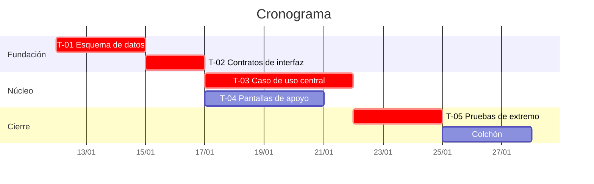

# Método del cronograma

Cómo se construye el cronograma de F8 sin inventar fechas. Léelo antes de
escribir la primera.

Un cronograma no es una promesa de cuándo estará todo: es un **modelo de qué
depende de qué**, con la aritmética hecha. Si al terminar no puedes señalar la
ruta crítica y decir «si este ticket se retrasa un día, la entrega se retrasa un
día», no hiciste un cronograma, ordenaste una lista.

---

## 1. Estimar

**Estima tamaño, no fecha.** El tamaño es una propiedad del trabajo; la fecha
depende además de quién, cuándo y con cuánta interrupción. Mezclarlos hace
imposible corregir el plan sin rehacerlo.

Escala recomendada, en **días ideales** (trabajo sin interrupciones):

| Talla | Días ideales | Significa |
| --- | --- | --- |
| **XS** | 0.5 | Cambio local, sin decisiones abiertas |
| **S** | 1 | Una pieza, camino conocido |
| **M** | 2–3 | Varias piezas, alguna decisión pequeña |
| **L** | 5 | Cruza componentes o introduce algo nuevo |
| **XL** | — | **No se estima: se parte.** Un XL es ignorancia disfrazada de tamaño |

Reglas:

- **Nada mayor que L entra al cronograma.** Si algo se estima en más de cinco
  días, no se sabe lo suficiente para estimarlo: pártelo o antepón un ticket de
  investigación con caja de tiempo (*timebox*) y resultado escrito.
- **Estima en rango cuando haya incertidumbre real**: «2–5 días». Un rango
  honesto informa; un punto falso tranquiliza y luego miente.
- **Lo desconocido se estima con un spike acotado**, no con un número optimista.
  El resultado del spike es una estimación, no la funcionalidad.

## 2. Convertir a capacidad real

La trampa clásica: sumar días ideales y ponerlos en el calendario.

```
capacidad semanal = personas × horas reales por semana × factor de foco
```

- **Horas reales**, no nominales. Pregúntalo en F0 y créelo: un equipo
  estudiantil con clases rara vez pasa de 10–15 h por persona y semana.
- **Factor de foco 0.6–0.8.** El resto se va en revisiones, entorno roto,
  reuniones, contexto y el trabajo que aparece. Usa 0.7 salvo que haya
  histórico propio que diga otra cosa.
- **La primera semana rinde menos.** Instalación, accesos, decisiones de
  arranque: cuenta 0.5 de foco.
- **Añadir gente a mitad de camino resta antes de sumar.** No lo modeles como
  suma lineal.

Escríbelo en el documento. Un cronograma que no dice de qué capacidad parte no
se puede discutir, solo creer o no creer.

## 3. Ordenar por dependencia y riesgo

Dos criterios, en este orden:

1. **Dependencia técnica.** Lo que otros necesitan va antes. Se declara por ID
   de ticket, nunca por intuición.
2. **Riesgo de invalidar el diseño.** Lo que puede demostrar que el diseño está
   mal va lo antes posible, aunque no se vea en pantalla y no luzca en una demo.
   Descubrir en la semana 8 que el modelo de datos no soporta la operación
   central cuesta el proyecto entero; descubrirlo en la semana 2 cuesta dos días.

Consecuencia incómoda y deliberada: **la interfaz bonita casi nunca va primero**,
aunque sea lo único que el evaluador o el cliente ven pronto. Si el proyecto
necesita mostrar algo temprano, se planifica una demo delgada de extremo a
extremo, no la pantalla completa.

## 4. Calcular la ruta crítica

1. Escribe el grafo de dependencias entre tickets.
2. Calcula la **cadena más larga** de días ideales desde el inicio hasta la
   entrega: esa es la ruta crítica.
3. Los tickets fuera de ella tienen **holgura** — cuántos días pueden retrasarse
   sin mover la entrega. Anótala: es lo que permite reasignar personas sin
   improvisar.
4. Márcala visualmente en el diagrama y nómbrala en el texto.

**Un retraso en la ruta crítica retrasa la entrega día por día.** Es la única
frase que hace útil a un cronograma, y solo se puede decir si se calculó.

## 5. Colchón, no relleno

- **Colchón al final, no por tarea.** Inflar cada estimación esconde el margen y
  garantiza que se consuma (el trabajo se expande hasta llenar el tiempo).
- **15–20 % de la duración total**, en un bloque explícito y nombrado.
- El colchón se **consume visiblemente**: cada vez que se usa, se anota por qué.
  Un colchón que se gasta en silencio no es un colchón, es un error de
  estimación que aparecerá el último día.

## 6. Hitos

Un hito (`H-`) es un punto donde algo **verificable** existe, no una fecha
bonita. Cada hito declara:

- Qué se puede **hacer o demostrar** que antes no se podía.
- Qué tickets lo componen.
- Cómo se comprueba — comando, prueba, demostración concreta.

Tres a seis hitos para un proyecto de un semestre. Menos no informa; más deja de
ser un hito y vuelve a ser una tarea.

## 7. Riesgos

Tabla con cinco columnas: riesgo, probabilidad, impacto, **señal temprana**,
respuesta. La señal temprana es la columna que la mayoría omite y la única que
convierte la tabla en algo accionable: describe **qué se verá** cuando el riesgo
empiece a materializarse, no cuando ya ocurrió.

## 8. Presentación

En el documento, tres cosas y en este orden:

1. **Tabla de tickets** con talla, dependencias, responsable, hito y holgura.
2. **Diagrama de Gantt** en texto versionable, con la ruta crítica marcada.
3. **Párrafo de supuestos**: capacidad asumida, factor de foco, fechas externas,
   y qué se recorta si la fecha no alcanza — decidido ahora, no en la última
   semana.

Ejemplo de Gantt en texto (Mermaid; cualquier formato versionable sirve):



`crit` marca la ruta crítica. T-04 tiene holgura: puede empezar tarde sin mover
la entrega, y es el primer sitio donde buscar una persona cuando la ruta crítica
se atasca.

## 9. Revisión

El cronograma se **corrige, no se defiende**. Al cerrar cada hito:

1. Compara estimado contra real y calcula el factor de desviación.
2. Aplica ese factor a lo que queda — no supongas que el próximo tramo será
   distinto porque esta vez sí van a apurarse.
3. Si la fecha ya no alcanza, aplica el recorte que se decidió en el §8 y dilo.

Reestimar con el dato real no es admitir un fracaso: es la única forma de que la
segunda mitad del plan valga más que la primera.
