# Documento Técnico del Sistema — Bank USAC

**Software Avanzado \| Segundo Semestre 2026 \| Sección B \| Grupo 2**  
**Catedrático:** Ing. Marco Tulio Aldana Prillwitz \| **Tutor Académico:** Kevin Raúl Pozuelos Estrada

---

## Índice de Contenidos

1. [Los entregables del enunciado y su ubicación](#1-los-entregables-del-enunciado-y-su-ubicación)
2. [Resumen del sistema y arquitectura general](#2-resumen-del-sistema-y-arquitectura-general)
3. [Diagramas arquitectónicos detallados (C4, UML y ER)](#3-diagramas-arquitectónicos-detallados)
   - [3.1 Arquitectura General del Sistema](#31-arquitectura-general-del-sistema)
   - [3.2 Modelo C4 — Nivel 1: Contexto del Sistema](#32-modelo-c4--nivel-1-contexto-del-sistema)
   - [3.3 Modelo C4 — Nivel 2: Contenedores](#33-modelo-c4--nivel-2-contenedores)
   - [3.4 Modelo C4 — Nivel 3: Componentes y Arquitectura Limpia](#34-modelo-c4--nivel-3-componentes-y-arquitectura-limpia)
   - [3.5 Diagrama UML de Despliegue](#35-diagrama-uml-de-despliegue-local-kind)
   - [3.6 Diagrama UML de Secuencia: Creación de Cuenta](#36-diagrama-uml-de-secuencia-creación-de-cuenta)
   - [3.7 Diagrama UML de Secuencia: Transferencia con Saga Coreografiada](#37-diagrama-uml-de-secuencia-transferencia-con-saga-coreografiada)
   - [3.8 Diagramas UML de Casos de Uso (Jerarquía y Roles)](#38-diagramas-uml-de-casos-de-uso-jerarquía-y-roles)
   - [3.9 Modelos Entidad-Relación Físicos (ER)](#39-modelos-entidad-relación-físicos-er)
   - [3.10 Diagrama de Despliegue en la Nube (GCP — Fase II)](#310-diagrama-de-despliegue-en-la-nube-gcp--fase-ii)
4. [Métricas SRE: Definición de SLI, SLO y SLA](#4-métricas-sre-definición-de-sli-slo-y-sla)
5. [Casos de uso detallados por rol](#5-casos-de-uso-detallados-por-rol)
6. [Justificación de decisiones arquitectónicas (ADRs)](#6-justificación-de-decisiones-arquitectónicas-adrs)
7. [Manual de usuario y guías operativas](#7-manual-de-usuario-y-guías-operativas)
8. [Estructura del monorepo y código fuente](#8-estructura-del-monorepo-y-código-fuente)
9. [Contenedores y despliegue en Kubernetes](#9-contenedores-y-despliegue-en-kubernetes)
10. [Frontend web (Nuxt 4) y validación de roles](#10-frontend-web-nuxt-4-y-validación-de-roles)
11. [Verificación, calidad y deudas técnicas controladas](#11-verificación-calidad-y-deudas-técnicas-controladas)
12. [Fase II — Extensión funcional por microservicio](#12-fase-ii--extensión-funcional-por-microservicio)
13. [Fase II — Pipeline CI/CD, estrategia de ramas y despliegue selectivo](#13-fase-ii--pipeline-cicd-estrategia-de-ramas-y-despliegue-selectivo)
14. [Fase II — Infraestructura como código y despliegue en la nube](#14-fase-ii--infraestructura-como-código-y-despliegue-en-la-nube)
15. [Fase III — observabilidad, interbancario y evidencia](#15-fase-iii--observabilidad-interbancario-y-evidencia)

---

## 1. Los entregables del enunciado y su ubicación

Este documento consolida arquitectura, diseño y evidencias de **Bank USAC**.
La revisión T-61 del **21 de octubre de 2026** distingue código implementado,
configuración declarada, estado cloud observado y pruebas ejecutadas. Los
estados de la tabla no certifican requisitos sin evidencia ni sustituyen los
pendientes de §15.

| Entregable Oficial | Dónde vive en el repositorio | Estado |
| :--- | :--- | :---: |
| **Documento técnico completo** | Este documento ([`docs/TECHNICAL_DOCUMENT.md`](TECHNICAL_DOCUMENT.md)) + [`docs/architecture.md`](architecture.md). El índice de toda la documentación es [`docs/README.md`](README.md) | **Completo** |
| **Caso de negocio, requisitos y trazabilidad** | [`docs/dda.md`](dda.md) — stakeholders, RF/RNF, escenarios de calidad y las matrices que atan cada requisito a su caso de uso | **Completo** |
| **Diagramas arquitectónicos** | [`docs/architecture/diagrams/`](architecture/diagrams/) (fuentes `.puml`, `.dsl`, `.dbml` y diagramas sólo en `.png`); [ADR-024](architecture/adr/ADR-024-native-lucid-and-png-delivery.md) exige edición nativa Lucid para casos de uso/despliegue | **Completo** |
| **Definición de SLI, SLO y SLA** | [`docs/sre/sli-slo-sla.md`](sre/sli-slo-sla.md) (indicadores, objetivos, ventanas, presupuesto y exclusiones; §5.3 concentra la medición de Fase III); las preocupaciones de diseño que responden, en [`docs/RELIABILITY.md`](RELIABILITY.md) | **Completo** |
| **Casos de uso detallados** | [`docs/domain/use-cases.md`](domain/use-cases.md) y jerarquía UML en [`docs/architecture/diagrams/cdu/`](architecture/diagrams/cdu/README.md) | **Completo** |
| **Decisiones arquitectónicas (ADRs)** | [`docs/adr.md`](adr.md) y los registros formales en [`docs/architecture/adr/`](architecture/adr/README.md), de los cuales [ADR-014](architecture/adr/ADR-014-cloud-provider.md), [ADR-015](architecture/adr/ADR-015-ci-cd-platform.md) y [ADR-016](architecture/adr/ADR-016-cloud-infrastructure.md) son los de la Fase II | **Completo** |
| **Manual de usuario y evidencia** | [`docs/manual/`](manual/README.md) — la guía general, una por rol y el [recorrido visual](manual/recorrido-visual.md) histórico de 78 pasos, más la [validación Fase III](qa/guia-validacion-manual-fase3.md) | **Procedimientos revisados; evidencia según registro** |
| **Estrategia de monorepo** | Raíz: `pnpm-workspace.yaml`, `package.json` y Turborepo (`turbo.json`) | **Completo** |
| **5 microservicios desacoplados** | [`apps/services/`](../apps/services/) (`customer`, `account`, `transaction`, `payment`, `notification-audit`) | **Completo** |
| **API Gateway perimetral** | [`apps/gateway/`](../apps/gateway/) (NestJS, puerto 3000, sin DB, sin HTTP interno) | **Completo** |
| **Despliegue en Kubernetes** | [`infra/k8s/`](../infra/k8s/README.md), chart Helm en `infra/k8s/helm/bank-usac/` y runbook local [`DEPLOYMENT.md`](operations/DEPLOYMENT.md) | **Completo** |
| **Frontend web funcional** | [`apps/web/`](../apps/web/README.md) (Nuxt 4, puerto 3010, Claude Design, 34 pantallas) | **Completo** |
| **Código: microservicios extendidos (Fase II)** | KYC, tipos de cuenta con comisión, historial con filtros, pagos externos simulados y clasificación de eventos — §12 de este documento, con la evidencia por ticket en [`docs/qa/backend/`](qa/README.md) | **Completo** |
| **Pipeline: CI/CD funcional (Fase II)** | [`.github/workflows/`](../.github/workflows/) — `ci.yml`, `changes.yml`, `release.yml`, `cd.yml`; explicados en [`operations/CI.md`](operations/CI.md) y en §13 | **Completo** |
| **Infraestructura: scripts de Terraform (Fase II)** | [`infra/terraform/gcp/`](../infra/terraform/gcp/README.md) — VPC, cinco VMs con PostgreSQL, GKE y Cloud Run; §14 | **Actualizado: recursos declarados y despliegue verificado por separado** |
| **Despliegue: sistema en la nube (Fase II)** | GKE namespaces `prod` y `dev`, frontend en Cloud Run. Procedimiento completo en [`operations/CLOUD.md`](operations/CLOUD.md) | **Completo** |
| **Documento: arquitectura actualizada (Fase II y III)** | Este documento (§3.10, §12, §13 y §14) y [`docs/architecture.md`](architecture.md) §7.1.2 | **Completo** |
| **Informe de Pruebas E2E** | [`docs/qa/`](qa/README.md) — el [informe de validación](qa/validation-report.md) con las 68 pruebas una por una, la [guía de happy path y errores](qa/happypath.md) y las capturas que produce cada suite; la narrativa de la ejecución, en [`E2E.md`](../E2E.md) | **Completo** |

---

## 2. Resumen del sistema y arquitectura general

Bank USAC implementa microservicios orientados a eventos, con **Clean
Architecture**, **Saga por coreografía** y comunicación interna asíncrona
mediante **RabbitMQ (AMQP 0-9-1)**. Payment y Notification & Audit realizan
HTTP hacia terceros, no hacia otros servicios del banco.

### Matriz de componentes y responsabilidades

| Componente | Rol en el sistema | Puerto de aplicación local | Base local / puerto publicado | Dependencias e integración |
| :--- | :--- | :---: | :---: | :--- |
| **Frontend Web** | Interfaz de usuario reactiva en Nuxt 4 para los 3 roles. | `3010` | Ninguna | HTTP REST hacia API Gateway |
| **API Gateway** | Único punto de entrada perimetral. Autenticación JWT, RBAC y traducción HTTP ↔ AMQP. | `3000` | Ninguna | RabbitMQ (`bank.commands`, `bank.replies`) y MinIO |
| **Customer Service** | Identidad, credenciales scrypt, activación y KYC; verifica y conserva la foto cargada. | `3001` | `5433` (`customer`) | RabbitMQ, PostgreSQL y lectura de objetos MinIO |
| **Account Service** | Cuentas, dinero exacto, depósitos, comisión, compensación y actividad. | `3002` | `5434` (`account`) | RabbitMQ y PostgreSQL |
| **Transaction Service** | Saga de seis estados, historial, deduplicación y outbox; no decide fondos. | `3003` | `5435` (`transaction`) | RabbitMQ y PostgreSQL |
| **Payment Service** | Intentos, simulación persistida y envío/recepción/reconciliación interbancaria. | `3004` | `5436` (`payment`) | RabbitMQ, PostgreSQL y HTTP al banco externo |
| **Notification & Audit** | Bitácora redactada antes del insert, bandejas, entrega y alertas SLO. | `3005` | `5437` (`notification_audit`) | RabbitMQ, PostgreSQL y HTTPS a Resend cuando está configurado |

Los servicios de dominio sirven las sondas HTTP `/health` y `/ready`, sin
operaciones bancarias HTTP entre ellos. Las métricas de los seis NestJS se
exportan por OTLP; Nuxt expone `/metrics` para scrape. Los puertos
5433–5437 son publicaciones locales: PostgreSQL usa 5432 dentro de la red de
infraestructura. La topología cloud y sus IP se explican en §3.10.

### Tres principios inviolables de aislamiento

1. **Cero llamadas HTTP entre microservicios:** Ningún microservicio expone endpoints de negocio ni invoca a otro por HTTP. La suite `isolation.spec.ts` y las reglas de lint impiden llamadas síncronas directas.
2. **Cero bases de datos compartidas:** Cada microservicio es dueño absoluto de su base de datos PostgreSQL. No existen tablas compartidas ni conexiones cruzadas.
3. **El Gateway no orquesta:** El API Gateway publica comandos con `correlationId` y espera respuestas sobre `bank.replies` con un timeout estricto de 5 segundos. Las transacciones multietapa las coordina la Saga por coreografía en los servicios.

---

## 3. Diagramas arquitectónicos detallados

A continuación se presentan los diagramas oficiales del sistema, organizados bajo el modelo C4 y UML, explicando la interacción técnica, topología y flujo de datos de cada uno.

### 3.1 Arquitectura General del Sistema

El diagrama de arquitectura general ilustra la división entre la red perimetral de acceso y la infraestructura interna de soporte:

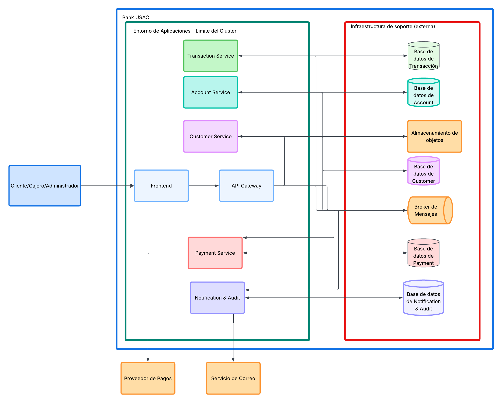

#### Explicación Técnica
* **Perímetro exterior:** En local, Web usa HTTP :3010 y Gateway HTTP :3000.
  En cloud, Web se sirve por HTTPS :443 desde Cloud Run; el Gateway observado
  sigue en HTTP :3000. El proxy Nitro evita contenido mixto en el navegador,
  pero no cifra ese segundo tramo.
* **Límite del Clúster / Entorno de Aplicaciones:** El API Gateway actúa como frontera de seguridad; valida credenciales y convierte las peticiones entrantes en comandos asíncronos encolados en RabbitMQ.
* **Infraestructura:** En kind local, PostgreSQL, RabbitMQ y MinIO están fuera
  del clúster sobre Docker. En GKE, PostgreSQL sigue fuera en cinco VMs,
  mientras RabbitMQ y MinIO residen en cada namespace bancario. Los puertos
  publicados locales se comprueban con Docker; no son las direcciones cloud.

---

### 3.2 Modelo C4 — Nivel 1: Contexto del Sistema

El diagrama de contexto establece los límites de **Bank USAC**, los actores y
los terceros. Las integraciones reales y los adaptadores de demostración se
identifican por separado:

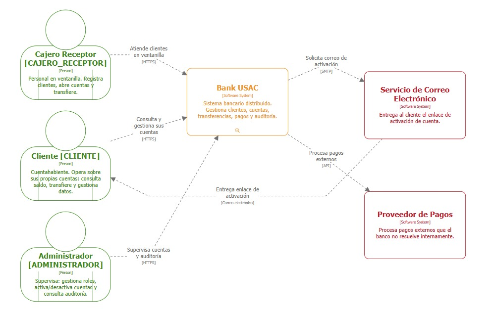

#### Explicación Técnica
* **Actores Principales:**
  1. **Cliente:** Cuentahabiente que consulta saldos, transfiere fondos, paga servicios y administra sus credenciales.
  2. **Cajero Receptor:** Operador en ventanilla que ejecuta depósitos en efectivo, abre cuentas presenciales y valida la identidad de nuevos clientes.
  3. **Administrador:** Personal bancario que supervisa la bitácora de auditoría global, desactiva cuentas inactivas y monitorea la salud del sistema.
* **Sistemas Externos:**
  * **Resend:** Puede entregar activación, recuperación y avisos de seguridad
    autorizados cuando existe dirección real y está configurado el canal.
  * **Banco externo:** Expone el protocolo interbancario v1; el mock BANK99
    desplegado en prod es una alternativa de pruebas, no evidencia de conexión
    a una entidad financiera real.
  * **Proveedor simulado:** Es un adaptador dentro de Payment. Pagar EEGSA,
    EMPAGUA o CLARO es transferir a su cuenta recaudadora en este banco; no se
    afirma una integración con las APIs reales de esas empresas.
  * **Operador SRE y observabilidad:** Acceso independiente a Grafana para
    métricas, trazas y logs; no se deriva del rol bancario.

---

### 3.3 Modelo C4 — Nivel 2: Contenedores

El diagrama de contenedores detalla los límites de despliegue, protocolos de red y responsabilidades de almacenamiento:


#### Explicación Técnica
* **Tráfico Web y API:** El Frontend (Nuxt 4) invoca al API Gateway mediante peticiones REST/JSON autenticadas con encabezados `Authorization: Bearer <JWT>`.
* **Bus de Mensajería RabbitMQ:** Cuatro topic exchanges durables organizan el enrutamiento:
  * `bank.commands`: Comandos directos dirigidos a un microservicio específico (`account.create.v1`, `transfer.requested.v1`, etc.).
  * `bank.events`: Eventos de dominio emitidos tras completar una operación (`account.opened.v1`, `account.debited.v1`, etc.).
  * `bank.replies`: Respuestas correlacionadas para operaciones de consulta o confirmación inmediata hacia el Gateway.
  * `bank.errors`: Mensajes rechazados o con fallos de validación dirigidos a Dead Letter Queues (DLQ).
* **Aislamiento de Persistencia:** Cinco bases de datos independientes impiden cualquier forma de acoplamiento de esquema. Las fotos de documentos de identificación se resguardan en MinIO, viajando por el broker únicamente su clave de objeto y digest SHA-256.

---

### 3.4 Modelo C4 — Nivel 3: Componentes y Arquitectura Limpia

El DSL contiene seis vistas internas: Gateway y cinco servicios. La vista
Transaction ilustra Clean Architecture; el Gateway no tiene capa de dominio.
[Las seis vistas y su explicación](architecture/c4-component.md) incluyen
Customer, Account, Payment y Notification & Audit:

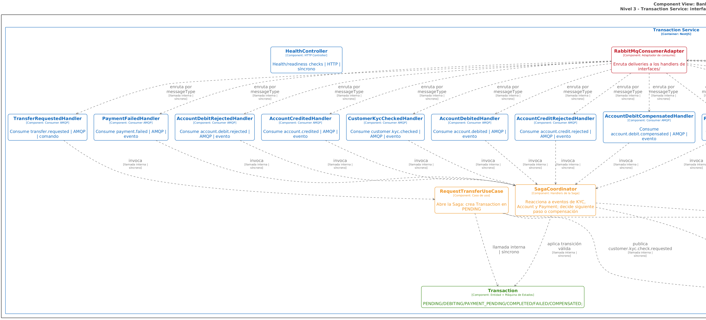

#### Explicación Técnica
* **Capa de Dominio (Pureza Absoluta):** Entidades como `Transaction` y la máquina de seis estados (`PENDING`, `DEBITING`, `PAYMENT_PENDING`, `COMPLETED`, `FAILED`, `COMPENSATED`). No importa librerías externas ni frameworks.
* **Aplicación:** Los casos de uso admiten la solicitud y aplican los eventos
  recibidos a la máquina de estados. Transaction coordina las siguientes
  órdenes mediante AMQP; no consulta balances ni llama servicios por HTTP.
* **Entrada:** El router de mensajes dirige cada sobre al handler registrado
  por `messageType`, que delega en el caso de uso correspondiente.
* **Salida:** El puerto de repositorio se implementa con PostgreSQL y bloqueos
  `SELECT ... FOR UPDATE`. El publicador y el relay outbox envían comandos,
  eventos y respuestas al exchange definido por el catálogo. El outbox y la
  idempotencia permiten reentrega sin duplicar el efecto monetario; no se
  afirma entrega exactamente una vez.

---

### 3.5 Diagrama UML de Despliegue (local, kind)


La fuente [05-uml-despliegue.puml](architecture/diagrams/05-uml-despliegue.puml)
representa el host Docker, kind y el namespace `bank-usac`. Helm instala los
siete componentes; `bank-observability` es un segundo chart en su namespace.
PostgreSQL, RabbitMQ y MinIO locales se alcanzan por red Docker mediante
Services/Endpoints; `host.docker.internal` es un fallback configurado.

Las sondas, HPA, ConfigMaps, Secrets y protocolos pertenecen al despliegue local;
no confundirlo con Cloud Run, VMs y GKE del diagrama 08.

---

### 3.6 Diagrama UML de Secuencia: Creación de Cuenta

Ilustra la interacción asíncrona real para la apertura de una cuenta bancaria (monetaria o de ahorro):

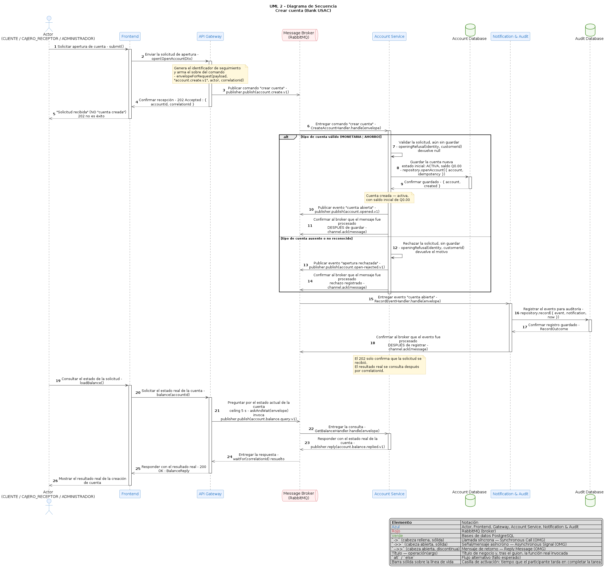

#### Paso a Paso del Flujo

1. El Gateway valida la petición HTTP y publica `account.create.v1`, con
   identidad, correlación y clave del intento.
2. Devuelve `202`, `accountId` y correlación; la apertura no es un
   request/reply que garantice éxito en esa respuesta.
3. Account valida y persiste el resultado idempotente. Monetaria y Ahorro
   tienen reglas e importes iniciales distintos.
4. Publica `account.opened.v1` o rechazo; Notification & Audit registra el
   evento y genera los avisos correspondientes.
5. La consulta posterior de la cuenta confirma el estado; el Administrador
   puede además observar el resultado en el rastro autorizado.

---

### 3.7 Diagrama UML de Secuencia: Transferencia con Saga Coreografiada

Representa los 15 pasos del patrón Saga coreografiada distribuida para transferencias entre cuentas y pagos a facturadores:

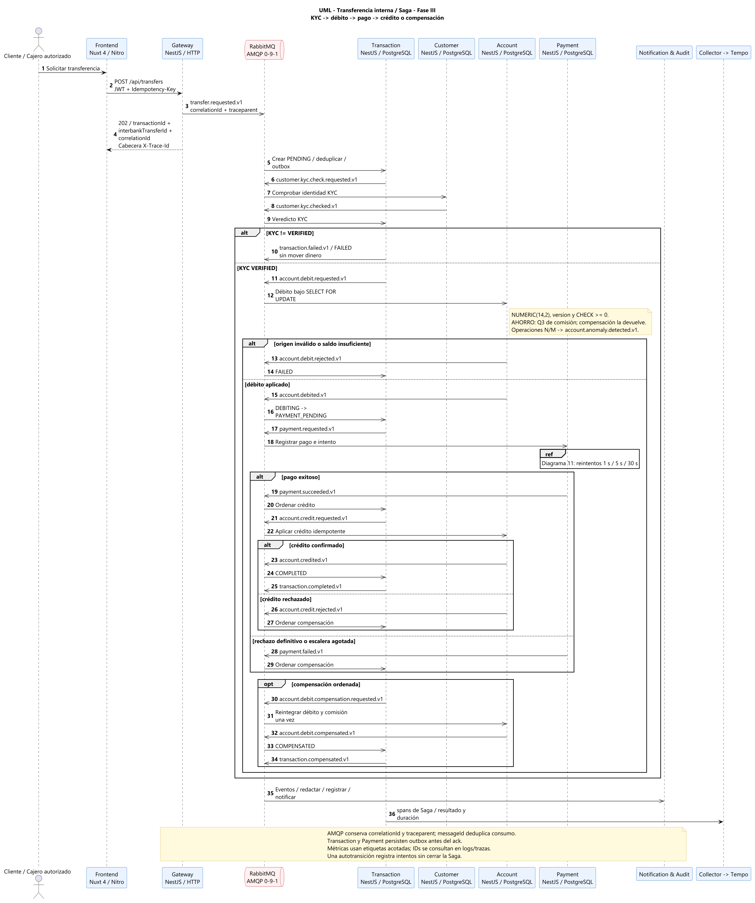

#### Mecánica de la Saga Coreografiada

La máquina de estados tiene **seis** estados y una sola función pura decide cada transición, rechazando cualquiera que no esté en el diagrama:

```
PENDING ──► DEBITING ──► PAYMENT_PENDING ──► COMPLETED
   │            │                └──► COMPENSATED   (pago fallido, o crédito rechazado)
   │            └──► FAILED                          (débito rechazado: no hay nada que deshacer)
   └──► FAILED                                       (el gate de KYC se negó)
```

1. **Gate de KYC (añadido en la Fase II).** El cliente solicita la transferencia; `transaction-service` crea el registro en `PENDING` y publica `customer.kyc.check.requested.v1`. `customer-service` responde `customer.kyc.checked.v1` con `allowed`. Si el cliente no está `VERIFIED`, la transacción cierra en `FAILED` con motivo `KYC_NOT_VERIFIED` **sin mover un centavo** y sin compensación, porque el dinero nunca salió.
2. **Débito bajo bloqueo.** Aprobado el KYC, la transición `PENDING → DEBITING` y el comando `account.debit.requested.v1` se escriben **en la misma transacción** (tabla `outbox_messages`, TD-031). `account-service` ejecuta `SELECT … FOR UPDATE` sobre la cuenta origen, comprueba el saldo contra `CHECK (balance >= 0)` más una versión optimista, aplica el débito y emite `account.debited.v1`.
3. **Comisión por tipo de cuenta (Fase II).** En el mismo bloqueo, una cuenta `AHORRO` cobra Q3.00 de comisión y emite `account.commission.charged.v1`; una `MONETARIA` no tiene regla de comisión. El destino recibe el monto íntegro.
4. **Pago externo.** `transaction-service` avanza a `PAYMENT_PENDING` y publica `payment.requested.v1`.
5. **Escalera de reintentos.** `payment-service` decide el intento con una función pura sin reloj ni base de datos. Ante un fallo transitorio o un `TIMEOUT` reintenta a 1 s, 5 s y 30 s, con el vencimiento en la **columna** `next_attempt_at` y no en un temporizador, y publica `payment.attempt.failed.v1` en cada intento fallido —incluido el último— que es lo que hace observable la escalera mientras se sube.
6. **Éxito.** Con `payment.succeeded.v1`, `account-service` acredita los fondos en el destino (`account.credited.v1`) y `transaction-service` cierra en `COMPLETED`.
7. **Compensación.** Si el pago falla de forma terminal (`payment.failed.v1`), `transaction-service` publica `account.debit.compensation.requested.v1`; `account-service` devuelve el monto exacto **y la comisión que hubiera cobrado** (TD-065), emite `account.debit.compensated.v1` y la transacción termina en `COMPENSATED`. **El saldo nunca se pierde ni queda en estado inconsistente**, y `pnpm images:flow` lo comprueba midiendo el saldo antes y después, no leyendo un estado.
8. **Notificación final.** `notification-audit-service` consume el cierre, lo clasifica (`INFO`, `WARNING` o `ERROR`) y genera la notificación al cliente.

Los tres estados que el enunciado de la Fase II nombra —`PENDING`, `APPROVED`, `FAILED`— se exponen como una **proyección** de estos seis (`phaseStatus`), nunca como un reemplazo: la máquina real conserva la información que la proyección descarta.

---

### 3.8 Diagramas UML de Casos de Uso (Jerarquía y Roles)

La funcionalidad del sistema se modela en una jerarquía formal que abarca los tres roles de usuario:

#### Nivel de Alto Nivel (`CDU000`)
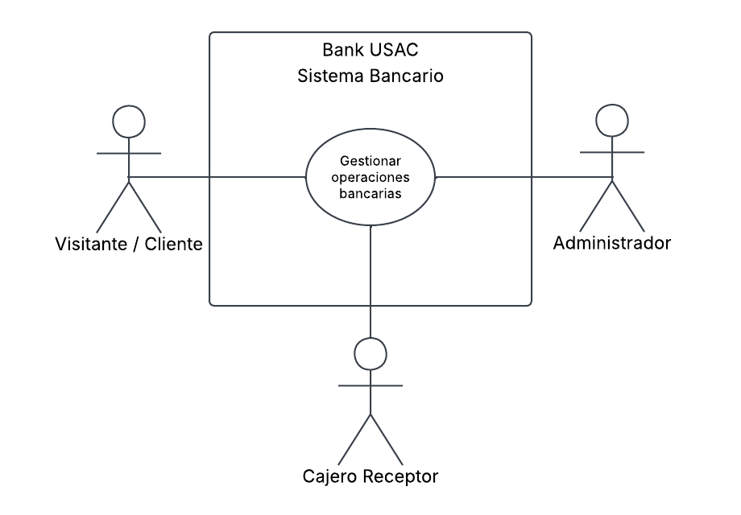

#### Primera Descomposición por Microservicio (`CDU001` a `CDU005`)
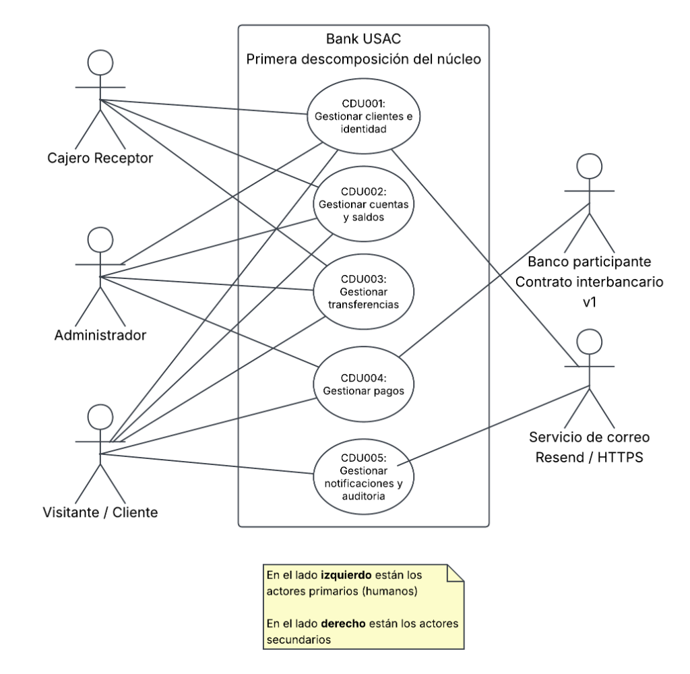

#### Cobertura Funcional por Rol
* **Cliente:**
  * `CDU001.1` Registrar cliente y subir fotografía de documento (DPI).
  * `CDU001.2` Activar cuenta mediante enlace y token recibido por correo.
  * `CDU001.3` Iniciar sesión y gestionar recuperación/cambio de contraseña.
  * `CDU002.1` Apertura de cuenta propia (monetaria o de ahorro).
  * `CDU002.2` Consulta de saldos y movimientos históricos.
  * `CDU003.1` Transferencias a otras cuentas bancarias locales.
  * `CDU004.1` Pago de facturas de servicios básicos (EEGSA, Empagua, Claro).
* **Cajero Receptor:**
  * `CDU001.6` Revisión y validación manual de documentos de identidad (aprobación/rechazo de DPI).
  * `CDU002.1` Apertura asistida de cuentas para cuentahabientes.
  * `CDU002.9` Registro de depósitos en efectivo por ventanilla.
* **Administrador:**
  * `CDU002.4` Cambio manual de estado con motivo; sólo Administrador.
  * `CDU002.8` Barrido automático: al menos seis meses calendario sin movimientos y saldo actual < Q50.00, con lease distribuido.
  * `CDU005.1` Registro de eventos de auditoría (consumidor interno).
  * `CDU005.3` Consulta administrativa de auditoría y rastro; estados Saga en CDU003.2.

---

### 3.9 Modelos Entidad-Relación Físicos (ER)

Cada servicio conserva una base propia. Los puertos 5433–5437 de abajo son
publicaciones locales, no puertos diferentes del motor PostgreSQL en cloud.
Los cinco DBML se contrastan con migraciones acumuladas; el
[catálogo físico](generated/db-schema.md) detalla columnas, índices y checks.
Los diagramas ER físicos corresponden a las exportaciones gráficas de los modelos DBML. El
[índice ER](architecture/diagrams/er/README.md) conserva la validación DBML y
los límites del modelo físico.

#### Customer Service (`postgres-customer` : 5433)

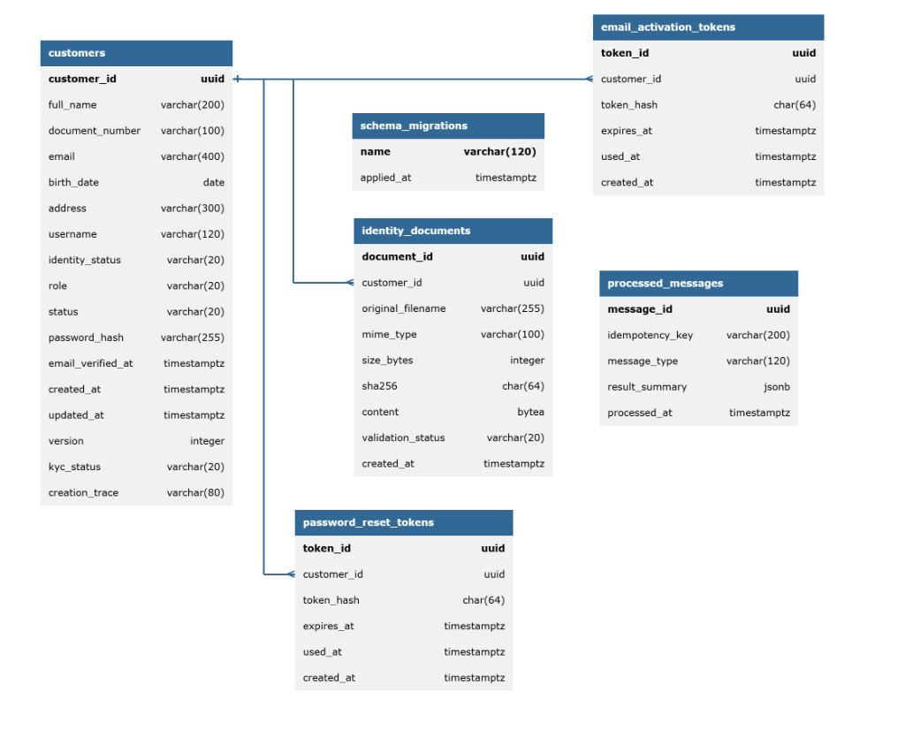

[Fuente DBML de Customer](architecture/diagrams/er/customer-er.dbml).

Identidad, credenciales, documentos, activación, recuperación e idempotencia.
La telemetría conserva el contexto de creación sin inventar una traza ausente.

#### Account Service (`postgres-account` : 5434)

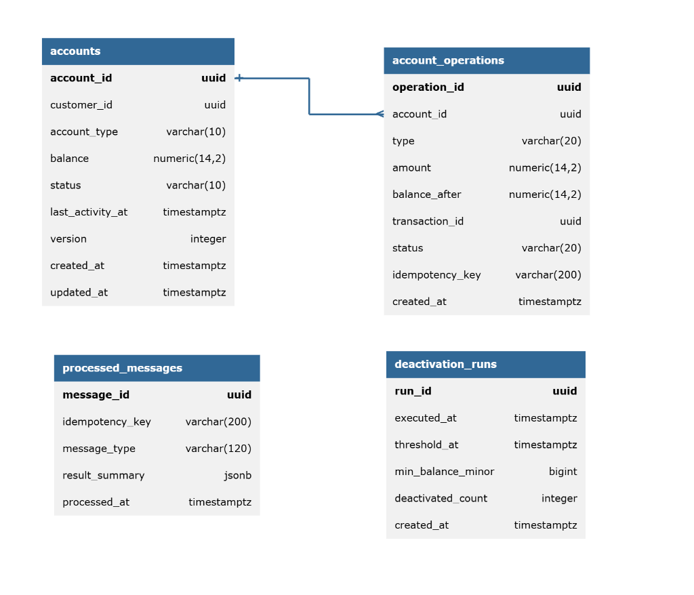

[Fuente DBML de Account](architecture/diagrams/er/account-er.dbml).

Cuentas y operaciones monetarias, versión y restricciones de saldo, barridos e
idempotencia. Las anomalías de actividad se registran antes de anunciarlas.

#### Transaction Service (`postgres-transaction` : 5435)

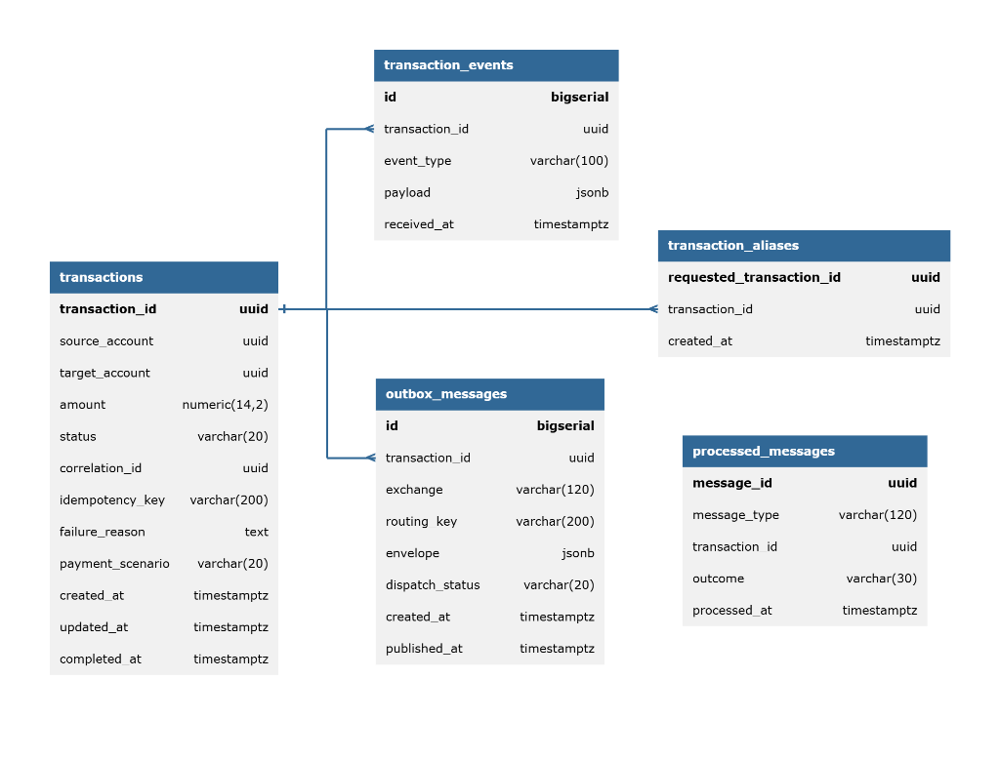

[Fuente DBML de Transaction](architecture/diagrams/er/transaction-er.dbml).

Transacciones, transiciones, deduplicación/alias y outbox. El historial conserva
estado y tiempos para medición de latencia; no duplica decisiones de saldo.

#### Payment Service (`postgres-payment` : 5436)

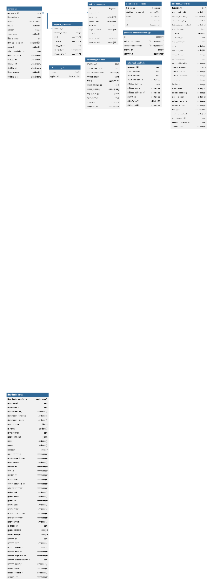

[Fuente DBML de Payment](architecture/diagrams/er/payment-er.dbml).

Pagos, intentos, simulación persistida, outbox y tablas interbancarias para
envío, recepción, intentos/callbacks, reservas, reconciliación y reversos.
Las claves y restricciones se explican en el catálogo; no son tablas de Account.

#### Notification & Audit Service (`postgres-notification-audit` : 5437)

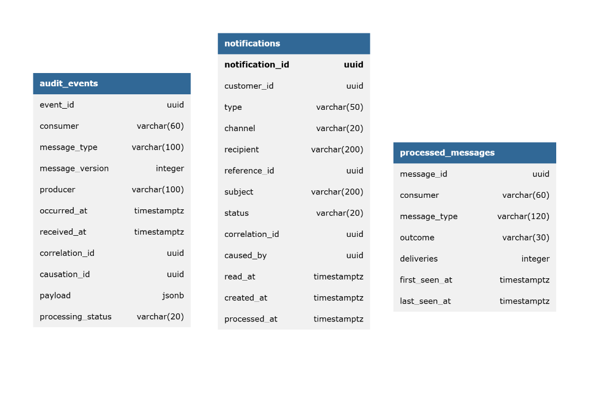

[Fuente DBML de Notification & Audit](architecture/diagrams/er/notification-audit-er.dbml).

Eventos redactados, notificaciones con lectura/entrega y destinatario lógico,
deduplicación y registro de alertas SLO. No se dibujan claves foráneas hacia
bases de otros servicios.

---

### 3.10 Diagrama de Despliegue en la Nube (GCP — Fase II)

La vista cloud se actualiza para Fase III y se mantiene distinta de la local.

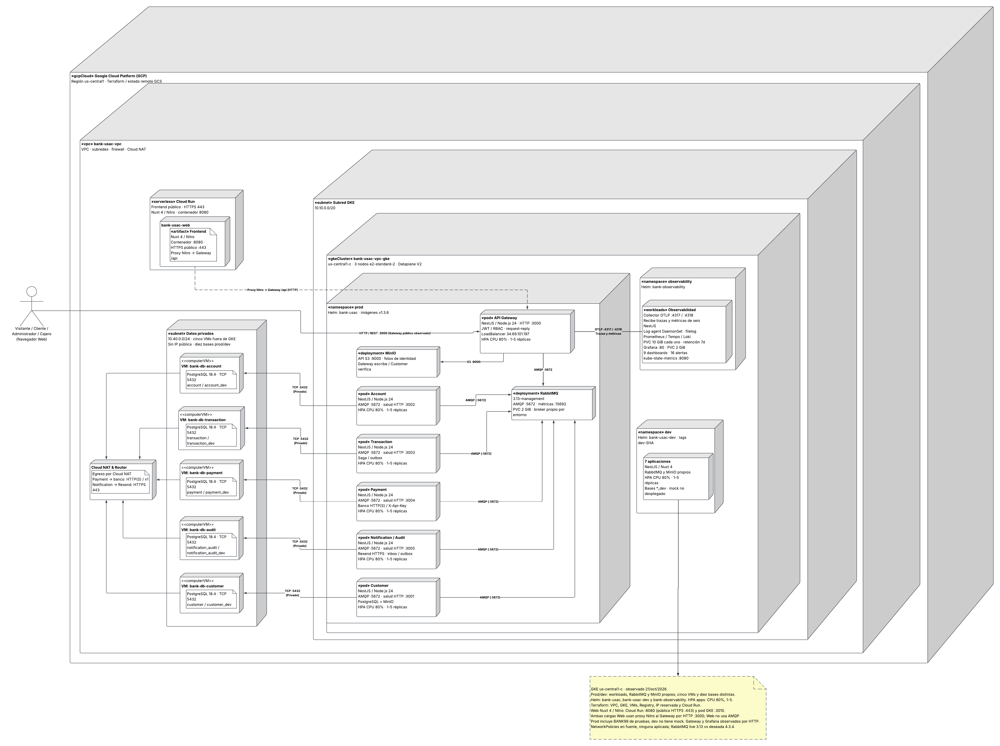

Fuente: [08-despliegue-cloud-gcp.puml](architecture/diagrams/08-despliegue-cloud-gcp.puml).

#### Lectura del diagrama

- **Terraform** declara VPC, subredes y rangos, Cloud Router/NAT, cinco VMs
  PostgreSQL privadas, GKE, Artifact Registry, IP reservada del Gateway y
  Cloud Run. Las flechas de aprovisionamiento se separan del tráfico.
- **Helm** instala el banco y el stack `bank-observability`; GitHub Actions
  publica imágenes versionadas, actualiza cargas y el frontend de Cloud Run.
- **GKE** observado está en `us-central1-c` con dev, prod y observability.
  Dev/prod tienen brokers y MinIO separados y bases con nombres distintos
  sobre las mismas VMs. VPC, nodos y cuotas son recursos compartidos.
- **Cloud Run** sirve el frontend Nuxt 4 por HTTPS; Nitro puede actuar como
  proxy hacia el Gateway HTTP para evitar contenido mixto.
- **HPA** está configurado al 80 % CPU, rango 1–5, con requests/limits. Account
  usa un lease PostgreSQL para que el barrido no se ejecute por cada réplica.
  Existencia de HPA no demuestra un escalado durante carga.
- **Observabilidad** recibe OTLP de los seis procesos NestJS y scrapea las
  métricas web de Nitro. Logs van por agente a Loki; Grafana consulta
  Prometheus, Tempo y Loki. PVC y políticas deseadas se rotulan por componente.
- **Diferencias live:** Grafana usa LoadBalancer público; no se observaron
  NetworkPolicies en los tres namespaces. RabbitMQ usa 3.13-management,
  frente a 4.3.4 deseado. Dev no tiene mock ni URL pareja configurada.

Los [inventarios](qa/load/) fijan lo observado el 21 de octubre; los pasos y
riesgos están en [CLOUD](operations/CLOUD.md). Un recurso en Terraform o un
control en Helm no demuestra que esté aplicado.

---

## 4. Métricas SRE: Definición de SLI, SLO y SLA

El [marco SLI/SLO/SLA](sre/sli-slo-sla.md) es la fuente de umbrales, ventanas,
PromQL y presupuesto; [RELIABILITY](RELIABILITY.md) explica su intención. Esta
sección evita mantener otro juego contradictorio de porcentajes.

Fase III operacionaliza cinco familias: disponibilidad del Gateway, duración
terminal de transferencias, éxito y latencia del proveedor, y confirmación
interbancaria por dirección. El [catálogo](sre/telemetry-catalog.md) fija
unidades, etiquetas, cardinalidad, spans y campos de logs.

El presupuesto debe calcularse para la ventana y entorno observados. Ausencia
de tráfico, NaN o datos sin continuidad no equivalen a 100 % de cumplimiento.
El proxy Prometheus y el objetivo de negocio pueden tener poblaciones
distintas; esas diferencias se declaran en §5.3 del marco.

El SLA es académico. Los invariantes financieros y de seguridad no reciben
presupuesto para pérdidas o accesos indebidos. No se presentan los objetivos
como disponibilidad garantizada o recuperación demostrada sin medición.

---

## 5. Casos de uso detallados por rol

Documentados en prosa formal en [`docs/domain/use-cases.md`](domain/use-cases.md), organizados por actor y objetivo de negocio:

1. **CU-01: Registro y Activación de Cliente (Rol Cliente)**  
   Captura de nombres, correo y documento; Customer guarda un hash de contraseña
   derivado con `scrypt`. El correo se entrega según el canal configurado y el
   estado real de envío.
2. **CU-02: Validación de Identidad por Ventanilla (Rol Cajero Receptor)**  
   Inspección visual de la fotografía recuperada por la ruta protegida. Emisión
   del veredicto con `POST /api/customers/:id/identity-verdict`
   (`VALIDATED` o `REJECTED`); el KYC usa su vocabulario
   `VERIFIED`/`REJECTED`, distinto del estado documental.
3. **CU-03: Apertura de Cuenta Monetaria o de Ahorro (Rol Cliente / Cajero)**  
   Creación con validación de tipo e identificador bancario único: Monetaria
   nace con Q 0.00; Ahorro exige un importe inicial de al menos Q 100.00.
4. **CU-04: Depósito en Ventanilla (Rol Cajero Receptor)**  
   Abono en efectivo inmediato a una cuenta existente mediante `POST /api/accounts/:id/deposit`.
5. **CU-05: Transferencia entre Cuentas y Compensación (Rol Cliente)**  
   Ejecución de la Saga coreografiada con débito atómico, verificación de fondos, pago a facturador y crédito final o reversión.
6. **CU-06: Auditoría Global y Gestión de Cuentas (Rol Administrador)**
   Consulta de eventos persistidos y cambios manuales de estado con motivo.
   El barrido de cuentas inactivas lo ejecuta Account automáticamente, con
   exclusión entre réplicas mediante lease PostgreSQL; no es un botón de
   Auditoría ni una tarea que el Administrador ejecute desde esa pantalla.

---

## 6. Justificación de decisiones arquitectónicas (ADRs)

Los registros de decisiones arquitectónicas están en el
[índice canónico](architecture/adr/README.md) y se sintetizan en
[`docs/adr.md`](adr.md). La tabla siguiente es una selección; los sucesores
conservan el razonamiento de las decisiones históricas.

| Registro | Decisión Adoptada | Alternativas Evaluadas y Rechazadas | Justificación Técnica Principal |
| :--- | :--- | :--- | :--- |
| **ADR-001** | Node.js 24 LTS + TypeScript en backend | Java (Spring Boot), Go | Tipado compartido en monorepo con Zod y compatibilidad nativa de contratos. |
| **ADR-002** | Nuxt 4 (Vue 3) en frontend | React / Next.js, Angular | SSR nativo, enrutamiento semántico y rápida integración con Claude Design. |
| **ADR-003** | Comunicación 100% asíncrona (AMQP) | REST síncrono inter-servicio, gRPC | Desacoplamiento total y resiliencia ante caídas temporales de servicios. |
| **ADR-004** | RabbitMQ como Message Broker | Apache Kafka, NATS | Soporte nativo para topic exchanges, colas durables y patrón request/reply. |
| **ADR-005** | PostgreSQL 18.4 independiente por servicio | MySQL, MongoDB | Integridad ACID, bloqueos `SELECT ... FOR UPDATE` y soporte `NUMERIC(14,2)`. |
| **ADR-006** | Contenedores Docker multi-stage | Imágenes convencionales | Separar build y runtime, ejecutar como `node` y verificar las imágenes con `images:smoke`; no se afirma un tamaño sin medirlo. |
| **ADR-007** | Orquestación local con kind y Helm | Minikube, Docker Compose puro | Reproduce fielmente la topología de clúster K8s de producción. |
| **ADR-008** | Clean Architecture / Puertos y Adaptadores | Arquitectura en capas tradicional | Independencia de frameworks y pruebas de dominio aisladas sin base de datos. |
| **ADR-009** | Transacciones distribuidas con Saga Coreografiada | Saga Orquestada, 2PC (Two-Phase Commit) | Reacciona a eventos; Transaction coordina sus transiciones y emite comandos. No hay transacción global ACID ni coordinador HTTP externo. |
| **ADR-010** | JWT HS256 + scrypt para contraseñas | Sesiones en Redis, Bcrypt | Seguridad contra ataques de fuerza bruta y validación de tokens sin consultar DB. |
| **ADR-022** | Política histórica de fuentes y renders; parcialmente sustituida por ADR-024 | Sólo imagen sin fuente verificable | Conserva la decisión del 2026-10-21 y la procedencia de las alternativas del editor. |
| **ADR-024** | Casos de uso/despliegue nativos en Lucid; diagramas sólo PNG; ER como DBML para exportación del solicitante | Importar imágenes como documento editable, SVG paralelos, regenerar ER con Pillow | Mantener fuentes semánticas y comprobar documento, exportación y legibilidad antes del cierre. |
| **ADR-012** | Almacenamiento de objetos en MinIO | Guardado en PostgreSQL (bytea), S3 AWS | Compatibilidad con API S3 para DPIs sin incurrir en costos de nube en local. |

---

## 7. Manual de usuario y guías operativas

El manual de usuario se encuentra completamente estructurado en [`docs/manual/recorrido-visual.md`](manual/recorrido-visual.md) y [`docs/manual/`](manual/README.md), proporcionando guías específicas para cada rol:

* **[Manual del Cliente](manual/rol-cliente.md):** Flujo de auto-registro, verificación de correo, consulta de balances, realización de transferencias locales y pago de facturas.
* **[Manual del Cajero Receptor](manual/rol-cajero-receptor.md):** Atención a cuentahabientes, registro de depósitos en efectivo y bandeja de validación de documentos DPI.
* **[Manual del Administrador](manual/rol-administrador.md):** Monitoreo de auditoría con mascarado de datos, inspección de eventos y gestión de desactivación de cuentas.

---

## 8. Estructura del monorepo y código fuente

El repositorio utiliza un esquema monorepo impulsado por **pnpm** y **Turborepo**:

```text
Proyecto-SA-B-2/
├── apps/
│   ├── gateway/                  # API Gateway NestJS (puerto 3000)
│   ├── web/                      # Frontend Nuxt 4 (puerto 3010)
│   ├── services/
│   │   ├── customer-service/     # Microservicio de Clientes e Identidad
│   │   ├── account-service/      # Microservicio de Cuentas y Saldos
│   │   ├── transaction-service/  # Microservicio de Transferencias y Saga
│   │   ├── payment-service/      # Microservicio de Pagos y Facturación
│   │   └── notification-audit-service/ # Microservicio de Notificaciones y Auditoría
│   └── packages/
│       ├── contracts/            # Esquemas Zod y contratos de eventos tipados
│       ├── messaging/            # Cliente AMQP RabbitMQ y publicadores
│       └── tooling/              # Reglas compartidas de ESLint, Prettier y TS
├── docs/                         # Documentación técnica, diagramas y manuales
├── infra/
│   ├── docker/                   # Docker Compose de infraestructura (Postgres, Rabbit, MinIO)
│   ├── k8s/                      # Chart de Helm y configuración del clúster kind
│   └── terraform/gcp/            # Infraestructura como código: VPC, VMs, GKE y Cloud Run
├── .github/
│   ├── workflows/                # ci.yml, changes.yml, release.yml, cd.yml
│   └── scripts/helm-deploy.sh    # El despliegue con rolling update, sonda y rollback
├── E2E.md                        # Informe y evidencias de pruebas E2E con Playwright
└── README.md                     # Guía de inicio rápido y puesta en marcha
```

Cada componente desplegable tiene además su propio `Dockerfile` y un enlace `k8s/`
a sus manifiestos dentro del chart, de modo que quien trabaja en `payment-service`
encuentra su `deployment.yaml`, su `service.yaml` y su `hpa.yaml` en su propio
directorio sin que exista un segundo original que mantener. El detalle está en
[`operations/MONOREPO.md`](operations/MONOREPO.md).

---

## 9. Contenedores y despliegue en Kubernetes

Esta sección es la evidencia del clúster **local**. El despliegue en la nube —GKE con dos namespaces, las VM de Compute Engine y Cloud Run— es §14, y su topología, §3.10.

### Evidencias de Despliegue en Clúster Local (kind)

| Captura de Ejecución | Descripción Técnica de la Evidencia |
| :---: | :--- |
| 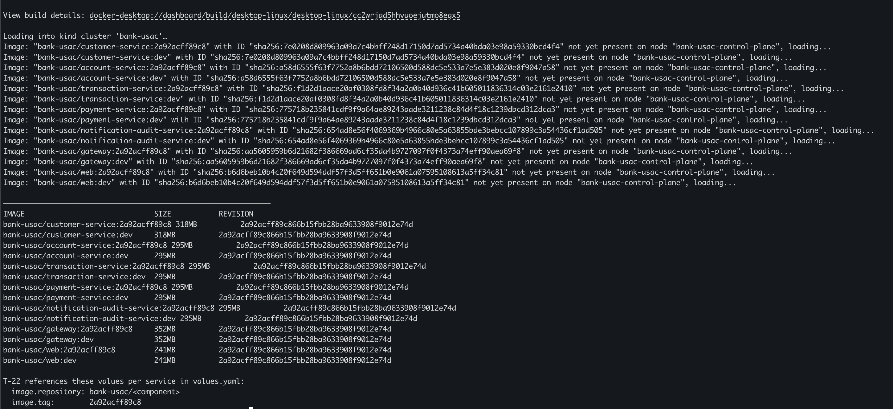 | **Construcción multi-stage:** Siete imágenes construidas y etiquetadas con el commit actual, cargadas en el nodo de kind sin subir a registros públicos. |
| 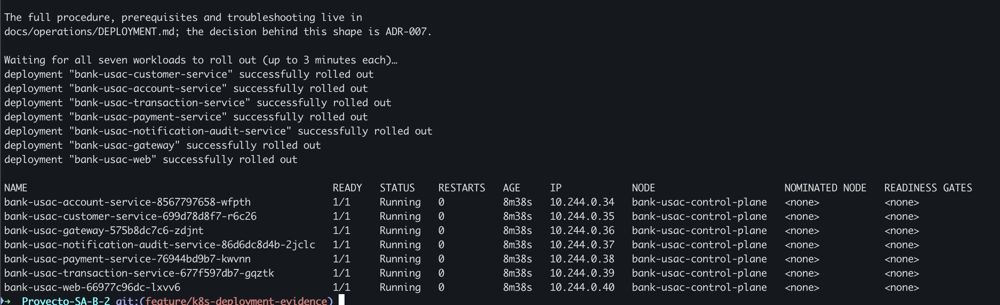 | **Instalación de Helm:** Despliegue exitoso del chart `bank-usac` con los 7 Deployments y Services. |
| 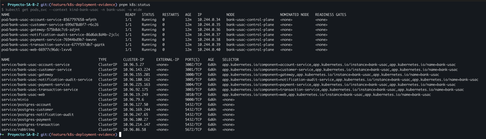 | **Pods en estado 1/1 Running:** Todos los microservicios activos dentro del namespace `bank-usac`. |
| 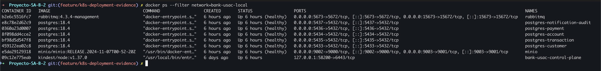 | **Dependencias externas al clúster:** Salida de `docker ps` que demuestra las 5 bases PostgreSQL, RabbitMQ y MinIO corriendo fuera del clúster en la red del host. |
| 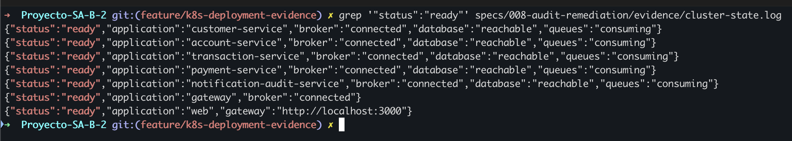 | **Sondas `/ready` en verde:** Cada microservicio confirma conexión exitosa a su base de datos y al broker RabbitMQ. |
| 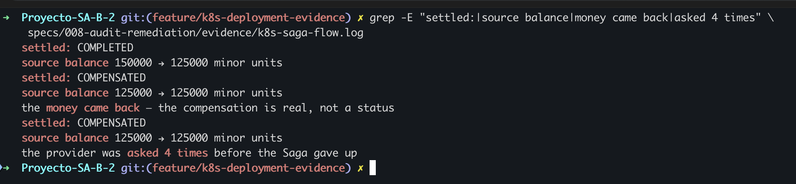 | **Ejecución de la Saga:** Demostración con saldos auditados de los flujos completado y compensado con `pnpm images:flow`. |
| 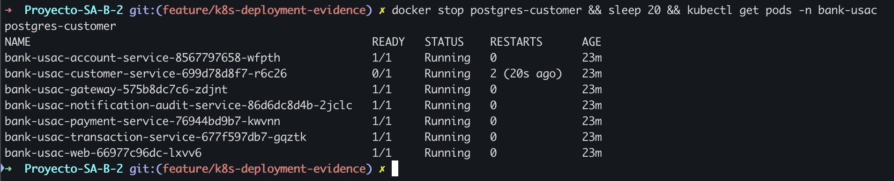 | **Tolerancia a fallos:** Al detener una base de datos, el pod pasa a `0/1 Running` (no `CrashLoopBackOff`) y se recupera automáticamente al restablecerla. |
| 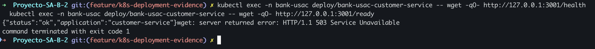 | **Separación de sondas:** Con la dependencia caída, `/health` responde `200 OK` (liveness vivo) y `/ready` devuelve `503` (sin recibir tráfico). |
| 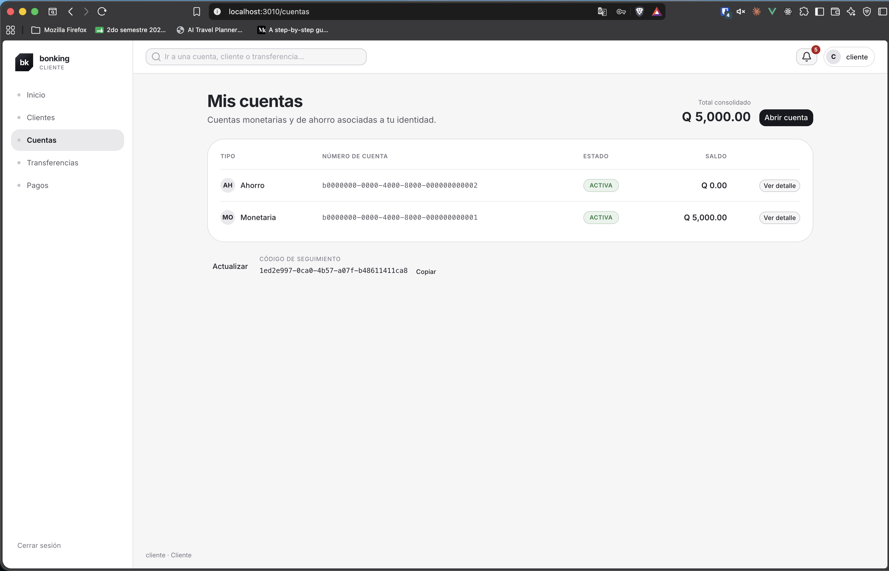 | **Frontend operativo:** Acceso a la interfaz web mediante `kubectl port-forward` con sesión activa. |

---

## 10. Frontend web (Nuxt 4) y validación de roles

La aplicación [Nuxt 4](FRONTEND.md) mapea las treinta y cuatro pantallas del
prototipo y añade Fase III. La comparación visual se registra por separado:

* **Módulo de Autenticación y Perfil:** Login, registro con carga de DPI, activación por correo, recuperación y cambio de contraseña.
* **Módulo de Cuentas y Movimientos:** Listado de cuentas monetarias y de ahorro, apertura asistida, detalle de saldos y depósitos en ventanilla.
* **Módulo de Transferencias y Saga Monitor:** Transferencias internas con los
  estados PENDING, DEBITING, PAYMENT_PENDING, COMPLETED, FAILED y COMPENSATED.
  No existe un estado Saga DEBITED; el débito confirmado llega como evento.
* **Módulo de Pagos de Servicios:** Pago de facturas de agua, luz y telefonía con selector de facturador y referencia de cobro.
* **Bandeja y Auditoría:** Lectura personal y consola de entrega independientes; cuatro filtros globales, detalle redactado y trazas enlazables.
* **Interbancario:** Formulario, lista por seis estados y detalle de motivo/historial/reverso; TIMEOUT no equivale a devolución.

---

## 11. Verificación, calidad y deudas técnicas controladas

### Evidencia y límites de validación

Los resultados y conteos deben leerse con su fecha y comando en
[QA](qa/README.md), [E2E](../E2E.md) y las evidencias por ticket. Los conteos
históricos no son el resultado de esta revisión ni una declaración de que el
checkout actual pasa todas las pruebas.

La web tiene Node test runner y Vitest/Nitro real con upstreams controlados.
Eso no prueba todos los componentes Vue ni el banco desplegado completo.
Las suites PostgreSQL/RabbitMQ requieren infraestructura de prueba y algunas se
omiten sin variables; las suites de repositorio hacen TRUNCATE. Nunca deben
apuntarse a bases de demo activas o producción.

Los comandos, entorno y resultados frescos de T-61 se incorporan a su informe
de validación; cualquier fallo existente se conserva como hallazgo. La
[matriz manual](qa/guia-validacion-manual-fase3.md) identifica qué recorridos
fueron observados y cuáles siguen pendientes.

### Registro de Deudas Técnicas Menores ([`docs/TECH_DEBT.md`](TECH_DEBT.md))
* **TD-018 (Retiro en ventanilla):** Se implementó el depósito en ventanilla (`POST /api/accounts/:id/deposit`), manteniéndose el retiro diferido para priorizar la estabilidad de la Saga de transferencias.
* **TD-021 (Auditoría restringida a Administrador):** Por diseño estricto de seguridad bancaria, la lectura de la bitácora global requiere privilegios de administrador para proteger datos transaccionales de terceros.

---

## 12. Fase II — Extensión funcional por microservicio

Las cinco capacidades que el enunciado de la Fase II (§4.1, pp. 4-6) añade a los microservicios existentes, más la integración de todas ellas en el flujo de transferencia. La evidencia de ejecución por ticket —comandos y salida real— vive en [`docs/qa/backend/`](qa/README.md); el diseño y el porqué, en [`docs/process/implementations.md`](process/implementations.md).

### 12.1 Customer Service — Gestión de estado KYC

| | |
| :--- | :--- |
| **Estados** | `PENDING` → `VERIFIED` \| `REJECTED`, con `VERIFIED` terminal |
| **Dónde vive** | Campo `kycStatus` del agregado `Customer`, **distinto de `identityStatus`** (que es la revisión de la foto del DPI de la Fase I) |
| **Contratos** | `customer.set-kyc-status.v1` (comando), `customer.kyc.verified.v1` y `customer.kyc.rejected.v1` (eventos), `kycStatus` añadido a `customer.get.replied.v1` |
| **Persistencia** | Migración `007_customers_kyc_status`: columna más `CHECK`, escritura bajo versión optimista |
| **Ruta** | `POST /api/customers/{customerId}/kyc-status`, sólo personal |
| **La regla que importa** | `mayInitiateTransactions` — un cliente que no está `VERIFIED` no puede iniciar una transferencia |

Son **dos** estados de validación y no uno a propósito: `identityStatus` responde "¿el documento que subió es suyo?" y lo decide un cajero mirando una foto; `kycStatus` responde "¿está habilitado para mover dinero?" y es la puerta que la Saga consulta. Colapsarlos habría atado una decisión operativa a una revisión manual.

### 12.2 Account Service — Tipos de cuenta y reglas de negocio

| Tipo | Depósito mínimo de apertura | Comisión por transacción |
| :--- | :--- | :--- |
| `MONETARIA` (corriente) | ninguno | ninguna |
| `AHORRO` | **Q100.00** (`AHORRO_MINIMUM_OPENING_BALANCE_MINOR = 10_000`) | **Q3.00** por débito (`commissionMinor = 300`) |

Las reglas viven en un solo lugar, `domain/account-type-rules.ts`, y no repartidas por los casos de uso. Tres detalles que un evaluador suele preguntar:

* **La comisión se cobra dentro del mismo bloqueo de fila que el débito**, como una operación propia en `account_operations` (migración `007_account_operations_commission_type`), y emite `account.commission.charged.v1`. No es un segundo movimiento de dinero que pueda quedar a medias.
* **El destino recibe el monto íntegro.** La comisión la paga el origen.
* **Una compensación devuelve también la comisión.** No lo hacía: una transferencia `AHORRO` compensada devolvía el monto y se quedaba con los Q3.00, de modo que el banco cancelaba la transferencia y aun así cobraba por ella. Corregido y registrado como **TD-065**, con prueba en los tres niveles, incluida una contra PostgreSQL real que comprueba que la fila de la comisión queda en `COMPENSATED`.
* **El «saldo mínimo» es una condición de apertura, no un piso permanente**: una vez abierta, una cuenta `AHORRO` puede debitarse hasta Q0.00 como cualquier otra. Es una lectura del requisito y está escrita como tal en el dominio.

### 12.3 Transaction Service — Historial y trazabilidad

`transaction.list.query.v1` / `.replied.v1` responden el historial con estos filtros, combinables:

| Filtro | Comportamiento |
| :--- | :--- |
| `from`, `to` | Rango de fechas |
| `status` | Uno de los seis estados reales de la Saga |
| `phaseStatus` | Uno de los tres que nombra el enunciado: `PENDING`, `APPROVED`, `FAILED` |
| `customerId` | Sólo personal; un `CLIENTE` queda acotado a lo suyo por la identidad del sobre, nunca por un parámetro que él controle |
| `limit` | 25 por defecto, **100 como techo** (`MAX_TRANSACTION_ROWS`) |

`phaseStatus` es una **proyección** de los seis estados, no un reemplazo: `COMPLETED` se presenta como `APPROVED`, y los estados intermedios como `PENDING`. Nombrar `status` y `phaseStatus` a la vez estrecha a su intersección en lugar de que uno pise al otro en silencio.

El alcance por rol se decide con la identidad verificada del sobre, y un `customerId` ajeno devuelve **una lista vacía y no un 403**: un `403` para un cliente que existe y un `200` vacío para uno que no responderían juntos a la pregunta «¿esta persona es cliente de este banco?».

### 12.4 Payment Service — Pagos externos simulados

El proveedor es **una función pura**: sin reloj, sin base de datos, sin aleatoriedad.

| Escenario solicitado | Resultado del proveedor | Qué hace la Saga |
| :--- | :--- | :--- |
| `APPROVE` | `SUCCESS` con referencia | `COMPLETED` |
| `REJECT` | `FAILURE` permanente | Compensa en el primer intento |
| `TRANSIENT_FAILURE` | `FAILURE` transitorio | Reintenta y, agotada la escalera, compensa |
| `TIMEOUT` | `TIMEOUT` | Igual que el transitorio: reintenta y compensa |

Un `TIMEOUT` se devuelve **de inmediato**, igual que los otros dos: es lo que el proveedor contesta, no una espera que este servicio tenga que sufrir para simularla.

La escalera de reintentos es **1 s, 5 s, 30 s**, y su vencimiento es una **columna** (`next_attempt_at`) y no un temporizador en memoria, de modo que un pod reprogramado no se olvida de una transferencia a medio pagar. Los intentos se serializan con `SELECT … FOR UPDATE` más una comprobación de que el número de intento sigue al de la fila, así que un comando reentregado y el barrido de reintentos no pueden cobrar los dos.

`payment.attempt.failed.v1` se publica en **cada** intento fallido, incluido el último; sólo el evento terminal cierra la Saga. Esa distinción es lo que hace observable la escalera mientras se está subiendo, y es lo que la pantalla de transferencias muestra en vivo.

### 12.5 Notification & Audit Service — Clasificación de eventos

Tres severidades, asignadas por una tabla explícita de tipo de evento a severidad —no inferidas del nombre:

| Severidad | Qué significa | Ejemplos |
| :--- | :--- | :--- |
| `INFO` | El sistema hizo lo que se le pidió | `customer.registered.v1`, `account.opened.v1`, `transaction.completed.v1` |
| `WARNING` | Una negativa esperada, sin nada que deshacer | `customer.register.rejected.v1`, `account.debit.rejected.v1` |
| `ERROR` | Algo que ya había ocurrido tuvo que deshacerse | `transaction.compensated.v1`, `account.debit.compensated.v1` |

La severidad no es decorativa: es un filtro de `audit.events.list.query.v1`, alimenta los contadores `infoToday` / `warningToday` / `errorToday` de las estadísticas, y viaja en la bandeja de notificaciones del cliente. Una compensación se clasifica `ERROR` aunque desde el lado del cliente «mi dinero volvió» suene bien — porque para quien opera el banco es exactamente lo que hay que mirar.

Dos decisiones deliberadas que conviene poder defender:

* **El payload se redacta antes del `INSERT`**, no al leerlo. La única base de datos que escucha todos los eventos del banco no guarda documentos, direcciones ni montos.
* **Este servicio no toma validador del broker.** Un mensaje que no puede interpretar se registra como `INVALID` en vez de aparcarse: el servicio cuyo trabajo es registrar lo que llegó no puede ser el que no lo ve.

### 12.6 Funcionalidad transversal obligatoria

| Requisito (§4.1, p. 6) | Cómo está resuelto |
| :--- | :--- |
| **Idempotencia** | Los cinco servicios deduplican por `messageId` del sobre en `processed_messages` **antes** de tocar estado; Account Service evalúa la idempotencia antes de mover un saldo; Notification & Audit usa la clave primaria `(event_id, consumer)` |
| **CorrelationId** | Viaja en el sobre compartido de `@bank/contracts` y se propaga por cada publicación; el Gateway lo devuelve en la cabecera `x-correlation-id` de toda respuesta, y la auditoría permite recorrer un flujo completo por él |
| **Manejo de estados** | Cada operación tiene estados definidos: seis en la Saga (una función pura rechaza toda transición fuera del diagrama), tres en KYC, y los de pago y auditoría |
| **Manejo de errores** | Un fallo genera un evento explícito con su código —`KYC_NOT_VERIFIED`, `INSUFFICIENT_FUNDS`, `ACCOUNT_INACTIVE`, entre otros— nunca silencio; el Gateway los traduce a siete códigos HTTP contratados |

### 12.7 Integración con la Saga

Las cinco extensiones están **dentro** del flujo de transferencia, que es el orden que dibuja §3.7: gate de KYC → regla del tipo de cuenta con su comisión → registro en el historial → pago externo con su escalera → notificación final clasificada. Ninguna vive en una pantalla aparte ni en un endpoint que sólo exista para demostrarla.

---

## 13. Fase II — Pipeline CI/CD, estrategia de ramas y despliegue selectivo

La decisión de plataforma y sus alternativas descartadas están en [ADR-015](architecture/adr/ADR-015-ci-cd-platform.md); el detalle operativo de cada workflow, en [`operations/CI.md`](operations/CI.md); la estrategia de monorepo, en [`operations/MONOREPO.md`](operations/MONOREPO.md). Esto es el resumen.

### 13.1 Los cuatro workflows

| Workflow | Se dispara con | Qué hace |
| :--- | :--- | :--- |
| [`ci.yml`](../.github/workflows/ci.yml) | push a `feature/**`, `fix/**`, `test/**`, `docs/**`, `chore/**`, `refactor/**`; PR hacia `develop` o `main` | **Fase 1 Build** → **Fase 2 Test** → **Fase 3 Validación**, como tres jobs |
| [`changes.yml`](../.github/workflows/changes.yml) | `workflow_call` | Clasifica los archivos que cambiaron y devuelve la lista de componentes |
| [`release.yml`](../.github/workflows/release.yml) | push a `release/**`, tag `v*` | Genera la versión formal y publica **siete imágenes versionadas** en Artifact Registry |
| [`cd.yml`](../.github/workflows/cd.yml) | push a `develop`; push a `main` | Despliega al namespace `dev`; hace **rolling update** en `prod` |

### 13.2 Las tres fases obligatorias son tres jobs

`test` declara `needs: build` y `validate` declara `needs: [build, test]`. El orden que el enunciado enumera lo impone el grafo, y un fallo en cualquier punto **salta todas las fases posteriores** automáticamente. Aparecen como tres entradas independientes en la lista de checks, que es lo que convierte «no se omitió ninguna etapa» en algo que se ve en lugar de algo que se afirma.

| Fase | Qué ejecuta |
| :--- | :--- |
| **Build** | `pnpm install --frozen-lockfile`, `pnpm build` |
| **Test** | `pnpm test`, `pnpm test:contract`, las suites de integración contra **PostgreSQL 18.4 y RabbitMQ 4.3.4 reales** (una base por servicio), y la forma de la pirámide 70/20/10 |
| **Validación** | Guard de `.env` versionado, `pnpm lint` (que incluye las reglas ejecutables de aislamiento) y `pnpm typecheck` |

Un detalle que vale la pena señalar en la defensa: **cada paso de integración falla si Jest reporta alguna suite como `skipped`**. Una suite que se salta sola cuenta como verde, y ese es exactamente el defecto que el guard existe para cazar.

### 13.3 Flujo de ramas

```
feature/<nombre>  ──push──►  CI: Build + Test + Validación
        │
        └──merge request──►  develop  ──►  CI: Build + Test
                                │
                                └──►  CD: build selectivo + despliegue a namespace dev
                                                │
        release/<version> o tag vX.X.X  ──►  Release: versión formal + 7 imágenes versionadas
                                                │
                                └──merge──►  main  ──►  CD: rolling update en prod
                                                        con las imágenes ya publicadas
```

**Producción nunca construye una imagen.** El job de producción resuelve el tag `v*` más reciente y despliega lo que `release.yml` ya publicó; si no existe ningún tag, **falla** en lugar de inventarse uno. Ninguna imagen se etiqueta `latest`: la entrega usa `vX.Y.Z`, `dev` usa `dev-<sha>`, y `helm-deploy.sh` rechaza `latest` explícitamente, de modo que la regla se sostiene incluso si alguien corre el script a mano.

### 13.4 Despliegue selectivo

`changes.yml` mapea directorios a componentes:

```
apps/services/payment-service/**   → payment-service
apps/gateway/**                    → gateway
apps/web/**                        → web
apps/packages/**                   → los siete
pnpm-lock.yaml, turbo.json         → los siete
.github/workflows/**, infra/k8s/** → los siete
```

**Lo compartido dispara todo a propósito:** un cambio de contrato que sólo reconstruyera el servicio que lo editó dejaría a los otros seis hablando la versión anterior.

Y el despliegue es selectivo en las dos mitades, no sólo en la construcción: `helm-deploy.sh` recibe `UPDATED_COMPONENTS`, pone la etiqueta nueva sólo en ésos y **lee con `helm get values` la que ya tenían** los demás. Sin esa lectura, Helm caería al `tag: dev` por defecto del chart —una etiqueta que no existe en el registry— y el despliegue «selectivo» rompería los seis servicios que nadie tocó.

### 13.5 Eficiencia, rolling update y rollback

* **Caché:** dependencias con `actions/setup-node` (pnpm) más la caché de Turborepo compartida entre los tres jobs por clave de commit; capas de Docker con `cache-from: type=gha` **por componente**.
* **Paralelismo:** `strategy.matrix` construye las siete imágenes a la vez en la entrega, y sólo las modificadas en `dev`.
* **Rolling update sin caída:** `maxUnavailable: 0`, `maxSurge: 1`, `preStop` de cinco segundos para dejar de recibir tráfico antes de cerrarse, y sondas `/health` y `/ready` distintas en los siete componentes. El script **sondea el Gateway cada segundo mientras la actualización ocurre** y reporta el resultado: la última corrida de producción registró *41 peticiones, 0 respuestas distintas de 200*.
* **Rollback automático:** si el `helm upgrade --wait` no alcanza `Ready`, el script vuelca el diagnóstico —pods, eventos, logs, capacidad del nodo— y ejecuta `helm rollback`. Si era la primera instalación no hay revisión anterior, y entonces retira el release a medias en lugar de dejar restos que envenenen el siguiente intento.

---

## 14. Fase II — Infraestructura como código y despliegue en la nube

La decisión y sus alternativas descartadas están en [ADR-014](architecture/adr/ADR-014-cloud-provider.md) y [ADR-016](architecture/adr/ADR-016-cloud-infrastructure.md); el procedimiento paso a paso, en [`operations/CLOUD.md`](operations/CLOUD.md); las variables del módulo, en [`infra/terraform/gcp/README.md`](../infra/terraform/gcp/README.md).

### 14.1 Recursos aprovisionados

Un único módulo raíz de Terraform, `infra/terraform/gcp/`, con el proveedor `google ~> 5.15`:

| Archivo | Recursos |
| :--- | :--- |
| [`vpc.tf`](../infra/terraform/gcp/vpc.tf) | VPC `bank-usac-vpc`, subred GKE `10.10.0.0/20` con rangos secundarios de pods y services, subred de bases `10.40.0.0/24`, Cloud Router, Cloud NAT y tres reglas de firewall (tráfico interno, SSH sólo desde el rango de IAP, y los rangos de health check) |
| [`compute_vms.tf`](../infra/terraform/gcp/compute_vms.tf) | Cinco instancias `e2-medium` con Debian 12, disco de 20 GB y **sin IP pública**, cada una con un `metadata_startup_script` que instala PostgreSQL y crea roles y bases por servicio; el aislamiento `_dev` se prepara con el procedimiento cloud |
| [`gke.tf`](../infra/terraform/gcp/gke.tf) | Clúster zonal, pool gestionado de 3 × `e2-standard-2`, canal `REGULAR`, auto-reparación, Workload Identity y el **addon de HPA habilitado** |
| [`cloud_run.tf`](../infra/terraform/gcp/cloud_run.tf) | Servicio `bank-usac-web`, puerto 8080, de 0 a 5 instancias, público |
| [`outputs.tf`](../infra/terraform/gcp/outputs.tf) | Las cinco IP privadas, el comando de credenciales de `kubectl` y la URL de Cloud Run |

### 14.2 Variables y procedimiento

El ciclo es el estándar —`terraform init`, `validate`, `plan`, `apply`— desde `infra/terraform/gcp/`, con un `terraform.tfvars` copiado del ejemplo. Las variables que hay que dar son `project_id` y las contraseñas de base de datos; el resto tiene valores por defecto (`region = us-central1`, `zone = us-central1-c`, `gke_node_count = 3`, `vm_machine_type = e2-medium`). Después, el pipeline despliega; cualquier cambio de infraestructura exige revisar el plan y el estado de Terraform.

El procedimiento completo, incluidos los pasos que Terraform no cubre, está en [`operations/CLOUD.md`](operations/CLOUD.md).

### 14.3 Autoescalado

Los siete componentes llevan un `HorizontalPodAutoscaler` (`autoscaling/v2`) con `averageUtilization: 80` sobre CPU, `minReplicas: 1` y `maxReplicas: 5`, y todos declaran `requests` y `limits` de CPU y memoria —50m/128Mi y 250m/256Mi por defecto, ajustables por componente. Es el requisito literal de §4.1 (p. 7-8).

### 14.4 Separación de entornos

Dev/prod tienen namespaces, broker, MinIO y bases con nombres distintos.
Comparten las cinco VMs, el clúster y cuotas. La evidencia de la revisión
confirma `payment_dev` frente a `payment`; las credenciales nunca se
publican. Las pruebas destructivas siguen requiriendo bases de prueba propias.

### 14.5 Propiedad de recursos y deriva

Terraform declara Artifact Registry y la IP reservada del Gateway. Helm declara
el Service LoadBalancer; CD aplica la versión de Cloud Run y Terraform ignora
su imagen para no revertirla. La vieja lista de tres recursos totalmente
manuales quedó obsoleta. La adopción por import y el estado aplicado se comprueban
según [CLOUD](operations/CLOUD.md), sin alterar ADR históricos.

---

## 15. Fase III — observabilidad, interbancario y evidencia

| Capacidad | Fuente y evidencia |
| --- | --- |
| Ciclo de vida del cliente y actividad de cuentas | [Catálogo de telemetría](sre/telemetry-catalog.md), evidencias T-41/T-42 en [QA](qa/README.md). |
| Duración y errores Saga, proveedor y simulación | Métricas T-43/T-44, intentos persistidos, [manual técnico](manual-tecnico.md#simulación-administrativa-de-pagos). |
| Auditoría, alertas y navegación por traza | T-45, cuatro filtros, payload redactado y [guía de navegador](qa/guia-validacion-manual-fase3.md). |
| Interbancario | [Contrato y runbook](operations/INTERBANK.md), [acuerdo](operations/INTERBANK-AGREEMENT.md), callback, consulta, cancelación y reverso. |
| Stack observabilidad | OpenTelemetry/Collector, Prometheus, Tempo, Loki, agente de logs, Grafana y kube-state-metrics; [runbooks](operations/runbooks/README.md). |
| SLO y respuesta | [Marco SRE](sre/sli-slo-sla.md), nueve dashboards, dieciséis reglas y siete runbooks. |
| Fallos y recuperación | [Postmortems](sre/postmortems/README.md), evidencia histórica y cloud distinguidas por fecha/entorno. |
| Estado cloud | Inventarios [prod](qa/load/2026-10-21-gke-prod-inventory.txt), [dev](qa/load/2026-10-21-gke-dev-inventory.txt) y [observabilidad](qa/load/2026-10-21-gke-observability-inventory.txt). |

### Diagramas técnicos complementarios

- [Envío interbancario](architecture/diagrams/09-secuencia-envio-interbancario.puml):
  reserva, HTTP, aceptación inicial, callback y resolución de TIMEOUT.
- [Recepción interbancaria](architecture/diagrams/10-secuencia-recepcion-interbancaria.puml):
  deduplicación, crédito y callback/reintentos.
- [Reintentos de pago](architecture/diagrams/11-secuencia-reintentos-pago.puml):
  persistencia, exclusión concurrente y compensación tras fallo terminal.
- [Observabilidad y alertas](architecture/diagrams/12-observabilidad-y-alertas.puml):
  OTLP backend, scrape web, logs, consultas y entrega de alertas por Gateway.

Los diagramas documentales se entregan sólo en PNG. Casos de uso y despliegue
pasan a edición nativa en Lucid; sus PUML conservan el contenido para cotejo.
C4 mantiene DSL/CLI y las secuencias mantienen PUML. Los cinco ER quedan como
DBML y sus cinco exportaciones PNG quedan incorporadas y enlazadas. La política vigente está
en [ADR-024](architecture/adr/ADR-024-native-lucid-and-png-delivery.md), que
sustituye la política gráfica de ADR-022. Las alternativas históricas del
editor siguen separadas. La [auditoría T-61](qa/T-61-documentation-audit.md)
registra las exportaciones comprobadas; la presencia de una imagen no prueba
su origen en Lucid ni la ejecución del escenario representado.

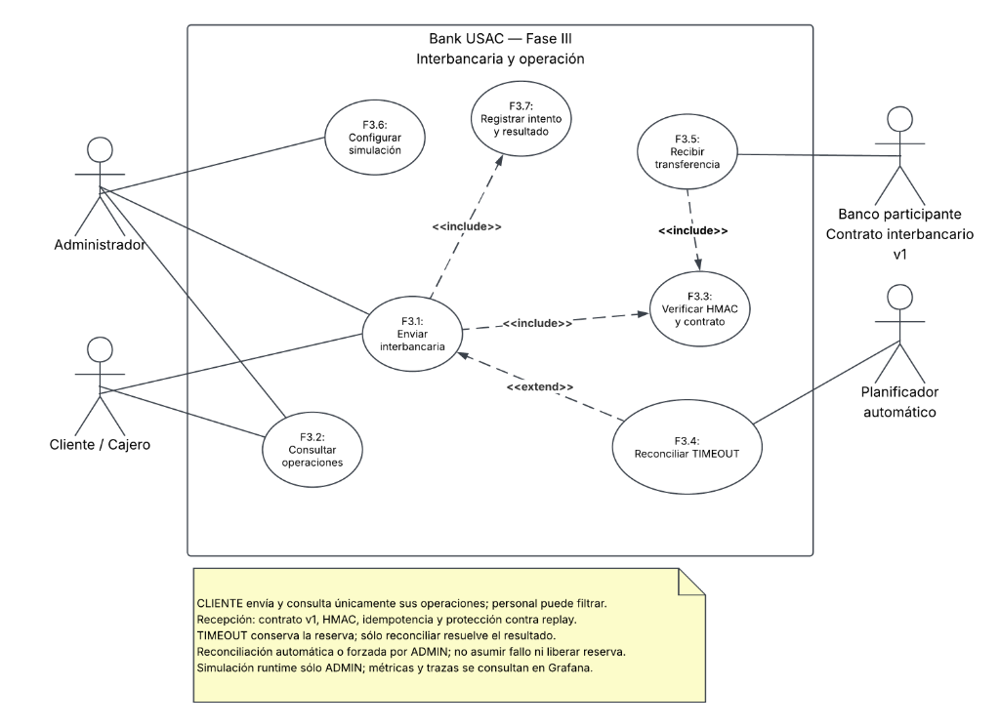

[Fuente 13](architecture/diagrams/13-casos-uso-fase3.puml): extensiones v1,
notificaciones, anomalía N/M, simulación API y acceso SRE. El detalle de
permisos continúa en el modelo de actores.

[Informe T-61](qa/T-61-documentation-audit.md) y
[evidencia cloud T-60](qa/backend/T-60-cloud-evidence.md) identifican resultados
reales, límites, pruebas fallidas y pendientes; no se deduce cumplimiento de
un pod Ready.

### Condiciones que impiden un cierre sin reservas

La revisión observó RabbitMQ live diferente del deseado, ausencia de
NetworkPolicies aplicadas y dev sin mock ni URL pareja; no se ocultan con un
diagrama del estado objetivo. Readiness y HPA configurado no acreditan tolerancia
a fallos ni escalado. La evidencia histórica no sustituye experimentos cloud
pendientes. La aceptación final de #168 depende de su matriz de criterios y de
resultados verificables, incluidos los pendientes vinculados a #167.

---

## Comandos Esenciales de Verificación

```bash
# 1. Compilación y validación de reglas de arquitectura
pnpm install
pnpm build
pnpm lint
pnpm test
pnpm test:contract

# 2. Levantar la plataforma completa en local (Docker + Host)
pnpm dev

# 3. Demostración de los tres flujos de la Saga (éxito y compensación)
pnpm images:flow

# 4. Ejecución de la suite de pruebas End-to-End (Playwright)
pnpm test:e2e

# 5. Fase II — la infraestructura, desde infra/terraform/gcp/
terraform init && terraform validate && terraform plan

# 6. Fase II — comprobar el sistema desplegado en la nube
curl -s http://<IP-del-Gateway>:3000/health
curl -s http://<IP-del-Gateway>:3000/ready
kubectl get pods,hpa -n prod
kubectl get pods,hpa -n dev
```

El procedimiento completo de nube está en [`operations/CLOUD.md`](operations/CLOUD.md).
