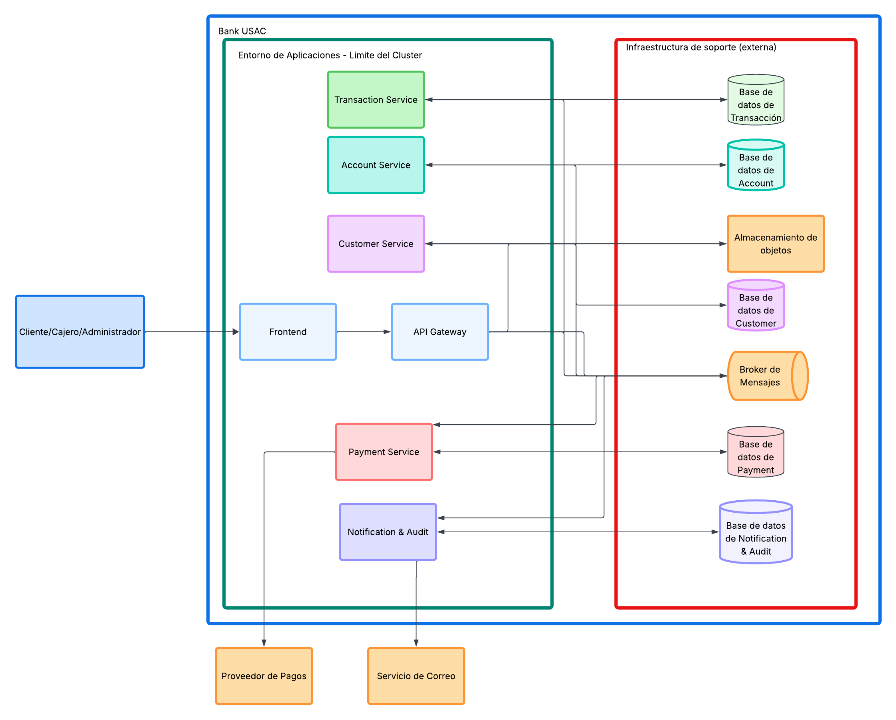
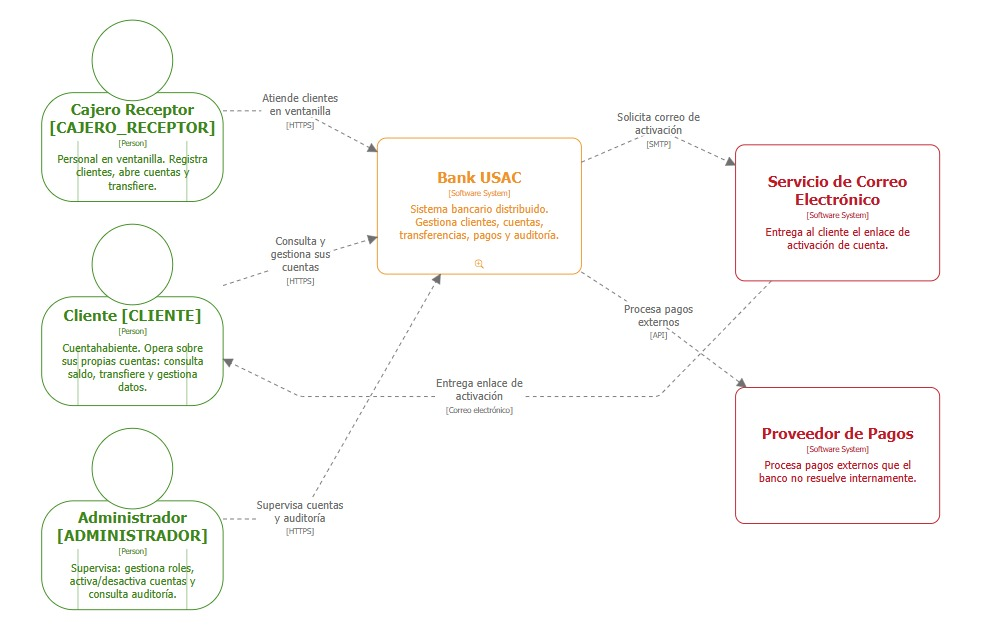
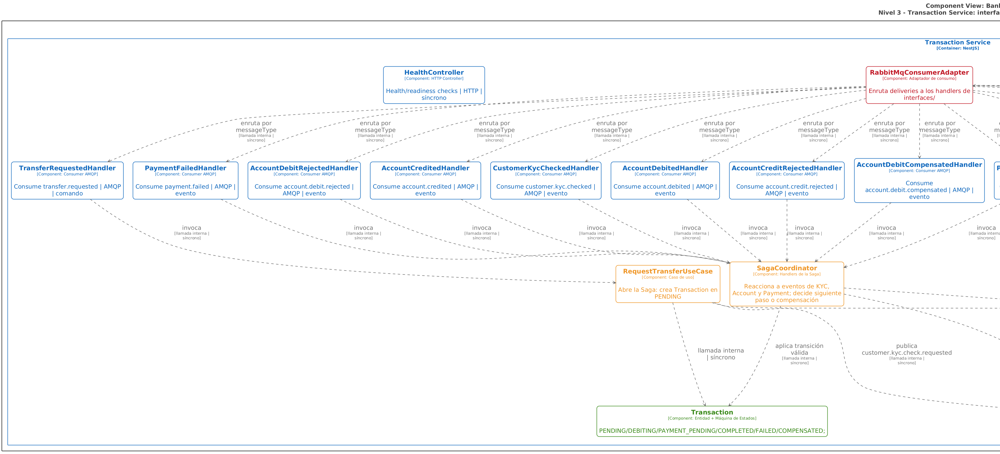

# Arquitectura del Sistema — Bank USAC

---

## Tabla de Contenidos

- [Arquitectura del Sistema — Bank USAC](#arquitectura-del-sistema--bank-usac)
  - [Tabla de Contenidos](#tabla-de-contenidos)
  - [1. Resumen Arquitectónico](#1-resumen-arquitectónico)
    - [1.1. Contexto y Visión de la Plataforma](#11-contexto-y-visión-de-la-plataforma)
    - [1.2. Principios Rectores de la Arquitectura](#12-principios-rectores-de-la-arquitectura)
    - [1.3. Aclaración del Estilo Arquitectónico](#13-aclaración-del-estilo-arquitectónico)
  - [2. Estilo y Patrón Arquitectónico](#2-estilo-y-patrón-arquitectónico)
    - [2.1. Ecosistema de Microservicios Asíncronos](#21-ecosistema-de-microservicios-asíncronos)
    - [2.2. Patrones de Diseño Aplicados](#22-patrones-de-diseño-aplicados)
  - [3. Diagrama de Contexto (C4 Nivel 1)](#3-diagrama-de-contexto-c4-nivel-1)
    - [3.1. Representación Visual del Contexto](#31-representación-visual-del-contexto)
    - [3.2. Actores Humanos (Usuarios del Sistema)](#32-actores-humanos-usuarios-del-sistema)
    - [3.3. Sistemas Externos e Infraestructura de Soporte](#33-sistemas-externos-e-infraestructura-de-soporte)
  - [4. Diagrama de Contenedores y Bloques (C4 Nivel 2)](#4-diagrama-de-contenedores-y-bloques-c4-nivel-2)
    - [4.1. Representación Visual de Contenedores](#41-representación-visual-de-contenedores)
    - [4.2. Desglose de Contenedores y Microservicios](#42-desglose-de-contenedores-y-microservicios)
      - [Frontend Web (Nuxt 3)](#frontend-web-nuxt-3)
      - [API Gateway (NestJS)](#api-gateway-nestjs)
      - [Customer Service (CDU001)](#customer-service-cdu001)
      - [Account Service (CDU002)](#account-service-cdu002)
      - [Transaction Service (CDU003)](#transaction-service-cdu003)
      - [Payment Service (CDU004)](#payment-service-cdu004)
      - [Notification & Audit Service (CDU005)](#notification--audit-service-cdu005)
      - [Message Broker (RabbitMQ 4.x)](#message-broker-rabbitmq-4x)
      - [Almacenamiento de Objetos (MinIO S3-Compatible)](#almacenamiento-de-objetos-minio-s3-compatible)
  - [5. Diagrama de Componentes y Capas Internas (C4 Nivel 3)](#5-diagrama-de-componentes-y-capas-internas-c4-nivel-3)
    - [5.1. Estructura Interna: Clean Architecture / Arquitectura Hexagonal](#51-estructura-interna-clean-architecture--arquitectura-hexagonal)
    - [5.2. Diagrama de Componentes de Transaction Service (Saga Coordinator)](#52-diagrama-de-componentes-de-transaction-service-saga-coordinator)
    - [5.3. Descripción de Capas](#53-descripción-de-capas)
  - [6. Decisiones Arquitectónicas Clave](#6-decisiones-arquitectónicas-clave)
  - [7. Infraestructura, Despliegue y Topología de Red](#7-infraestructura-despliegue-y-topología-de-red)
    - [7.1. Diagrama de Despliegue (UML / Kubernetes)](#71-diagrama-de-despliegue-uml--kubernetes)
    - [7.2. Matriz de Puertos y Variables de Entorno](#72-matriz-de-puertos-y-variables-de-entorno)
    - [7.3. Estrategia de Resiliencia y Healthchecks](#73-estrategia-de-resiliencia-y-healthchecks)

---

## 1. Resumen Arquitectónico

### 1.1. Contexto y Visión de la Plataforma

**Bank USAC** es una plataforma de banca digital distribuida de última generación, diseñada para prestar servicios financieros de alta confiabilidad a tres actores diferenciados: **Clientes**, **Cajeros Receptores** y **Administradores**. El sistema abarca el autoregistro público con validación biométrica y documental en MinIO, activación criptográfica por correo, apertura de cuentas monetarias y de ahorro, depósitos en ventanilla con emisión síncrona de comprobantes contables, transferencias interbancarias y pago de servicios mediante Sagas coreografiadas asíncronas, y auditoría forense inmutable punto a punto.

### 1.2. Principios Rectores de la Arquitectura

| Principio | Descripción y Aplicación en Bank USAC |
|---|---|
| **Consistencia Financiera** | Cero pérdida de dinero y cero saldos negativos. Aritmética exacta de punto fijo `NUMERIC(14,2)` y bloqueos pesimistas de fila `SELECT ... FOR UPDATE` en PostgreSQL. |
| **Aislamiento Estricto** | Regla constitucional de microservicios: **Database per Service**. Ningún servicio puede consultar la base de datos de otro ni realizar llamadas HTTP directas a servicios de dominio. |
| **Disponibilidad y Resiliencia** | Meta de 99.9% de uptime. Recepción asíncrona inmediata en Gateway (`202 Accepted`), colas durables en RabbitMQ y escalera de reintentos automatizada. |
| **Seguridad y Menor Privilegio** | Autenticación stateless por JWT, contraseñas protegidas con `scrypt`, redacción de datos confidenciales antes de la inserción en auditoría y control de acceso RBAC perimetral (ADR D-06). |
| **Idempotencia Transaccional** | Protección de base de datos contra duplicidad de débitos o créditos ante reintentos de red mediante índices únicos `UNIQUE (idempotency_key, type)`. |
| **Cloud-Ready y Portabilidad** | Empaquetado en imágenes Docker multi-stage ejecutadas bajo usuario no root (`node`), desplegables localmente con Docker Compose o en clústeres Kubernetes con Helm. |

### 1.3. Aclaración del Estilo Arquitectónico

Bank USAC se implementa como una **Arquitectura de Microservicios Asíncrona Orientada a Eventos (Event-Driven Architecture - EDA)** pura para la comunicación inter-servicios, complementada con un **API Gateway Perimetral** que actúa como punto único de entrada para clientes web. 

- **Sin llamadas HTTP inter-servicios:** Los 5 microservicios de dominio no exponen puertos HTTP entre sí; toda la coordinación transaccional se realiza consumiendo y publicando eventos a través de **RabbitMQ**.
- **Request/Reply Asíncrono en Gateway:** Para consultas que demandan respuesta inmediata (ej. autenticación o balance), el Gateway publica comandos con colas temporales exclusivas de respuesta (*direct reply-to* / correlation ID) con un techo estricto de timeout de 5 segundos.

---

## 2. Estilo y Patrón Arquitectónico

### 2.1. Ecosistema de Microservicios Asíncronos

> **Descripción del diagrama:** La arquitectura general presenta al API Gateway como único punto de entrada HTTP desde el frontend, desacoplado de los cinco microservicios de dominio (Customer, Account, Transaction, Payment y Notification & Audit) a través del broker de mensajería RabbitMQ. Cada microservicio cuenta con su base de datos PostgreSQL exclusiva y almacenamiento de objetos MinIO para fotografías de identidad.

### 2.2. Patrones de Diseño Aplicados

1. **Patrón Saga Coreografiada (ADR-009):** Orquestación distribuida de transferencias sin coordinador síncrono central. Cada servicio escucha eventos del broker y emite el siguiente comando/evento correspondiente, ejecutando compensaciones atómicas si un paso falla.
2. **Patrón Database per Service (ADR-005):** Cada microservicio posee un esquema y servidor PostgreSQL dedicado. Se prohíbe el acceso cruzado a datos.
3. **Patrón API Gateway & Aggregator (ADR-003 / D-06):** Punto de entrada único que valida JWT, autoriza por roles y compone respuestas (ej. asociar nombre de cliente y cuentas en `/api/accounts`) sin poseer base de datos ni lógica de negocio propia.
4. **Patrón Transactional Outbox (US3 / TD-031):** En *Transaction Service* y *Payment Service*, los mensajes y eventos salientes se guardan en la tabla `outbox_messages` dentro de la misma transacción SQL que el cambio de estado, y un relay en segundo plano (`OutboxRelay`) los despacha de forma confiable, cerrando la ventana de fallos de caída entre commit y publicación.
5. **Patrón Pre-Insert Redaction (ADR-010 / US5):** El servicio de auditoría oculta contraseñas, documentos de identidad y montos antes de ejecutar la sentencia `INSERT`, asegurando que la base de datos compartida de auditoría no almacene secretos.

---

## 3. Diagrama de Contexto (C4 Nivel 1)

### 3.1. Representación Visual del Contexto

> **Descripción del diagrama:** El diagrama de contexto sitúa a Bank USAC como el núcleo central interactuando con los tres actores humanos (Cliente, Cajero Receptor y Administrador) a través del API Gateway mediante HTTPS/REST, y comunicándose con sistemas externos como el servicio de correo para activación de cuentas y el proveedor externo de pagos.

### 3.2. Actores Humanos (Usuarios del Sistema)

| Actor | Rol en Sistema | Interacción Principal y Permisos |
|---|---|---|
| **Cliente** | `CLIENTE` | Accede a la banca web para consultar sus cuentas, realizar transferencias con Saga coreografiada, pagar servicios y actualizar sus datos. Restringido estrictamente a sus propios registros. |
| **Cajero Receptor** | `CAJERO_RECEPTOR` | Opera en ventanilla bancaria: atiende clientes presenciales, inspecciona fotografías de DPI almacenadas en MinIO para aprobar identidades y registra depósitos en efectivo con comprobante síncrono. |
| **Administrador** | `ADMINISTRADOR` | Realiza supervisión y gobierno del sistema: consulta el rastro forense de auditoría distribuida por `correlationId`, monitorea la escalera de reintentos de pagos y activa/bloquea cuentas bancarias. |

### 3.3. Sistemas Externos e Infraestructura de Soporte

| Sistema Externo / Infra | Tipo de Integración | Responsabilidad y Mecanismo |
|---|---|---|
| **Servicio de Correo (Resend)** | API REST / HTTPS | Envío asíncrono de correos transaccionales con tokens criptográficos de activación y recuperación. En desarrollo opera bajo canal simulado sin fallos. |
| **Proveedor de Pagos / Biller** | API REST / Adaptador | Pasarela externa para liquidación de transferencias hacia empresas recaudadoras (EEGSA, Empagua, Claro) con evaluación determinista de reintentos. |
| **RabbitMQ Message Broker** | AMQP 0-9-1 | Columna vertebral de mensajería asíncrona; gestiona colas durables, enrutamiento por topics y Dead Letter Queues (`bank.errors`). |
| **MinIO Object Storage** | S3 API / HTTP | Almacén de objetos seguro para fotografías de DPI, garantizando que los archivos binarios no saturen las bases de datos ni el broker. |

---

## 4. Diagrama de Contenedores y Bloques (C4 Nivel 2)

### 4.1. Representación Visual de Contenedores

> **Descripción del diagrama:** Descomposición en contenedores del sistema. En el clúster residen el Frontend Nuxt 3, el API Gateway NestJS y los cinco microservicios de dominio. En la infraestructura de persistencia se ubican las cinco bases de datos PostgreSQL independientes, el broker RabbitMQ y el almacenamiento MinIO.

---

### 4.2. Desglose de Contenedores y Microservicios

#### Frontend Web (Nuxt 3)
* **Responsabilidad:** Renderiza las 34 pantallas del portal bancario para los tres roles, gestiona el estado reactivo en memoria y se comunica únicamente con el API Gateway.
* **Tecnología:** Nuxt 3, Vue 3, Composition API, TypeScript, TailwindCSS.

#### API Gateway (NestJS)
* **Responsabilidad:** Entrada perimetral única. Autentica sesiones mediante JWT Bearer, aplica control de acceso RBAC (**ADR D-06**), enruta comandos a RabbitMQ y compone datos agregados sin almacenar estado.
* **Tecnología:** NestJS, Fastify/Express, Passport JWT, amqplib.

#### Customer Service (CDU001)
* **Responsabilidad:** Gestiona el ciclo de vida de identidades, registro en 3 pasos con validación de edad ($\ge 18$ años), hashing `scrypt`, activación por correo y validación de fotografías en MinIO.
* **Persistencia:** PostgreSQL dedicado (`customer_db` en puerto 5433).

#### Account Service (CDU002)
* **Responsabilidad:** Administra cuentas Monetarias y de Ahorro con UUID inmutable, gestiona balances con aritmética exacta `NUMERIC(14,2)`, ejecuta débitos y créditos atómicos con bloqueo `SELECT ... FOR UPDATE`, procesa depósitos en ventanilla y ejecuta el job de desactivación automática de cuentas inactivas.
* **Persistencia:** PostgreSQL dedicado (`account_db` en puerto 5434).

#### Transaction Service (CDU003)
* **Responsabilidad:** Coordina la máquina de estados finita de transferencias bancarias (Saga coreografiada de 6 estados). Emite comandos de débito, pago, crédito y compensación garantizando la consistencia eventual. Implementa Transactional Outbox para publicación segura.
* **Persistencia:** PostgreSQL dedicado (`transaction_db` en puerto 5435).

#### Payment Service (CDU004)
* **Responsabilidad:** Procesa intentos de cobro de pasarela y pagos de servicios a billers (EEGSA, Empagua, Claro). Maneja una escalera de reintentos determinista (1s, 5s, 30s) y emite veredictos finales para la Saga.
* **Persistencia:** PostgreSQL dedicado (`payment_db` en puerto 5436).

#### Notification & Audit Service (CDU005)
* **Responsabilidad:** Receptor pasivo de todos los eventos del bus. Aplica redacción de datos sensibles antes de la inserción SQL (`pre-insert redaction`), gestiona la bitácora forense por `correlationId` y despacha notificaciones.
* **Persistencia:** PostgreSQL dedicado (`notification_audit_db` en puerto 5437).

#### Message Broker (RabbitMQ 4.x)
* **Responsabilidad:** Desacopla la comunicación mediante 4 exchanges configurados como tipo `topic` y durables: `bank.commands` (comandos y solicitudes de consulta emitidos al bus), `bank.events` (eventos de dominio y notificaciones de cambio de estado), `bank.replies` (respuestas de consulta correlacionadas hacia el API Gateway) y `bank.errors` (mensajes rechazados o inválidos en Dead Letter Exchanges).

#### Almacenamiento de Objetos (MinIO S3-Compatible)
* **Responsabilidad:** Almacena de forma binaria las fotografías de documentos DPI con acceso seguro por referencias y verificación de hashes SHA-256.

---

## 5. Diagrama de Componentes y Capas Internas (C4 Nivel 3)

### 5.1. Estructura Interna: Clean Architecture / Arquitectura Hexagonal

Cada uno de los microservicios sigue estrictamente la separación de 4 capas concéntricas con regla de dependencia hacia el interior:

1. **`domain/` (Núcleo):** Entidades de negocio puras, objetos de valor (`Money`), máquinas de estados y reglas invariantes sin dependencias de base de datos ni frameworks.
2. **`application/`:** Casos de uso (*Use Cases*) y puertos abstractos (`ports.ts`) para repositorios y publicadores de eventos.
3. **`infrastructure/`:** Adaptadores tecnológicos (PostgreSQL con pg/TypeORM, `OutboxRelay`, adaptadores de RabbitMQ y MinIO).
4. **`interfaces/`:** Controladores de mensajes (*Message Handlers*) que consumen del router de eventos y controladores de salud HTTP (`/health`, `/ready`).

---

### 5.2. Diagrama de Componentes de Transaction Service (Saga Coordinator)

> **Descripción del diagrama:** Estructura interna de Transaction Service modelada en Clean Architecture: los Message Handlers en `interfaces/` reciben eventos AMQP, los Casos de Uso en `application/` aplican transiciones sobre la máquina de estados en `domain/`, y los adaptadores en `infrastructure/` persisten en PostgreSQL gestionando el Transactional Outbox.

---

### 5.3. Descripción de Capas

| Capa | Responsabilidad Principal | Reglas de Dependencia |
|---|---|---|
| **Dominio (`domain/`)** | Contiene las entidades puras (`Customer`, `Account`, `Transaction`), objetos de valor inmutables (`Money`) y máquinas de estados. | **Cero dependencias externas.** No importa NestJS, base de datos ni librerías de red. |
| **Aplicación (`application/`)** | Orquesta los casos de uso del sistema e interactúa con el dominio mediante puertos e interfaces. | Depende únicamente de la capa de Dominio. |
| **Infraestructura (`infrastructure/`)** | Implementa los puertos mediante adaptadores concretos (SQL PostgreSQL, Outbox Scheduler, RabbitMQ). | Depende de Aplicación y Dominio. |
| **Interfaces (`interfaces/`)** | Enruta los mensajes AMQP entrantes hacia los casos de uso correspondientes y expone endpoints de diagnóstico. | Depende de Aplicación. |

---

## 6. Decisiones Arquitectónicas Clave

La arquitectura de Bank USAC se fundamenta en doce decisiones técnicas principales (**ADR-001 a ADR-012**) y seis decisiones de dominio (**D-01 a D-06**), detalladas en [docs/adr.md](adr.md):

* **ADR-001 / ADR-002:** Ecosistema homogéneo TypeScript con NestJS en backend y Nuxt 3 en frontend sobre monorepo Turborepo.
* **ADR-003 / ADR-004:** Desacoplamiento asíncrono puro con RabbitMQ 4.x, eliminando llamadas HTTP síncronas entre microservicios de dominio.
* **ADR-005:** Persistencia aislada con PostgreSQL 18 (*Database per Service*), precisión decimal exacta `NUMERIC(14,2)` y bloqueos `SELECT ... FOR UPDATE`.
* **ADR-006 / ADR-007:** Contenerización multi-stage sin privilegios root (`node`) y orquestación con Docker Compose (local) y Kubernetes Helm charts (cloud).
* **ADR-008 / ADR-009:** Clean Architecture interna y patrón Saga Coreografiada con compensación determinista ante fallos.
* **ADR-010 / ADR-012:** Seguridad stateless con JWT, cifrado `scrypt`, control RBAC perimetral (D-06) y almacenamiento S3 en MinIO para fotografías de DPI.

---

## 7. Infraestructura, Despliegue y Topología de Red

### 7.1. Diagrama de Despliegue (UML / Kubernetes)

> **Descripción del diagrama:** Topología de despliegue en clúster Kubernetes / kind. Cada microservicio corre como un Pod/Deployment dentro del namespace `bank-usac` con su Service ClusterIP, consumiendo configuración de ConfigMaps y credenciales de Secrets, interactuando con la infraestructura de bases de datos PostgreSQL, RabbitMQ y MinIO.

---

### 7.2. Matriz de Puertos y Variables de Entorno

| Componente / Servicio | Puerto Host | Protocolo | Variable de Entorno Primaria | Propósito / Destino |
|---|:---:|:---:|---|---|
| **Frontend Web** | `3010` | HTTP | `NUXT_PUBLIC_API_BASE_URL` | Interfaz de usuario para clientes y staff. |
| **API Gateway** | `3000` | HTTP | `PORT`, `JWT_SECRET`, `RABBITMQ_URL` | Entrada pública REST y autenticación JWT. |
| **Customer Service** | `3001` | HTTP (Health) | `DATABASE_URL`, `MINIO_ENDPOINT` | Gestión de identidad y credenciales. |
| **Account Service** | `3002` | HTTP (Health) | `DATABASE_URL` (Puerto 5434) | Contabilidad, saldos y depósitos. |
| **Transaction Service** | `3003` | HTTP (Health) | `DATABASE_URL` (Puerto 5435) | Coordinación de la Saga de transferencias. |
| **Payment Service** | `3004` | HTTP (Health) | `DATABASE_URL` (Puerto 5436) | Cobro a proveedores y escalera de reintentos. |
| **Notification & Audit** | `3005` | HTTP (Health) | `DATABASE_URL` (Puerto 5437) | Bitácora forense y envío de correos. |
| **PostgreSQL Customer** | `5433` | TCP | `POSTGRES_DB=customer` | Base de datos de identidades. |
| **PostgreSQL Account** | `5434` | TCP | `POSTGRES_DB=account` | Base de datos de cuentas y balances. |
| **PostgreSQL Transaction**| `5435` | TCP | `POSTGRES_DB=transaction` | Base de datos de transacciones y outbox. |
| **PostgreSQL Payment** | `5436` | TCP | `POSTGRES_DB=payment` | Base de datos de pagos e intentos. |
| **PostgreSQL Audit** | `5437` | TCP | `POSTGRES_DB=notification_audit` | Base de datos inmutable de auditoría. |
| **RabbitMQ Broker** | `5672` / `15672`| AMQP / HTTP | `RABBITMQ_DEFAULT_USER=admin` | Broker de mensajería y consola web. |
| **MinIO Object Store** | `9000` / `9001`| HTTP / S3 | `MINIO_ROOT_USER=minioadmin` | Almacenamiento de fotografías de DPI. |

---

### 7.3. Estrategia de Resiliencia y Healthchecks

1. **Desacoplamiento de Sondas de Salud:** Cada uno de los 7 contenedores implementa dos endpoints de diagnóstico HTTP independientes:
   * **`/health` (Liveness Probe):** Responde inmediatamente `200 OK {"status":"ok"}` indicando que el proceso Node.js está vivo, evitando reinicios espurios de Kubernetes mientras los servicios se conectan.
   * **`/ready` (Readiness Probe):** Evalúa la conectividad efectiva con su base de datos PostgreSQL y el broker RabbitMQ antes de recibir tráfico de red.
2. **Reconexión Automática de Mensajería:** El cliente `@bank/messaging` implementa reconexión automática exponencial ante caídas del broker RabbitMQ, reanudando las suscripciones y confirmaciones de ACKs sin intervención manual.
3. **Aislamiento de Fallos en Bases de Datos:** Si una base de datos específica se degrada, únicamente las operaciones de ese microservicio se detienen; las demás funciones del banco continúan operando normalmente.
