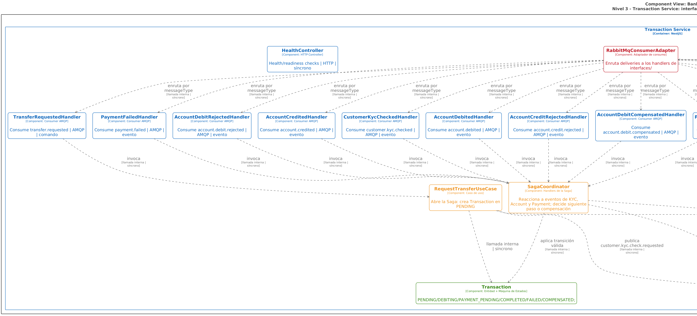
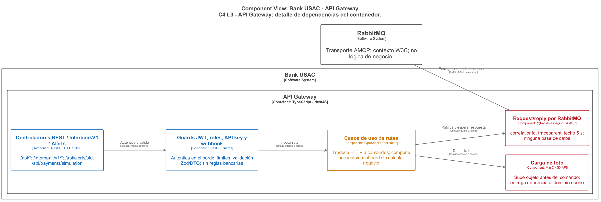
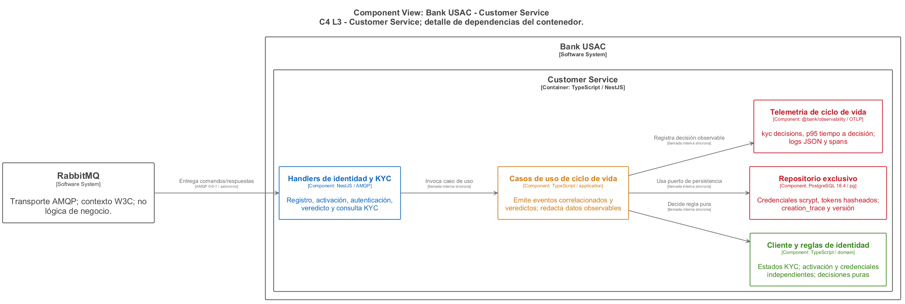
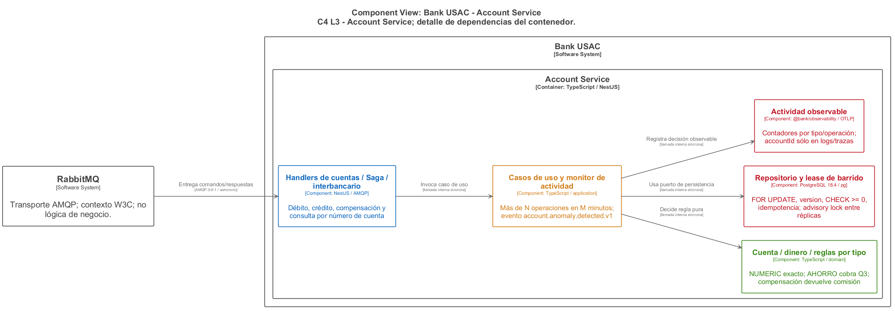
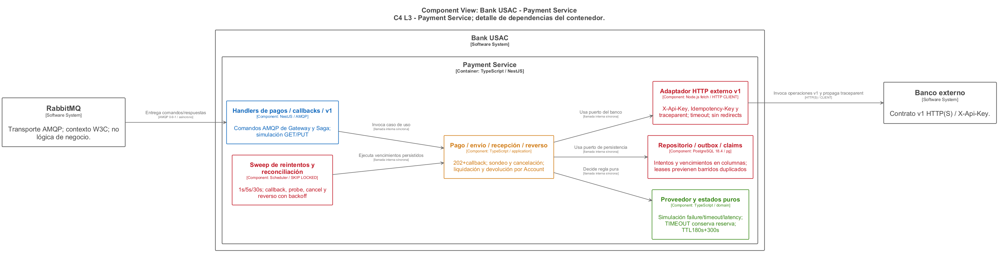
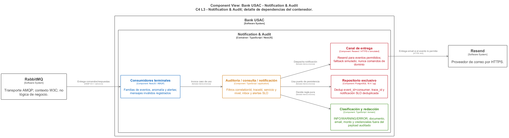

# C4 L3 — Componentes por contenedor

[DSL de las seis vistas](diagrams/04-c4-componentes.dsl), revisado contra el
código el **2026-10-22**. Transaction es la vista principal y conserva su
descomposición técnica; las otras cinco vistas son complementarias y agrupan
responsabilidades por capa. No representan una clase por cada bloque agregado.

Azul: interfaces; naranja: aplicación y contratos de puerto; verde: dominio;
rojo: infraestructura. Las flechas continuas indican uso o colaboración y su
etiqueta distingue llamada local, AMQP, SQL y HTTP. Las discontinuas
«Implementa» van del adaptador concreto a su contrato. El borde discontinuo de
un puerto representa una interfaz, no una cola. El dominio no importa NestJS,
`pg` ni mensajería. La dirección del grafo facilita la lectura; no convierte la
dependencia del caso de uso en una dependencia de su adaptador concreto.

## Transaction — vista principal



[Fuente PlantUML](diagrams/04-c4-componentes.puml), [fuente DSL](diagrams/04-c4-componentes.dsl), [PNG ampliado](diagrams/04-c4-componentes.png).

Diagrama optimizado con espaciado generoso (`ranksep 260`, `nodesep 80`), curvas suaves (`polyline`) y código cromático por capa de Clean Architecture (Azul: Inbound Handlers, Naranja: Casos de Uso, Verde: Dominio Puro, Rojo: AMQP/Outbox, Verde Azulado: PostgreSQL, Púrpura discontinuo: Telemetría `saga.*`).

Los 26 componentes muestran el recorrido del delivery hasta la decisión y su
persistencia. Se conservan los nombres reales y las carpetas aparecen en los
metadatos de cada bloque:

| Capa | Componentes y fuente comprobable |
| --- | --- |
| `interfaces/` | `InboundMessageRouter`; `RequestTransferHandler`, `TransactionStatusHandler`, `TransactionListHandler`, `TransactionStatsHandler`, `PaymentAttemptFailedHandler` y `SagaEventHandler<T>`; `HealthController` y `DependencyHealthPort`. [Router](../../apps/services/transaction-service/src/interfaces/inbound-message.handler.ts), [handlers](../../apps/services/transaction-service/src/interfaces/message-handlers.ts) y [health](../../apps/services/transaction-service/src/interfaces/health.controller.ts). |
| `application/` | `RequestTransferUseCase`, `AdvanceSagaUseCase`, `GetTransactionStatusUseCase`, `ListTransactionsUseCase`, `GetTransactionStatsUseCase` y `RecordPaymentAttemptUseCase`; contratos `TransactionRepository`, `EventPublisher` y `TransferTelemetry`. [Casos de uso](../../apps/services/transaction-service/src/application/) y [puertos](../../apps/services/transaction-service/src/application/ports.ts). |
| `domain/` | `Transaction` y `applyEvent()`, validación exacta del monto en `money.ts`, y proyección `phaseStatusOf()` / `statusesInPhase()`. [Entidad y transiciones](../../apps/services/transaction-service/src/domain/transaction.ts), [dinero](../../apps/services/transaction-service/src/domain/money.ts) y [proyección](../../apps/services/transaction-service/src/domain/phase-status.ts). |
| `infrastructure/` | `PostgresTransactionRepository`, `BrokerEventPublisher`, `MessageBroker` de `@bank/messaging`, `OutboxRelay` y `OtelTransferTelemetry`. [Adaptadores](../../apps/services/transaction-service/src/infrastructure/), [relay](../../apps/services/transaction-service/src/infrastructure/scheduler/outbox.scheduler.ts) y [composición en `main.ts`](../../apps/services/transaction-service/src/main.ts). |

`sagaHandlers()` instancia el handler genérico para ocho bindings:
`customer.kyc.checked.v1`, `account.debited.v1`, `account.debit.rejected.v1`,
`payment.succeeded.v1`, `payment.failed.v1`, `account.credited.v1`,
`account.credit.rejected.v1` y `account.debit.compensated.v1`. Esos eventos no
corresponden a ocho clases distintas. `AdvanceSagaUseCase` es el caso de uso
real que avanza la Saga; no existe una clase `SagaCoordinator`.

La solicitud crea `PENDING` y abre KYC antes del débito. La máquina conserva
`PENDING`, `DEBITING`, `PAYMENT_PENDING`, `COMPLETED`, `FAILED` y `COMPENSATED`;
`phaseStatus` es una proyección de consulta. Transaction valida el monto y
coordina los pasos; Account decide la disponibilidad de fondos.
`RecordPaymentAttemptUseCase` registra el intento fallido y `willRetry` sin
cerrar `PAYMENT_PENDING`.

El caso de uso entrega una función de decisión al repositorio. El adaptador
PostgreSQL la ejecuta bajo `FOR UPDATE` y confirma estado, transición,
deduplicación y mensajes outbox en la misma transacción local. `envelopeFor`
construye el mensaje persistible; `OutboxRelay` publica después del commit
mediante `MessageBroker`. Sus lecturas usan `SKIP LOCKED`. El diagrama incluye
la base exclusiva y las dos direcciones AMQP; ningún servicio lee otra base.
`HealthController` consulta el puerto suministrado por la composición y no
importa el repositorio concreto. Los handlers, publishers y router por delivery
se componen en `main.ts`, conservando causalidad y contexto de traza.

## Gateway



HTTP, guards JWT/roles, casos de ruta, request/reply y almacenamiento S3. No
tiene dominio, BD ni cliente HTTP hacia servicios internos. Componer cuentas
y dashboard agrega respuestas sin decidir reglas bancarias.

## Customer



Registro, KYC, activación, recuperación y contraseña; credenciales scrypt,
tokens hash y comprobación S3. Los comandos pueden contener credenciales de
entrada; eventos y auditoría no deben copiarlas.

## Account



Dinero exacto, locks/version/CHECK, comisión y compensación, liquidación,
anomalía N/M y barrido de desactivación con exclusión distribuida PostgreSQL.

## Payment



Proveedor simulado puro, escalera persistida, simulación runtime; envío,
recepción, callbacks, sondeo/cancelación, reverso y liquidación v1. El adaptador
externo valida respuestas, usa timeout y propaga `traceparent`.

## Notification & Audit



Consumidores por familia, redacción antes de insertar, dedup por evento y
consumidor, consultas por correlación/traza/servicio/nivel, notificaciones e
ingreso de alertas SLO. Sólo publica respuestas; nunca ordena negocio.

## Render reproducible: DSL → CLI → PlantUML → PNG

Los ocho PNG C4 se generaron desde los DSL con
[Structurizr CLI 2025.11.09](https://github.com/structurizr/cli/releases/tag/v2025.11.09)
y [PlantUML 1.2026.9](https://github.com/plantuml/plantuml/releases/tag/v1.2026.9),
sin editar el PUML intermedio ni los píxeles resultantes. En esta revisión se
usó OpenJDK 25.0.4.1 y el Graphviz 2.44.1 que extrae PlantUML en Windows. La
fuente Arial y la versión de Graphviz afectan las medidas; otro sistema debe
registrar su entorno si busca comparar píxeles. No se generan SVG ni se usa
un editor de imágenes para estos C4.

Desde la raíz, con Java disponible y PowerShell, descargar los binarios
oficiales a una carpeta temporal y crear la configuración de presentación:

```powershell
$c4work = Join-Path $PWD 'tmp/t61-c4'
New-Item -ItemType Directory -Force $c4work | Out-Null
Invoke-WebRequest 'https://github.com/structurizr/cli/releases/download/v2025.11.09/structurizr-cli.zip' -OutFile "$c4work/structurizr-cli.zip"
Expand-Archive "$c4work/structurizr-cli.zip" "$c4work/structurizr" -Force
Invoke-WebRequest 'https://github.com/plantuml/plantuml/releases/download/v1.2026.9/plantuml-1.2026.9.jar' -OutFile "$c4work/plantuml-1.2026.9.jar"
$c4java = (Get-Command java).Source
# En la revisión Windows se usó C:/Program Files/DBeaver/jre/bin/java.exe.
@'
skinparam linetype polyline
skinparam shadowing false
skinparam Padding 12
skinparam defaultFontName Arial
'@ | Set-Content "$c4work/layout.config" -Encoding utf8

foreach ($c4source in 'c4', '02-c4-contexto', '03-c4-contenedores', '04-c4-componentes') {
    & $c4java -cp "$c4work/structurizr/lib/*" com.structurizr.cli.StructurizrCliApplication validate -workspace "docs/architecture/diagrams/$c4source.dsl"
    if ($LASTEXITCODE -ne 0) { throw "DSL no válido: $c4source" }
}
foreach ($c4level in '02', '03', '04') {
    $c4source = @{ '02' = '02-c4-contexto'; '03' = '03-c4-contenedores'; '04' = '04-c4-componentes' }[$c4level]
    & $c4java -cp "$c4work/structurizr/lib/*" com.structurizr.cli.StructurizrCliApplication export -workspace "docs/architecture/diagrams/$c4source.dsl" -format plantuml -output "$c4work/export$c4level"
    if ($LASTEXITCODE -ne 0) { throw "Exportación fallida: $c4source" }
}
```

El exportador también escribe vistas heredadas del modelo compartido y sus
leyendas `*-key.puml`. Se seleccionan explícitamente las ocho vistas que se
publican, para no confundir una vista heredada con la entrega de Fase III:

```powershell
$c4renders = [ordered]@{
    '02/structurizr-Contexto_Fase_III' = '02-c4-contexto'
    '03/structurizr-Contenedores_Fase_III' = '03-c4-contenedores'
    '04/structurizr-Diagrama_Componentes_Transaction' = '04-c4-componentes'
    '04/structurizr-Componentes_gateway' = '04-componentes-gateway'
    '04/structurizr-Componentes_customer' = '04-componentes-customer'
    '04/structurizr-Componentes_account' = '04-componentes-account'
    '04/structurizr-Componentes_payment' = '04-componentes-payment'
    '04/structurizr-Componentes_audit' = '04-componentes-audit'
}
foreach ($c4render in $c4renders.GetEnumerator()) {
    $c4input = "$c4work/export$($c4render.Key).puml"
    & $c4java -DPLANTUML_LIMIT_SIZE=24000 -jar "$c4work/plantuml-1.2026.9.jar" -config "$c4work/layout.config" -charset UTF-8 -tpng $c4input
    if ($LASTEXITCODE -ne 0) { throw "Render fallido: $c4input" }
    Copy-Item ($c4input -replace '\.puml$', '.png') "docs/architecture/diagrams/$($c4render.Value).png"
}
```

`PLANTUML_LIMIT_SIZE` eleva el límite permitido; no aplica escala ni reduce la
imagen a un lienzo fijo. No usar `scale max 6000*5000`: reduciría el texto de
las vistas densas. Abrir los PNG completos y ampliados después del render para
revisar extremos, etiquetas, cruces y límites de contenedor.

### Qué controla realmente la distribución

La versión incluida de `structurizr-export` es **5.0.2**. Se cotejó su
`StructurizrPlantUMLExporter` con el PUML emitido; estas conversiones son del
exportador, no unidades de píxel finales de Graphviz:

| Entrada | Efecto comprobado en este procedimiento |
| --- | --- |
| `autoLayout lr rango nodo` | Exporta `left to right direction`, `ranksep = entero(rango / 5)` y `nodesep = entero(nodo / 10)`. L1/L2 usan `lr 900 500`: 180 y 50. Las seis L3 usan `lr 600 400`: 120 y 40. |
| Colores, formas, `fontSize`, estilo de borde y línea del DSL | Se trasladan a estilos PlantUML. Componentes L3: fuente 20; relaciones: 16. El estilo discontinuo `Implements` diferencia las realizaciones. |
| `width` de elementos | Se exporta como `MaximumWidth` del texto; no fija coordenadas ni el ancho exacto del rectángulo. Se usan 390 en el modelo compartido y 360 en componentes. |
| Configuración PlantUML | `linetype polyline` elige trazos por segmentos; `Padding 12` añade margen interior, `shadowing false` quita sombras y Arial fija la familia tipográfica. Se aplica con `-config`, después de exportar. |
| Coordenadas o vértices guardados en Structurizr, `routing` y ancho de etiqueta de una relación | Este exportador no los reproduce como restricciones de ruta. Cambiarlos no garantiza otra trayectoria en estos PNG. No se añadieron para aparentar control del resultado. |

Graphviz decide las posiciones y los cruces finales a partir del grafo y esos
parámetros. La vista completa L2 conserva todas las conexiones bancarias, de
datos y observabilidad y debe consultarse ampliada; las L3 permiten seguir una
dependencia dentro del contenedor con menor densidad. El render no demuestra
despliegue ni pruebas cloud; esos hechos están en
[la evidencia de operación](../operations/CLOUD.md).
