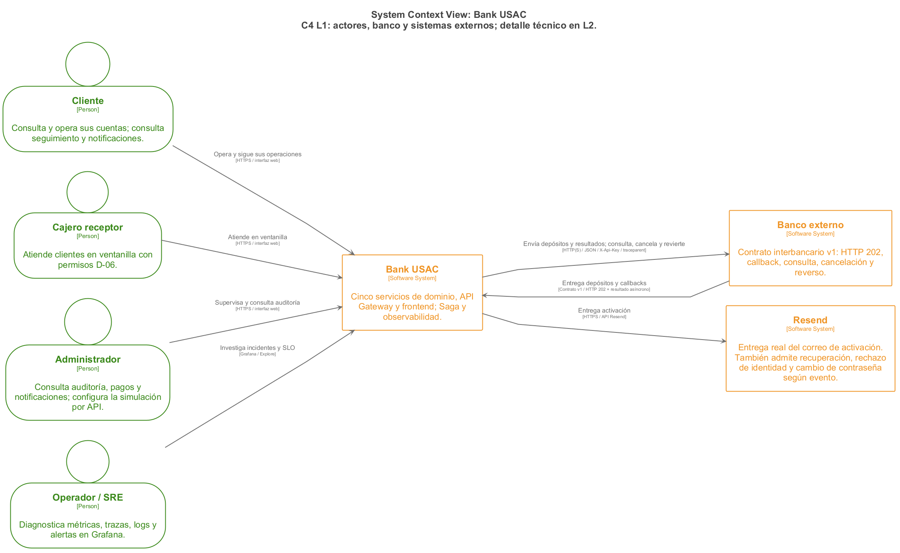

# C4 L1 — Contexto

[Fuente DSL](diagrams/02-c4-contexto.dsl), [modelo](diagrams/c4.dsl),
[PNG ampliado](diagrams/02-c4-contexto.png).

Cliente, cajero y administrador usan Bank USAC mediante el frontend. El
operador SRE consulta Grafana con un acceso separado del JWT bancario. Banco
participante y Resend son sistemas externos: el primero intercambia depósitos
mediante contrato v1 y callbacks; el segundo entrega los correos permitidos
por evento. BANK99 observado en producción es un mock, no evidencia de un
acuerdo ejecutado con otro grupo. L1 explica personas y límites; las
tecnologías, puertos y transportes internos se detallan en [L2](c4-container.md).
