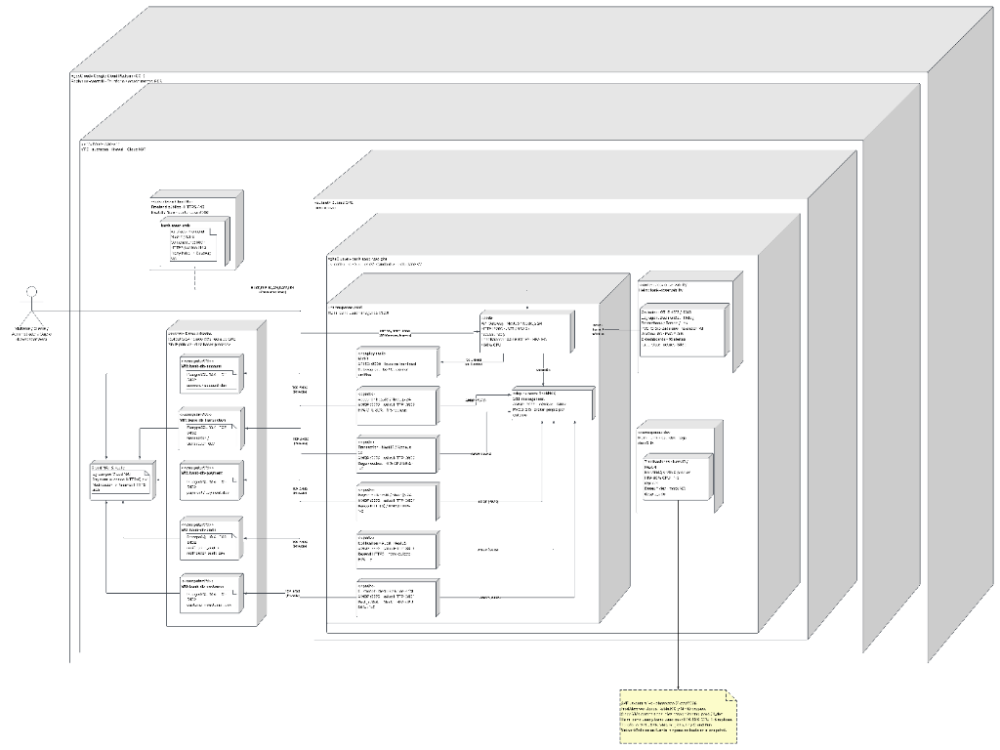

# Despliegue local y GCP — Fase III

La política del 2026-10-22 pide edición nativa de estas vistas en Lucid y
exportación sólo a PNG; los PUML se conservan como referencia semántica.
[ADR-024](adr/ADR-024-native-lucid-and-png-delivery.md) describe el cambio.
El estado de revisión/exportación se registra en la
[auditoría T-61](../qa/T-61-documentation-audit.md); una imagen existente no
certifica por sí sola que se haya completado la nueva edición.

## Local: kind, Docker y Helm

[PUML](diagrams/05-uml-despliegue.puml).
Los siete componentes corren en kind; cinco PostgreSQL, RabbitMQ y MinIO están
fuera del clúster en la red Docker. `kubectl port-forward` expone Web y Gateway
al host. `bank-usac` y `bank-observability` son charts distintos. El overlay
kind reduce recursos y retención: Prometheus 2h sin PVC, Tempo 24h/PVC 5Gi y
Loki/PVC 2Gi. No demuestra siete días de historial ni escalado HPA sin
metrics-server. Terraform corresponde al cloud, no crea el host local.
Procedimiento: [DEPLOYMENT.md](../operations/DEPLOYMENT.md).

## GCP: Terraform, GKE, Cloud Run y Helm

[PUML](diagrams/08-despliegue-cloud-gcp.puml).
Terraform declara VPC/subredes, Router/NAT, GKE, cinco VMs privadas PostgreSQL,
Artifact Registry, IP reservada y Cloud Run. GitHub Actions publica imágenes
versionadas y despliega por Helm mediante WIF; `terraform apply` sigue siendo
un procedimiento humano. El clúster observado es `bank-usac-vpc-gke`,
`us-central1-c`, tres nodos `e2-standard-2`, Dataplane V2.

| Límite | Estado contrastado el 2026-10-21 |
| --- | --- |
| `prod` | Siete aplicaciones v1.3.6, RabbitMQ con PVC 2Gi, MinIO y mock BANK99. |
| `dev` | Siete aplicaciones, broker/PVC y MinIO propios; banco externo desactivado. |
| Datos fuera de GKE | Cinco VMs sin IP pública; bases `customer`, `account`, `transaction`, `payment`, `notification_audit` y sus equivalentes `_dev`. |
| Observabilidad | Collector, tres agentes de logs, Prometheus/Tempo/Loki PVC 10Gi cada uno; Grafana PVC 2Gi; retención cloud configurada 7d. |
| Escalado | Siete HPA CPU 80%, mínimo 1/máximo 5; Account usa un lease distribuido. |
| Acceso público | Cloud Run HTTPS; Gateway y Grafana observados por HTTP. Las API keys no cifran el canal. |
| Red | Dataplane V2 habilitado; ninguna NetworkPolicy aplicada en los tres namespaces. |

El frontend Cloud Run y la carga `web` de GKE son despliegues distintos del
mismo componente. Las VMs/capacidad y observabilidad son compartidas; los datos
dev/prod están separados por nombre de base. No inferir aislamiento físico.
La existencia de plantillas de seguridad no prueba su activación. Inventarios,
pruebas y limitaciones: [evidencia cloud](../qa/backend/T-60-cloud-evidence.md).
Runbook completo: [CLOUD.md](../operations/CLOUD.md).
