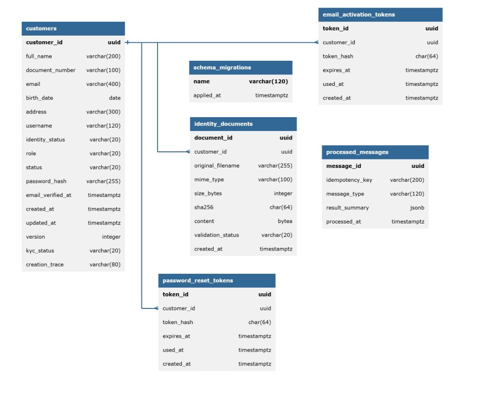
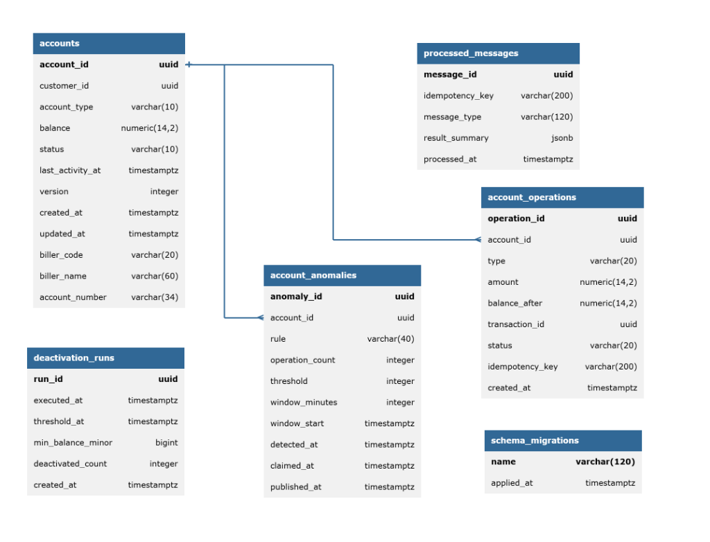
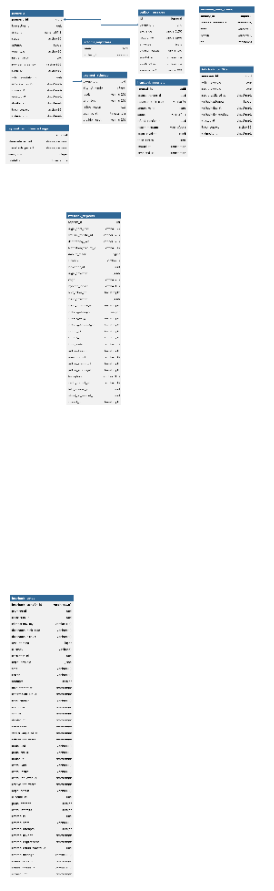
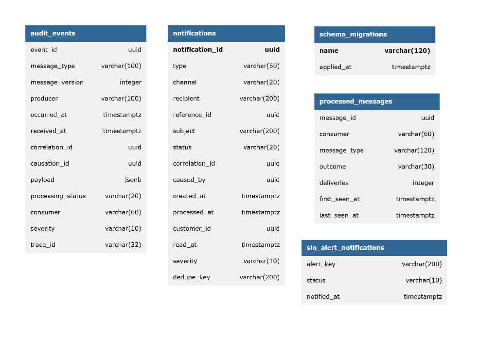

# Diagramas entidad–relación por servicio — Fase III

Los cinco diagramas reflejan el DDL **acumulado** de las migraciones del repositorio, revisado el 2026-10-21. No afirman que una instancia desplegada tenga todas las migraciones aplicadas. [El catálogo físico](../../../generated/db-schema.md) detalla cada columna, default, CHECK e índice; la fuente ejecutable sigue siendo `apps/services/*/src/infrastructure/persistence/migrations.ts`.

| Servicio | Migraciones | Tablas propias + migrador | Fuente | Exportación |
| --- | --- | --- | --- | --- |
| Customer | 001–009 | 5 + 1 | [DBML](customer-er.dbml) | [PNG](customer-er.png) |
| Account | 001–010 | 5 + 1 | [DBML](account-er.dbml) | [PNG](account-er.png) |
| Transaction | 001–012 | 6 + 1 | [DBML](transaction-er.dbml) | Pendiente de exportación |
| Payment | 001–018 | 9 + 1 | [DBML](payment-er.dbml) | [PNG](payment-er.png) |
| Notification & Audit | 001–007 | 4 + 1 | [DBML](notification-audit-er.dbml) | [PNG](notification-audit-er.png) |

`schema_migrations` es infraestructura del migrador: se crea antes de recorrer `MIGRATIONS`, en cada base, y no es una entidad bancaria. Se incluye para que “todas las tablas” tenga un significado físico verificable. `account_number_seq` es una secuencia, documentada en el catálogo, y no se dibuja como tabla.

Las PK, FK y nulabilidad aparecen junto a las columnas. Los índices parciales conservan su predicado en `note`, porque DBML no expresa `WHERE` como propiedad de índice. Los CHECK conservan su SQL completo en la nota de tabla y en el catálogo; no se presentan enumeraciones de aplicación como restricciones inexistentes. La marca de tiempo física `interbank_sends.decided_at` incluye TIMEOUT por compatibilidad de su CHECK, aunque TIMEOUT **ya no es un veredicto de negocio**.

Sólo las once FK **declaradas en SQL** producen líneas. `customer_id`, referencias de cuentas, `original_transfer_id`, `hold_reversal_id` y referencias entre servicios no reciben FK inventadas. Un ER físico no convierte una asociación lógica en acoplamiento de datos.

## 1. Customer Service (`customer_db`)



[Fuente DBML: ER de Customer Service](customer-er.dbml)

Identidad, fotografía, activación y recuperación; añade KYC, contexto de traza y tamaños físicos ampliados de correo/documento/usuario para liberar sus valores al rechazar una identidad. Los límites de entrada del DTO no se amplían por ello. Tres FK locales con `ON DELETE CASCADE`; SHA-256 único, correo único normalizado y tokens almacenados como digest.

## 2. Account Service (`account_db`)



[Fuente DBML: ER de Account Service](account-er.dbml)

Account es el único escritor del saldo. `NUMERIC(14,2)`, bloqueo de fila, versión y CHECK de no negatividad se complementan. `COMMISSION` forma parte del libro y se devuelve en compensación. `account_anomalies` registra alta frecuencia sin bloquear. El número público `02-NNNNNNNNN` convive con el UUID interno y permite interoperar con el límite de 34 caracteres del contrato oficial.

## 3. Transaction Service (`transaction_db`)

[Fuente DBML: ER de Transaction Service](transaction-er.dbml)

La Saga conserva seis estados. `transaction_events` registra mensajes y rechazos de transición; `transaction_transitions` registra cada transición legal junto a su cambio de estado. El outbox conserva el contexto W3C. `transactions.interbank` es contexto del pago externo y no una relación SQL con Payment. Las cuentas siguen siendo opacas y no se lee un saldo desde aquí.

## 4. Payment Service (`payment_db`)



[Fuente DBML: ER de Payment Service](payment-er.dbml)

Nueve tablas propias: pago e intentos, outbox, simulación, depósitos entrantes, conflictos, envíos, reversos recibidos e historial de envíos. Los plazos, consultas/cancelaciones, reverso automático, identificación y liquidación del reembolso y arrendamientos (`claimed_until`) son columnas persistidas. El `payment_id` del outbox admite NULL: un veredicto interbancario no necesita crear una fila ficticia en `payments`. Los porcentajes de simulación usan `DOUBLE PRECISION`; el dinero nunca lo hace.

## 5. Notification & Audit Service (`notification_audit_db`)



[Fuente DBML: ER de Notification & Audit Service](notification-audit-er.dbml)

Auditoría redactada antes del INSERT, deduplicada por evento y consumidor, con `trace_id` opcional y filtros por productor/severidad. Las notificaciones tienen destinatario de buzón y clave de repetición. `slo_alert_notifications` controla `firing` y `resolved`; escuchar una alerta no da al servicio autoridad sobre una Saga. No hay FK locales declaradas: no se añaden por el parecido de los identificadores.

## Edición y validación

Los modelos DBML y sus exportaciones gráficas corresponden a las 5 bases de datos de Bank USAC. Cuatro de las exportaciones PNG han sido incorporadas y Transaction conserva su fuente DBML validada. [ADR-024](../../adr/ADR-024-native-lucid-and-png-delivery.md) registra la política de fuentes y entrega.

1. Modificar el DBML a partir del resultado acumulado de las migraciones;
   comprobar tipos, nulabilidad, defaults, índices y restricciones, incluyendo
   eliminaciones y sustituciones.
2. Validar con el parser oficial de DBML. `dbml2sql <archivo.dbml> --postgres
   -o <salida-temporal.sql>` es una opción donde el CLI resuelva las rutas;
   la comprobación en memoria de abajo documenta la alternativa usada en
   Windows. El SQL exportado es sólo una comprobación de sintaxis: **no es
   una migración**, no debe aplicarse y no preserva por sí solo los CHECK o
   predicados WHERE documentados como notas.
3. El solicitante exportará los ER en PNG. Antes de volver a incrustarlos,
   revisar nombres, claves, cardinalidades, direcciones, nulabilidad,
   legibilidad y ausencia de recortes contra DBML y el catálogo acumulado.
   La validación de sintaxis no demuestra esa revisión visual.

### Validación DBML ejecutada en T-61 (Windows)

El CLI oficial `@dbml/cli` 10.3.1 falló antes de leer los modelos al convertir
la ruta absoluta Windows a una cadena codificada. Se usó su parser oficial
`@dbml/core` 10.3.1 en memoria, formato `dbmlv2`: **cinco modelos válidos,
34 tablas y once FK**, con exportación PostgreSQL sólo a archivos temporales.
[Resultado por archivo](../../../qa/verification/T-61-dbml.json).
No se aplicó ese SQL ni se alteraron migraciones.

Para reproducirlo, instala `@dbml/core@10.3.1` con npm en una carpeta temporal
ajena a las dependencias del workspace. Guarda allí `verify.cjs`, junto a su
`node_modules`, y ejecuta `node <temporal>/verify.cjs <raíz-del-repositorio>`:

```javascript
const fs = require('node:fs');
const path = require('node:path');
const { Parser, ModelExporter } = require('@dbml/core');
const folder = path.join(process.argv[2], 'docs/architecture/diagrams/er');
for (const name of fs.readdirSync(folder).filter(n => n.endsWith('.dbml'))) {
  const model = Parser.parse(fs.readFileSync(path.join(folder, name), 'utf8'), 'dbmlv2');
  const sql = ModelExporter.export(model, 'postgres');
  console.log(name, 'tables:', model.schemas.reduce((n, s) => n + s.tables.length, 0),
    'FK:', (sql.match(/ADD FOREIGN KEY/g) || []).length);
}
```

El parser confirma sintaxis y referencias locales del modelo. La equivalencia
con las migraciones se revisa además mediante el catálogo acumulado: una
exportación exitosa no comprueba por sí sola CHECK, predicados ni datos vivos.
