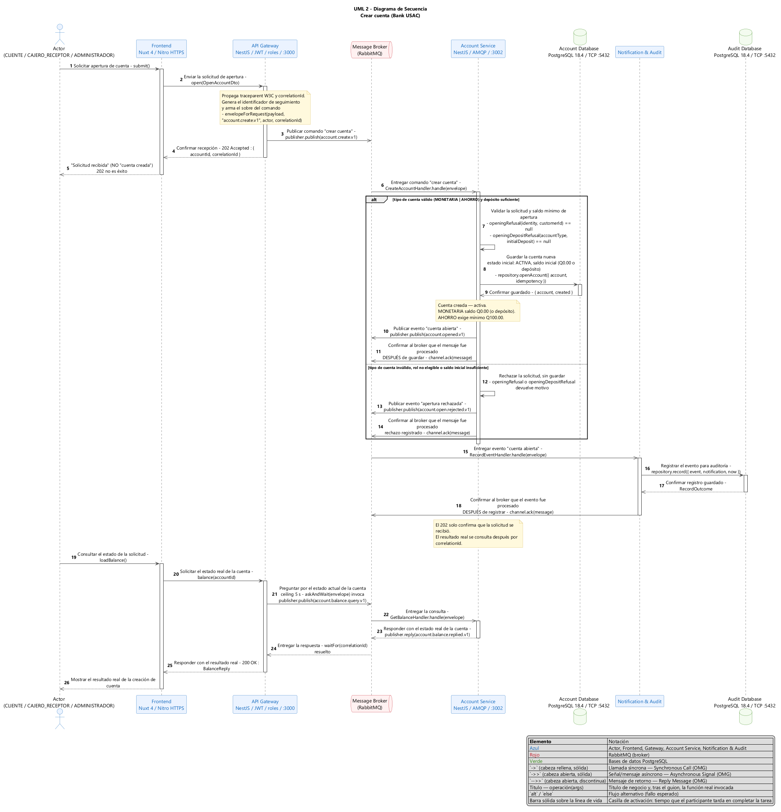

# Secuencia — Crear cuenta

[PUML](diagrams/06-uml-secuencia-crear-cuenta.puml).
Frontend Nuxt → Gateway NestJS con JWT/rol → comando AMQP `account.create.v1`.
El **202** confirma recepción, no creación. Account valida tipo/actor y depósito
inicial: MONETARIA admite Q0; AHORRO exige Q100. La cuenta ACTIVA, dedup y evento
se persisten bajo las garantías de su repositorio PostgreSQL. Un rechazo no
crea cuenta. Auditoría recibe el evento, redacta y registra una sola vez por
consumidor. La consulta posterior confirma el resultado real; request/reply
tiene un techo de 5s. `correlationId` sigue la operación y `traceparent` la
traza distribuida; no son claves de idempotencia.
