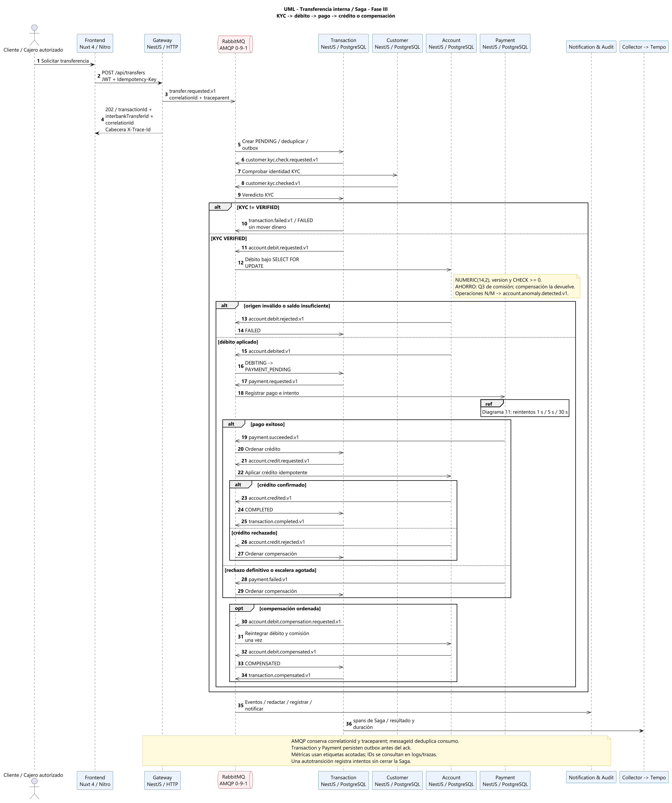
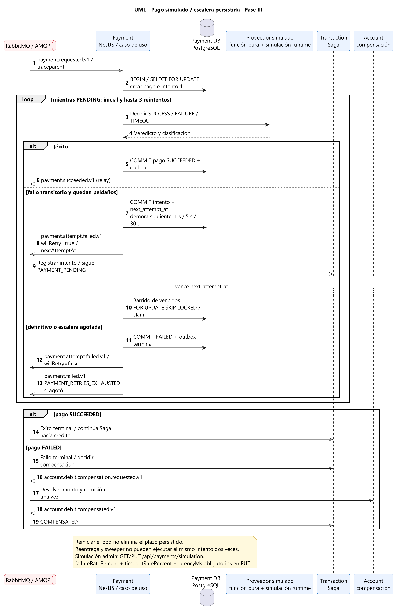

# Secuencia — Transferencia, reintentos y compensación

[PUML](diagrams/07-uml-secuencia-transferencia.puml).
El Gateway devuelve 202 y Transaction crea/deduplica la Saga. Customer decide
KYC; un cliente no VERIFIED falla antes de mover dinero. Account decide débito
bajo row lock, con saldo exacto, versión y CHECK no negativo. AHORRO cobra Q3
en la misma operación. Transaction no lee balances.

Payment decide el intento; el éxito permite ordenar crédito. Un rechazo
terminal o crédito rechazado ordena compensación. Account devuelve débito y
comisión una sola vez; sólo su evento confirmado permite COMPENSATED.
Outbox y dedup separan entrega al menos una vez de efecto monetario único.

[Fuente](diagrams/11-secuencia-reintentos-pago.puml). Inicial + hasta tres
reintentos con demoras 1/5/30s; `next_attempt_at` sobrevive al pod. Cada fallo
emite un intento observable, y sólo el terminal cierra el paso. `GET/PUT
/api/payments/simulation` es administrativo; no hay editor de simulación UI.
Las pruebas cloud observan un p95 de 10.4061s con fallos inyectados: la
resiliencia no garantiza cumplir el SLO de 5s ([evidencia](../qa/backend/T-60-cloud-evidence.md)).

Los depósitos externos no se simplifican a esta secuencia: véanse
[envío](diagrams/09-secuencia-envio-interbancario.png),
[recepción](diagrams/10-secuencia-recepcion-interbancaria.png) y
[protocolo v1](../operations/INTERBANK.md). TIMEOUT conserva la reserva hasta
resolver sondeo/cancelación o el margen de seguridad; un callback tardío puede
iniciar un reverso saliente y devolución a liquidación.
