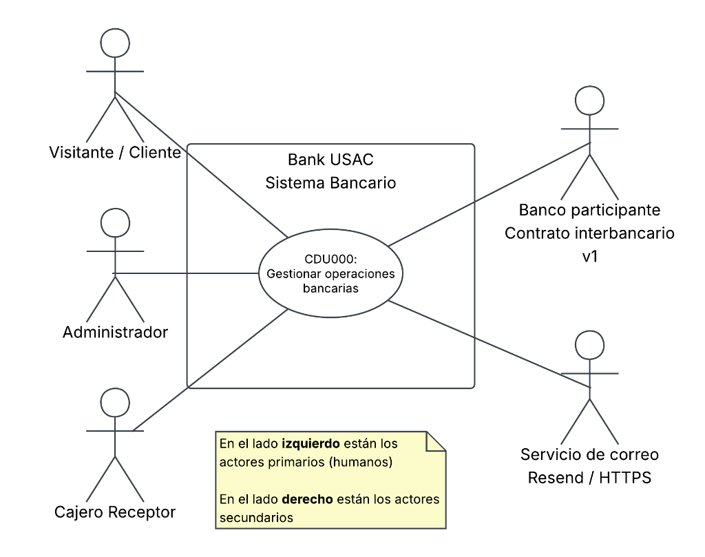
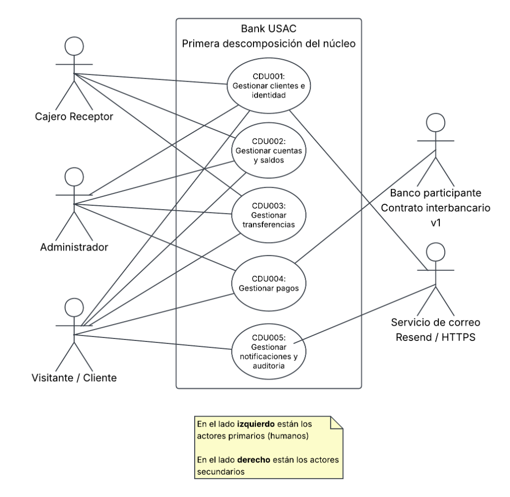
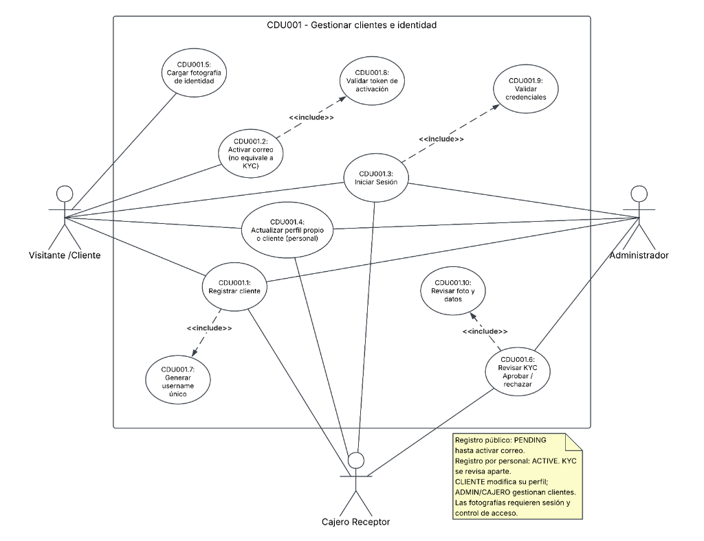
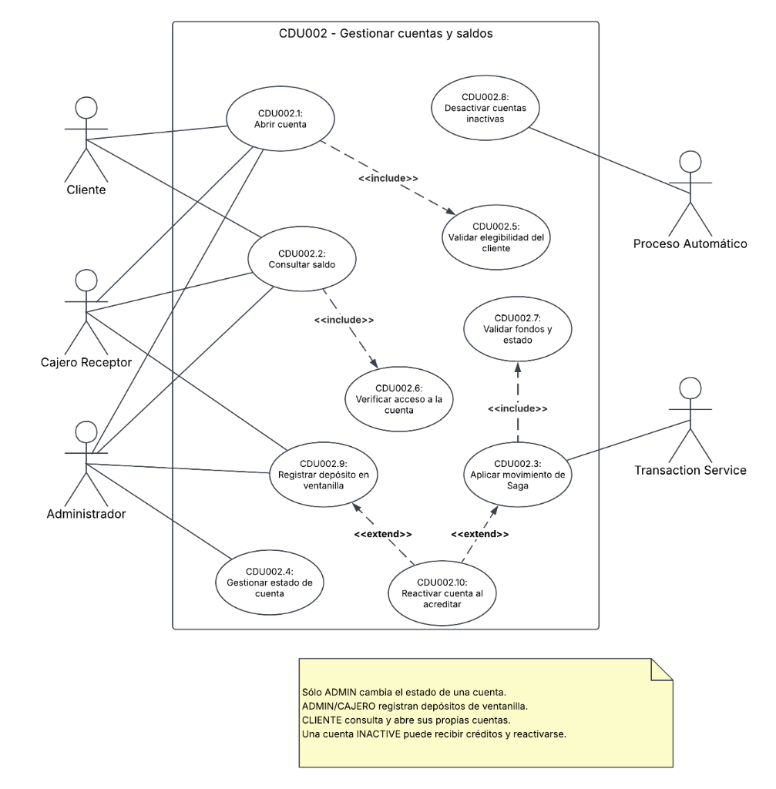
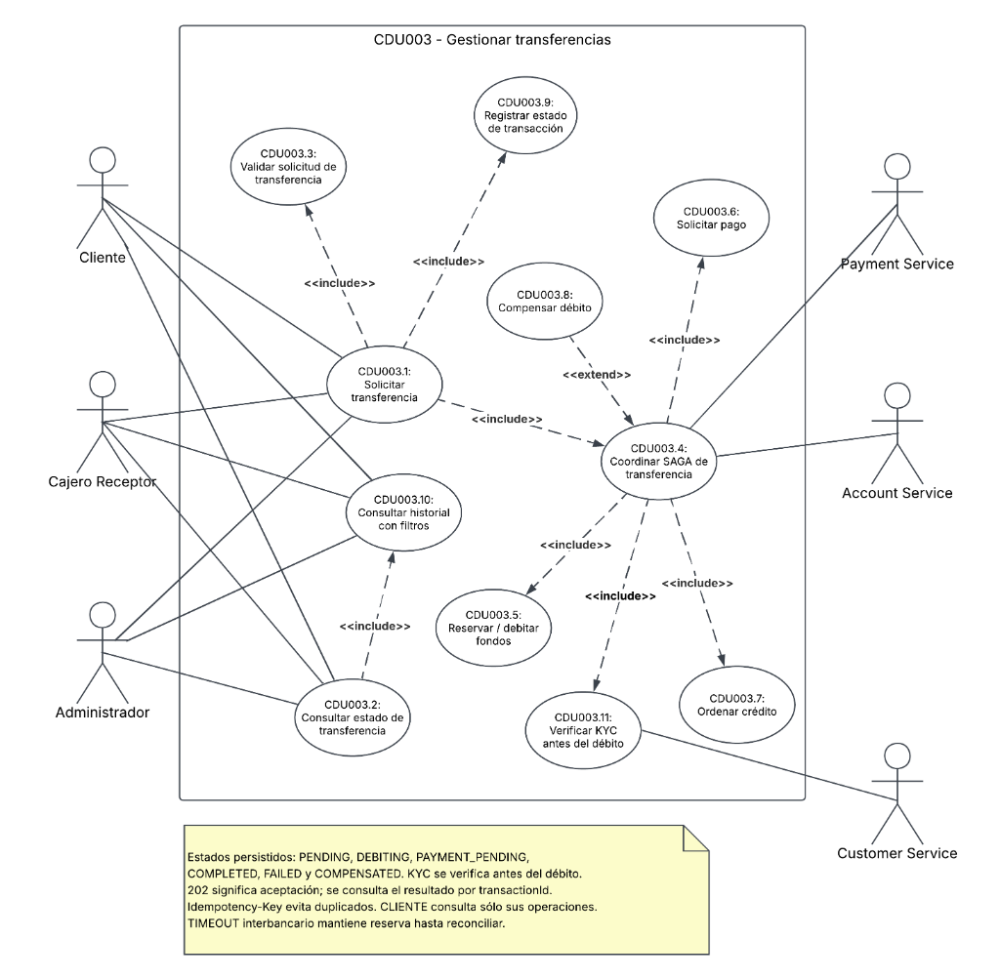
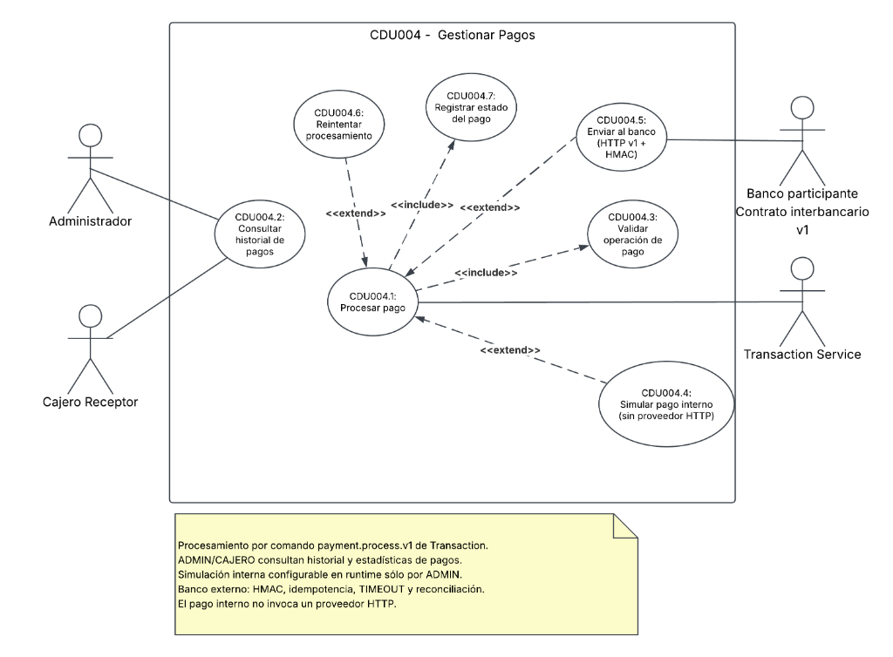
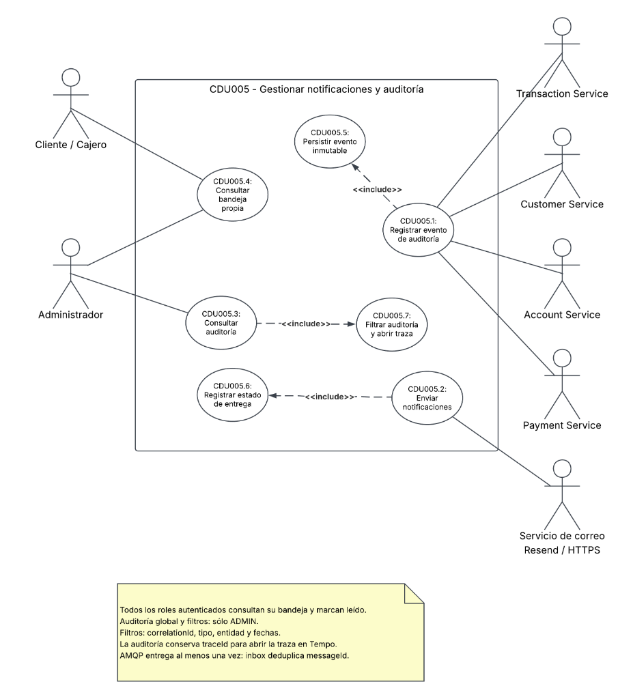
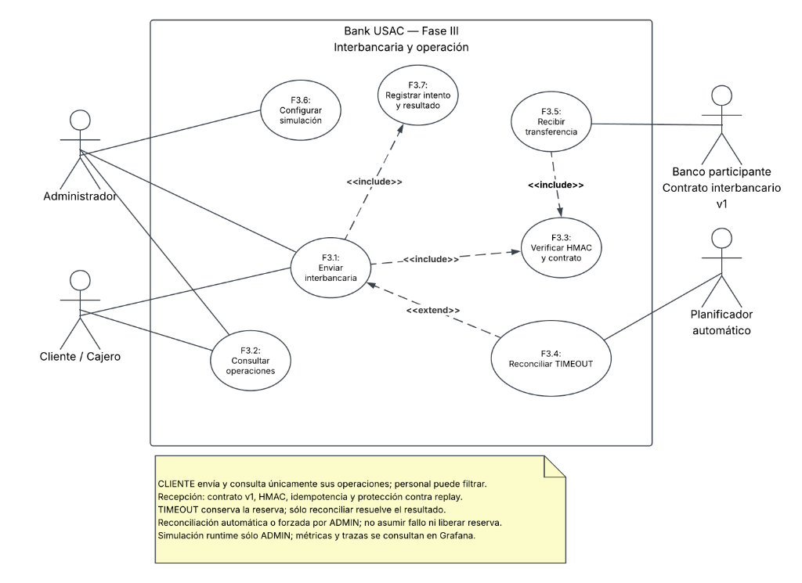

# Diagramas y Especificación de Casos de Uso (UML) — Bank USAC

Este documento consolida la especificación formal y la jerarquía de **Casos de Uso de Bank USAC**, combinando los diagramas visuales UML con la especificación textual detallada de cada flujo de negocio (actores, precondiciones, entradas, secuencias asíncronas y excepciones esperadas).

La política del 2026-10-22 exige figuras y conectores nativos de Lucid para los
casos de uso y entrega sólo en PNG. Los enlaces PlantUML de abajo conservan
la fuente semántica para cotejo; no certifican la nueva edición o exportación
de Lucid. [ADR-024](adr/ADR-024-native-lucid-and-png-delivery.md) registra la
decisión y la [auditoría T-61](../qa/T-61-documentation-audit.md) su avance.

---

## 1. Nivel Macro: Alto Nivel del Sistema (`CDU000`)

Muestra a Bank USAC como una caja negra en el nivel de negocio. A la izquierda se encuentran los actores primarios (humanos) y a la derecha los actores secundarios (sistemas externos de apoyo).

Fuentes: [PlantUML (`00-alto-nivel.puml`)](diagrams/cdu/00-alto-nivel.puml)

---

## 2. Primera Descomposición Funcional (`CDU001` - `CDU005`)

Descompone el núcleo del banco en sus cinco funciones principales, correspondientes a cada microservicio de dominio:

Fuentes: [PlantUML (`01-primera-descomposicion.puml`)](diagrams/cdu/01-primera-descomposicion.puml)

---

## 3. Detalle de Casos de Uso por Microservicio

### A. Customer Service (`CDU001 - Gestionar clientes e identidad`)
* Registro de usuario, carga de fotografía de DPI, activación por correo, inicio de sesión y validación de identidad por mesa de control.
* Diagrama: 
* Fuentes: [PlantUML](diagrams/cdu/customer/customer-casos-de-uso.puml)

### B. Account Service (`CDU002 - Gestionar cuentas y saldos`)
* Apertura de cuentas, consulta de saldos, movimientos contables de la Saga, depósito en ventanilla y proceso automático de desactivación por inactividad.
* Diagrama: 
* Fuentes: [PlantUML](diagrams/cdu/account/account-casos-de-uso.puml)

### C. Transaction Service (`CDU003 - Gestionar transferencias`)
* Transferencias de fondos, consulta de estado, coordinación de la Saga coreografiada, orden de débito, solicitud de pago y compensación contable.
* Diagrama: 
* Fuentes: [PlantUML](diagrams/cdu/transaction/transaction-casos-de-uso.puml)

### D. Payment Service (`CDU004 - Gestionar pagos`)
* Procesamiento de cobros a facturadores, escalera de reintentos con backoff exponencial y emisión de desenlaces terminales.
* Diagrama: 
* Fuentes: [PlantUML](diagrams/cdu/payment/payment-casos-de-uso.puml)

### E. Notification & Audit Service (`CDU005 - Gestionar notificaciones y auditoría`)
* Registro inmutable de eventos con datos personales redactados, consulta de auditoría filtrada por `correlationId` y entrega de alertas al buzón personal.
* Diagrama: 
* Fuentes: [PlantUML](diagrams/cdu/notification-audit/notification-audit-casos-de-uso.puml)

---

## 4. Especificación Detallada de Flujos de Negocio

### Caso de Uso 1: Registrar Cliente
* **Actor**: Visitante anónimo o personal de agencia (`CAJERO_RECEPTOR` / `ADMINISTRADOR`) en nombre del cliente.
* **Precondiciones**: Ninguna.
* **Datos de Entrada**: Nombre completo, documento DPI (13 dígitos), correo electrónico, fecha de nacimiento, dirección y contraseña.
* **Resultado Observable**: Se crea un `Customer` en la base de datos con `username` generado determinísticamente, estado `PENDING_ACTIVATION` e `identityStatus = PENDING`.
* **Secuencia**:
  1. El API Gateway publica `customer.register.v1` en RabbitMQ.
  2. Customer Service valida unicidad de DPI, correo y fecha de nacimiento; persiste el registro y emite `customer.registered.v1`.
  3. Notification & Audit Service almacena el evento en la bitácora inmutable.
* **Manejo de Errores**:
  * DPI ya registrado: Se rechaza con `DOCUMENT_ALREADY_REGISTERED` (C-1).
  * Correo ya registrado: Se rechaza con `EMAIL_ALREADY_REGISTERED` (C-3).
  * Fecha de nacimiento incoherente: Se rechaza con `INVALID_BIRTH_DATE` (C-5).
  * Colisión de username: Se resuelve automáticamente agregando sufijo numérico incremental (`juanperez2`).

---

### Caso de Uso 2: Abrir Cuenta Bancaria
* **Actor**: `CLIENTE` (para sí mismo tras validación) o `CAJERO_RECEPTOR` / `ADMINISTRADOR`.
* **Precondiciones**: El cliente debe existir en el sistema y poseer rol `CLIENTE` con identidad aprobada.
* **Datos de Entrada**: Identificador `customerId`, tipo de cuenta (`MONETARIA` o `AHORRO`).
* **Resultado Observable**: Se crea una `Account` en `account_db` con saldo inicial de `Q 0.00`, estado `ACTIVE` y el tipo solicitado.
* **Secuencia**:
  1. El Gateway publica el comando `account.create.v1`.
  2. Account Service persiste la cuenta almacenando `customerId` como referencia opaca (sin hacer joins ni consultas cross-database hacia Customer DB). Emite `account.opened.v1`.
  3. Notification & Audit registra la apertura y encola notificación de bienvenida.
* **Manejo de Errores**:
  * El usuario es empleado bancario: Se rechaza con `ROLE_NOT_ELIGIBLE` (C-6).
  * Tipo de cuenta no válido: Se rechaza la solicitud antes de persistir.

---

### Caso de Uso 3: Consultar Saldo
* **Actor**: `CLIENTE` sobre sus propias cuentas; `CAJERO_RECEPTOR` y `ADMINISTRADOR` sobre cualquier cuenta.
* **Precondiciones**: Usuario debidamente autenticado con JWT; la cuenta debe existir.
* **Datos de Entrada**: `accountId`.
* **Resultado Observable**: Se retorna el saldo actual exacto en Quetzales.
* **Secuencia**:
  1. El Gateway envía un mensaje request/reply asíncrono hacia Account Service.
  2. Account Service responde con el saldo contable exacto.
  3. *Regla de Actividad*: Consultar el saldo **no actualiza** la fecha `lastActivityAt`. Mirar una cuenta no es un movimiento de fondos.

---

### Caso de Uso 4: Activar Cuenta por Correo Electrónico
* **Actor**: `CLIENTE`.
* **Precondiciones**: Usuario registrado en estado `PENDING_ACTIVATION`.
* **Datos de Entrada**: Primer intento de inicio de sesión y posterior clic en el enlace con token firmado.
* **Resultado Observable**: `emailVerifiedAt` queda registrado con marca de tiempo y `status` transiciona a `ACTIVE`.
* **Secuencia**:
  1. Customer Service genera el token criptográfico con hash SHA-256 de 24 horas de vigencia y emite `customer.activation.requested.v1`.
  2. Notification & Audit envía el correo simulado con el enlace.
  3. Al pulsar el enlace, el Gateway publica `customer.verify-email.v1`.
  4. Customer Service valida el token, activa la cuenta y emite `customer.email.verified.v1`.
* **Manejo de Errores**:
  * Token expirado o reutilizado: Se rechaza con `ACTIVATION_TOKEN_INVALID` sin modificar el estado (C-7).

---

### Caso de Uso 5: Inicio de Sesión (Login)
* **Actor**: Cualquier rol registrado.
* **Datos de Entrada**: Correo electrónico y contraseña (el correo es el identificador de acceso, ADR D-05).
* **Secuencia**:
  1. Customer Service verifica el hash de la contraseña mediante `scrypt`.
  2. Si es válida y `emailVerifiedAt` existe: retorna claims (`customerId`, `role`, `status`) y emite `customer.login.succeeded.v1`.
  3. Si es válida pero el correo no ha sido verificado: deniega acceso con `ACCOUNT_PENDING_ACTIVATION` y reenvía enlace de activación.
  4. Si la contraseña es errónea: deniega acceso con error genérico homogéneo `INVALID_CREDENTIALS` (ADR D-04).

---

### Caso de Uso 6: Transferencia Monetaria con Saga
* **Actor**: `CLIENTE` desde sus cuentas; `CAJERO_RECEPTOR` en ventanilla.
* **Precondiciones**: Cuentas origen y destino deben existir; cuenta origen debe estar `ACTIVE` y poseer saldo suficiente.
* **Datos de Entrada**: `sourceAccount`, `targetAccount`, `amount` (> 0), `idempotencyKey`.
* **Resultado Observable**: El monto se debita de la cuenta origen y se acredita en la cuenta destino, cerrando la Saga en `COMPLETED`.
* **Secuencia de 7 Pasos**:
  1. `Transaction Service`: Valida monto y unicidad de idempotencia. Crea transacción en `PENDING` $\rightarrow$ `DEBITING`. Publica `account.debit.requested.v1`.
  2. `Account Service`: Aplica bloqueo `SELECT ... FOR UPDATE`, verifica saldo $\ge$ monto, aplica débito y actualiza `lastActivityAt`. Emite `account.debited.v1`.
  3. `Transaction Service`: Transiciona a `PAYMENT_PENDING`. Publica `payment.requested.v1`.
  4. `Payment Service`: Procesa el cobro con escalera de reintentos. Emite `payment.succeeded.v1`.
  5. `Transaction Service`: Ordena la acreditación hacia la cuenta destino.
  6. `Account Service`: Acredita el dinero. Si la cuenta destino estaba inactiva, la reactiva automáticamente. Emite `account.credited.v1`.
  7. `Transaction Service`: Cierra en `COMPLETED` y emite `transaction.completed.v1`.
* **Compensación Contable**:
  * Si el débito falla inicialmente: Cierra en `FAILED` (no hay nada que deshacer porque el dinero nunca salió).
  * Si el pago posterior falla o se agotan los reintentos: Se ejecuta la compensación. `Account Service` devuelve el dinero exacto a la cuenta origen mediante un registro formal `COMPENSATION` y la transacción culmina en `COMPENSATED`.

## Extensiones Fase III

[Fuente](diagrams/13-casos-uso-fase3.puml). Complementa la jerarquía CDU
histórica con depósitos v1, notificaciones, simulación administrativa,
anomalías N/M y observabilidad. Los permisos efectivos están en
[actores](../domain/actors.md); el acceso SRE a Grafana es independiente del
JWT bancario. Los flujos detallados actuales son los de
[casos de uso](../domain/use-cases.md).
