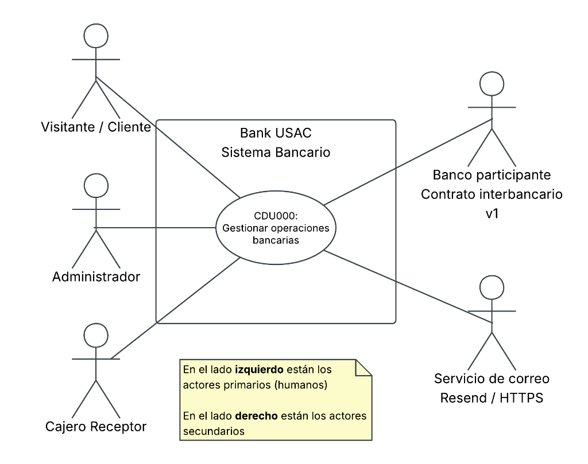
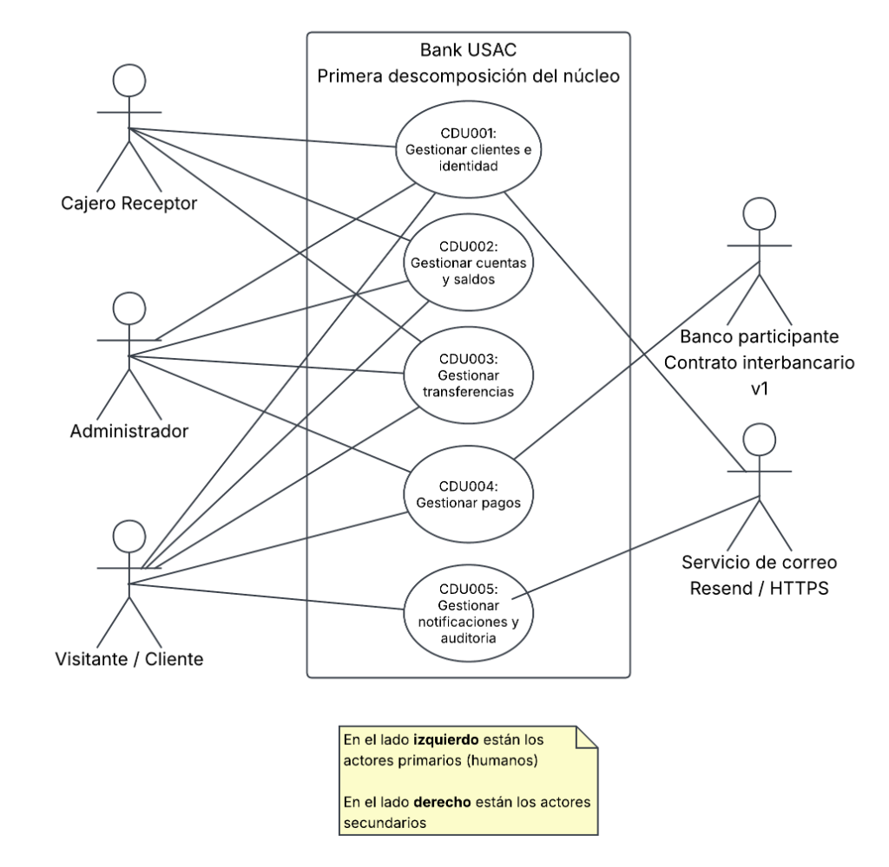
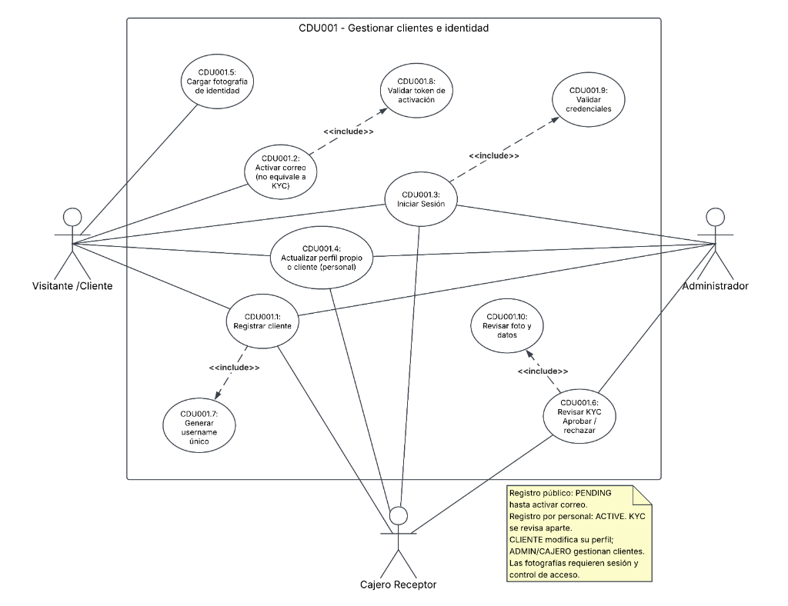
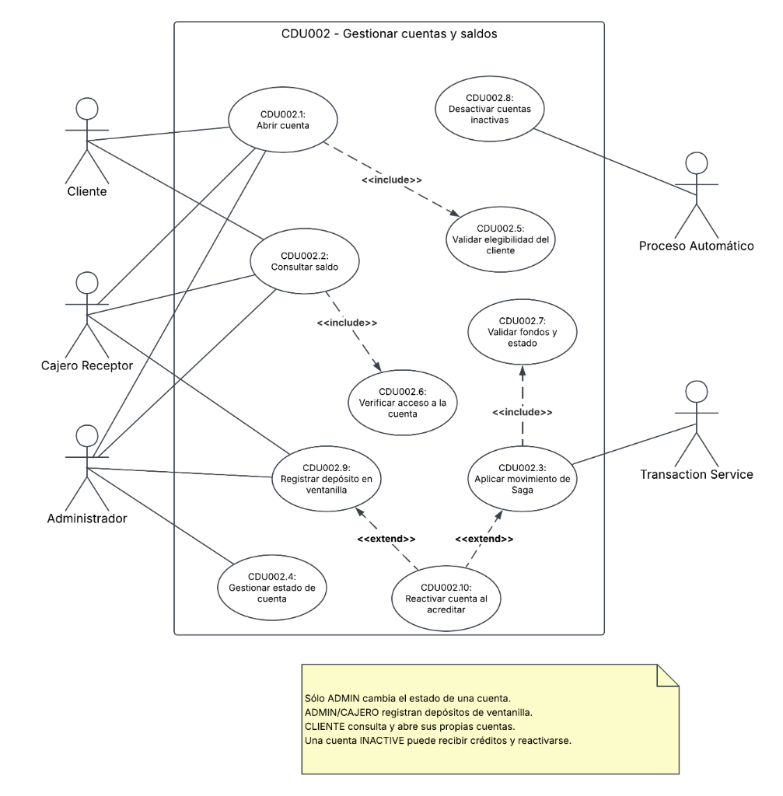
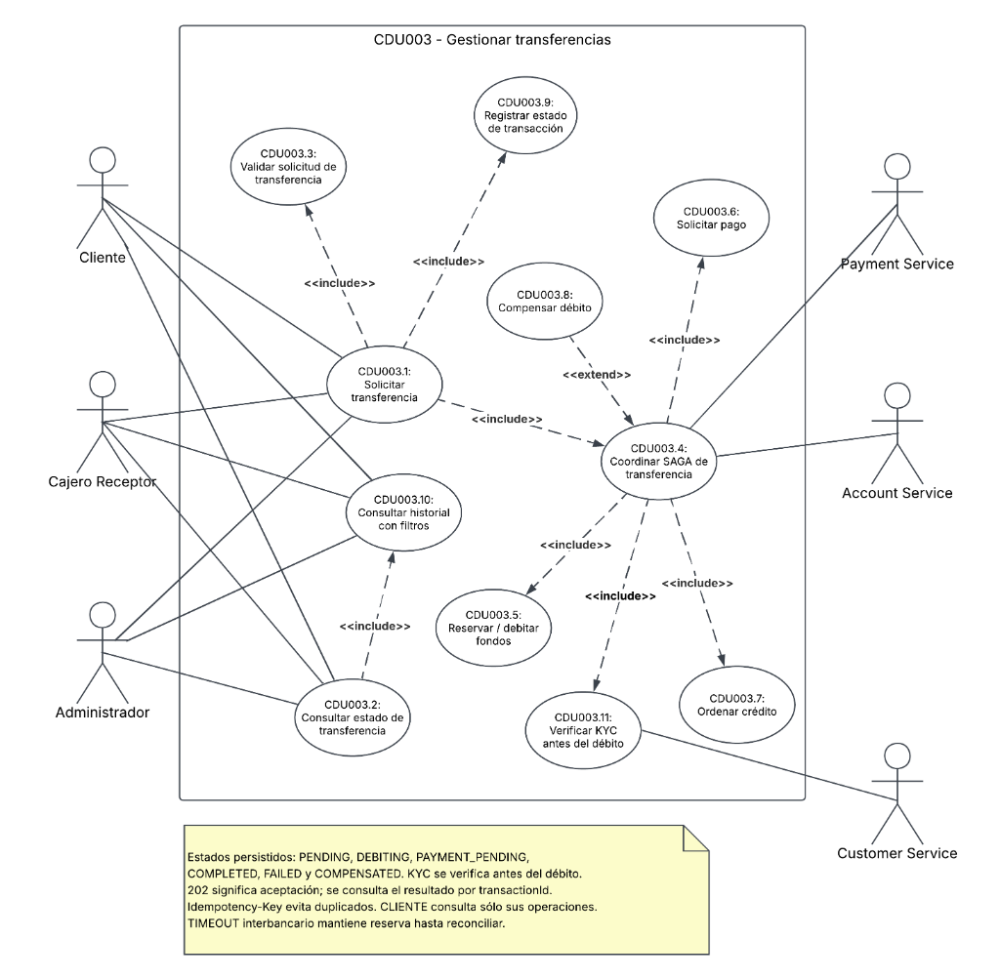
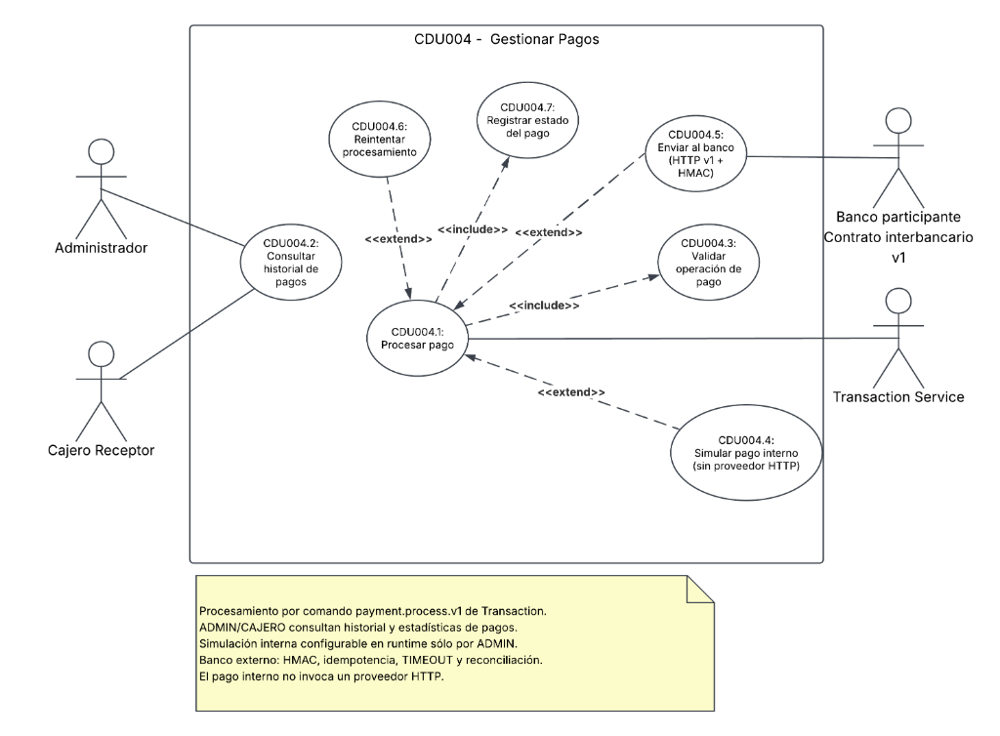
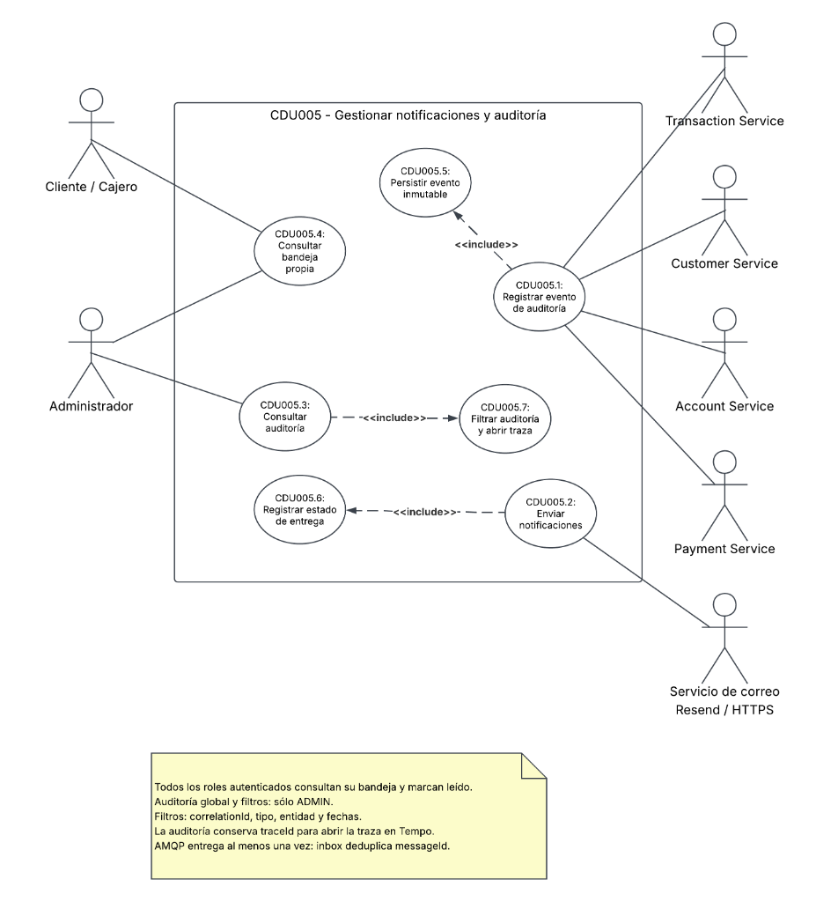
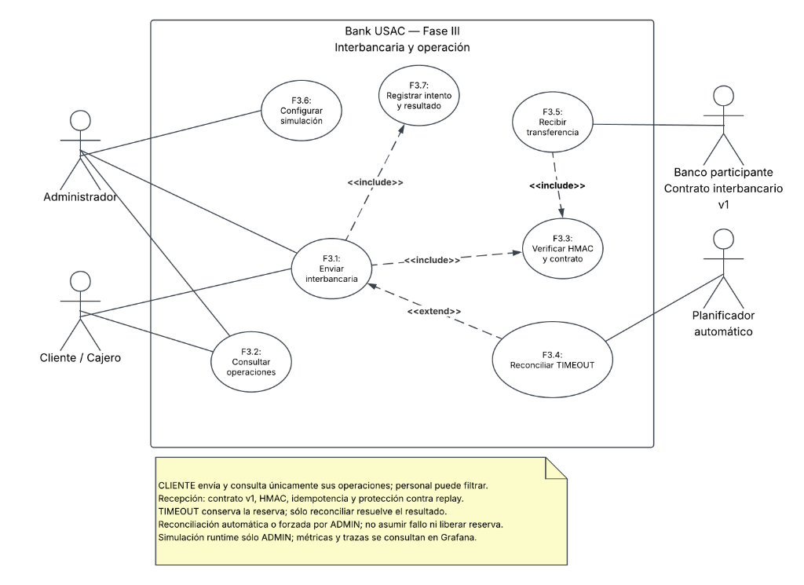

# Documento de Decisión y Diseño de Arquitectura (DDA) — Bank USAC

---

## Índice

- [Documento de Decisión y Diseño de Arquitectura (DDA) — Bank USAC](#documento-de-decisión-y-diseño-de-arquitectura-dda--bank-usac)
  - [Índice](#índice)
  - [1. Caso del Negocio](#1-caso-del-negocio)
    - [1.1. Contexto y Visión del Sistema](#11-contexto-y-visión-del-sistema)
    - [1.2. Actores del Sistema](#12-actores-del-sistema)
    - [1.3. Diagrama de Casos de Uso de Negocio — Alto Nivel (CDU000)](#13-diagrama-de-casos-de-uso-de-negocio--alto-nivel-cdu000)
    - [1.4. Primera Descomposición Funcional por Microservicio](#14-primera-descomposición-funcional-por-microservicio)
  - [2. Listado de Stakeholders y Preocupaciones Arquitectónicas](#2-listado-de-stakeholders-y-preocupaciones-arquitectónicas)
  - [3. Características del Sistema Priorizadas](#3-características-del-sistema-priorizadas)
    - [3.1. Prioridad 1: Críticas (Mandatorias para la Operación Bancaria)](#31-prioridad-1-críticas-mandatorias-para-la-operación-bancaria)
    - [3.2. Prioridad 2: Altas (Necesarias para la Escalabilidad y Cumplimiento)](#32-prioridad-2-altas-necesarias-para-la-escalabilidad-y-cumplimiento)
    - [3.3. Prioridad 3: Medias (Soporte Operativo y Experiencia de Usuario)](#33-prioridad-3-medias-soporte-operativo-y-experiencia-de-usuario)
  - [4. Drivers de Requisitos Funcionales](#4-drivers-de-requisitos-funcionales)
    - [4.1. Catálogo General de Requisitos Funcionales](#41-catálogo-general-de-requisitos-funcionales)
    - [4.2. CDU001 – Gestión de Clientes e Identidad (Customer Service)](#42-cdu001--gestión-de-clientes-e-identidad-customer-service)
    - [4.3. CDU002 – Gestión de Cuentas y Saldos (Account Service)](#43-cdu002--gestión-de-cuentas-y-saldos-account-service)
    - [4.4. CDU003 – Gestión de Transferencias y Saga (Transaction Service)](#44-cdu003--gestión-de-transferencias-y-saga-transaction-service)
    - [4.5. CDU004 – Gestión de Pagos a Proveedores (Payment Service)](#45-cdu004--gestión-de-pagos-a-proveedores-payment-service)
    - [4.6. CDU005 – Gestión de Notificaciones y Auditoría (Notification & Audit Service)](#46-cdu005--gestión-de-notificaciones-y-auditoría-notification--audit-service)
    - [4.7. Historias de Usuario (HU)](#47-historias-de-usuario-hu)
  - [5. Drivers de Calidad (Requisitos No Funcionales y EAC)](#5-drivers-de-calidad-requisitos-no-funcionales-y-eac)
    - [5.1. Requisitos No Funcionales (RNF)](#51-requisitos-no-funcionales-rnf)
    - [5.2. Escenarios de Atributos de Calidad (EAC)](#52-escenarios-de-atributos-de-calidad-eac)
      - [EAC-01: Disponibilidad y Recuperación ante Fallos (Crítico)](#eac-01-disponibilidad-y-recuperación-ante-fallos-crítico)
      - [EAC-02: Consistencia Transaccional y Rendimiento Financiero (Crítico)](#eac-02-consistencia-transaccional-y-rendimiento-financiero-crítico)
      - [EAC-03: Seguridad, Autenticación y Autorización RBAC (Alto)](#eac-03-seguridad-autenticación-y-autorización-rbac-alto)
      - [EAC-04: Modificabilidad y Desacoplamiento por Eventos (Alto)](#eac-04-modificabilidad-y-desacoplamiento-por-eventos-alto)
      - [EAC-05: Auditabilidad Forense e Inmutabilidad (Alto)](#eac-05-auditabilidad-forense-e-inmutabilidad-alto)
      - [EAC-06: Portabilidad y Resiliencia en Contenedores (Medio)](#eac-06-portabilidad-y-resiliencia-en-contenedores-medio)
  - [6. Drivers de Restricción](#6-drivers-de-restricción)
  - [7. Matrices de Trazabilidad](#7-matrices-de-trazabilidad)
    - [7.1. Matriz RF vs. Stakeholders](#71-matriz-rf-vs-stakeholders)
    - [7.2. Matriz RF vs. RNF](#72-matriz-rf-vs-rnf)
    - [7.3. Matriz CDU vs. EAC](#73-matriz-cdu-vs-eac)
    - [7.4. Matriz CDU vs. Actores (Matriz de Autorización D-06)](#74-matriz-cdu-vs-actores-matriz-de-autorización-d-06)
    - [7.5. Matriz HU vs. RF](#75-matriz-hu-vs-rf)
    - [7.6. Matriz HU vs. CDU](#76-matriz-hu-vs-cdu)

---

> Revisión del estado implementado y observado: **22 de octubre de 2026**.
> Las métricas normativas vigentes están en [SLI/SLO/SLA](sre/sli-slo-sla.md);
> las mediciones cloud y sus límites, en [T-60](qa/backend/T-60-cloud-evidence.md).
> RF-01–29 conservan su identidad; la ampliación Fase III se añade al final.

## 1. Caso del Negocio

### 1.1. Contexto y Visión del Sistema

**Bank USAC** es una plataforma de banca digital distribuida diseñada bajo un enfoque de **microservicios que se comunican por AMQP**, orientada a garantizar alta disponibilidad, consistencia transaccional eventual y estricto aislamiento de datos. El sistema desacopla la recepción de peticiones (API Gateway) del procesamiento de reglas de negocio, ejecutando las transferencias internas mediante una **Saga dirigida por eventos**, y los depósitos interbancarios mediante el contrato v1 sobre un bus de eventos en **RabbitMQ**, respaldado por bases de datos relacionales independientes (**Database per Service**) y almacenamiento seguro de objetos en **MinIO**.

### 1.2. Actores del Sistema

| Actor | Tipo | Descripción y Alcance en el Dominio |
|---|---|---|
| **Visitante / Cliente** (`CLIENTE`) | Humano (Externo) | Cuentahabiente del banco. Se autoregistra, activa su cuenta por correo, abre cuentas monetarias o de ahorro, consulta balances, transfiere dinero a terceros y paga servicios públicos. Solo puede operar y visualizar sus propios recursos. |
| **Cajero Receptor** (`CAJERO_RECEPTOR`) | Humano (Interno / Ventanilla) | Personal operativo de ventanilla. Valida la identidad física y digital de clientes cotejando la foto de DPI a través de la ruta protegida del Gateway que accede a MinIO, realiza abonos en efectivo (depósitos) y ejecuta transferencias presenciales. No tiene acceso a auditoría ni puede alterar el estado de las cuentas. |
| **Administrador del Sistema** (`ADMINISTRADOR`) | Humano (Interno / Supervisión) | Personal de supervisión y control. Posee visibilidad global del sistema, consulta registros forenses de auditoría inmutables por `correlationId`, monitorea la escalera de reintentos de pagos y gestiona manualmente el estado de las cuentas bancarias. |
| **Prestador de servicios / Biller** | Beneficiario del dominio | EEGSA, EMPAGUA y CLARO tienen cuentas recaudadoras en el banco. La decisión de pago es una simulación interna de Payment; no se prueba conexión con sus sistemas reales. |
| **Banco participante** | Sistema externo | Intercambia depósitos mediante HTTPS/HTTP según el ambiente, contrato v1 y `X-Api-Key`; aceptación 202, callback, consulta, cancelación y reverso. El mock BANK99 es una alternativa de prueba. |
| **Operador SRE** | Humano operativo | Consulta Grafana, métricas, logs y trazas mediante acceso separado de los roles bancarios; investiga alertas y ejecuta los runbooks autorizados. |
| **Servicio de Notificación / Correo** | Sistema de Infraestructura | Canal asíncrono encargado de la entrega de correos electrónicos transaccionales (activación, recuperación, rechazo de identidad y cambio de contraseña cuando el evento es elegible y contiene email). Resend es el adaptador real; otros eventos pueden quedar simulados. |
| **Proceso Automático (Scheduler)** | Componente Interno | Tarea periódica con reloj inyectado que evalúa cuentas inactivas (sin movimientos en 6 meses y saldo < Q50.00) para ejecutar su desactivación automática. |

---

### 1.3. Diagrama de Casos de Uso de Negocio — Alto Nivel (CDU000)

El diagrama de alto nivel representa la meta global del sistema (**CDU000: Gestionar operaciones bancarias**) interactuando con los tres actores humanos principales.

> **Descripción del diagrama:** CDU000 representa el objetivo general del negocio bancario interactuando con los tres actores del sistema: Visitante/Cliente, Cajero Receptor y Administrador. Los casos de uso CDU001 a CDU005 constituyen sus funciones principales desacopladas.

---

### 1.4. Primera Descomposición Funcional por Microservicio

La primera descomposición mapea cada una de las 5 funciones principales del negocio hacia el microservicio que posee el contexto delimitado (**Bounded Context**) y la base de datos exclusiva:

> **Descripción del diagrama:** Mapeo de los cinco casos de uso principales hacia sus respectivos microservicios: Customer Service (CDU001), Account Service (CDU002), Transaction Service (CDU003), Payment Service (CDU004) y Notification & Audit Service (CDU005). Cliente y Cajero acceden a CDU005 únicamente para su buzón de notificaciones propio; la auditoría global es exclusiva del Administrador (ADR D-06).

---

## 2. Listado de Stakeholders y Preocupaciones Arquitectónicas

| Stakeholder | Rol / Interés Principal | Preocupación Arquitectónica Principal |
|---|---|---|
| **Junta Directiva / Patrocinador** | Rentabilidad, cumplimiento normativo y confianza institucional. | **Consistencia Financiera y Continuidad:** Cero pérdida de fondos, precisión exacta en cálculos monetarios (`NUMERIC(14,2)`) y protección contra fraudes o transacciones en limbo. |
| **Oficial de Seguridad y Cumplimiento** | Garantizar que el banco cumpla con normativas bancarias y protección de datos. | **Auditabilidad e Inmutabilidad:** Trazabilidad forense punto a punto por `correlationId`, redacción de datos sensibles antes de persistir (`pre-insert redaction`) y hashing `scrypt`. |
| **Gerente de TI / Arquitecto de Software** | Mantenibilidad, desacoplamiento y escalabilidad del ecosistema. | **Aislamiento de Microservicios:** Database per service estricto, comunicación asíncrona por eventos, contratos fuertemente tipados (`@bank/contracts`) y ausencia de dependencias circulares. |
| **Jefe de Operaciones / Personal de Ventanilla** | Agilidad en la atención al cliente presencial y validación rigurosa de documentos. | **Rendimiento y Usabilidad en Ventanilla:** Respuesta síncrona en depósitos (`200 OK`) e inspección inmediata de fotos de DPI almacenadas en MinIO. |
| **Cuentahabientes (Clientes)** | Facilidad de uso, seguridad en transferencias y disponibilidad 24/7. | **Disponibilidad y Resiliencia:** Capacidad de operar desde cualquier navegador sin interrupciones, garantías de no cobro duplicado (Idempotencia) y reversión automática si un pago falla (Compensación). |
| **Equipo de DevOps / SRE** | Observabilidad, estabilidad en despliegue y monitoreo proactivo. | **Contenerización y Métricas:** Despliegue estandarizado en contenedores Linux sin privilegios (`node uid 1000`), healthchecks independientes (`/health` vs `/ready`), métricas Prometheus y logs estructurados. |

---

## 3. Características del Sistema Priorizadas

### 3.1. Prioridad 1: Críticas (Mandatorias para la Operación Bancaria)

- **Consistencia Financiera y Transaccionalidad Distribuida:** Las transferencias que cruzan múltiples microservicios deben completarse en su totalidad o revertirse limpiamente mediante compensación contable (Saga Coreografiada), impidiendo la creación o destrucción artificial de dinero.
- **Seguridad y Control de Acceso (RBAC D-06):** Ninguna petición anónima o con rol insuficiente debe acceder a recursos protegidos. El Gateway valida JWT y cada microservicio valida la propiedad de los datos por alcance (`scope`).
- **Disponibilidad del Sistema (SLO-27: 99 % de respuestas no 5xx en siete días):** Los servicios deben tolerar fallos transitorios de red o bases de datos sin bloquear la aceptación de solicitudes en el Gateway (`202 Accepted`).
- **Idempotencia Financiera:** Garantía absoluta de que el reenvío de una petición de depósito o transferencia con la misma `Idempotency-Key` no generará duplicidad de saldos ni dobles débitos en la cuenta.

### 3.2. Prioridad 2: Altas (Necesarias para la Escalabilidad y Cumplimiento)

- **Auditabilidad Forense Inmutable:** Los eventos de las familias suscritas por auditoría deben quedar registrados de forma inalterable (`append-only`), correlacionado por un UUID v4 unificado.
- **Rendimiento y Baja Latencia:** Metas vigentes: 95 % de lecturas GET bajo 1 s, comandos POST bajo 3 s y transferencias bajo 5 s; véase el marco SRE para denominadores, exclusiones y presupuestos. La aceptación HTTP no mide la terminación de la Saga.
- **Modificabilidad y Desacoplamiento:** Capacidad de actualizar o desplegar un microservicio de forma independiente sin afectar los contratos de los demás componentes.
- **Privacidad por Diseño:** Ninguna credencial de acceso, contraseña o documento de identificación en texto claro debe residir en tablas de auditoría compartida.

### 3.3. Prioridad 3: Medias (Soporte Operativo y Experiencia de Usuario)

- **Usabilidad y Accesibilidad Web:** Interfaz gráfica responsive desarrollada en Nuxt 4 con retroalimentación visual clara de estados asíncronos y mensajes de error orientados al usuario.
- **Portabilidad e Infraestructura Cloud-Ready:** Empaquetado en imágenes Docker multi-stage optimizadas, compatibles tanto con entornos locales (Docker Compose) como con orquestadores Kubernetes (Helm charts).
- **Recuperabilidad Automatizada:** Reconexión automática de consumidores RabbitMQ y reintentos exponenciales con Dead Letter Queues ante caídas transitorias.

---

## 4. Drivers de Requisitos Funcionales

### 4.1. Catálogo General de Requisitos Funcionales

| ID | Módulo | Nombre del Requisito | Descripción Funcional | Actor(es) | Prioridad |
|---|---|---|---|---|---|
| **RF-01** | CDU001 | Registro Público de Clientes | Captura de datos personales, DPI de 13 dígitos, validación de mayoría de edad ($\ge 18$ años) y carga de foto en MinIO. | Visitante, Cliente | Alta |
| **RF-02** | CDU001 | Generación de Username Único | Algoritmo automático que genera identificador alfanumérico a partir del nombre y resuelve colisiones mediante sufijo numérico incremental. | Sistema | Alta |
| **RF-03** | CDU001 | Activación de Cuenta por Correo | Emisión de token criptográfico temporal (24h) de uso único para activar al cliente tras su registro. | Cliente | Alta |
| **RF-04** | CDU001 | Autenticación y Emisión de Sesión | Validación de credenciales mediante hash `scrypt` y emisión de Bearer JWT con claims de rol y cliente. Mensaje 401 unificado ante fallos (D-04). | Cliente, Cajero, Admin | Alta |
| **RF-05** | CDU001 | Recuperación de Contraseña | Solicitud anónima de restablecimiento por correo con enlace temporal de 1 hora de vigencia. | Visitante, Cliente | Media |
| **RF-06** | CDU001 | Cambio de Contraseña Propia | Actualización de clave desde la sesión activa exigiendo la contraseña actual; restringido estrictamente al propio usuario (D-06). | Cliente, Cajero, Admin | Media |
| **RF-07** | CDU001 | Validación de Identidad en Ventanilla | Inspección visual de la fotografía de DPI alojada en MinIO y emisión de veredicto (Aprobado/Rechazado) por personal de staff. | Cajero, Admin | Alta |
| **RF-08** | CDU002 | Apertura de Cuentas Bancarias | Creación de cuentas Monetarias y de Ahorro con UUID interno y número público, asociadas a un cliente activo; MONETARIA abre con Q0.00 y AHORRO requiere al menos Q100.00. | Cliente, Cajero, Admin | Alta |
| **RF-09** | CDU002 | Consulta de Balance y Movimientos | Obtención de saldo disponible en tiempo real e historial detallado de cargos, abonos y compensaciones contables. | Cliente, Cajero, Admin | Alta |
| **RF-10** | CDU002 | Depósito en Efectivo por Ventanilla | Abono contable síncrono (`200 OK`) con bloqueo de fila `SELECT ... FOR UPDATE`, emisión de comprobante y reactivación automática de cuenta si estaba inactiva. | Cajero, Admin | Alta |
| **RF-11** | CDU002 | Desactivación Automática de Cuentas | Job desatendido que pasa a estado `INACTIVE` aquellas cuentas con al menos seis meses calendario sin movimientos y saldo actual menor a Q50.00. | Scheduler | Media |
| **RF-12** | CDU002 | Gestión Manual de Estado de Cuentas | Bloqueo o reactivación explícita de cuentas con justificación obligatoria, exclusivo para Administradores. | Administrador | Media |
| **RF-13** | CDU003 | Solicitud de Transferencia de Fondos | Inicio de movimiento de dinero entre dos cuentas distintas con monto > Q0.00 y generación inmediata de `transactionId` (`202 Accepted`). | Cliente, Cajero, Admin | Alta |
| **RF-14** | CDU003 | Orquestación de Saga de Transferencia | Validación KYC antes del débito, procesamiento de pago simulado, crédito en destino y eventos terminales. `AdvanceSagaUseCase` emite comandos según las transiciones; véase TD-103 sobre la terminología histórica de coreografía. | Sistema (Saga) | Alta |
| **RF-15** | CDU003 | Compensación Contable de Transferencia | Reversión automática del débito en la cuenta origen si el pago o el crédito de destino son rechazados, garantizando la integridad de fondos. | Sistema (Saga) | Alta |
| **RF-16** | CDU003 | Consulta de Estado de Transferencia | Monitoreo del estado actual de la transacción (`PENDING`, `DEBITING`, `PAYMENT_PENDING`, `COMPLETED`, `FAILED`, `COMPENSATED`). | Cliente, Cajero, Admin | Alta |
| **RF-17** | CDU004 | Procesamiento de Cobros de Proveedor | Evaluación determinista del intento de pago con manejo de escenarios simulados (Éxito, Fallo Transitorio, Rechazo Permanente). | Sistema | Alta |
| **RF-18** | CDU004 | Escalera de Reintentos de Pagos | Reintentos automáticos programados (1s, 5s, 30s) ante fallos transitorios antes de declarar el pago como fallido. | Sistema | Alta |
| **RF-19** | CDU004 | Pago de Servicios Públicos | Transferencia directa hacia la cuenta recaudadora de un prestador registrado (Luz, Agua, Teléfono) adjuntando número de referencia. | Cliente, Cajero, Admin | Alta |
| **RF-20** | CDU005 | Registro Inmutable de Auditoría | Captura de las familias de eventos suscritas (no de todos los comandos ni replies del broker) con redacción previa de datos sensibles e indexación por `correlationId`. | Sistema | Alta |
| **RF-21** | CDU005 | Consulta Forense de Auditoría | Búsqueda por `correlationId` que reconstruye la línea de tiempo completa de eventos emitidos por todos los microservicios. | Administrador | Alta |
| **RF-22** | CDU005 | Buzón de Notificaciones al Cliente | Visualización y marcado de lectura de notificaciones transaccionales propias de cada usuario. | Cliente, Cajero, Admin | Media |

#### Requisitos incorporados en la Fase II

Los siete siguientes provienen de la extensión funcional del enunciado de la Fase II (§4.1, pp. 4-6). Son **aditivos**: ninguno reemplaza a un requisito anterior, y los siete están implementados y verificados (ver [`TECHNICAL_DOCUMENT.md` §12](TECHNICAL_DOCUMENT.md#12-fase-ii--extensión-funcional-por-microservicio)).

| ID | Módulo | Nombre del Requisito | Descripción Funcional | Actor(es) | Prioridad |
|---|---|---|---|---|---|
| **RF-23** | CDU001 | Gestión de Estado KYC del Cliente | Registro y actualización del estado de validación `PENDING`, `VERIFIED` o `REJECTED`, independiente del veredicto de identidad de RF-07 y con `VERIFIED` como estado terminal. | Cajero, Admin | Alta |
| **RF-24** | CDU001 | Bloqueo de Transacciones a Clientes no Verificados | Sólo un cliente con `kycStatus = VERIFIED` puede iniciar una transferencia; el rechazo cierra la Saga en `FAILED` con motivo `KYC_NOT_VERIFIED` y sin mover fondos. | Sistema (Saga) | Alta |
| **RF-25** | CDU002 | Reglas Diferenciadas por Tipo de Cuenta | La cuenta `AHORRO` exige un depósito mínimo de apertura de Q100.00 y cobra una comisión de Q3.00 por débito; la `MONETARIA` no tiene ninguna de las dos. El destino recibe siempre el monto íntegro. | Cliente, Cajero, Admin | Alta |
| **RF-26** | CDU002 | Reversión de Comisión en Compensación | Una transferencia compensada devuelve el monto **y** la comisión que el débito cobró, de modo que el saldo vuelve exactamente a su valor previo. | Sistema (Saga) | Alta |
| **RF-27** | CDU003 | Historial de Transacciones con Filtros | Consulta del historial por cuenta con filtros combinables de rango de fechas y estado, paginada (25 por defecto, 100 como techo), acotada por la identidad del solicitante. | Cliente, Cajero, Admin | Alta |
| **RF-28** | CDU004 | Simulación de Timeout del Proveedor Externo | Además del éxito y el fallo, el proveedor simulado devuelve `TIMEOUT`, que entra a la escalera de reintentos de RF-18 y termina en compensación si se agota. | Sistema | Alta |
| **RF-29** | CDU005 | Clasificación de Eventos por Severidad | Cada evento auditado se clasifica `INFO`, `WARNING` o `ERROR` mediante una tabla explícita; la severidad es filtrable, alimenta las estadísticas diarias y determina la notificación generada. | Administrador, Sistema | Alta |

---

### 4.2. CDU001 – Gestión de Clientes e Identidad (Customer Service)

> **Descripción del diagrama:** Casos de uso de Customer Service que abarcan el registro de clientes, activación por correo, inicio de sesión, actualización de datos, carga y validación de fotografía de DPI en MinIO, generación de username y recuperación/cambio de contraseña.

#### Especificación del Caso de Uso General CDU001

| Campo | Especificación |
|---|---|
| **Nombre** | Gestión de Clientes e Identidad |
| **Código** | CDU001 |
| **Actores** | **Primarios:** Visitante, Cliente, Cajero Receptor, Administrador. **Secundarios:** Notification Service (Canal de correo), MinIO (Almacén de objetos). |
| **Descripción** | Administra el ciclo de vida de los usuarios en el banco: autoregistro público con DPI, generación determinista de username, verificación criptográfica por correo electrónico, autenticación segura con JWT, validación presencial de identidad mediante fotografías en MinIO y recuperación/cambio de contraseñas. |
| **Precondiciones** | Para registro: datos válidos no registrados previamente. Para login: usuario activo y correo verificado. |
| **Postcondiciones** | **Éxito:** Registro persistido en PostgreSQL propio de Customer (`customer` o `customer_dev`), token emitido, credenciales validadas o perfil actualizado. **Fallo:** Error 400 por validación de formulario, 401 unificado por credenciales erróneas o 409 por duplicidad de DPI/Email. |
| **Flujo Principal** | 1. El usuario completa el formulario de registro en 3 pasos adjuntando foto del DPI. 2. Gateway almacena la foto en MinIO mediante su adaptador S3; Customer valida unicidad y genera username (CDU001.7), persistiendo la referencia de la foto (CDU001.5). 3. Se publica evento de activación hacia RabbitMQ. 4. El cliente recibe el enlace y activa su cuenta (CDU001.2). 5. El usuario inicia sesión (CDU001.3), valida hash scrypt (CDU001.9) y obtiene su JWT. 6. Un cajero o admin revisa la foto en ventanilla y emite veredicto de identidad (CDU001.6). |
| **Flujos Alternos** | **FA1 (Email o DPI duplicado):** Customer Service rechaza la solicitud y emite evento de rechazo sin alterar la base de datos. **FA2 (Token de activación expirado/usado):** El backend distingue token expirado de inválido/usado; no se afirma una reemisión automática desde login. **FA3 (Olvidó contraseña):** El usuario solicita recuperación (CDU001.11), recibe enlace temporal de 1 hora y actualiza su credencial (CDU001.12). |

---

### 4.3. CDU002 – Gestión de Cuentas y Saldos (Account Service)

> **Descripción del diagrama:** Casos de uso de Account Service que comprenden la apertura de cuentas Monetarias y de Ahorro, consulta de balances, aplicación de débitos/créditos atómicos para la Saga, depósitos en ventanilla y políticas de desactivación automática/manual.

#### Especificación del Caso de Uso General CDU002

| Campo | Especificación |
|---|---|
| **Nombre** | Gestión de Cuentas y Saldos |
| **Código** | CDU002 |
| **Actores** | **Primarios:** Cliente, Cajero Receptor, Administrador. **Secundarios:** Transaction Service (coordinador Saga), Scheduler (proceso batch). |
| **Descripción** | Administra las cuentas bancarias (Monetarias y de Ahorro), la apertura MONETARIA con saldo cero o AHORRO con mínimo Q100.00, las consultas de balances en tiempo real, la aplicación atómica de débitos y créditos con bloqueo de fila `SELECT ... FOR UPDATE`, depósitos en ventanilla y políticas de desactivación/reactivación. |
| **Precondiciones** | Cliente activo con rol `CLIENTE`. Para operaciones de débito: cuenta activa y saldo suficiente ($\text{balance} - \text{monto} \ge 0$). |
| **Postcondiciones** | **Éxito:** Cuenta aperturada con UUID inmutable, saldo modificado con precisión decimal exacta y movimiento registrado en el libro contable. **Fallo:** Rechazo con código `INSUFFICIENT_FUNDS`, `ACCOUNT_INACTIVE` o `ACCOUNT_NOT_FOUND`. |
| **Flujo Principal** | 1. El cliente o staff solicita apertura de cuenta especificando tipo (CDU002.1). 2. Account Service valida elegibilidad (CDU002.5) y crea el registro con el saldo de apertura correspondiente al tipo; AHORRO exige Q100.00 como mínimo. 3. En ventanilla, el cajero registra depósito en efectivo (CDU002.9); el servicio bloquea la fila, suma el saldo y emite comprobante. 4. Durante transferencias, Transaction Service solicita débito/crédito (CDU002.3); Account Service ejecuta la operación de forma atómica. 5. Un crédito ordinario a una cuenta INACTIVE la reactiva; un crédito de compensación no cambia ese estado (CDU002.10). |
| **Flujos Alternos** | **FA1 (Fondos insuficientes en débito):** Account Service emite `account.debit.rejected.v1`; el balance no se altera. **FA2 (Desactivación por inactividad):** El scheduler identifica cuentas con al menos seis meses calendario sin movimientos y saldo actual < Q50.00 y las marca como `INACTIVE` (CDU002.8). **FA3 (Desactivación manual):** Un administrador desactiva o reactiva una cuenta registrando el motivo obligatorio (CDU002.4). |

---

### 4.4. CDU003 – Gestión de Transferencias y Saga (Transaction Service)

> **Descripción del diagrama:** Casos de uso de Transaction Service para la coordinación de la Saga coreografiada: validación de parámetros, emisión de órdenes de débito, cobro en pasarela, crédito en destino y ejecución de compensación contable si ocurre algún fallo.

#### Especificación del Caso de Uso General CDU003

| Campo | Especificación |
|---|---|
| **Nombre** | Gestión de Transferencias y Saga Coreografiada |
| **Código** | CDU003 |
| **Actores** | **Primarios:** Cliente, Cajero Receptor, Administrador. **Secundarios:** Account Service, Payment Service, Notification & Audit Service. |
| **Descripción** | Orquesta la ejecución de transferencias monetarias entre cuentas mediante una máquina de estados determinista (Saga) de 6 estados: `PENDING`, `DEBITING`, `PAYMENT_PENDING`, `COMPLETED`, `FAILED` y `COMPENSATED`. Los tres últimos son terminales; no existe un estado `CREDITING`. Los pendientes requieren seguimiento y reconciliación. |
| **Precondiciones** | Cuentas origen y destino existentes y distintas. Monto positivo en quetzales. Usuario emisor autenticado y con titularidad de la cuenta origen. |
| **Postcondiciones** | **Éxito:** Estado final `COMPLETED`, débito y crédito asentados contablemente. **Fallo / Reversión:** Estado final `FAILED` (si el débito falló) o `COMPENSATED` (si el pago falló tras debitar, reponiendo el dinero al origen). |
| **Flujo Principal** | 1. El cliente envía solicitud de transferencia con Idempotency-Key. 2. Gateway valida y responde `202 Accepted` con `transactionId`. 3. Transaction Service valida solicitud (CDU003.3), comprueba KYC VERIFIED y sólo entonces solicita débito a Account Service (CDU003.5). 4. Account Service debita y emite `account.debited.v1`. 5. Transaction Service solicita procesamiento de pago a Payment Service (CDU003.6). 6. Payment Service aprueba y emite `payment.succeeded.v1`. 7. Transaction Service ordena crédito a la cuenta destino (CDU003.7). 8. Account Service acredita y la transacción concluye en `COMPLETED`. |
| **Flujos Alternos** | **FA1 (Rechazo por saldo insuficiente):** Account Service emite `account.debit.rejected.v1`; la Saga transiciona inmediatamente a `FAILED` sin compensación (el dinero no salió). **FA2 (Fallo de pago en proveedor):** Payment Service agota reintentos y emite `payment.failed.v1`; Transaction Service activa compensación (CDU003.8), ordenando crédito de retorno al origen y cerrando en `COMPENSATED`. |

---

### 4.5. CDU004 – Gestión de Pagos a Proveedores (Payment Service)

> **Descripción del diagrama:** Casos de uso de Payment Service que incluyen el procesamiento simulado de pagos asociados a empresas recaudadoras (billers) y la integración interbancaria por un adaptador separado, la gestión de la escalera de reintentos programada y el registro seguro en el outbox.

#### Especificación del Caso de Uso General CDU004

| Campo | Especificación |
|---|---|
| **Nombre** | Gestión de Pagos a Proveedores |
| **Código** | CDU004 |
| **Actores** | **Primarios:** Cliente, Cajero Receptor, Administrador. **Secundarios:** Transaction Service (origen de la orden), Proveedor Externo / Biller. |
| **Descripción** | Procesa los cobros asociados a transferencias y pagos de servicios mediante una función pura de decisión que evalúa escenarios deterministas, gestiona una escalera de reintentos persistida en base de datos (1s, 5s, 30s) y emite veredictos finales para la Saga. |
| **Precondiciones** | Comando `payment.process.v1` recibido desde Transaction con transacción en estado `PAYMENT_PENDING`. |
| **Postcondiciones** | **Éxito:** Evento `payment.succeeded.v1` publicado. **Fallo:** Evento `payment.failed.v1` publicado tras agotar la escalera de reintentos. |
| **Flujo Principal** | 1. Payment Service recibe comando `payment.process.v1`. 2. Valida la operación (CDU004.3) y evalúa el proveedor correspondiente. 3. Ejecuta el intento de cobro; si es exitoso, emite `payment.succeeded.v1` y registra la transacción (CDU004.7). |
| **Flujos Alternos** | **FA1 (Fallo transitorio):** Si el proveedor reporta indisponibilidad momentánea, el servicio programa el siguiente intento en la columna `due_at` de la base de datos (CDU004.6) hasta un máximo de 4 intentos. **FA2 (Rechazo permanente):** Si el proveedor rechaza de forma definitiva, se publica inmediatamente `payment.failed.v1` para disparar la compensación de la Saga. |

---

### 4.6. CDU005 – Gestión de Notificaciones y Auditoría (Notification & Audit Service)

> **Descripción del diagrama:** Casos de uso de Notification & Audit Service que cubren el consumo y persistencia inmutable de eventos con redacción de datos confidenciales, la entrega de notificaciones transaccionales y la consulta forense del rastro por correlationId.

#### Especificación del Caso de Uso General CDU005

| Campo | Especificación |
|---|---|
| **Nombre** | Gestión de Notificaciones y Auditoría |
| **Código** | CDU005 |
| **Actores** | **Primarios:** Administrador (consulta global), Cliente / Cajero (buzón personal). **Secundarios:** Todos los microservicios emisores, Canal de correo. |
| **Descripción** | Actúa como receptor de las familias de eventos bancarios suscritas, con auditoría append-only. Aplica redacción de datos confidenciales antes de insertar en base de datos, despacha notificaciones simuladas o reales por correo electrónico y provee interfaz de reconstrucción forense de trazas por `correlationId`. |
| **Precondiciones** | Evento entregado por un binding de auditoría declarado en la topología RabbitMQ. |
| **Postcondiciones** | **Éxito:** Evento almacenado en `audit_events` con payload redactado y deduplicación `(event_id, consumer)`; si es notificable se crea el aviso. Resend sólo entrega tipos elegibles con email; un fallo queda FAILED, sin cola de reintento de correo implementada. |
| **Flujo Principal** | 1. El servicio consume eventos desde las 5 colas de auditoría dedicadas. 2. Aplica filtro de redacción (ocultando los campos sensibles definidos en la política de redacción) y persiste en PostgreSQL (CDU005.5). 3. Si el evento requiere aviso al usuario, genera la notificación y registra el estado de entrega (CDU005.2). 4. Un Administrador consulta el historial de una transacción ingresando su `correlationId` (CDU005.3). |
| **Flujos Alternos** | **FA1 (Mensaje con esquema no conforme):** Notification Service no descarta el mensaje; lo registra con estado `INVALID` para mantener el rastro de fallos en auditoría sin romper el consumidor. |

---

### 4.7. Historias de Usuario (HU)

| ID | Módulo | Historia de Usuario | Criterios de Aceptación (Gherkin / Reglas) |
|---|---|---|---|
| **HU-01** | CDU001 | **Como** visitante del portal bancario, **quiero** registrarme en línea ingresando mis datos y foto de DPI, **para** obtener una cuenta de banca digital de forma autónoma. | **Dado** que ingreso datos válidos, fecha de nacimiento ($\ge 18$ años) y DPI de 13 dígitos con foto JPG/PNG $\le 5\text{MB}$, **Cuando** envío el formulario, **Entonces** el sistema responde `202 Accepted`, genera mi username y envía correo de activación. |
| **HU-02** | CDU001 | **Como** cliente recién registrado, **quiero** activar mi cuenta abriendo el enlace de mi correo, **para** poder iniciar sesión y operar en la plataforma. | **Dado** un token de activación válido emitido en las últimas 24 horas, **Cuando** visito `/activar?token=...`, **Entonces** el estado pasa a `ACTIVE` y el token queda invalidado para futuros usos (single-use). |
| **HU-03** | CDU001 | **Como** cajero receptor en ventanilla, **quiero** revisar la foto de DPI subida por el cliente y cotejarla con sus datos, **para** aprobar o rechazar formalmente su identidad bancaria. | **Dado** que accedo a `/clientes/validaciones`, **Cuando** inspecciono la imagen en MinIO y presiono *Aprobar Identidad*, **Entonces** el estado de identidad del cliente cambia a `VALIDATED` y se emite evento de auditoría. |
| **HU-04** | CDU002 | **Como** cliente autenticado, **quiero** abrir una cuenta Monetaria o de Ahorro, **para** disponer de un identificador donde guardar mi dinero y recibir transferencias. | **Dado** que selecciono el tipo de cuenta deseado, **Cuando** confirmo la apertura, **Entonces** el sistema genera un UUID inmutable de cuenta en estado `ACTIVE`, con Q0.00 para MONETARIA o el depósito inicial de al menos Q100.00 para AHORRO. |
| **HU-05** | CDU002 | **Como** cajero receptor, **quiero** registrar un depósito en efectivo a una cuenta bancaria, **para** acreditar fondos inmediatamente al cuentahabiente en ventanilla. | **Dado** un número de cuenta existente y un monto en efectivo > Q0.00, **Cuando** confirmo el depósito, **Entonces** Account Service bloquea la fila (`FOR UPDATE`), incrementa el saldo y emite comprobante `200 OK`. |
| **HU-06** | CDU003 | **Como** cliente con fondos disponibles, **quiero** transferir dinero a otra cuenta bancaria, **para** enviar fondos de forma segura y en tiempo real. | **Dado** saldo suficiente en mi cuenta origen y una cuenta destino válida distinta, **Cuando** confirmo la transferencia, **Entonces** la Saga debita el origen, liquida el pago, acredita el destino y cierra en `COMPLETED`. |
| **HU-07** | CDU003 | **Como** cliente emisor, **quiero** que si una transferencia falla en el banco destino el dinero debitado sea devuelto, **para** no perder mis fondos por errores ajenos. | **Dado** que el débito ocurrió pero el pago o crédito destino fue rechazado, **Cuando** la Saga detecta el fallo, **Entonces** ejecuta la compensación contable acreditando de vuelta el dinero y finaliza en `COMPENSATED`. |
| **HU-08** | CDU004 | **Como** cliente autenticado, **quiero** pagar la factura de un servicio público (Luz/Agua/Teléfono), **para** mantener al día mis obligaciones sin acudir a agencias externas. | **Dado** que selecciono un prestador (ej. EEGSA) e ingreso mi número de contrato, **Cuando** autorizo el pago, **Entonces** se transfiere el monto a la cuenta recaudadora del biller y se genera comprobante con número de referencia. |
| **HU-09** | CDU005 | **Como** administrador del banco, **quiero** consultar el rastro de una transacción ingresando su `correlationId`, **para** realizar auditorías forenses y verificar qué servicios intervinieron. | **Dado** un `correlationId` válido, **Cuando** consulto en `/auditoria`, **Entonces** visualizo la cronología exacta de eventos con datos sensibles redactados. |
| **HU-10** | CDU002 | **Como** administrador del sistema, **quiero** desactivar o reactivar manualmente una cuenta bancaria registrando el motivo, **para** cumplir con órdenes judiciales o solicitudes de congelamiento preventivo. | **Dado** que selecciono una cuenta y registro la justificación obligatoria, **Cuando** confirmo la acción, **Entonces** el estado de la cuenta cambia y se genera un registro de auditoría inmutable. |

---

## 5. Drivers de Calidad (Requisitos No Funcionales y EAC)

### 5.1. Requisitos No Funcionales (RNF)

| ID | Atributo de Calidad | Métrica / Umbral Exigido | Mecanismo Arquitectónico de Soporte |
|---|---|---|---|
| **RNF-01** | **Disponibilidad** | SLO-27: al menos 99 % de respuestas HTTP no 5xx en siete días. Readiness y recuperación son indicadores separados; no se promete recuperación en 15 s. | Sondas independientes, réplicas, HPA y controlador Kubernetes. Readiness no demuestra disponibilidad sostenida. |
| **RNF-02** | **Consistencia de Datos** | Cero inconsistencias contables ($\Delta \text{Balance} = 0$). Precisión exacta a 2 decimales. | Aritmética de punto fijo `NUMERIC(14,2)`, bloqueo `SELECT ... FOR UPDATE` y restricciones `CHECK (balance >= 0)`. |
| **RNF-03** | **Rendimiento** | SLO-6/7/2: al menos 95 % de GET bajo 1 s, POST bajo 3 s y transferencias bajo 5 s. | Histogramas Gateway y Transaction. El percentil de polling del cliente se informa separado del histograma interno y de la aceptación 202. |
| **RNF-04** | **Seguridad y Cifrado** | Sin contraseñas en texto claro persistidas ni en logs/auditoría. Los comandos de credenciales transportan el valor necesario para validar; Customer almacena hashes scrypt, no cifrado reversible. | Hashing en Customer Service y tokens Bearer JWT firmados con expiración de 1 hora. |
| **RNF-05** | **Autorización (RBAC)** | 100% de cumplimiento de la matriz ADR D-06 en API Gateway y servicios. | `RolesGuard` en Gateway e inspección estricta de `scope` por identidad de sobre en microservicios. |
| **RNF-06** | **Idempotencia** | 100% de operaciones de débito, crédito y apertura inmunes a duplicidad por reintentos de red. | Restricción única en base de datos `UNIQUE (idempotency_key, type)` y tabla de deduplicación. |
| **RNF-07** | **Auditabilidad Forense** | Objetivo: 100 % de eventos de las familias auditadas con `correlationId`; no incluye capturar comandos/replies indiscriminadamente. | Consumidor dedicado en Notification & Audit Service con base de datos exclusiva `append-only`. |
| **RNF-08** | **Privacidad de Datos** | Cero credenciales o datos sensibles persistidos en auditoría compartida. | Filtro de redacción en memoria antes de la inserción SQL (`pre-insert redaction`). |
| **RNF-09** | **Modificabilidad** | Despliegue y compilación independiente de los 7 artefactos del monorepo. | Arquitectura Hexagonal / Clean Architecture y contratos versionados en `@bank/contracts`. |
| **RNF-10** | **Resiliencia de Mensajería** | Objetivo de entrega durable y deduplicada ante reinicios; no equivale a garantía absoluta frente a pérdida de volumen o caída del broker único. | Escalera de reintentos (1s, 5s, 30s), Dead Letter Queues (`bank.errors`) y confirmación manual de ACKs. |
| **RNF-11** | **Escalabilidad** | Capacidad de escalar horizontalmente los microservicios sin contención de estado. | Microservicios sin estado (Stateless), sesiones manejadas en JWT y pools de conexiones optimizados. |
| **RNF-12** | **Portabilidad** | Mismo contrato funcional en Docker Compose, kind y GKE; retención, persistencia y controles operativos difieren y se documentan por ambiente. | Imágenes multi-stage basadas en Node.js Alpine/Slim ejecutadas bajo usuario no privilegiado (`node`). |

#### Requisitos no funcionales incorporados en la Fase II

| ID | Atributo de Calidad | Métrica / Umbral Exigido | Mecanismo Arquitectónico de Soporte |
|---|---|---|---|
| **RNF-13** | **Integración Continua** | Las tres fases obligatorias —Build, Test, Validación— se ejecutan en cada push a una rama de trabajo y el pipeline se detiene ante cualquier fallo. Cero etapas omitidas. | Tres jobs encadenados con `needs` en [`ci.yml`](../.github/workflows/ci.yml), visibles como tres checks independientes ([ADR-015](architecture/adr/ADR-015-ci-cd-platform.md)). |
| **RNF-14** | **Entrega y Despliegue Continuos** | Cero despliegues manuales a producción y cero imágenes sin versionar. Rolling update sin respuestas fallidas durante la actualización. | `release.yml` publica imágenes `vX.Y.Z`; `cd.yml` despliega **sólo las ya publicadas**; `helm-deploy.sh` rechaza `latest`, sondea la disponibilidad durante el upgrade y hace `helm rollback` si no alcanza `Ready`. |
| **RNF-15** | **Infraestructura Reproducible** | La red, las máquinas virtuales y el clúster se recrean desde código en un solo comando, sin pasos manuales. | Módulo único de Terraform en [`infra/terraform/gcp/`](../infra/terraform/gcp/README.md) ([ADR-016](architecture/adr/ADR-016-cloud-infrastructure.md)). Artifact Registry, IP reservada y Cloud Run ya están declarados. El bootstrap de estado/IAM y la importación de recursos existentes requieren el procedimiento documentado; TD-079–081 conservan su historia con estado actual en TECH_DEBT. |
| **RNF-16** | **Elasticidad (Autoescalado)** | Cada microservicio escala horizontalmente al alcanzar el **80 % de CPU**, entre 1 y 5 réplicas, con `requests` y `limits` de CPU y memoria declarados. | Un `HorizontalPodAutoscaler` (`autoscaling/v2`) por componente en el chart de Helm, sobre el addon de HPA del plano de control de GKE. |
| **RNF-17** | **Separación de Entornos** | Un despliegue a desarrollo no debe afectar a producción. | Dos namespaces del mismo clúster, cada uno con sus pods, su propio RabbitMQ y su propio MinIO. Verificado: diez bases con nombres distintos (sufijo `_dev` en desarrollo), alojadas en cinco VMs compartidas. TD-070 está cerrado; existe aislamiento lógico de datos, pero se comparte capacidad, clúster y red. |

---

### 5.2. Escenarios de Atributos de Calidad (EAC)

Los tiempos de estos escenarios son **criterios de diseño históricos, no
resultados medidos ni compromisos vigentes**. Para evaluación Fase III se usan
los SLO del apartado anterior y la evidencia por corrida. La latencia de una
compensación con reintentos 1/5/30 s no puede prometerse bajo 1.5 s.
Un consumidor concurrente tampoco garantiza orden global de entrega.

#### EAC-01: Disponibilidad y Recuperación ante Fallos (Crítico)
* **Fuente del Estímulo:** Caída imprevista de un pod de `Account Service` o saturación temporal de su base de datos.
* **Estímulo:** Solicitudes continuas de apertura de cuentas y transferencias llegando al API Gateway.
* **Artefacto:** API Gateway, RabbitMQ Broker y microservicio de cuentas.
* **Entorno:** Operación normal en alta concurrencia.
* **Respuesta:** El API Gateway acepta las solicitudes respondiendo `202 Accepted` y encola los comandos en RabbitMQ. Los mensajes se retienen de forma duradera hasta que el contenedor se recupera.
* **Medida de Respuesta:** Ninguna solicitud es rechazada con error 500; los mensajes se procesan en orden tras el restablecimiento del pod en menos de 10 segundos.

#### EAC-02: Consistencia Transaccional y Rendimiento Financiero (Crítico)
* **Fuente del Estímulo:** Cliente solicita transferencia de Q1,000.00 hacia otra cuenta cuando el proveedor de pagos experimenta un fallo irrecuperable.
* **Estímulo:** Ejecución de la Saga coreografiada en el paso de débito completado.
* **Artefacto:** `Transaction Service`, `Account Service`, `Payment Service`.
* **Entorno:** Fallo de pasarela externa tras haber debitado el origen.
* **Respuesta:** Payment Service publica `payment.failed.v1`. Transaction Service detecta el fallo terminal y publica `account.credit.requested.v1` por compensación. Account Service acredita los Q1,000.00 de vuelta al origen.
* **Medida de Respuesta:** El balance final del cliente emisor queda idéntico al inicial ($\Delta \text{Balance} = 0$), con dos movimientos registrados (*Débito* y *Compensación*), resolviendo la reversión en menos de 1.5 segundos.

#### EAC-03: Seguridad, Autenticación y Autorización RBAC (Alto)
* **Fuente del Estímulo:** Usuario malicioso autenticado con rol `CLIENTE` intenta invocar `POST /api/accounts/:id/deposit` o consultar `/api/audit`.
* **Estímulo:** Envío de petición HTTP con token JWT válido de cliente hacia una ruta administrativa.
* **Artefacto:** `API Gateway (RolesGuard)`.
* **Entorno:** Intento de escalación horizontal/vertical de privilegios.
* **Respuesta:** El Gateway evalúa la matriz **ADR D-06**, detecta que el rol `CLIENTE` carece de permisos sobre el endpoint y rechaza la petición inmediatamente con `403 Forbidden` sin reenviar nada al bus de eventos.
* **Medida de Respuesta:** 100% de intentos no autorizados bloqueados en el perímetro del sistema en menos de 10ms.

#### EAC-04: Modificabilidad y Desacoplamiento por Eventos (Alto)
* **Fuente del Estímulo:** Equipo de ingeniería introduce un nuevo tipo de notificación (ej. WhatsApp/SMS) o actualiza las reglas de validación de identidad.
* **Estímulo:** Cambio de código y despliegue del microservicio `Notification & Audit Service`.
* **Artefacto:** `Notification & Audit Service`, paquete `@bank/contracts`.
* **Entorno:** Despliegue en caliente sin ventana de mantenimiento.
* **Respuesta:** Como el servicio consume eventos asíncronos mediante contratos fuertemente tipados, su actualización no requiere reiniciar ni recompilar `Transaction Service`, `Customer Service` ni el `Gateway`.
* **Medida de Respuesta:** Tiempo de despliegue independiente < 2 minutos; cero afectación en el resto de microservicios.

#### EAC-05: Auditabilidad Forense e Inmutabilidad (Alto)
* **Fuente del Estímulo:** Auditor interno o entidad reguladora solicita verificar la secuencia de eventos de un reclamo por transferencia.
* **Estímulo:** Consulta de auditoría por `correlationId` en el módulo administrativo.
* **Artefacto:** `Notification & Audit Service`, base de datos `postgres-notification-audit`.
* **Entorno:** Operación diaria de supervisión.
* **Respuesta:** El sistema retorna la cronología de los eventos auditados emitidos por todos los servicios participantes, con marcas de tiempo exactas y datos sensibles protegidos bajo redacción previa.
* **Medida de Respuesta:** Trazabilidad completa generada en menos de 200ms sin revelar contraseñas ni documentos privados.

#### EAC-06: Portabilidad y Resiliencia en Contenedores (Medio)
* **Fuente del Estímulo:** Despliegue del banco en un cluster nuevo de Kubernetes mediante Helm chart o en Docker Compose local.
* **Estímulo:** Ejecución de `pnpm dev` o `helm install`.
* **Artefacto:** Imágenes Docker multi-stage de las 7 aplicaciones.
* **Entorno:** Infraestructura limpia sin volúmenes previos.
* **Respuesta:** Los contenedores inician sus puertos HTTP antes de conectarse a base de datos para responder a las sondas liveness, ejecutan migraciones automáticas ordenadas y configuran la topología de RabbitMQ de forma idempotente.
* **Medida de Respuesta:** Stack completo 100% operativo y en estado `Healthy` en menos de 60 segundos sin intervención manual.

---

## 6. Drivers de Restricción

| Código | Categoría | Descripción de la Restricción | Justificación / Impacto en la Arquitectura |
|---|---|---|---|
| **RES-01** | **Técnica** | Separación estricta de base de datos por microservicio (**Database per Service**). | Prohibición absoluta de joins o consultas directas entre bases de datos distintas; toda integración es vía eventos RabbitMQ o request/reply en Gateway. |
| **RES-02** | **Técnica** | No llamadas síncronas HTTP directas entre microservicios de dominio. | Los servicios internos no exponen puertos HTTP hacia otros servicios de dominio; solo consumen y publican mensajes a través del broker. |
| **RES-03** | **Técnica** | Precisión monetaria exacta en punto fijo (`NUMERIC(14,2)`). | Prohibido el uso de tipos de datos de coma flotante (`float`, `double`) para evitar errores de redondeo en operaciones financieras. |
| **RES-04** | **Arquitectónica** | API Gateway sin lógica de negocio (**Constitution Rule V**). | El Gateway solo valida JWT, enruta, agrega respuestas y aplica guardias; no posee base de datos ni decide reglas de negocio. |
| **RES-05** | **Seguridad** | Cifrado unidireccional de contraseñas con algoritmo `scrypt`. | Prohibido almacenar contraseñas en texto plano o con algoritmos obsoletos (MD5, SHA1). |
| **RES-06** | **Normativa / Negocio** | Restricción de mayoría de edad legal ($\ge 18$ años) y DPI de 13 dígitos. | Validación obligatoria en registro conforme a la legislación guatemalteca (CUI de RENAP). |
| **RES-07** | **Normativa / Negocio** | Ausencia de retiros de efectivo en ventanilla (TD-018). | El alcance del proyecto modela depósitos en ventanilla y transferencias electrónicas; las salidas de dinero ocurren exclusivamente por transferencias. |
| **RES-08** | **Operativa** | Contenedores ejecutados bajo usuario no privilegiado (`node`, UID 1000). | Cumplimiento de estándares de seguridad en contenedores evitando ejecución como `root`. |
| **RES-09** | **Técnica (Fase II)** | Las bases de datos se ejecutan en **máquinas virtuales**, nunca como servicio gestionado ni dentro del clúster. | §4.2 y §4.3 del enunciado de la Fase II lo exigen literalmente. Descarta Cloud SQL, que sería mejor ingeniería y un requisito incumplido ([ADR-016](architecture/adr/ADR-016-cloud-infrastructure.md)). |
| **RES-10** | **Técnica (Fase II)** | Toda la infraestructura se provisiona con **Terraform**; nada se crea a mano. | §8.3 penaliza con 50 % la infraestructura creada manualmente. Las tres excepciones vigentes están registradas como deuda (TD-079 … TD-081) y no como práctica aceptada. |
| **RES-11** | **Operativa (Fase II)** | Prohibido el uso de imágenes sin versionar (`latest`) en cualquier entorno. | Producción consume `vX.Y.Z` publicadas por la fase de entrega y desarrollo `dev-<sha>`; `helm-deploy.sh` aborta si recibe `latest`. |
| **RES-12** | **Operativa (Fase II)** | Prohibido el despliegue manual a producción; todo pasa por el pipeline. | El despliegue a `prod` sólo ocurre al mergear a `main` y sólo con imágenes ya publicadas. **Excepción vigente**: la revisión de Cloud Run del frontend todavía se actualiza a mano (TD-081). |
| **RES-13** | **Operativa (Fase II)** | El frontend no puede desplegarse en S3 ni en un servicio no permitido. | Se despliega en **Google Cloud Run**, que §4.4 del enunciado nombra explícitamente como destino aceptado. |

---

## 7. Matrices de Trazabilidad

### 7.1. Matriz RF vs. Stakeholders

| Requisito Funcional | Junta Directiva | Oficial de Seguridad | Gerente de TI | Jefe Operaciones | Clientes | Equipo DevOps |
|:---:|:---:|:---:|:---:|:---:|:---:|:---:|
| **RF-01 a RF-03 (Registro y Activación)** | X | X | X | X | X | |
| **RF-04 a RF-06 (Autenticación y Claves)** | | X | X | | X | |
| **RF-07 (Validación de Identidad DPI)** | X | X | | X | X | |
| **RF-08 a RF-09 (Cuentas y Balances)** | X | | X | X | X | |
| **RF-10 (Depósito en Ventanilla)** | X | | X | X | X | |
| **RF-11 a RF-12 (Gestión de Cuentas)** | X | X | X | | | |
| **RF-13 a RF-16 (Transferencias y Saga)** | X | X | X | X | X | X |
| **RF-17 a RF-19 (Pagos y Reintentos)** | X | | X | | X | X |
| **RF-20 a RF-22 (Auditoría y Notificaciones)**| X | X | X | | X | X |

---

### 7.2. Matriz RF vs. RNF

| Requisito Funcional | RNF-01 (Disp.) | RNF-02 (Cons.) | RNF-03 (Rend.) | RNF-04 (Seg.) | RNF-05 (RBAC) | RNF-06 (Idemp.) | RNF-07 (Audit.) | RNF-08 (Priv.) |
|:---:|:---:|:---:|:---:|:---:|:---:|:---:|:---:|:---:|
| **RF-01 a RF-03 (Registro/Activación)** | X | | X | X | X | X | X | X |
| **RF-04 a RF-06 (Autenticación)** | X | | X | X | X | | X | X |
| **RF-07 (Validación DPI)** | X | | X | X | X | | X | X |
| **RF-08 a RF-09 (Cuentas/Saldos)** | X | X | X | | X | X | X | |
| **RF-10 (Depósitos)** | X | X | X | | X | X | X | |
| **RF-11 a RF-12 (Desactivación)** | | X | | | X | | X | |
| **RF-13 a RF-16 (Transferencias/Saga)** | X | X | X | X | X | X | X | X |
| **RF-17 a RF-19 (Pagos)** | X | X | X | | X | X | X | |
| **RF-20 a RF-22 (Auditoría/Notif.)** | X | | X | X | X | | X | X |

---

### 7.3. Matriz CDU vs. EAC

| Caso de Uso Principal | EAC-01 (Disp.) | EAC-02 (Cons.) | EAC-03 (Seg.) | EAC-04 (Modif.) | EAC-05 (Audit.) | EAC-06 (Portab.) |
|---|:---:|:---:|:---:|:---:|:---:|:---:|
| **CDU001 (Customer Service)** | X | | X | X | X | X |
| **CDU002 (Account Service)** | X | X | X | X | X | X |
| **CDU003 (Transaction Service)** | X | X | X | X | X | X |
| **CDU004 (Payment Service)** | X | X | | X | X | X |
| **CDU005 (Notification & Audit)** | X | | X | X | X | X |

---

### 7.4. Matriz CDU vs. Actores (Matriz de Autorización D-06)

| Caso de Uso | Visitante | Cliente (`CLIENTE`) | Cajero (`CAJERO_RECEPTOR`) | Administrador (`ADMINISTRADOR`) |
|---|:---:|:---:|:---:|:---:|
| **CDU001.1 Registrar cliente** | Permitido (Autoregistro) | Denegado | Permitido (En ventanilla) | Permitido |
| **CDU001.2 Activar cuenta por correo** | Permitido (Con token) | Permitido | Denegado | Denegado |
| **CDU001.3 Iniciar sesión** | Permitido | Permitido | Permitido | Permitido |
| **CDU001.4 Actualizar datos personales** | Denegado | Solo datos propios | Cualquier cliente | Todos los clientes |
| **CDU001.6 Validar identidad de DPI** | Denegado | Denegado (Solo sube foto) | Permitido (Mesa de control) | Permitido |
| **CDU001.11 / 12 Recuperar contraseña** | Permitido | Permitido | Permitido | Permitido |
| **CDU001.13 Cambiar contraseña propia** | Denegado | Solo contraseña propia | Solo contraseña propia | Solo contraseña propia |
| **CDU002.1 Abrir cuenta bancaria** | Denegado | Solo a nombre propio | Para cualquier cliente | Para cualquier cliente |
| **CDU002.2 Consultar balances** | Denegado | Solo cuentas propias | Cualquier cuenta | Cualquier cuenta |
| **CDU002.4 Gestionar estado de cuenta** | Denegado | Denegado | Denegado | Permitido (Exclusivo) |
| **CDU002.9 Registrar depósito ventanilla** | Denegado | Denegado | Permitido | Permitido |
| **CDU003.1 Transferir fondos** | Denegado | Desde cuentas propias | En ventanilla | Permitido |
| **CDU003.2 Consultar transferencia** | Denegado | Solo transferencias propias | Todas | Todas |
| **CDU004.1 Pagar servicios públicos** | Denegado | Permitido (Con débito propio)| Permitido | Permitido |
| **CDU004.2 Monitoreo de pagos** | Denegado | Denegado | Permitido (Staff) | Permitido (Staff) |
| **CDU005.3 Consultar auditoría global** | Denegado | Denegado | Denegado | Permitido (Exclusivo) |
| **CDU005.4 Bandeja de notificaciones** | Denegado | Solo buzón propio | Solo buzón propio | Solo buzón propio |

---

### 7.5. Matriz HU vs. RF

| Historia de Usuario | Requisitos Funcionales Cubiertos |
|---|---|
| **HU-01 (Registro con DPI y Foto)** | RF-01, RF-02 |
| **HU-02 (Activación por Correo)** | RF-03, RF-04 |
| **HU-03 (Validación de Identidad)** | RF-07 |
| **HU-04 (Apertura de Cuenta)** | RF-08 |
| **HU-05 (Depósito en Ventanilla)** | RF-09, RF-10 |
| **HU-06 (Transferencia Exitosa)** | RF-13, RF-14, RF-16 |
| **HU-07 (Compensación de Saga)** | RF-14, RF-15, RF-16 |
| **HU-08 (Pago de Servicios Públicos)** | RF-13, RF-17, RF-19 |
| **HU-09 (Auditoría Forense por Correlation)** | RF-20, RF-21 |
| **HU-10 (Gestión de Estado de Cuentas)** | RF-11, RF-12 |

---

### 7.6. Matriz HU vs. CDU

| Historia de Usuario | Casos de Uso Involucrados |
|---|---|
| **HU-01** | CDU001.1, CDU001.5, CDU001.7, CDU005.1 |
| **HU-02** | CDU001.2, CDU001.8, CDU005.1, CDU005.2 |
| **HU-03** | CDU001.6, CDU001.10, CDU005.1 |
| **HU-04** | CDU002.1, CDU002.5, CDU005.1 |
| **HU-05** | CDU002.7, CDU002.9, CDU002.10, CDU005.1 |
| **HU-06** | CDU003.1, CDU003.3, CDU003.4, CDU002.3, CDU004.1, CDU005.1 |
| **HU-07** | CDU003.4, CDU003.8, CDU002.3, CDU004.1, CDU005.1 |
| **HU-08** | CDU003.1, CDU004.1, CDU004.5, CDU002.3, CDU005.1 |
| **HU-09** | CDU005.3, CDU005.5, CDU005.7 |
| **HU-10** | CDU002.4, CDU002.8, CDU005.1 |

---

## Conclusiones del Documento de Decisión y Diseño de Arquitectura

1. **Alineación con el Negocio Bancario:** La arquitectura por microservicios desacoplados refleja fielmente la separación de responsabilidades exigida por un banco moderno, aislando el manejo de identidad, contabilidad, transferencias, pagos y auditoría.
2. **Consistencia Transaccional:** La Saga usa comandos/eventos asíncronos, outbox, idempotencia y compensación. Las corridas T-60 comprobaron conservación de los saldos observados; no prueban todos los fallos posibles ni resuelven las deudas de reconciliación.
3. **Controles de Seguridad:** El modelo de autorización ADR D-06, la redacción previa al almacenamiento en auditoría y el hashing con `scrypt` aseguran que el sistema proteja el secreto bancario y los datos de cuentahabientes en los límites descritos en SECURITY; quedan abiertos TLS público, NetworkPolicies aplicadas y otros controles de TECH_DEBT.
4. **Trazabilidad Integral:** La matriz permite revisar las correspondencias documentadas entre los objetivos de los stakeholders, las historias de usuario, los requisitos funcionales/no funcionales y los diagramas de casos de uso del sistema.

## 8. Ampliación y trazabilidad de la Fase III

RF-30–37 son identificadores de este documento, no números de tickets. Amplían
RF-01–29 sin renumerar los casos existentes. La nueva vista técnica conserva
los colores de la jerarquía original y explicita tecnologías y permisos.

| ID | Requisito verificable | Actor / propietario | Relación y decisión | Evidencia / límite |
| --- | --- | --- | --- | --- |
| RF-30 | Reportar anomalía por más de N movimientos en una ventana M; no bloquear la cuenta por el reporte. | Admin consulta; Account calcula. | CDU002; RNF-07; ADR-017. | [Dominio Account](domain/entities.md#account); reglas y reporte, no una autorización de transferencia. |
| RF-31 | Enviar depósito interbancario con monto decimal GTQ y clave idempotente; seguir el estado sin confundir 202 con éxito. | Sólo CLIENTE envía; Payment posee estado y Account fondos. | CDU004; RNF-02/06; ADR-021. | [Protocolo](operations/INTERBANK.md); staff consulta globalmente, cliente sólo sus recursos. |
| RF-32 | Recibir, consultar, cancelar y reversar depósitos según contrato v1, autenticar con X-Api-Key y entregar callback por outbox. | Banco participante; Gateway/Payment/Account. | CDU004/002; RNF-06/10; ADR-019/021. | [Recepción](architecture/diagrams/10-secuencia-recepcion-interbancaria.png); brecha de crédito vencido TD-098. |
| RF-33 | Conciliar TIMEOUT sin liberar prematuramente la reserva, consultar/cancelar y compensar/reversar según resultado. | Payment y banco participante. | RF-31/32; RNF-02; ADR-021. | [Dominio Payment](domain/entities.md#payment); mock productivo no demuestra integración con otro grupo. |
| RF-34 | Configurar tasas de fallo/timeout y latencia del proveedor simulado sin reiniciar la aplicación. | Sólo Admin por API; Payment. | CDU004; RNF-03/10. | [Manual de usuario](manual-usuario.md#337-simulación-administrativa-de-pagos); no hay formulario web; ensayos dev y restauración registrados en T-60. |
| RF-35 | Filtrar auditoría y navegar por correlationId/traceId entre eventos, Tempo y Loki. | Admin en banca; operador SRE en Grafana. | CDU005; RNF-07/08; ADR-023. | [Recorrido real](manual-usuario.md#4-recorrido-visual-de-fase-iii-evidencia-real-en-producción); rastro compensado y salto de traza a logs en T-60. |
| RF-36 | Exportar métricas de negocio, HTTP, mensajería y plataforma; propagar contexto W3C y recolectar logs estructurados. | Siete aplicaciones, Collector y log agent. | RNF-01/03/10/16; ADR-020/023. | [Catálogo](sre/telemetry-catalog.md); nueve dashboards, dieciséis reglas y siete runbooks. |
| RF-37 | Evaluar cinco SLO instrumentados con presupuestos y alertas; registrar pruebas de fallo reproducibles. | Operador SRE y Admin receptor de alerta. | RNF-01/03/07/10; ADR-020. | [Marco SRE](sre/sli-slo-sla.md) y [T-60](qa/backend/T-60-cloud-evidence.md). Las ventanas configuradas no prueban siete días completos ni firing/resolved no observados. |

### Reglas de aceptación y límites actuales

- La transferencia interna exige KYC VERIFIED antes del débito; AHORRO cobra
  Q3 por débito y la compensación devuelve monto y comisión.
- El depósito interbancario usa UUID internos y número público `02-NNNNNNNNN`,
  TTL de 180 s y margen de reconciliación de 300 s tras expiresAt. TIMEOUT
  conserva la reserva mientras se determina el resultado remoto.
- Los ambientes tienen brokers y nombres de bases separados; comparten VMs,
  clúster y capacidad. GKE posee Dataplane V2, pero la consulta viva no encontró
  NetworkPolicies en dev/prod/observability. RabbitMQ vivo 3.13-management
  difiere del deseado 4.3.4. Una plantilla no prueba un control aplicado.
- La evidencia de carga documenta compensaciones, conservación contable y
  reposición de un pod dev; hay umbrales fallidos y experimentos interbancarios
  pendientes porque dev no tiene banco mock configurado. No se presentan como
  criterios aprobados ni se cierran #167/#168 automáticamente.

El [informe T-61](qa/T-61-documentation-audit.md) permite revisar cada familia
documental, sus fuentes y el estado de verificación de esta actualización.
