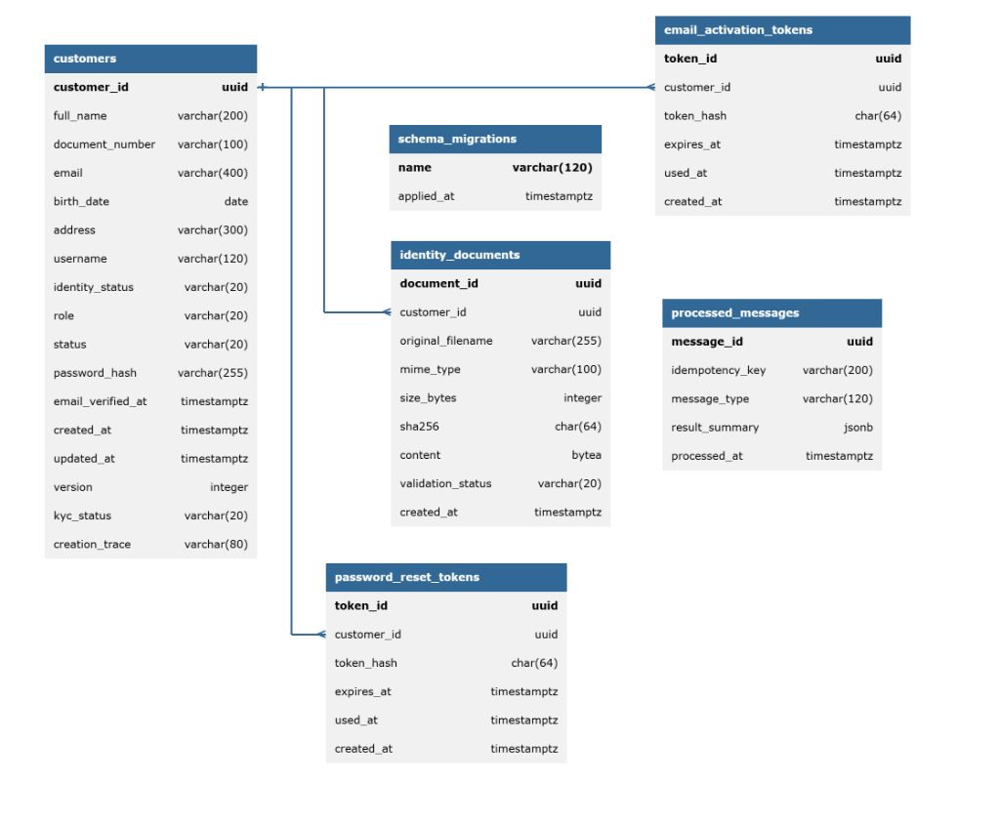
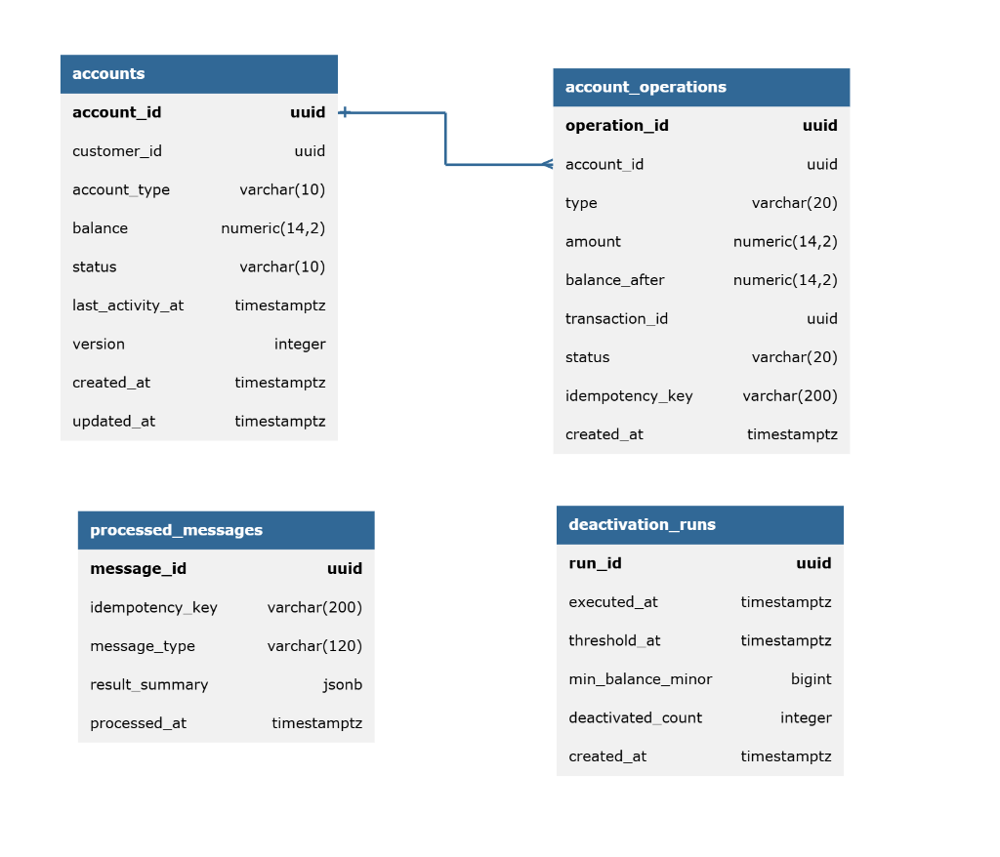
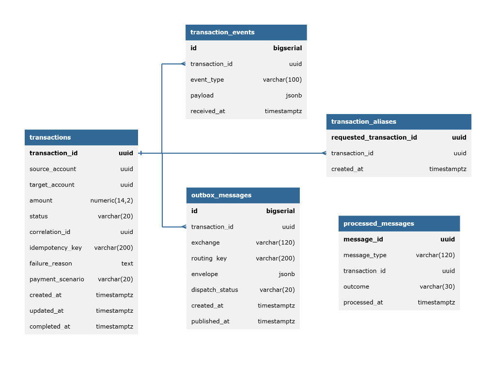
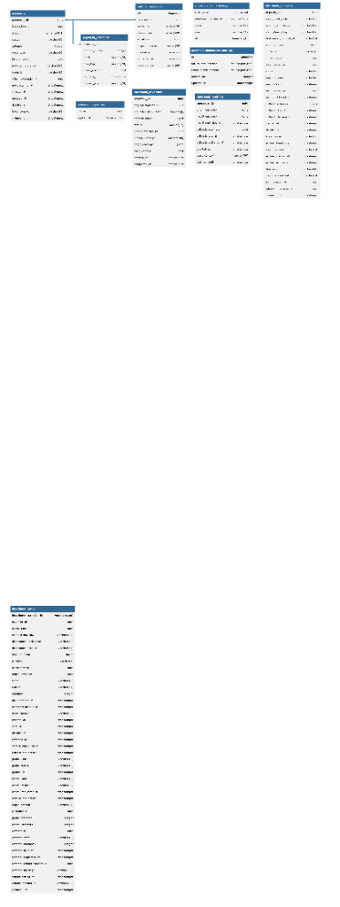
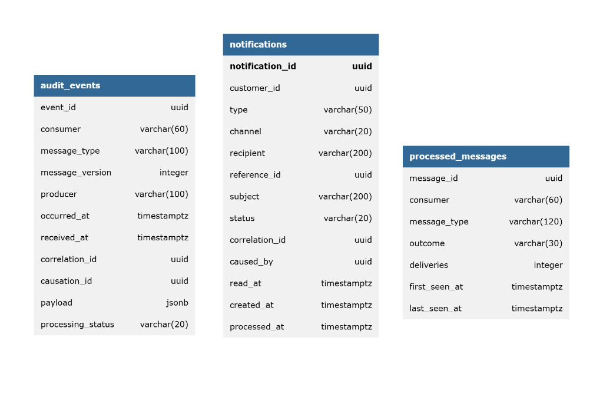

# Modelo de Dominio — Bank USAC

> *"Domain es la representación de las entidades principales del negocio bancario, sus atributos, relaciones y responsabilidades. El enunciado indica que deben analizar y definir entidades como cliente, cuenta, transacción y pago, y establecer los bounded contexts para dividir correctamente los microservicios."* — Kevin Raúl Pozuelos Estrada (Auxiliar del Curso)

Este documento define de forma exhaustiva las **entidades principales del negocio bancario**, sus atributos, máquinas de estado, invariantes de consistencia, códigos de error y los diagramas Entidad-Relación (ER) físicos de cada microservicio.

---

## 1. Entidades Principales del Negocio Bancario

### A. Cliente (`Customer`)
* **Microservicio Dueño**: Customer Service.
* **Identificador Único**: `customerId` (UUID).
* **Atributos**:
  * `fullName`: Nombre completo del cliente.
  * `documentNumber`: Documento Personal de Identificación (DPI) único (13 dígitos).
  * `email`: Correo electrónico único. **Identificador principal de inicio de sesión (ADR D-05)**.
  * `birthDate`: Fecha de nacimiento coherente (en el pasado y válida para persona viva).
  * `address`: Dirección de residencia del cliente.
  * `username`: Generado determinísticamente a partir del nombre y apellido (ej. `juanperez`, `juanperez2` ante colisiones).
  * `identityStatus`: Estado de verificación de fotografía (`PENDING`, `VALIDATED`, `REJECTED`).
  * `role`: Rol del usuario en el sistema (`CLIENTE`, `CAJERO_RECEPTOR`, `ADMINISTRADOR`).
  * `status`: Estado de la cuenta de usuario (`PENDING_ACTIVATION`, `ACTIVE`).
  * `passwordHash`: Hash criptográfico seguro con algoritmo `scrypt` (jamás sale del servicio).
  * `emailVerifiedAt`: Marca de tiempo de confirmación por enlace de correo.
* **Máquina de Estados de Identidad y Cuenta**:
  * `status`: `PENDING_ACTIVATION` $\rightarrow$ `ACTIVE` (habilitado tras verificar token de correo).
  * `identityStatus`: `PENDING` $\rightarrow$ `VALIDATED` \| `REJECTED` (mesa de control). Si es rechazado, vuelve a `PENDING` al cargar una nueva imagen de DPI.
  * *Independencia de ejes*: La verificación de correo (que habilita login) y la validación de fotografía (que habilita aperturar cuentas bancarias) son independientes.
* **Invariantes del Cliente**:
  * `C-1`: El número de DPI es único en el banco (`DOCUMENT_ALREADY_REGISTERED`).
  * `C-2`: El `username` es único y se asigna atómicamente en la misma transacción de registro.
  * `C-3`: El correo electrónico es estrictamente único (`EMAIL_ALREADY_REGISTERED`).
  * `C-4`: `status = ACTIVE` si y solo si `emailVerifiedAt` no es nulo.
  * `C-5`: La fecha de nacimiento debe ser plausible (`INVALID_BIRTH_DATE`).
  * `C-6`: Únicamente los usuarios con rol `CLIENTE` requieren validación de DPI y pueden ser titulares de cuentas bancarias (`ROLE_NOT_ELIGIBLE` si se intenta abrir a personal bancario).
  * `C-7`: Verificar un token expirado o ya utilizado no modifica el estado (`ACTIVATION_TOKEN_INVALID`).

---

### B. Cuenta Bancaria (`Account`)
* **Microservicio Dueño**: Account Service.
* **Identificador Único**: `accountId` (UUID).
* **Atributos**:
  * `customerId`: Referencia opaca hacia el cliente titular (`role = CLIENTE`).
  * `balance`: Saldo contable en Quetzales con exactamente dos decimales (`NUMERIC(14,2)`).
  * `status`: Estado operativo de la cuenta (`ACTIVE`, `INACTIVE`).
  * `accountType`: Clasificación de producto (`MONETARIA`, `AHORRO`).
  * `lastActivityAt`: Fecha del último movimiento contable confirmado.
  * `version`: Entero incremental para control de concurrencia optimista.
* **Reglas de Desactivación y Reactivación Automática**:
  * Una cuenta con más de 6 meses sin actividad y saldo menor a Q 50.00 se desactiva automáticamente (`ACTIVE` $\rightarrow$ `INACTIVE`).
  * *Actividad*: Es ser origen o destino de un movimiento contable real (débito, crédito o compensación). Consultar el saldo **no cuenta como actividad**.
  * Una cuenta `INACTIVE` no puede ser origen de transferencias, pero **sí puede ser destino**: un crédito entrante o depósito en ventanilla se aplica con éxito y **reactiva automáticamente la cuenta** (`INACTIVE` $\rightarrow$ `ACTIVE`).
* **Invariantes de la Cuenta**:
  * `A-1`: El saldo jamás puede ser negativo tras una operación aprobada (`CHECK (balance >= 0)`). Si no alcanza, se rechaza por fondos insuficientes (`INSUFFICIENT_FUNDS`).
  * `A-2`: Un débito solo aplica sobre cuentas activas (`ACCOUNT_INACTIVE`).
  * `A-3`: Un crédito sobre cuenta inactiva se aplica y la reactiva automáticamente.
  * `A-4`: Las consultas de saldo nunca actualizan `lastActivityAt`.
  * `A-5`: Montos siempre con dos decimales exactos en centavos (`INVALID_AMOUNT_PRECISION`), jamás redondeados silenciosamente.

---

### C. Transacción / Transferencia (`Transaction`)
* **Microservicio Dueño**: Transaction Service.
* **Identificador Único**: `transactionId` (UUID).
* **Atributos**:
  * `sourceAccount`: Identificador de cuenta de origen (referencia opaca).
  * `targetAccount`: Identificador de cuenta de destino (referencia opaca).
  * `amount`: Monto monetario mayor a cero en Quetzales.
  * `status`: Estado actual de la Saga (`PENDING`, `DEBITING`, `PAYMENT_PENDING`, `COMPLETED`, `FAILED`, `COMPENSATED`).
  * `correlationId`: Identificador de trazabilidad distribuida.
  * `idempotencyKey`: Llave única para evitar transferencias duplicadas.
* **Máquina de Estados Finita**:
  ```mermaid
  stateDiagram-v2
      [*] --> PENDING: Iniciar transferencia
      PENDING --> DEBITING: Solicitar débito
      DEBITING --> FAILED: Débito rechazado (sin fondos / inactiva)
      DEBITING --> PAYMENT_PENDING: Débito aplicado con éxito
      PAYMENT_PENDING --> COMPLETED: Crédito aplicado con éxito
      PAYMENT_PENDING --> COMPENSATED: Fallo en cobro o rechazo de crédito (Compensación)
      COMPLETED --> [*]
      FAILED --> [*]
      COMPENSATED --> [*]
  ```

* **Invariantes de la Transacción**:
  * `T-1`: El monto debe ser estrictamente mayor a cero (`INVALID_AMOUNT`).
  * `T-2`: La cuenta de origen y destino deben ser distintas (`SAME_ACCOUNT_TRANSFER`).
  * `T-3`: La misma `idempotencyKey` con idéntico payload retorna la transacción original sin mover dinero.
  * `T-4`: La misma `idempotencyKey` con payload distinto se rechaza (`IDEMPOTENCY_KEY_CONFLICT`).
  * `T-5`: Deduplicación por `messageId`: un evento repetido en RabbitMQ no produce doble transición ni doble compensación.
  * `T-6`: `FAILED` significa que el dinero nunca salió del origen; `COMPENSATED` significa que salió y fue reintegrado formalmente.

---

### D. Pago a Facturadores (`Payment`)
* **Microservicio Dueño**: Payment Service.
* **Identificador Único**: `paymentId` (UUID).
* **Atributos**:
  * `transactionId`: Referencia única a la transferencia de la Saga (`UNIQUE(transaction_id)`).
  * `amount`: Monto cobrado por el facturador.
  * `status`: Estado del cobro (`PENDING`, `SUCCEEDED`, `FAILED`).
  * `attempt`: Contador monótono de intentos ejecutados (inicia en 1).
  * `nextAttemptAt`: Fecha y hora programada en base de datos para el siguiente intento.
  * `failureReason`: Motivo del fallo terminal (`PAYMENT_DECLINED`, `RETRIES_EXHAUSTED`).
* **Invariantes del Pago**:
  * `P-1`: Una misma transferencia jamás produce dos cobros exitosos (`PAYMENT_ALREADY_PROCESSED`).
  * `P-2`: Los reintentos transitorios operan con backoff exponencial persistido en columna (inmune a caídas de contenedores).
  * `P-3`: Solo el desenlace terminal (`SUCCEEDED` o `FAILED`) emite el evento de cierre de la Saga.

---

### E. Auditoría y Notificaciones (`AuditEvent` & `Notification`)
* **Microservicio Dueño**: Notification & Audit Service.
* **Atributos de Auditoría**:
  * `eventId`: Identificador único del evento original en RabbitMQ.
  * `consumer`: Nombre de la cola receptora (`audit.customer`, `audit.account`, etc.).
  * `messageType`: Familia y nombre del mensaje (ej. `account.debited.v1`).
  * `occurredAt`: Marca de tiempo del reloj del productor.
  * `receivedAt`: Marca de tiempo del reloj local de auditoría.
  * `correlationId`: Código de trazabilidad transversal.
  * `payload`: Cuerpo del mensaje redactado (sin contraseñas, saldos ni DPIs).
* **Invariantes**:
  * `E-1`: Tabla append-only inmutable: no existen sentencias `UPDATE` ni `DELETE`.
  * `E-2`: Deduplicación por clave primaria compuesta `(event_id, consumer)`.
  * `N-1`: Un fallo en el envío de correo jamás altera el estado de negocio de ningún servicio.
  * `N-2`: Un evento repetido no produce una segunda notificación en el buzón.

---

## 2. Diagramas Entidad-Relación (ER) Físicos

En cumplimiento con el requisito del auxiliar, cada base de datos independiente cuenta con su modelado físico completo:

| Base de Datos | Microservicio Responsable | Especificación DBML | Especificación Mermaid | Diagrama Gráfico |
|---|---|---|---|---|
| `customer_db` | Customer Service | [`customer-er.dbml`](../architecture/diagrams/er/customer-er.dbml) | [`customer-er.mmd`](../architecture/diagrams/er/customer-er.mmd) |  |
| `account_db` | Account Service | [`account-er.dbml`](../architecture/diagrams/er/account-er.dbml) | [`account-er.mmd`](../architecture/diagrams/er/account-er.mmd) |  |
| `transaction_db` | Transaction Service | [`transaction-er.dbml`](../architecture/diagrams/er/transaction-er.dbml) | [`transaction-er.mmd`](../architecture/diagrams/er/transaction-er.mmd) |  |
| `payment_db` | Payment Service | [`payment-er.dbml`](../architecture/diagrams/er/payment-er.dbml) | [`payment-er.mmd`](../architecture/diagrams/er/payment-er.mmd) |  |
| `notification_audit_db` | Notification & Audit Service | [`notification-audit-er.dbml`](../architecture/diagrams/er/notification-audit-er.dbml) | [`notification-audit-er.mmd`](../architecture/diagrams/er/notification-audit-er.mmd) |  |

Para detalles de índices, llaves foráneas y tipos de datos SQL de cada tabla, consultar [`docs/architecture/diagrams/er/README.md`](../architecture/diagrams/er/README.md).
