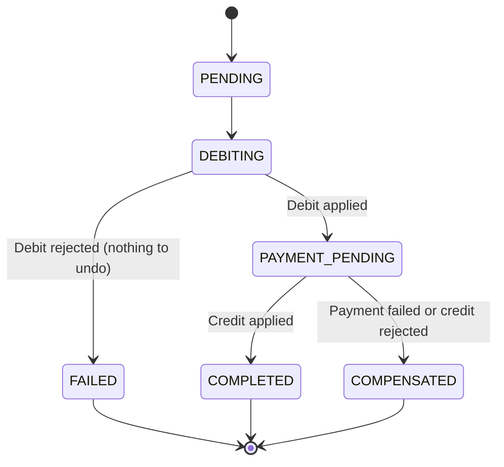

# Entities, States and Invariants

Every entity with its identifier, attributes, the closed set of states it may hold, the legal
transitions between them, and the rules it may never violate. Every invariant names the failure
that results from trying.

**Transitions not listed here are illegal and are discarded**, not applied. This matters most
when events arrive out of order or twice.

Related: [bounded-contexts.md](bounded-contexts.md) · [use-cases.md](use-cases.md)

---

## Customer

**Owner**: Customer Service · **Identity**: `customerId`

| Attribute | Notes |
| --- | --- |
| Full name | Source of the generated `username` |
| Identity document | Unique |
| Email | Unique. **The login identifier** (D-05) |
| Date of birth | The assignment requires validating the field's coherence (§4.1, p. 5) |
| Address | — |
| `username` | Generated from the full name, and unique |
| Identity-document photo reference | Nullable until uploaded |
| Access credential | Never leaves the service |
| `role` | `ADMINISTRADOR` \| `CAJERO_RECEPTOR` \| `CLIENTE` |
| `identityStatus` | `PENDING` \| `VALIDATED` \| `REJECTED` |
| `kycStatus` | `PENDING` \| `VERIFIED` \| `REJECTED` — Fase 2 (§4.1, p. 4), C-8 |
| `emailVerifiedAt` | Nullable timestamp |
| `status` | `PENDING_ACTIVATION` \| `ACTIVE` |

### Username generation

The `username` is generated, not chosen: the assignment states it derives from the user's name
(§4.1, p. 5). The rule is deterministic — normalize the full name (lower case, no accents, no
spaces), take the given name and the first surname. On collision, append the lowest available
numeric suffix starting at `2`: `juanperez`, `juanperez2`, `juanperez3`.

Assignment and uniqueness happen **in the same operation that creates the `Customer`**, never
in a later step. The assignment requires protection against race conditions in this service
(§4.1, p. 5), and two simultaneous registrations of people with the same name must not produce
the same username.

### States

`status`: `PENDING_ACTIVATION` → `ACTIVE`. One legal transition, triggered by successful token
verification. There is no path back in Phase 1.

`identityStatus`: `PENDING` → `VALIDATED` \| `REJECTED`, and `REJECTED` → `PENDING` when a new
photo is uploaded.

`kycStatus` (Fase 2): `PENDING` → `VERIFIED` \| `REJECTED`, and `REJECTED` → `PENDING` when a new
review reopens it. `VERIFIED` is terminal, for the same reason `VALIDATED` is on `identityStatus`
— re-verifying an already-verified customer would let a later, weaker review silently replace an
accepted one. Distinct from `identityStatus`: that axis is Fase 1's review of the document photo;
this one is the broader compliance decision a teller or administrator registers directly
(`customer.set-kyc-status.v1`), and it is what C-8 ties to initiating a transaction.

**The two axes are independent.** Email verification (which enables signing in) and
identity-document validation (which reviews the photo) are different flows and neither implies
the other. A customer may be `ACTIVE` with `identityStatus = PENDING`, and may be
`PENDING_ACTIVATION` with `identityStatus = VALIDATED`.

### Invariants

| # | Invariant | Expected failure |
| --- | --- | --- |
| C-1 | The identity document is unique | `DOCUMENT_ALREADY_REGISTERED` — rejected, no `Customer` created |
| C-2 | The `username` is unique | Resolved by numeric suffix; never surfaces as a failure |
| C-3 | The email is unique | `EMAIL_ALREADY_REGISTERED` — rejected |
| C-4 | `status = ACTIVE` if and only if `emailVerifiedAt` is not null | Illegal transition, discarded. The redundancy is deliberate: the assignment names the state, the timestamp records when |
| C-5 | The date of birth is coherent — in the past, and plausible for a living person | `INVALID_BIRTH_DATE` — rejected |
| C-6 | Only `role = CLIENTE` requires identity validation and may hold accounts | `ROLE_NOT_ELIGIBLE` when opening an account for staff |
| C-7 | Verifying a token that is expired, already used or invalidated changes no state | `ACTIVATION_TOKEN_INVALID` — rejected with no effect |
| C-8 | A `CLIENTE` may initiate a transaction only when `kycStatus = VERIFIED` (Fase 2, §4.1 p. 4) | `mayInitiateTransactions` refuses; enforcing this inside the transfer Saga is **T-31**, which consumes `customer.kyc.verified.v1` / `customer.kyc.rejected.v1` rather than querying this service's table (X-1) |

---

## Account

**Owner**: Account Service · **Identity**: `accountId`

| Attribute | Notes |
| --- | --- |
| `customerId` | Opaque reference. Always to a `Customer` with `role = CLIENTE` |
| `balance` | Quetzales, exactly two decimals |
| `status` | `ACTIVE` \| `INACTIVE` |
| `accountType` | `MONETARIA` \| `AHORRO`. Pure classification through Phase 1 (D-02); carries its own rules as of T-27 |
| `billerCode` | Optional code for institutional biller collection accounts (EEGSA, Empagua, Claro) |
| `billerName` | Optional commercial name of institutional biller |
| `lastActivityAt` | Last confirmed money movement |

### Account type

`accountType` is recorded, reported on creation and displayed. Through Phase 1 it changed **no
invariant, no state and no flow**, and both types were equally subject to automatic
deactivation. The assignment required the two types to exist (§4.1, note on p. 7); it did not
require them to behave differently, and the domain said in so many words that introducing
differentiated rules later was a model change needing a new approval.

**T-27 (Fase 2, §4.1, p. 6) is that approval.** Each type now carries a fixed rule
(`account-type-rules.ts`), stated the way `deactivation-policy.ts` states its own boundary
decisions rather than left implicit — the assignment names the two capabilities ("Límite de
saldo mínimo", "Comisión por transacción (opcional)") but no amounts, and neither when in the
account's life each applies:

| Type | Minimum balance | Per-debit commission |
| --- | --- | --- |
| `MONETARIA` (the assignment's "Corriente") | none | none |
| `AHORRO` | Q100.00, **to open** | Q3.00, on every debit |

The minimum balance is a condition of **opening** an `AHORRO` account — the initial deposit must
reach Q100.00, checked once by `openingDepositRefusal`, or the opening is refused
(`account.open.rejected.v1`, `MINIMUM_BALANCE_VIOLATION`) and no account is created. It is not a
floor the domain re-enforces afterward: an open `AHORRO` account may be debited down to Q0.00 by
ordinary transfers, exactly like `MONETARIA`. (An earlier revision of this section described the
minimum as a floor `debit` checked on every movement; that was corrected before the ticket closed
— `AHORRO`'s Q100.00 is an entry requirement, not a balance the account must stay above.)

The commission, unlike the minimum, applies for the account's whole life: every `AHORRO` debit
carries one. It is a fact separate from the transfer itself and travels on its own event,
`account.commission.charged.v1`, never folded into `account.debited.v1`'s `amount`, because
Transaction Service compares that field against the amount its own Saga asked to move. Automatic
deactivation is unaffected — both types remain equally subject to it, and its own Q50.00
threshold (`MIN_BALANCE_MINOR` in `deactivation-policy.ts`) is a distinct number from
`AHORRO`'s opening minimum, checked by a different job for a different reason.

**A compensated transfer refunds the commission too (T-29 correction).** Testing T-29's
`TIMEOUT` scenario end to end surfaced a gap T-27 never actually decided on purpose: `compensate`
only ever saw the transfer amount, so an `AHORRO` transfer the Saga cancelled after debiting
still left the customer paying Q3.00 for a transfer that never happened. `CompensateDebitUseCase`
now has the repository look up the `COMMISSION` row the original debit charged (its own
`account_operations` entry, found by `transaction_id` inside the same lock that reverses the
debit), mark it `COMPENSATED`, and hand its amount to `compensate` so the full amount —
transfer plus commission — returns in one movement. A `MONETARIA` compensation is unaffected:
there was never a commission to look up.

### Automatic deactivation

The assignment requires an automatic process that deactivates inactive accounts with a balance
below Q50.00 after six months of inactivity (§4.1, p. 5). **Both conditions apply together**:
an account with Q10.00 and activity yesterday stays active, and an account with Q5,000.00 and
two years untouched is not deactivated.

**Activity** means being the source or target of a *confirmed* money movement — an applied
debit, an applied credit, an applied compensation. **Querying the balance is not activity.**
That distinction is what gives the rule meaning: if looking counted, no account would ever be
deactivated.

The process belongs to Account Service because `balance`, `status` and `lastActivityAt` are
its data; reading them from outside would be a cross-service read.

### States

- `ACTIVE` → `INACTIVE`: by the automatic process, or by an `ADMINISTRADOR`.
- `INACTIVE` → `ACTIVE`: on receiving a credit, or by an `ADMINISTRADOR`.

An `INACTIVE` account **cannot be the source** of a transfer, but **can be the target**: an
incoming credit is applied and reactivates it. Deactivation exists to stop maintaining
abandoned accounts, not to trap money — and rejecting an incoming credit would create a worse
case, a transfer failing at the last step for a reason the sender can neither know nor fix.

### Invariants

| # | Invariant | Expected failure |
| --- | --- | --- |
| A-1 | `balance` is never negative after an approved operation | `INSUFFICIENT_FUNDS` — the debit is rejected, never partially applied |
| A-2 | A debit applies only to an `ACTIVE` account | `ACCOUNT_INACTIVE` — rejected; the Saga closes in `FAILED` |
| A-3 | A credit to an `INACTIVE` account is applied and reactivates it | No failure; this is a legal transition |
| A-4 | Every confirmed movement updates `lastActivityAt`; querying the balance does not | — |
| A-5 | The deactivation process is idempotent: an already `INACTIVE` account does not transition again nor emit a second event | — |
| A-6 | Amounts carry exactly two decimals | `INVALID_AMOUNT_PRECISION` — rejected, never rounded |

---

## Transaction

**Owner**: Transaction Service · **Identity**: `transactionId`

| Attribute | Notes |
| --- | --- |
| `customerId` | Originator customer reference for access control and ownership |
| `sourceAccount`, `targetAccount` | Opaque references |
| `amount` | Greater than zero, two decimals |
| `status` | See below |
| `reference` | Optional transfer concept/note |
| `paymentScenario` | Simulation scenario for payment gateway attempts |
| `failureReason` | Stored reason when transfer fails or compensates |
| `correlationId` | Originated by the Gateway, propagated through the whole flow |
| `idempotencyKey` | Unique within this service |
| `createdAt`, `updatedAt` | — |

### States

`COMPLETED`, `FAILED` and `COMPENSATED` are terminal. Any transition not drawn above is illegal
and is discarded.

**`FAILED` and `COMPENSATED` are not the same thing.** `FAILED` means money never left the
source account. `COMPENSATED` means it left and was returned. They are two different
operational situations and the audit record has to be able to tell them apart.

### Invariants

| # | Invariant | Expected failure |
| --- | --- | --- |
| T-1 | `amount` is greater than zero | `INVALID_AMOUNT` — rejected before the transaction is created |
| T-2 | `sourceAccount` and `targetAccount` differ | `SAME_ACCOUNT_TRANSFER` — rejected |
| T-3 | The same `idempotencyKey` with the same content returns the original transaction without moving balances | No failure; idempotent response |
| T-4 | The same `idempotencyKey` with different content is rejected | `IDEMPOTENCY_KEY_CONFLICT` |
| T-5 | A repeated event produces no second transition and no second compensation | Silently discarded; the envelope's `messageId` was already processed |
| T-6 | An event requesting a transition not in the diagram is discarded and recorded | `ILLEGAL_TRANSITION` in the audit record, no state change |
| T-7 | Any transaction that left `DEBITING` with the debit applied ends in `COMPLETED` or `COMPENSATED`, never in `FAILED` | Saga guarantee |

### Phase status (T-28)

Fase 2 of the assignment names three states — `PENDING`, `APPROVED`, `FAILED` — coarser
than the six above. Rather than a seventh vocabulary the machine has to agree with, it is a
**projection** computed from `status` by `phaseStatusOf` in the domain and never stored:
`PENDING`/`DEBITING`/`PAYMENT_PENDING` read as `PENDING`, `COMPLETED` as `APPROVED`,
`FAILED`/`COMPENSATED` as `FAILED`. It is carried on `transaction.list.replied.v1` and
`transaction.status.replied.v1` alongside `status`, and both vocabularies are available as
listing filters — naming both narrows to their overlap.

### Real history (T-28)

**Table**: `transaction_transitions` · **Owner**: Transaction Service, this service's own
database only.

| Column | Notes |
| --- | --- |
| `transactionId` | Opaque reference to the owning transaction |
| `fromStatus` | Null only on the opening row — the transfer's acceptance, which nothing preceded |
| `toStatus` | One of the six states above |
| `eventType` | The message type that caused this row, or `transfer.requested.v1` for the opening one |
| `failureReason` | Set exactly when the transition records a cause |
| `messageId` | Null only on the opening row; the envelope's `messageId` for every other |
| `occurredAt` | — |

One row per legal transition `applyEvent` actually applies — self-transitions on
`PAYMENT_PENDING` included, since those are the ones that order the payment, the credit and
the compensation — written inside the same database transaction as the state change it
records. Illegal transitions are not here: they moved nothing, and T-6's own record in
`transaction_events` and `processed_messages.outcome` already covers them. A unique index on
`(transactionId, messageId)` makes T-5 (no second row for a redelivered message) a fact about
this table, not only about `processed_messages`'s own primary key.

Exposed as `transitions` on `transaction.status.replied.v1`, oldest first — the answer to
"what happened to this transfer, step by step", as opposed to the timeline a screen can
already draw from `status` alone.

---

## Payment

**Owner**: Payment Service · **Identity**: `paymentId`

| Attribute | Notes |
| --- | --- |
| `transactionId` | Opaque reference |
| `status` | `PENDING` \| `SUCCEEDED` \| `FAILED` |
| `attempt` | Attempt number, starting at 1 |
| `failureReason` | Nullable; required when `status = FAILED` |

### States

`PENDING` → `SUCCEEDED` \| `FAILED`. Retries happen **inside** `PENDING`, incrementing
`attempt`; `FAILED` is reached only when retries are exhausted, and is terminal.

### The simulated external provider (T-29)

Each attempt asks a simulated provider — deterministic, chosen by the
demonstration `scenario` carried from the transfer request — and records what
it answered: `SUCCESS`, `FAILURE`, or `TIMEOUT`. This `providerResult` is
distinct from `errorType`: `errorType` is the retry policy's own statement
about whether an attempt is worth retrying (`TRANSIENT` vs `PERMANENT`), while
`providerResult` is what the provider itself said. A `TRANSIENT_FAILURE`
scenario and a `TIMEOUT` scenario both produce `errorType: 'TRANSIENT'` and
climb the identical retry ladder — `providerResult` is the only fact that
tells the two apart in the record kept of each attempt.

### Invariants

| # | Invariant | Expected failure |
| --- | --- | --- |
| P-1 | One `transactionId` never produces two successful payments | `PAYMENT_ALREADY_PROCESSED` — the existing result is returned |
| P-2 | `status = FAILED` requires a `failureReason` | Invalid state, not persistable |
| P-3 | `attempt` increases monotonically | — |

---

## AuditEvent

**Owner**: Notification & Audit Service · **Identity**: `eventId`

Attributes: event type, `timestamp`, `payload`, `correlationId`, originating service.

**No states.** It is an append-only record and it is **immutable**: never modified, never
deleted, not even by an `ADMINISTRADOR`.

### Invariants

| # | Invariant | Expected failure |
| --- | --- | --- |
| E-1 | Every `AuditEvent` carries a `correlationId` | Record rejected; an event without correlation is not auditable |
| E-2 | An already recorded `eventId` is not recorded twice | Silently discarded |
| E-3 | The `payload` contains no access credential and no full identity document number | A model violation, not a runtime error — it is caught in review |

---

## Notification

**Owner**: Notification & Audit Service

Attributes: `notificationId`, `customerId` (for recipient inbox scoping), `recipient`, `subject`, `channel`, `type`, `status` (`PENDING` \| `SENT` \| `FAILED`), `readAt`, `causedBy`, `referenceId`, `correlationId`, attempts.

### Invariants

| # | Invariant | Expected failure |
| --- | --- | --- |
| N-1 | A delivery failure alters no domain state in any other service | Retried and recorded; the `Customer` and the `Transaction` do not change |
| N-2 | A repeated event produces no second notification | Discarded by `eventId` |

---

## Cross-cutting invariants

| # | Invariant | Protected by |
| --- | --- | --- |
| X-1 | No service queries another service's tables | All. This is the one penalized with 50 % of the grade (§4.2, p. 13) |
| X-2 | Data owned elsewhere arrives by event or async request/reply | All |
| X-3 | Every flow propagates its `correlationId` end to end | The Gateway originates it; everyone propagates it |
| X-4 | Every consumer deduplicates by `eventId` | All consumers |
| X-5 | Every operation spanning two services has a defined compensation | Coordinated by Transaction Service |
| X-6 | All amounts are quetzales with exactly two decimals | Account and Transaction |
| X-7 | The Gateway makes no domain decision | The Gateway |

## Money

All amounts and balances are quetzales with **exactly two decimals**, using exact arithmetic
and never binary floating point. An amount carrying more than two decimals is **rejected, not
rounded**. There is no currency conversion.

Silently rounding a transfer amount is unacceptable here: the client asked to move one figure
and the system would move another. Rejection is visible and correctable. Exact arithmetic is
also what makes A-1 enforceable — with floating point, comparing balance against amount is
unreliable at the boundary.

## Three idempotency mechanisms, and why they are not the same

Confusing them is the classic mistake in this kind of system.

| Mechanism | Scope | What it protects |
| --- | --- | --- |
| `idempotencyKey` | One transfer request, within Transaction Service | Prevents the same requested transfer from moving balances twice (T-3, T-4) |
| `eventId` deduplication | Every consumer of every event | Prevents a redelivered event from causing a second state transition or a second compensation (T-5, E-2, N-2) |
| `correlationId` | The whole flow, across all services | **Traceability only.** It deduplicates nothing |

Using `correlationId` as a deduplication key would deduplicate the entire flow — every message
in one transfer shares it. The assignment requires idempotency and traceability as separate
concerns (§4.2, SRE considerations, p. 7), and they stay separate here.
