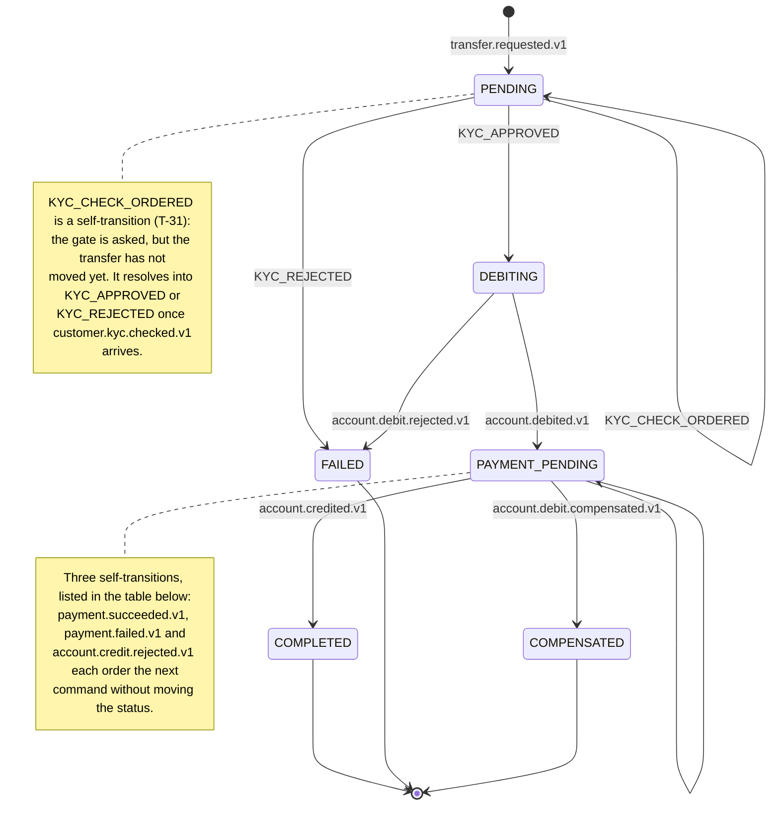

# The transfer Saga

The one flow that spans five services (T-31 added Customer Service's KYC gate to the four
Transaction/Account/Payment always had). It is a Saga with explicit compensation, implemented as
choreography (ADR-009), and it is the flow the assignment grades twice: criterion 2.7
"distributed flow" and criterion 2.8 "failure handling", five points each, awarded whole or not
at all (§8.2, page 25).

**The sequence itself was decided by T-02** in [`../domain/use-cases.md`](../domain/use-cases.md)
§6. This document adds the versioned message of every transition, the two endings, and what
happens in each way it can go wrong. Worked examples live in [`examples/`](examples/) and are
generated from the contracts, so they cannot describe a flow the code would reject.

## The eight steps

T-31 (§4.1 p. 4) added the first one: before any money moves, the Saga asks
whether the customer who requested this transfer may transact at all.

| # | Service | Reacts to | Does | Publishes | Transaction state |
| --- | --- | --- | --- | --- | --- |
| 1 | Transaction | `transfer.requested.v1` | Validates amount, distinct accounts, idempotency. Creates the transaction, asks the KYC gate | `customer.kyc.check.requested.v1` | `PENDING` (unchanged) |
| 2 | Customer | `customer.kyc.check.requested.v1` | Answers whether this customer may initiate a transaction (`mayInitiateTransactions`) | `customer.kyc.checked.v1` | — |
| 3 | Transaction | `customer.kyc.checked.v1` | Orders the debit if allowed, otherwise closes | `account.debit.requested.v1` (allowed) | `PENDING` → `DEBITING` \| `PENDING` → `FAILED` |
| 4 | Account | `account.debit.requested.v1` | Locks the source, checks it is `ACTIVE` and funded, debits, updates `lastActivityAt` | `account.debited.v1` \| `account.debit.rejected.v1` | — |
| 5 | Transaction | `account.debited.v1` | Moves on to payment | `payment.requested.v1` | `PAYMENT_PENDING` |
| 6 | Payment | `payment.requested.v1` | Processes, retrying internally and counting `attempt` | `payment.succeeded.v1` \| `payment.failed.v1` | — |
| 7 | Transaction | `payment.succeeded.v1` | Orders the credit | `account.credit.requested.v1` | `PAYMENT_PENDING` (unchanged) |
| 8 | Account | `account.credit.requested.v1` | Credits the target; reactivates it if it was `INACTIVE` (A-3) | `account.credited.v1` \| `account.credit.rejected.v1` | — |
| 9 | Transaction | `account.credited.v1` | Closes | `transaction.completed.v1` | `COMPLETED` |

(Nine rows for eight steps: step 3 branches into two outcomes, one of them terminal.)

**Payment reacts to `payment.requested.v1`, not to `account.debited.v1`.** Transaction Service
orders the payment. This is worth stating because it is the one place where the ticket text and
the domain model disagreed, and the domain model won: routing every step through the service
that owns the Saga's state is what keeps that state in one place. Owning state is not
orchestration — no service waits on another, and each reacts to what it hears.

## States

There are **six**, and not one more: `PENDING`, `DEBITING`, `PAYMENT_PENDING`, `COMPLETED`,
`FAILED`, `COMPENSATED`. Three independent places say so and agree —
[`transaction.ts`](../../apps/services/transaction-service/src/domain/transaction.ts)'s
`TransactionStatus`, the `transactions_status_known` `CHECK` on the status column, and
`transactionStatus` in `@bank/contracts`.

Two loops carry self-transitions a state diagram cannot label separately, so every transition of
the machine is written out here as well. Below the first row, which is the request that opens the
transaction, this table **is** `applyEvent`: one row per arm of it, in the order the choreography
produces them.

| From | Arrives as | Legal when | Orders / publishes | To |
| --- | --- | --- | --- | --- |
| — | `transfer.requested.v1` | The request passes T-1 to T-4 | `transaction.initiated.v1` | `PENDING` |
| `PENDING` | `KYC_CHECK_ORDERED`, taken in the same handler | always | `customer.kyc.check.requested.v1` | `PENDING` |
| `PENDING` | `KYC_APPROVED` | always | `account.debit.requested.v1` | `DEBITING` |
| `PENDING` | `KYC_REJECTED` | always | `transaction.failed.v1` | `FAILED` |
| `DEBITING` | `account.debited.v1` | always | `payment.requested.v1` | `PAYMENT_PENDING` |
| `DEBITING` | `account.debit.rejected.v1` | always | `transaction.failed.v1` | `FAILED` |
| `PAYMENT_PENDING` | `payment.succeeded.v1` | no cause recorded | `account.credit.requested.v1` | `PAYMENT_PENDING` |
| `PAYMENT_PENDING` | `payment.failed.v1` | no cause recorded | records the cause, `account.debit.compensation.requested.v1` | `PAYMENT_PENDING` |
| `PAYMENT_PENDING` | `account.credit.rejected.v1` | no cause recorded | records the cause, `account.debit.compensation.requested.v1` | `PAYMENT_PENDING` |
| `PAYMENT_PENDING` | `account.credited.v1` | no cause recorded | `transaction.completed.v1` | `COMPLETED` |
| `PAYMENT_PENDING` | `account.debit.compensated.v1` | a cause was recorded | `transaction.compensated.v1` | `COMPENSATED` |

`COMPLETED`, `FAILED` and `COMPENSATED` are terminal. Any transition not in this table is
illegal, is discarded, and is recorded as `ILLEGAL_TRANSITION` (T-6). The diagram and the table
are the source; the formal UML sequence diagram is **T-13**, and it must agree with this.

**There is no `CHECKING_KYC`, no `CREDITING` and no `COMPENSATING`.** The KYC check is ordered from
`PENDING`, the credit from `PAYMENT_PENDING`, and so is the compensation: all three are
self-transitions, which is why those rows above end where they started. Inventing a seventh or
eighth state to name those moments would mean a status the contract cannot carry and the column's
`CHECK` will not store, so the machine has six and the deviation is deliberate — see the
`applyEvent` docstring, which says the same thing next to the code that does it.

What tells the two branches apart is therefore not a state but **`failureReason`**, the "legal
when" column above. It is `null` while the transfer is still trying to complete, and is set on
the same transition that orders the compensation. That single column is what makes
`account.credited.v1` legal only on a transfer with no recorded cause,
`account.debit.compensated.v1` legal only on one that has one, and a **second**
`payment.failed.v1` illegal rather than a second refund (T-5).

`KYC_CHECK_ORDERED` is the one transition with no message of its own — it is a domain event, not a
wire event. Transaction Service takes it itself, in the same call that accepted
`transfer.requested.v1`, through the same locked and deduplicated path as every other transition,
rather than ordering the check by hand outside the machine. Every other row is a handler bound in
`sagaHandlers`.

## The two endings

They are not two names for the same outcome, and the audit record has to tell them apart.

### `FAILED` — nothing to undo

Reachable from two places, both before any money moves: step 3, when the KYC gate answers
`allowed: false` (T-31), and step 4, when `account.debit.rejected.v1` says the debit itself was
refused. Either way **no compensation runs**: there is no effect to reverse. Transaction Service
moves `PENDING` → `FAILED` (KYC) or `DEBITING` → `FAILED` (debit) and publishes
`transaction.failed.v1`.

Worked example: [`examples/rejected.json`](examples/rejected.json).

### `COMPENSATED` — it left and came back

Reachable from two different failures, both after the debit succeeded:

- `payment.failed.v1` at step 6, once Payment Service has spent its own retries.
- `account.credit.rejected.v1` at step 8.

Both take the same path:

1. Transaction Service records the cause in `failureReason` and publishes
   `account.debit.compensation.requested.v1`, carrying `triggeredBy` so the audit record can say
   which failure caused it. **The status does not move**: the transfer stays in
   `PAYMENT_PENDING` for as long as the compensation is in flight, and the recorded cause is what
   says a refund was already ordered.
2. Account Service returns the amount to the source account and publishes
   `account.debit.compensated.v1`.
3. Transaction Service closes in `COMPENSATED` and publishes `transaction.compensated.v1`.

Worked example: [`examples/compensated.json`](examples/compensated.json).

**Invariant T-7**: any transaction that left `DEBITING` with the debit applied ends in
`COMPLETED` or `COMPENSATED`, never in `FAILED`.

## The seven scenarios

### 1. Happy path

All eight steps, closing in `COMPLETED`. Eleven messages, one `correlationId`, a causal chain
with no gaps. [`examples/happy-path.json`](examples/happy-path.json).

### 2. KYC refused

Step 3 answers `allowed: false` (T-31, §4.1 p. 4): the customer who requested the transfer is not
`VERIFIED`. Closes in `FAILED` with no compensation, because no debit was ever ordered — the money
never moved, and the source account was never touched.

### 3. Insufficient funds

Step 4 refuses with `INSUFFICIENT_FUNDS` (A-1). The debit is never partially applied. Closes in
`FAILED` with no compensation, because the money never moved.

`ACCOUNT_INACTIVE` (A-2) and `ACCOUNT_NOT_FOUND` behave identically: rejected at step 4, closed
in `FAILED`.

### 4. Reply timeout

The Gateway waits at most five seconds for a reply. When that expires it stops waiting and
answers the client that the result is not yet known.

**The timeout does not cancel anything.** There is no cancellation message in the catalogue,
and adding one would be wrong: the Saga is already in flight across five services and stopping
it midway is exactly the situation compensation exists to avoid. The caller comes back with
`transaction.status.requested.v1` and finds out how it ended.

### 5. Payment failure

Step 6 publishes `payment.failed.v1` after its retries are spent. The debit has already
happened, so this compensates rather than fails. Closes in `COMPENSATED`.

`failureReason` is required on this message even though the entity allows it to be null: a
compensation whose cause was not recorded produces an audit trail that explains nothing.

### 6. Duplicate message

Any step, any message. The consumer recognises the redelivery through the envelope's
**`messageId`**, which it claims as the primary key of its own `processed_messages` table before
touching any state — a redelivery loses that insert and produces **no second effect**: no second
debit, no second transition, no second compensation (T-5, X-4).

The envelope also carries an `idempotencyKey`, and on most messages in this flow the two values
are identical, which is why the mechanism is easy to misname. They coincide because
`createEnvelope` defaults `idempotencyKey` to the `messageId` it just minted, and every follow-up
in the Saga takes that default. The transfer request is the exception: the Gateway passes the
caller's own key, so there `idempotencyKey` is the client's intention (T-3, T-4, enforced by a
unique constraint on `transactions`) while `messageId` is this delivery of it.

This is not a nicety. The delivery policy retries up to three times and the broker may redeliver
on its own after a consumer crash, so every step in this flow will eventually be delivered
twice in practice.

A message arriving **out of order** is a different case: the transition it requests is not legal
from the current state, so it is discarded and recorded as `ILLEGAL_TRANSITION` (T-6). It is
never applied, and the flow does not depend on global ordering.

### 7. Compensation

Covered above. Both routes into it are exercised by
[`examples/compensated.json`](examples/compensated.json), which uses the payment failure.

## Where a stalled Saga shows up

If a consumer in this flow exhausts its retries, the message lands in that consumer's
dead-letter queue and the transfer stops advancing. The most serious case is
`account.debit.compensation.requested.v1`: the money is out of the source account and has not
come back.

Nothing in this ticket detects that. The procedure for finding and resolving a stalled Saga is
**T-23**; the dead-letter queues that make it findable are described in
[`topology.md`](topology.md).
