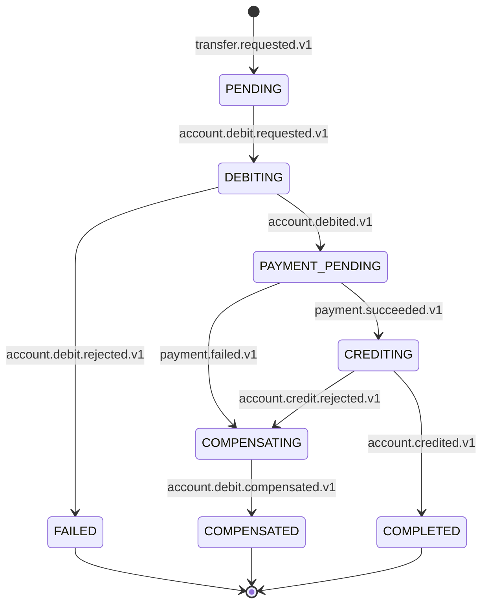

# The transfer Saga

The one flow that spans four services. It is a Saga with explicit compensation, implemented as
choreography (ADR-009), and it is the flow the assignment grades twice: criterion 2.7
"distributed flow" and criterion 2.8 "failure handling", five points each, awarded whole or not
at all (§8.2, page 25).

**The sequence itself was decided by T-02** in [`../domain/use-cases.md`](../domain/use-cases.md)
§6. This document adds the versioned message of every transition, the two endings, and what
happens in each way it can go wrong. Worked examples live in [`examples/`](examples/) and are
generated from the contracts, so they cannot describe a flow the code would reject.

## The seven steps

| # | Service | Reacts to | Does | Publishes | Transaction state |
| --- | --- | --- | --- | --- | --- |
| 1 | Transaction | `transfer.requested.v1` | Validates amount, distinct accounts, idempotency. Creates the transaction | `account.debit.requested.v1` | `PENDING` → `DEBITING` |
| 2 | Account | `account.debit.requested.v1` | Locks the source, checks it is `ACTIVE` and funded, debits, updates `lastActivityAt` | `account.debited.v1` \| `account.debit.rejected.v1` | — |
| 3 | Transaction | `account.debited.v1` | Moves on to payment | `payment.requested.v1` | `PAYMENT_PENDING` |
| 4 | Payment | `payment.requested.v1` | Processes, retrying internally and counting `attempt` | `payment.succeeded.v1` \| `payment.failed.v1` | — |
| 5 | Transaction | `payment.succeeded.v1` | Orders the credit | `account.credit.requested.v1` | — |
| 6 | Account | `account.credit.requested.v1` | Credits the target; reactivates it if it was `INACTIVE` (A-3) | `account.credited.v1` \| `account.credit.rejected.v1` | — |
| 7 | Transaction | `account.credited.v1` | Closes | `transaction.completed.v1` | `COMPLETED` |

**Payment reacts to `payment.requested.v1`, not to `account.debited.v1`.** Transaction Service
orders the payment. This is worth stating because it is the one place where the ticket text and
the domain model disagreed, and the domain model won: routing every step through the service
that owns the Saga's state is what keeps that state in one place. Owning state is not
orchestration — no service waits on another, and each reacts to what it hears.

## States

`COMPLETED`, `FAILED` and `COMPENSATED` are terminal. Any transition not drawn here is illegal,
is discarded, and is recorded as `ILLEGAL_TRANSITION` (T-6). The diagram is the source; the
formal UML sequence diagram is **T-13**, and it must agree with this.

## The two endings

They are not two names for the same outcome, and the audit record has to tell them apart.

### `FAILED` — nothing to undo

Reachable only from step 2. `account.debit.rejected.v1` means the money never left the source
account, so **no compensation runs**: there is no effect to reverse. Transaction Service moves
`DEBITING` → `FAILED` and publishes `transaction.failed.v1`.

Worked example: [`examples/rejected.json`](examples/rejected.json).

### `COMPENSATED` — it left and came back

Reachable from two different failures, both after the debit succeeded:

- `payment.failed.v1` at step 4, once Payment Service has spent its own retries.
- `account.credit.rejected.v1` at step 6.

Both take the same path:

1. Transaction Service publishes `account.debit.compensation.requested.v1`, carrying
   `triggeredBy` so the audit record can say which failure caused it.
2. Account Service returns the amount to the source account and publishes
   `account.debit.compensated.v1`.
3. Transaction Service closes in `COMPENSATED` and publishes `transaction.compensated.v1`.

Worked example: [`examples/compensated.json`](examples/compensated.json).

**Invariant T-7**: any transaction that left `DEBITING` with the debit applied ends in
`COMPLETED` or `COMPENSATED`, never in `FAILED`.

## The six scenarios

### 1. Happy path

All seven steps, closing in `COMPLETED`. Nine messages, one `correlationId`, a causal chain with
no gaps. [`examples/happy-path.json`](examples/happy-path.json).

### 2. Insufficient funds

Step 2 refuses with `INSUFFICIENT_FUNDS` (A-1). The debit is never partially applied. Closes in
`FAILED` with no compensation, because the money never moved.

`ACCOUNT_INACTIVE` (A-2) and `ACCOUNT_NOT_FOUND` behave identically: rejected at step 2, closed
in `FAILED`.

### 3. Reply timeout

The Gateway waits at most five seconds for a reply. When that expires it stops waiting and
answers the client that the result is not yet known.

**The timeout does not cancel anything.** There is no cancellation message in the catalogue,
and adding one would be wrong: the Saga is already in flight across four services and stopping
it midway is exactly the situation compensation exists to avoid. The caller comes back with
`transaction.status.requested.v1` and finds out how it ended.

### 4. Payment failure

Step 4 publishes `payment.failed.v1` after its retries are spent. The debit has already
happened, so this compensates rather than fails. Closes in `COMPENSATED`.

`failureReason` is required on this message even though the entity allows it to be null: a
compensation whose cause was not recorded produces an audit trail that explains nothing.

### 5. Duplicate message

Any step, any message. The consumer recognises the redelivery through the envelope's
`idempotencyKey` and produces **no second effect** — no second debit, no second transition, no
second compensation (T-5, X-4).

This is not a nicety. The delivery policy retries up to three times and the broker may redeliver
on its own after a consumer crash, so every step in this flow will eventually be delivered
twice in practice.

A message arriving **out of order** is a different case: the transition it requests is not legal
from the current state, so it is discarded and recorded as `ILLEGAL_TRANSITION` (T-6). It is
never applied, and the flow does not depend on global ordering.

### 6. Compensation

Covered above. Both routes into it are exercised by
[`examples/compensated.json`](examples/compensated.json), which uses the payment failure.

## Where a stalled Saga shows up

If a consumer in this flow exhausts its retries, the message lands in that consumer's
dead-letter queue and the transfer stops advancing. The most serious case is
`account.debit.compensation.requested.v1`: the money is out of the source account and has not
come back.

Nothing in this ticket detects that. The procedure for finding and resolving a stalled Saga is
**T-23**; the dead-letter queues that make it findable are described in
[`topology.md`](topology.md).
