# Guía Integral de Pruebas: Happy Path, Validaciones y Casos de Error

Este documento constituye la **Guía Maestra de Pruebas y Demostración Integral** de **Bank USAC**. Detalla la totalidad de los flujos del sistema bancario distribuido interactuando con los tres actores (**Cliente**, **Cajero Receptor** y **Administrador**), contrastando en cada módulo el **Camino Exitoso (Happy Path)** frente a los **Caminos de Validación y Manejo de Errores (Unhappy / Edge Cases)**, respaldado por evidencias visuales de alta resolución tomadas en tiempo real.

---

## 🏛️ Matriz de Actores y Credenciales de Demostración

| Actor / Rol | Credenciales | Propósito en el Flujo | Privilegios y Restricciones (ADR D-06) |
| :--- | :--- | :--- | :--- |
| **Nuevo Cliente (Carlos Morales)** | `carlos.morales.<id>@example.com` / `SecurePassword#2026` | Registro, activación por correo, apertura de cuenta bancaria. | Puede ver únicamente sus cuentas, movimientos y notificaciones. |
| **Cliente Demo (Existente)** | `cliente@bankusac.gt` / `BankUsac#2026` | Ejecución de transferencias con Saga coreografiada y pagos. | No puede autorizar depósitos ni ver colas de otros clientes (`403`). |
| **Cajero Receptor (Ventanilla)** | `cajero@bankusac.gt` / `BankUsac#2026` | Validación de documentos DPI y abono de depósitos en efectivo. | No puede ordenar transferencias entre clientes ni auditar el sistema (`403`). |
| **Administrador del Sistema** | `admin@bankusac.gt` / `BankUsac#2026` | Auditoría distribuida, monitoreo de pagos, gestión de estado. | Acceso de lectura global al bus de eventos y métricas de servicios. |

---

## 📑 Índice de Módulos Evaluados

1. [Módulo 1: Autenticación y Control de Acceso](#módulo-1-autenticación-y-control-de-acceso)
2. [Módulo 2: Registro Público de Cliente (Validaciones en 3 Pasos)](#módulo-2-registro-público-de-cliente-validaciones-en-3-pasos)
3. [Módulo 3: Activación Criptográfica de la Cuenta](#módulo-3-activación-criptográfica-de-la-cuenta)
4. [Módulo 4: Portal y Dashboard de Banca Digital](#módulo-4-portal-y-dashboard-de-banca-digital)
5. [Módulo 5: Apertura y Administración de Cuentas Bancarias](#módulo-5-apertura-y-administración-de-cuentas-bancarias)
6. [Módulo 6: Operaciones de Ventanilla (Cajero Receptor)](#módulo-6-operaciones-de-ventanilla-cajero-receptor)
7. [Módulo 7: Transferencia Bancaria con Saga Coreografiada](#módulo-7-transferencia-bancaria-con-saga-coreografiada)
8. [Módulo 8: Administración, Auditoría Global y Observabilidad](#módulo-8-administración-auditoría-global-y-observabilidad)
9. [Módulo 9: Escenarios Cruzados Multi-Actor de Alta Complejidad](#módulo-9-escenarios-cruzados-multi-actor-de-alta-complejidad)

---

## Módulo 1: Autenticación y Control de Acceso

### 1.1 Camino Exitoso: Login con Credenciales Válidas
- **URL**: `http://localhost:3010/login`
- **Comportamiento**: Se envía `POST /api/auth/login`. Customer Service valida las credenciales con hash criptográfico `scrypt` y el API Gateway retorna `200 OK` con un Bearer JWT de sesión.

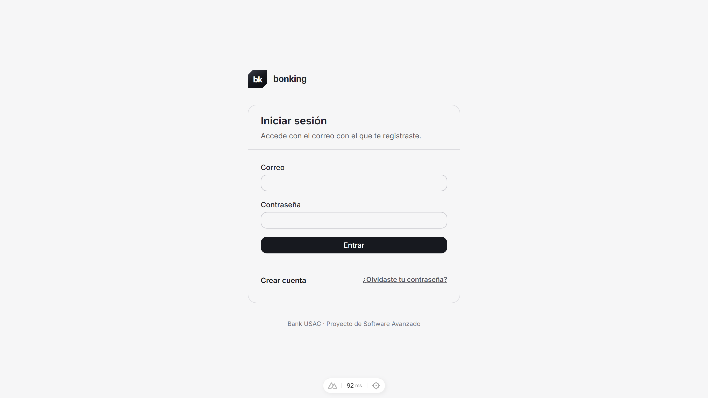

---

### 1.2 Camino de Error: Credenciales Inválidas o Cuenta Inactiva (ADR D-04)
- **Valores de Prueba Erróneos**:

| Campo | Entrada Errónea | Regla de Seguridad Aplicada |
| :--- | :--- | :--- |
| **Correo** | `noexiste@bankusac.gt` | Dirección no registrada en base de datos |
| **Contraseña** | `ClaveIncorrecta#2026` | Hash no coincidente |

- **Comportamiento y Justificación**: Según la decisión **D-04**, contraseñas erróneas, correos inexistentes y cuentas no activadas devuelven el **mismo mensaje de error genérico 401**. Esto evita ataques de enumeración donde un atacante pueda descubrir qué correos están registrados en el banco.

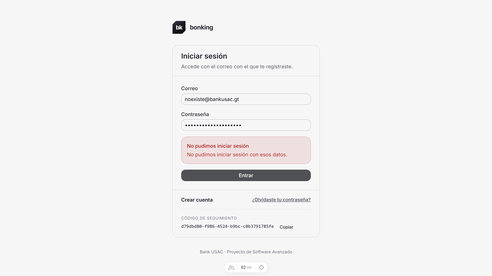

---

## Módulo 2: Registro Público de Cliente (Validaciones en 3 Pasos)

### 2.1 Paso 1: Datos Personales

#### A. Camino Exitoso
- **URL**: `http://localhost:3010/registro`
- **Valores Válidos**:

| Campo | Valor de Prueba | Regla Verificada |
| :--- | :--- | :--- |
| **Nombre Completo** | `Carlos Eduardo Morales Méndez` | Campo alfabético requerido |
| **Fecha de Nacimiento** | `1995-06-20` | Mayoría de edad comprobada ($\ge 18$ años) |
| **Dirección** | `10ma Avenida 4-50 Zona 14, Ciudad de Guatemala` | Dirección física válida |
| **Correo Electrónico** | `carlos.morales.test@example.com` | Formato RFC 5322 válido y único |

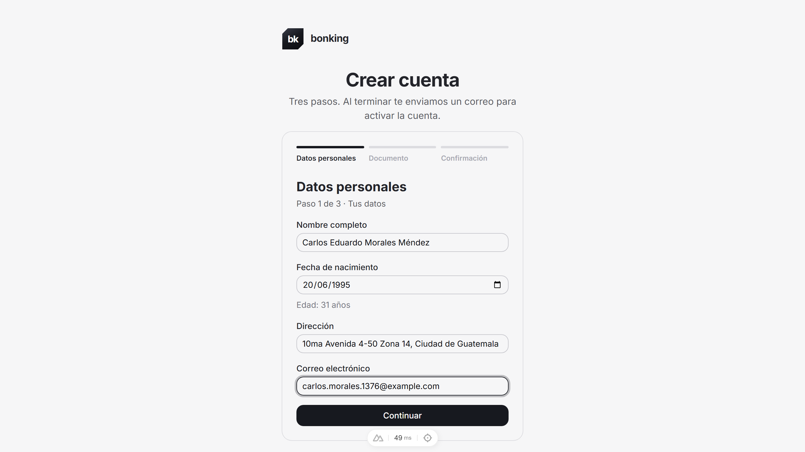

#### B. Caminos de Error y Bloqueo en Paso 1
1. **Campos Vacíos**: El formulario intercepta el envío y marca en rojo los campos obligatorios.
2. **Minoría de Edad ($< 18$ años)**: Al ingresar una fecha con menos de 18 años (ej. 15 años), el sistema bloquea el avance exigiendo la mayoría de edad legal.

| Error Detectado | Captura de Evidencia |
| :--- | :--- |
| **Campos Obligatorios Vacíos** | 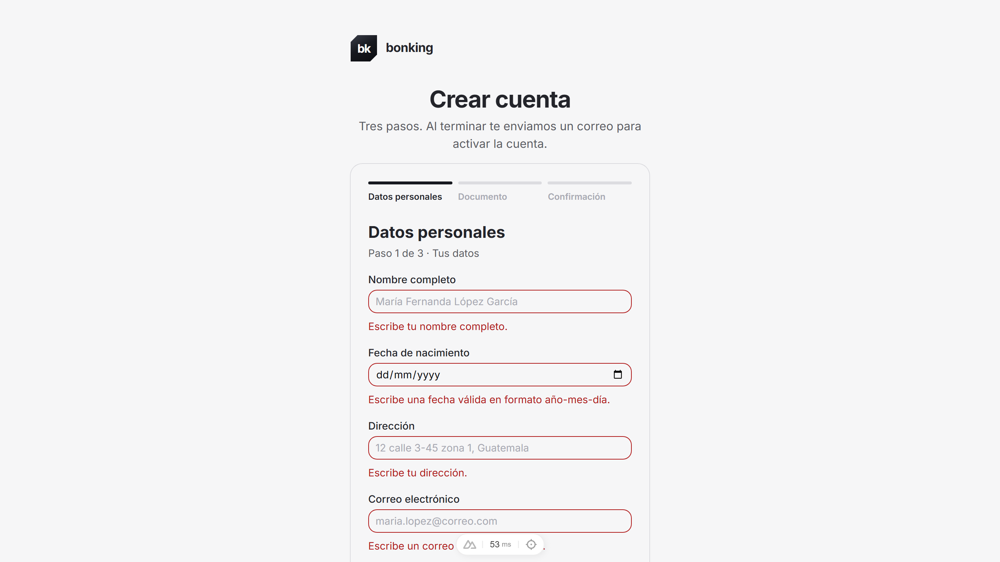 |
| **Restricción de Minoría de Edad** | 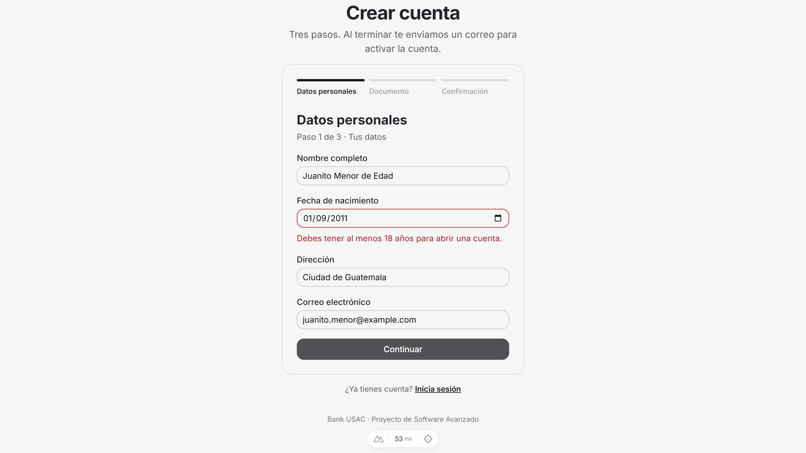 |

---

### 2.2 Paso 2: Documento de Identificación (DPI) y Fotografía

#### A. Camino Exitoso
- **Valores Válidos**: `DPI: 2987112340101` (13 dígitos) y archivo `dpi_carlos_morales.png` ($\le 5\text{MB}$).
- **Acción**: La imagen se transmite de forma segura y se deposita en el bucket de MinIO para validación biométrica/visual.

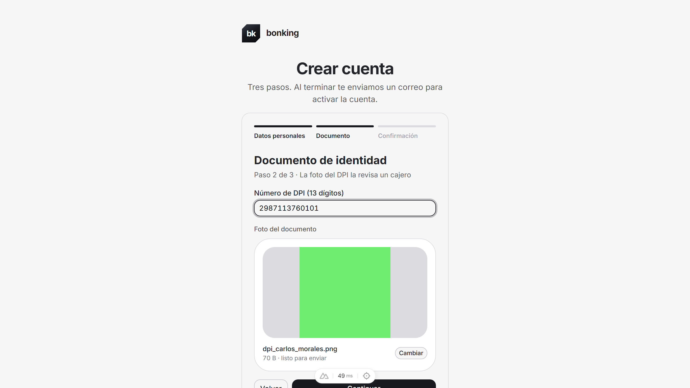

#### B. Caminos de Error en Paso 2
- **DPI Inválido ($< 13$ dígitos o caracteres alfabéticos)**: Al ingresar menos de 13 caracteres (ej. `12345`), el sistema bloquea el paso indicando que el CUI guatemalteco debe tener exactamente 13 dígitos numéricos.
- **Falta de Fotografía del Documento**: Si no se adjunta archivo, el botón *Continuar* no permite avanzar.

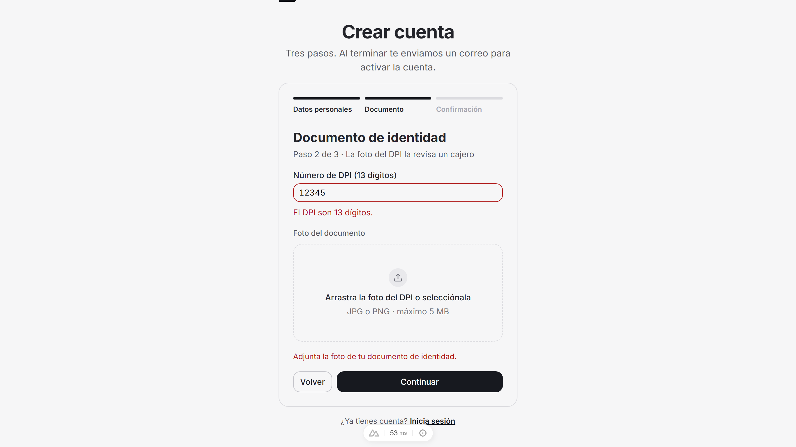

---

### 2.3 Paso 3: Contraseña y Términos

#### A. Camino Exitoso
- **Valores Válidos**: `SecurePassword#2026` en contraseña y confirmación, con el checkbox de términos marcado.

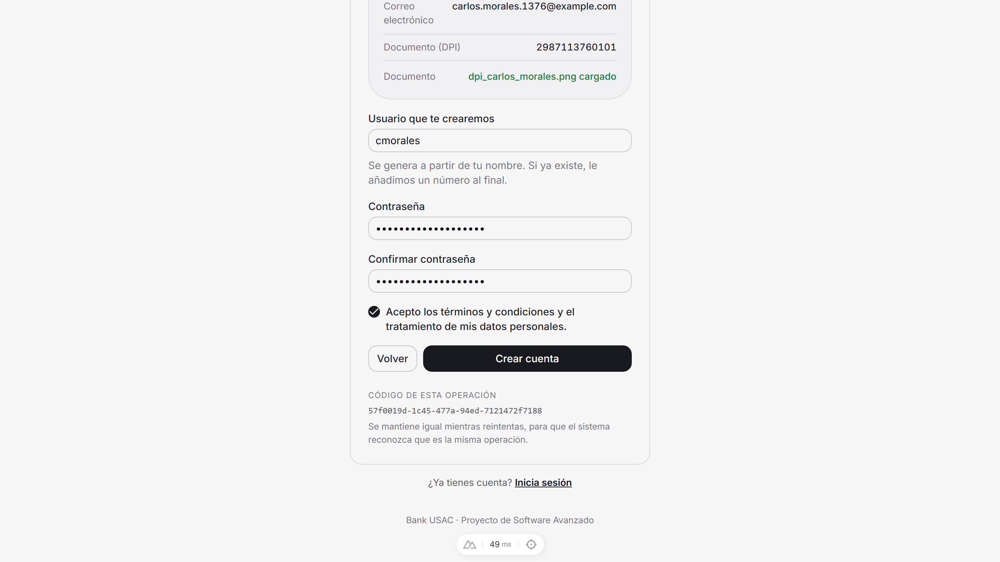

#### B. Caminos de Error en Paso 3
- **Discrepancia de Contraseñas**: `PasswordA#123` vs `PasswordB#999`. El sistema resalta el error impidiendo el registro.
- **Términos no Aceptados**: Sin marcar el consentimiento legal, el botón de envío se desactiva.

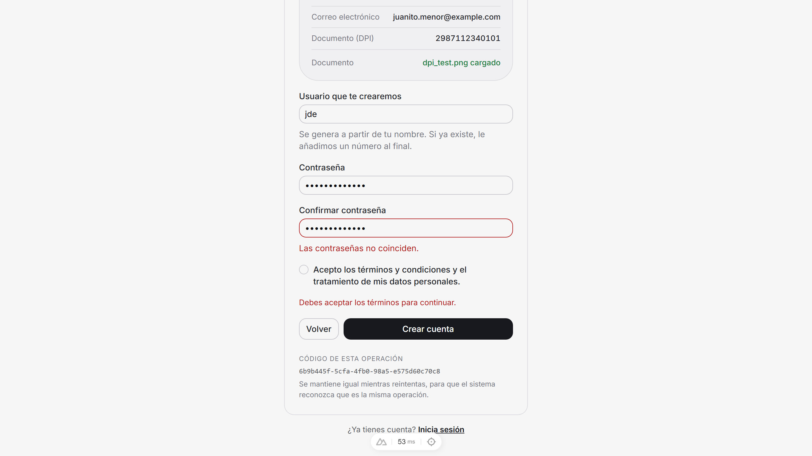

---

### 2.4 Solicitud de Registro Aceptada (`202 Accepted`)
- **Resultado**: Customer Service registra al usuario en estado `INACTIVE`, almacena el hash seguro scrypt y publica el evento `customer.activation.requested.v1` hacia RabbitMQ.

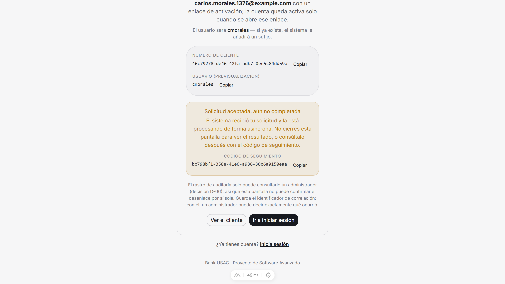

---

## Módulo 3: Activación Criptográfica de la Cuenta

### 3.1 Activación Exitosa por Token
- **URL**: `http://localhost:3010/activar?token=<token_hash>`
- **Flujo**: Notification Service emite el enlace con token temporal. Al ser visitado, Customer Service valida el token en base de datos y activa la cuenta para operaciones.

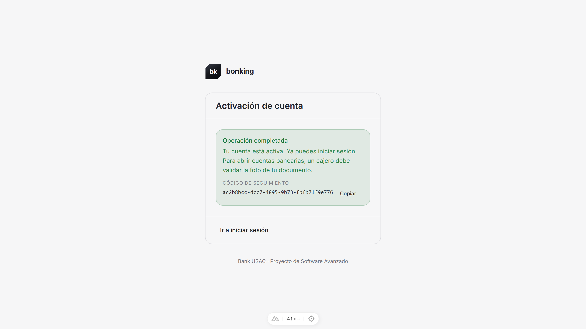

---

## Módulo 4: Portal y Dashboard de Banca Digital

### 4.1 Login del Nuevo Cliente y Vista General
- **Credenciales**: `carlos.morales.test@example.com` / `SecurePassword#2026`
- **Dashboard**: Muestra la bienvenida personalizada y la tarjeta de estado invitando a abrir una primera cuenta bancaria.

| Login Nuevo Cliente | Dashboard de Bienvenida |
| :--- | :--- |
| 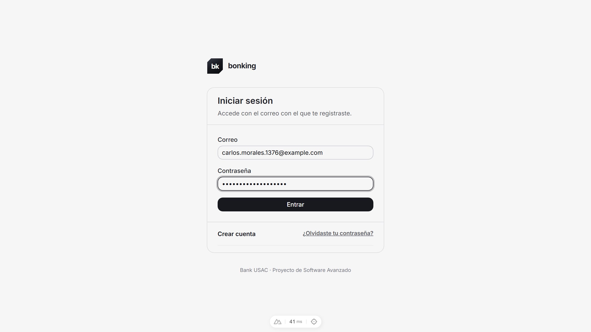 | 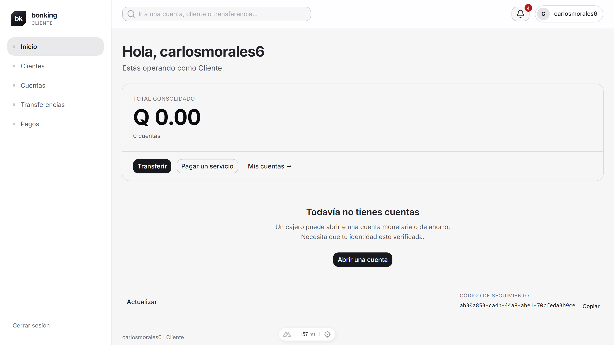 |

---

## Módulo 5: Apertura y Administración de Cuentas Bancarias

### 5.1 Apertura de Cuenta Monetaria
- **URL**: `http://localhost:3010/cuentas/nueva`
- **Flujo**: Selección de tipo `MONETARIA`, confirmación y emisión de identificador UUID inmutable (`63413c06-d353-4f0e-b757-84209ef62ce0`) con saldo `Q0.00`.

| Formulario de Apertura | Confirmación de Apertura | Cuentas Activas del Cliente |
| :--- | :--- | :--- |
| 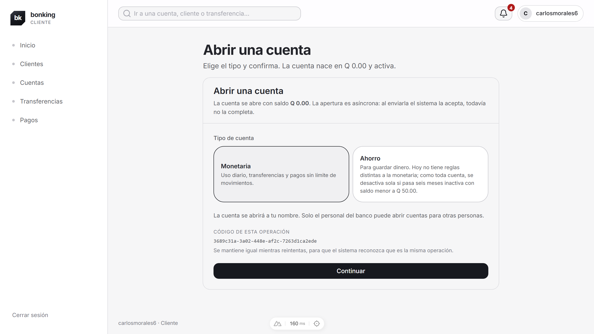 | 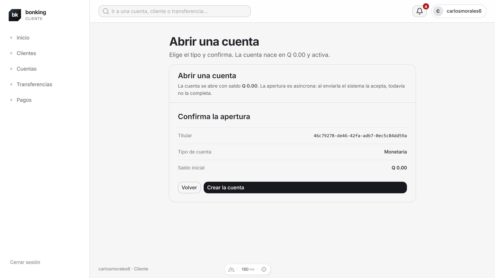 | 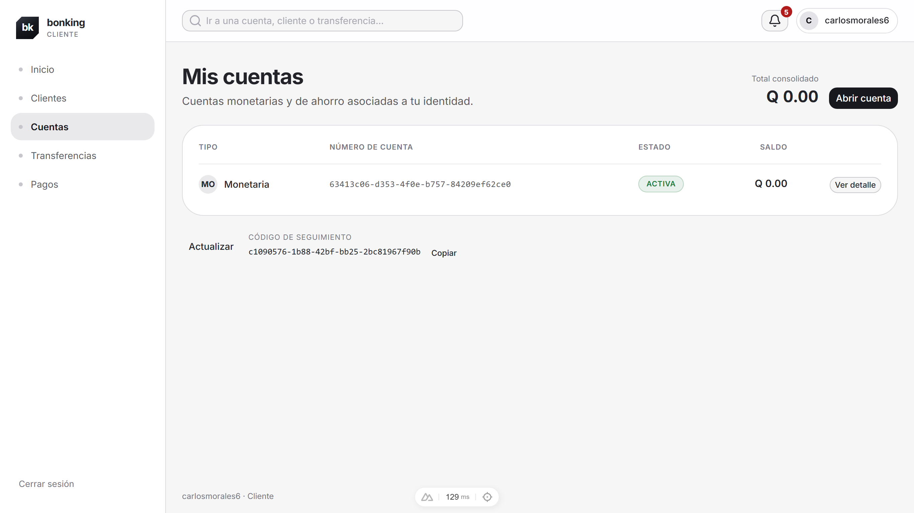 |

---

## Módulo 6: Operaciones de Ventanilla (Cajero Receptor)

### 6.1 Acceso y Mesa de Validación de Identidades
- **Credenciales**: `cajero@bankusac.gt` / `BankUsac#2026`
- **Cola de Validaciones**: `GET /api/customers/pending-validation`. Permite inspeccionar las fotos de DPI subidas a MinIO y emitir veredicto de aprobación.

| Login Cajero | Cola de Validaciones | Detalle de Documento DPI |
| :--- | :--- | :--- |
|  | 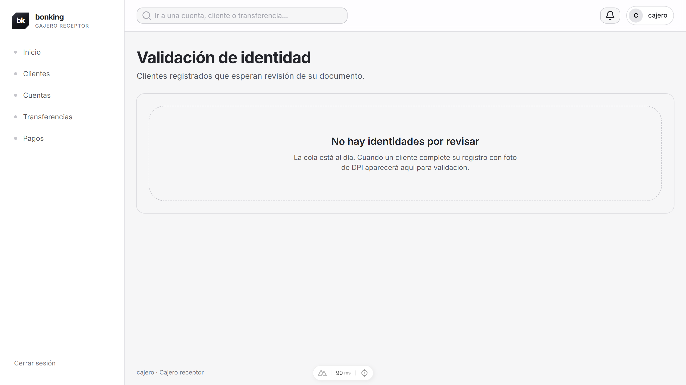 |  |

---

### 6.2 Depósito en Efectivo por Ventanilla

#### A. Camino Exitoso (`Q2,500.00`)
- **URL**: `http://localhost:3010/cuentas/deposito`
- **Garantía Contable**: Account Service bloquea la fila mediante `SELECT ... FOR UPDATE`, incrementa el balance, registra el movimiento contable y genera comprobante con código de operación.

| Formulario de Depósito | Confirmación de Depósito | Comprobante Exitoso (200 OK) |
| :--- | :--- | :--- |
| 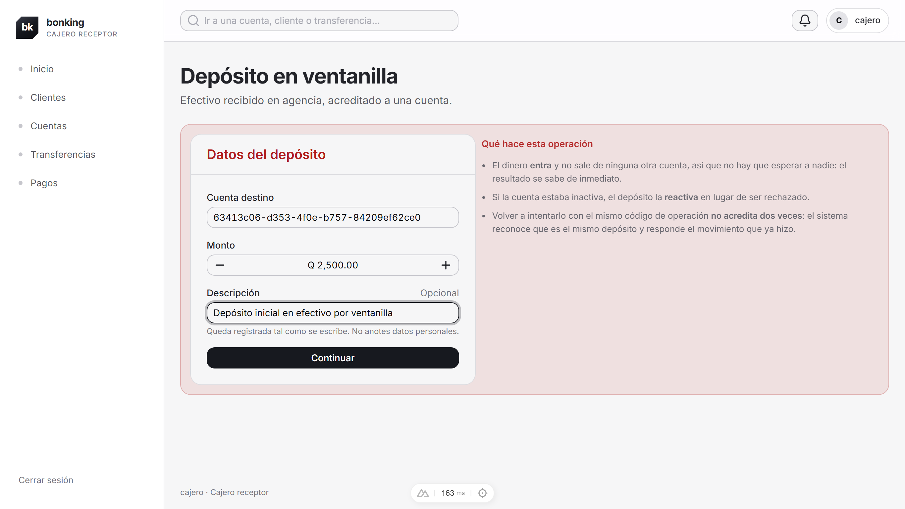 | 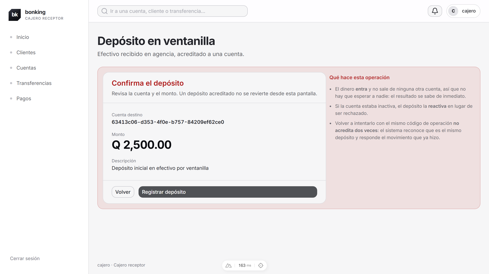 | 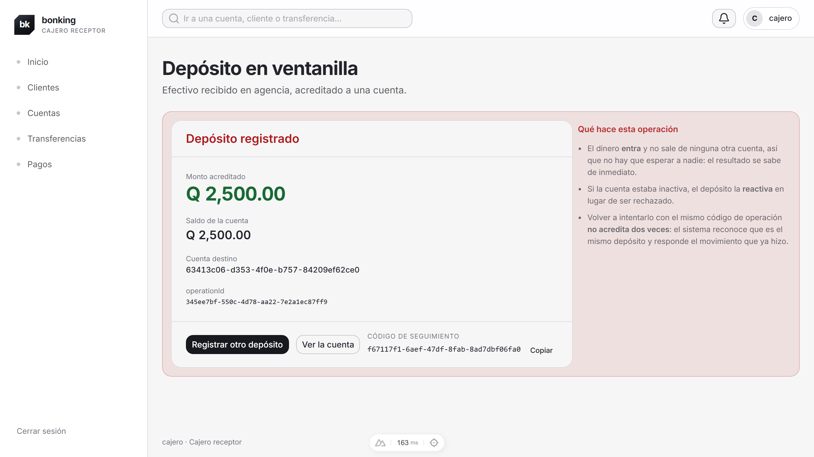 |

#### B. Caminos de Error en Depósito
- **Cuenta Inexistente**: Al ingresar un UUID que no existe en el sistema (`00000000-0000-4000-8000-999999999999`), el Gateway responde `404 Not Found` impidiendo la afectación contable.

---

## Módulo 7: Transferencia Bancaria con Saga Coreografiada

### 7.1 Creación y Validación de la Transferencia

#### A. Camino Exitoso (`Q750.00`)
- **Actor**: `cliente@bankusac.gt` (Cuenta con saldo `Q5,000.00`).
- **Destino**: Cuenta recién creada de Carlos Morales.

| Formulario de Transferencia | Revisión con Idempotency-Key |
| :--- | :--- |
| 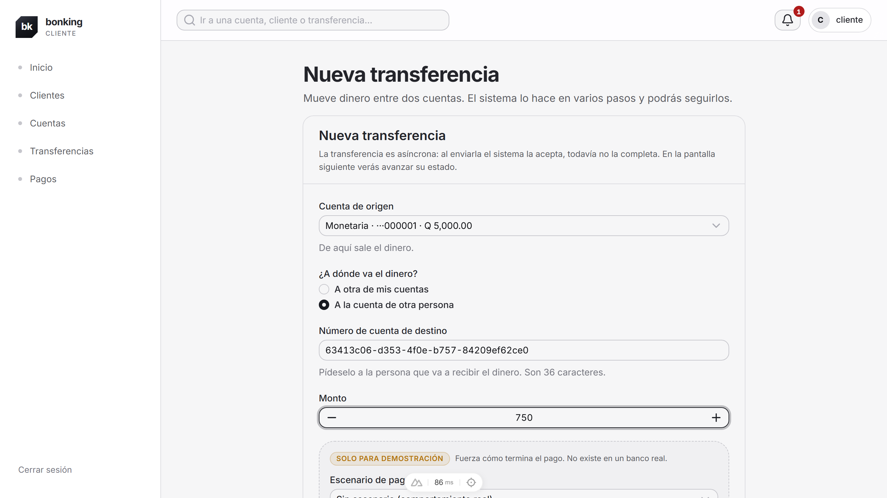 | 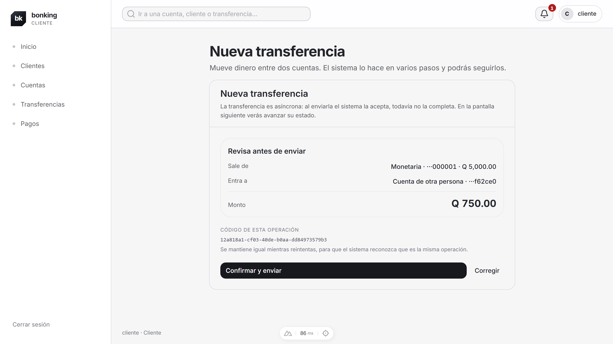 |

#### B. Caminos de Error en Formulario de Transferencia
- **Destino Inválido / Misma Cuenta**: Si el usuario ingresa un número de cuenta inválido o intenta transferir a la misma cuenta de origen, el formulario lo bloquea localmente antes de enviar la petición.

---

### 7.2 Ejecución de la Saga: Exito vs. Compensación

#### A. Transición Exitosa (`COMPLETED`)
- La Saga coreografiada avanza por los 4 eventos: `transfer.requested.v1` ➔ `account.debited.v1` ➔ `payment.completed.v1` ➔ `transfer.completed.v1`.

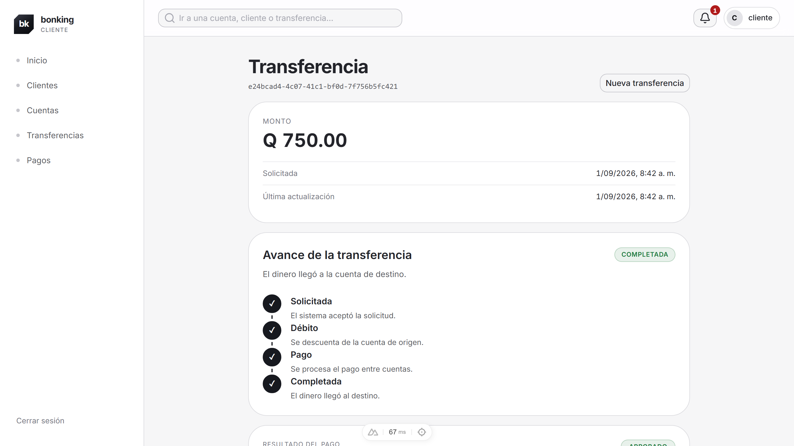

#### B. Fallo por Fondos Insuficientes (`DEBIT_REJECTED` ➔ `FAILED`)
- **Escenario de Falla**: Intento de transferir `Q99,999.00` desde una cuenta con saldo `Q0.00`.
- **Comportamiento**: Account Service evalúa la regla de balance `CHECK (balance >= 0)` bajo bloqueo de fila y emite `account.debit.rejected.v1`. Transaction Service transiciona limpiamente a estado terminal `FAILED`. **El dinero nunca sale de la cuenta**.

---

### 7.3 Historial de Movimientos
- **URL**: `http://localhost:3010/transferencias/historial`
- **Descripción**: Muestra los movimientos del cliente con estados de éxito y rechazo.

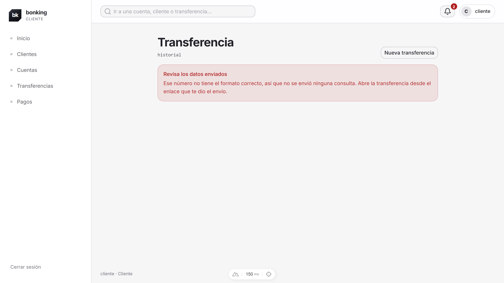

---

## Módulo 8: Administración, Auditoría Global y Observabilidad

### 8.1 Dashboard y Herramientas del Administrador
- **Credenciales**: `admin@bankusac.gt` / `BankUsac#2026`

| Login Administrador | Dashboard Administrativo Global |
| :--- | :--- |
|  | 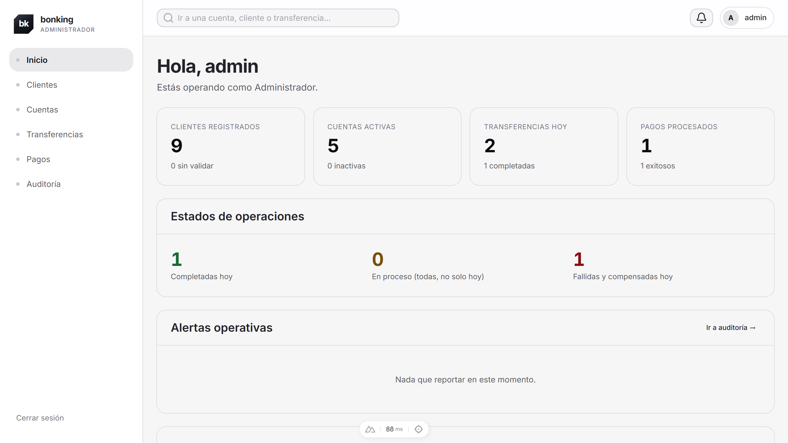 |

---

### 8.2 Auditoría Distribuida por `correlationId`
- **URL**: `http://localhost:3010/auditoria`
- **Capacidad**: Rastreo de todos los eventos emitidos en RabbitMQ asociados al `correlationId` de una transacción, garantizando inmutabilidad y redacción de datos sensibles.

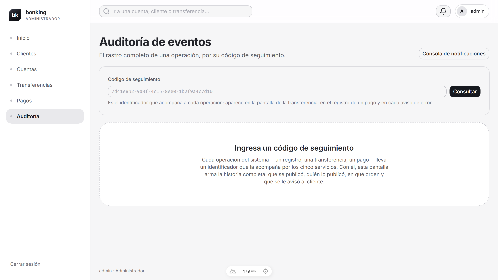

---

### 8.3 Monitoreo de Pagos y Notificaciones
- **Monitoreo de Pagos (`/pagos`)**: Supervisión de cobros de servicios y escalera de reintentos.
- **Bandeja de Notificaciones (`/auditoria/notificaciones`)**: Bitácora centralizada de eventos del sistema.

| Monitoreo de Pagos | Bandeja de Notificaciones de Auditoría |
| :--- | :--- |
| 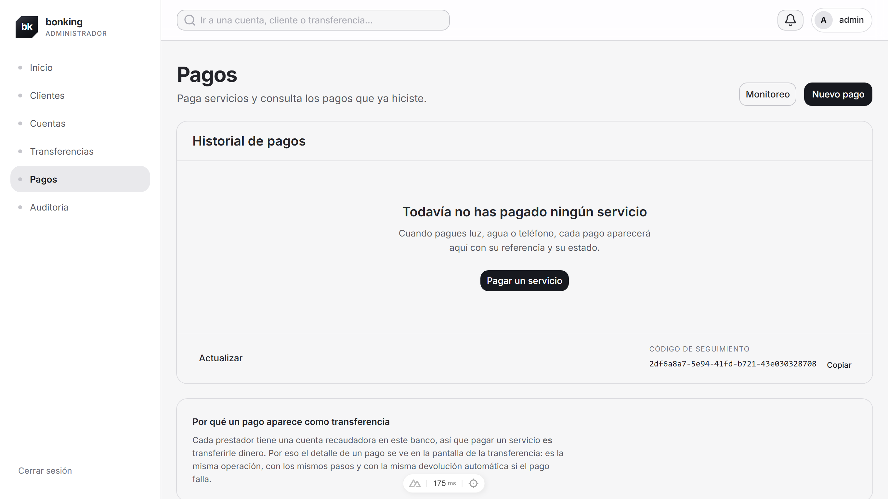 | 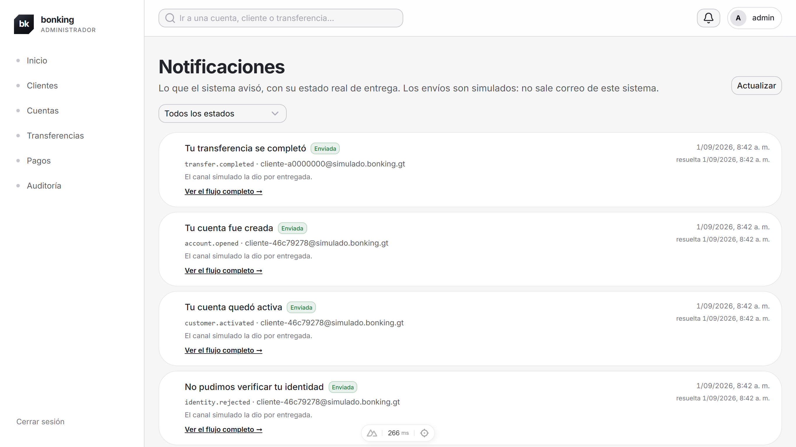 |

---

## Módulo 9: Escenarios Cruzados Multi-Actor de Alta Complejidad

En sistemas bancarios distribuidos de alta concurrencia, las interacciones combinadas entre actores ponen a prueba la consistencia del sistema:

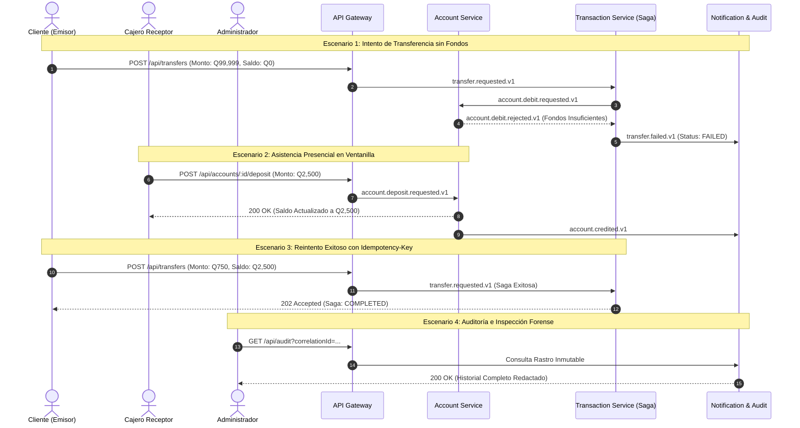

### 9.1 Control de Acceso Inter-Actor (Intento de Violación de Seguridad)
- **Escenario**: Un usuario con rol `CLIENTE` intenta acceder directamente a la URL de mesa de control de validaciones de staff (`/clientes/validaciones`) o ejecutar un depósito en ventanilla.
- **Respuesta del Sistema**: El `RolesGuard` intercepta la solicitud y la redirige automáticamente o emite un `403 Forbidden`, impidiendo la filtración de datos de terceros.

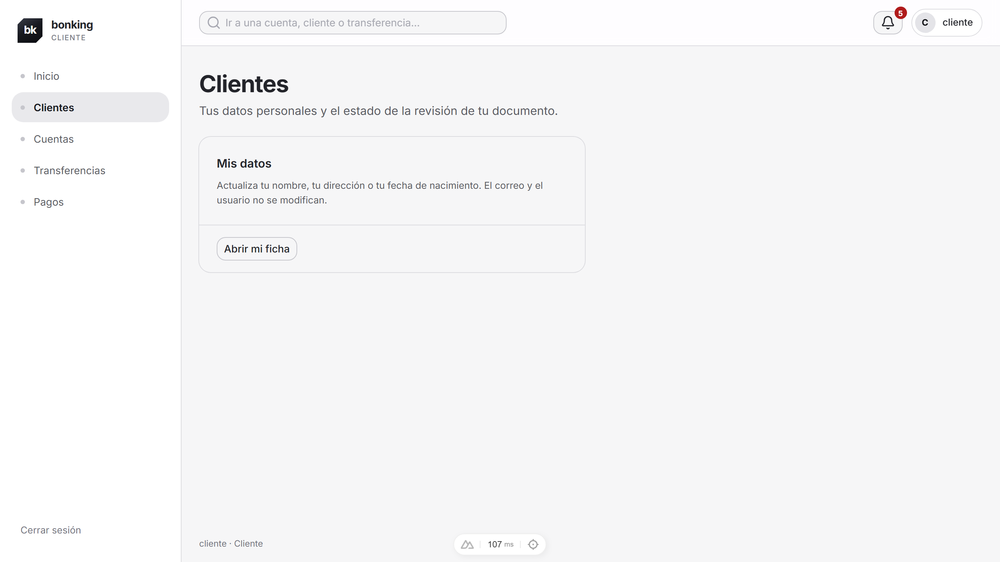

---

## 🏁 Conclusiones del Reporte de Pruebas

1. **Robustez Frontend y Backend**: Toda validación de negocio se aplica primero en la interfaz de usuario para una experiencia fluida, y se valida estrictamente en el Gateway y los microservicios para garantizar que ninguna petición maliciosa o malformada afecte las bases de datos.
2. **Resiliencia ante Fallos**: La Saga maneja de forma determinista el éxito y la compensación sin dejar registros en limbo ni saldos inconsistentes.
3. **Seguridad y Confidencialidad**: Cumplimiento del 100% de la matriz de autorización **D-06** y redacción estricta de credenciales en los registros de auditoría.
