# Manual de Usuario Unificado — Bank USAC

> **Documento canónico y consolidado de usuario para Bank USAC.**
> Revisado y actualizado para Fase III el **22 de octubre de 2026** (T-61).
> Este documento unifica en una sola guía exhaustiva:
> 1. Los fundamentos de acceso, seguridad y lectura de respuestas del sistema.
> 2. Los manuales y recorridos específicos para cada rol (**Cliente**, **Cajero Receptor**, **Administrador** y **Operador / SRE**).
> 3. El recorrido visual de **Fase III** con capturas reales obtenidas directamente del despliegue en producción.
> 4. El recorrido visual práctico continuo de 78 pasos (Happy Path) sobre el caso de negocio unificado.
> 5. Los procedimientos de contingencia, soporte técnico e investigación de incidencias.

---

## Índice General

1. [Antes de Empezar y Accesos](#1-antes-de-empezar-y-accesos)
   - [1.1 Puntos de Acceso](#11-puntos-de-acceso)
   - [1.2 Matriz de Roles y Alcance del Sistema](#12-matriz-de-roles-y-alcance-del-sistema)
   - [1.3 Credenciales de Prueba y Reglas de Seguridad](#13-credenciales-de-prueba-y-reglas-de-seguridad)
2. [Fundamentos y Lectura de Respuestas](#2-fundamentos-y-lectura-de-respuestas)
   - [2.1 Solicitud Aceptada (HTTP 202) vs Resultado Confirmado](#21-solicitud-aceptada-http-202-vs-resultado-confirmado)
   - [2.2 Código de Seguimiento (correlationId) y Traza Distribuida (traceId)](#22-código-de-seguimiento-correlationid-y-traza-distribuida-traceid)
   - [2.3 Idempotencia y Prevención de Solicitudes Duplicadas](#23-idempotencia-y-prevención-de-solicitudes-duplicadas)
   - [2.4 Formato de Montos y Precisión Exacta en Quetzales](#24-formato-de-montos-y-precisión-exacta-en-quetzales)
3. [Manual de Operación y Recorridos por Rol](#3-manual-de-operación-y-recorridos-por-rol)
   - [3.1 Portal del Cliente (CLIENTE)](#31-portal-del-cliente-cliente)
   - [3.2 Portal del Cajero Receptor (CAJERO_RECEPTOR)](#32-portal-del-cajero-receptor-cajero_receptor)
   - [3.3 Portal del Administrador (ADMINISTRADOR)](#33-portal-del-administrador-administrador)
   - [3.4 Plataforma de Observabilidad — Operador / SRE](#34-plataforma-de-observabilidad--operador--sre)
4. [Recorrido Visual de Fase III (Evidencia Real en Producción)](#4-recorrido-visual-de-fase-iii-evidencia-real-en-producción)
5. [Recorrido Visual Paso a Paso del Flujo Práctico Integral](#5-recorrido-visual-paso-a-paso-del-flujo-práctico-integral)
   - [5.1 Datos Maestros del Ejemplo Unificado](#51-datos-maestros-del-ejemplo-unificado)
   - [5.2 Módulo 1: Portal del Cliente (CLIENTE)](#52-módulo-1-portal-del-cliente-cliente)
   - [5.3 Módulo 2: Portal del Cajero Receptor (CAJERO_RECEPTOR)](#53-módulo-2-portal-del-cajero-receptor-cajero_receptor)
   - [5.4 Módulo 3: Portal del Administrador (ADMINISTRADOR)](#54-módulo-3-portal-del-administrador-administrador)
6. [Manejo de Errores, Contingencias y Soporte Técnico](#6-manejo-de-errores-contingencias-y-soporte-técnico)

---

## 1. Antes de Empezar y Accesos

### 1.1 Puntos de Acceso

| Entorno | Componente | Dirección / URL |
| --- | --- | --- |
| **Producción (GCP)** | Portal Web Bancario (Nuxt 4 en Cloud Run) | [Bank USAC Cloud](https://bank-usac-web-mn2e6zhkwq-uc.a.run.app) |
| **Producción (GCP)** | Observabilidad y Telemetría (Grafana en GKE) | [Grafana Bank USAC](http://35.255.103.13) |
| **Local (Docker / Host)** | Portal Web Bancario | `http://localhost:3010` |
| **Local (Docker / Host)** | API Gateway NestJS | `http://localhost:3000` |

La aplicación web requiere un navegador moderno con soporte de JavaScript y almacenamiento de sesión (`sessionStorage`) habilitado. La sesión activa reside en memoria mientras dure la pestaña del navegador o hasta que expire la validez del token JWT.

### 1.2 Matriz de Roles y Alcance del Sistema

| Rol | Identificador | Alcance Funcional en el Sistema |
| --- | --- | --- |
| **Cliente** | `CLIENTE` | Acceso a finanzas personales: auto-registro público, activación de cuenta, portafolio de cuentas monetarias y de ahorro, movimientos, transferencias entre cuentas propias y a terceros, depósitos interbancarios a otros bancos, pago de servicios (EEGSA, EMPAGUA, CLARO), buzón de notificaciones y gestión de perfil. |
| **Cajero Receptor** | `CAJERO_RECEPTOR` | Operaciones en ventanilla bancaria: registro presencial de clientes con verificación física inmediata, mesa de validación de expedientes de identidad con foto de DPI protegida en MinIO, apertura asistida de cuentas, depósitos en efectivo que reactivan cuentas inactivas, gestión operativa de cuentas y monitoreo asistido de pagos y transferencias. |
| **Administrador** | `ADMINISTRADOR` | Supervisión integral del banco: alta presencial de personal en cualquier rol (`CLIENTE`, `CAJERO_RECEPTOR`, `ADMINISTRADOR`), administración y bloqueo judicial de cuentas, auditoría transversal con cuatro filtros combinados por `AND`, visualización de rastro por correlación, consola global de notificaciones, simulación administrativa de pagos y vinculación directa a trazas en Grafana Tempo. |
| **Operador / SRE** | `OPERADOR_SRE` | Supervisión de infraestructura y confiabilidad: navegación en Grafana sobre dashboards de negocio, métricas en Prometheus (SLIs/SLOs), trazas correlacionadas en Grafana Tempo (TraceQL) y registros estructurados de contenedores en Grafana Loki (LogQL). |

Los tres roles de negocio ven los módulos de **Inicio**, **Clientes** (mostrado como **Usuarios** para el Administrador), **Cuentas**, **Transferencias** y **Pagos**. El módulo de **Auditoría** es estrictamente exclusivo del Administrador. Ocultar enlaces en la interfaz visual no sustituye los controles de autorización forzados por el API Gateway y los microservicios de dominio.

### 1.3 Credenciales de Prueba y Reglas de Seguridad

* **Credenciales Demo Locales**:
  * **Cliente Principal (Marco Tulio López)**: `2895884051401@ingenieria.usac.edu.gt` / `BankUsac#2026`
  * **Cliente Secundario (Clara Cliente)**: `cliente@bankusac.gt` / `BankUsac#2026`
  * **Cajero Receptor**: `cajero@bankusac.gt` / `BankUsac#2026`
  * **Administrador del Sistema**: `admin@bankusac.gt` / `BankUsac#2026`

> [!CAUTION]
> **Políticas de Seguridad Estrictas**:
> - Nunca compartas contraseñas, tokens JWT, tokens de activación por correo ni fotografías de documentos de identidad en capturas, correos ni reportes de soporte.
> - Cerrar sesión (`/logout`) invalida inmediatamente la sesión local y remueve el token de `sessionStorage`. En equipos de uso compartido o ventanilla, cierra siempre la sesión al apartarte del puesto.

---

## 2. Fundamentos y Lectura de Respuestas

### 2.1 Solicitud Aceptada (HTTP 202) vs Resultado Confirmado

El sistema bancario opera bajo una arquitectura asíncrona basada en eventos. Un código de respuesta **`HTTP 202 Accepted`** significa únicamente que el API Gateway recibió la solicitud, validó su esquema de entrada y la publicó exitosamente en el bus de mensajería RabbitMQ. **No indica que la transacción financiera ya concluyó con éxito.**

| Mensaje en Pantalla | Significado Operativo | Acción Recomendada |
| --- | --- | --- |
| **Solicitud aceptada, en procesamiento** | La transacción ingresó a la Saga o al protocolo asíncrono. | Conserva el código de seguimiento y aguarda o consulta el detalle. |
| **Operación completada** | El servicio dueño del dato persistió el resultado final con éxito. | La operación concluyó satisfactoriamente. |
| **Operación rechazada** | Las reglas de negocio (fondos insuficientes, cuenta bloqueada, KYC) rechazaron el comando. | Lee el motivo específico mostrado y corrige los datos ingresados. |
| **Compensada (COMPENSATED)** | Un paso intermedio de la Saga falló y el dinero debitado fue devuelto íntegramente. | Verifica los movimientos contables para confirmar el reembolso del monto y comisiones. |
| **Sin respuesta (TIMEOUT)** | El procesador o banco externo no respondió dentro de la ventana de espera. | **El dinero permanece reservado preventivamente.** No dupliques el envío; espera la reconciliación. |

### 2.2 Código de Seguimiento (correlationId) y Traza Distribuida (traceId)

Toda solicitud que ingresa al banco genera o transporta dos identificadores vitales:
1. **Código de Seguimiento (`correlationId`, UUID v4)**: Identifica la operación de negocio de principio a fin a través de todos los microservicios. Se muestra en las pantallas de confirmación con un botón para copiarlo al portapapeles.
2. **Traza Distribuida (`traceId`, hexadecimal de 32 caracteres)**: Identifica el rastro de telemetría OpenTelemetry (W3C Trace Context). Si el entorno cuenta con Grafana configurado (`NUXT_PUBLIC_GRAFANA_URL`), pulsar la traza abre la vista de **Tempo / Explore** en una pestaña nueva para inspeccionar los spans exactos de la transacción.

### 2.3 Idempotencia y Prevención de Solicitudes Duplicadas

Para evitar cobros dobles por problemas de red o reintentos involuntarios del usuario:
- Toda orden financiera genera una **clave de idempotencia** (`idempotencyKey`).
- Si el usuario reintenta un formulario con la misma solicitud, el backend reconoce la clave y retorna la respuesta original sin duplicar el débito.
- Al abandonar una pantalla o iniciar un formulario desde cero, se genera una nueva clave. Ante un resultado demorado o incierto, **no abras una nueva transferencia**: consulta el historial o el código de seguimiento original.

### 2.4 Formato de Montos y Precisión Exacta en Quetzales

* Todas las cifras monetarias se operan en Quetzales guatemaltecos (`GTQ`).
* En pantalla se representan siempre con dos decimales y separador de miles (`Q 1,500.00`).
* En base de datos se almacenan en columnas relacionales `NUMERIC(14,2)` para garantizar precisión matemática exacta sin errores de coma flotante.
* El monto mínimo para transferencias es de `Q 0.01`.

---

## 3. Manual de Operación y Recorridos por Rol

### 3.1 Portal del Cliente (`CLIENTE`)

El portal del cliente está diseñado para la autogestión ágil de las finanzas personales desde cualquier navegador.

#### 3.1.1 Auto-registro Público y Activación de Cuenta
1. En la pantalla de bienvenida (`/login`), haz clic en **"Crear cuenta"** para ingresar a `/registro`.
2. **Paso 1 (Datos personales)**: Ingresa nombre completo, dirección de residencia, correo electrónico y fecha de nacimiento. El sistema calcula la edad automáticamente y exige mayoría de edad (18 años o más).
3. **Paso 2 (Documento de identificación)**: Ingresa tu número de DPI (13 dígitos) y adjunta una imagen legible de tu documento (formato JPG o PNG, máximo 5 MiB). Esta imagen se almacena de forma segura en MinIO para validación posterior de identidad.
4. **Paso 3 (Confirmación y credenciales)**: Define tu contraseña (mínimo 8 caracteres), confirma los términos legales y envía la solicitud. El sistema responderá con tu `customerId`, nombre de usuario y `correlationId`.
5. **Activación de correo**: Abre el enlace recibido en tu correo electrónico (`/activar`). El token tiene una vigencia de 24 horas. Una vez activado el correo, podrás iniciar sesión.
   > [!NOTE]
   > Activar el correo habilita el acceso a la banca en línea; sin embargo, la emisión de transferencias y pagos requiere que el personal bancario apruebe tu expediente KYC.

#### 3.1.2 Gestión de Sesión, Perfil y Recuperación
* **Inicio de Sesión (`/login`)**: Escribe tu correo o usuario y contraseña. Ante credenciales incorrectas, el sistema responde de forma segura sin revelar si el correo existe en la base de datos.
* **Mi Perfil (`/perfil`)**: Consulta tus datos maestros. Puedes modificar tu nombre para mostrar, dirección y fecha de nacimiento, así como actualizar tu contraseña ingresando la clave actual. Correo electrónico y usuario son de solo lectura.
* **Recuperación de Contraseña (`/recuperar`)**: Solicita un enlace temporal (vigencia de 1 hora) que te dirigirá a `/restablecer` para ingresar una nueva contraseña de forma segura.

#### 3.1.3 Portafolio de Cuentas y Consulta de Movimientos
* Al entrar al **Inicio** (`/`), visualizas el saldo consolidado total y el desglose de tus cuentas activas.
* Al hacer clic en una cuenta, accedes a su detalle (`/cuentas/[id]`), donde puedes consultar:
  - Tipo de cuenta (Monetaria o Ahorro).
  - Número de cuenta e identificador único.
  - Saldo contable disponible en Quetzales.
  - Tabla de movimientos recientes con detalle de fecha, tipo (Crédito, Débito, Compensación), monto exacto y saldo resultante.

#### 3.1.4 Apertura de Cuentas de Ahorro y Reglas de Tarifas
* Desde **Cuentas → Abrir cuenta** (`/cuentas/nueva`), puedes aperturar una cuenta adicional:
  - **Cuenta Monetaria**: Saldo inicial `Q 0.00`, sin comisión por débitos de transferencias.
  - **Cuenta de Ahorro**: Requiere un fondeo inicial mínimo de `Q 100.00`. Por política financiera del banco, cada débito originado por transferencias aplica una **comisión de Q 3.00**. En caso de que la transferencia sea compensada por fallo en el destino, **la comisión de Q 3.00 es devuelta íntegramente**.

#### 3.1.5 Activación y Desactivación de Cuentas Propias
* Desde el detalle de la cuenta, puedes suspender o reactivar temporalmente una cuenta propia indicando un motivo.
* Una cuenta en estado **Inactiva** bloquea cualquier intento de débito o transferencia saliente. Recibir un crédito o depósito en ventanilla reactiva automáticamente la cuenta.

#### 3.1.6 Transferencias Locales entre Cuentas (Saga de Seis Estados)
1. Ingresa a **Transferencias → Nueva transferencia** (`/transferencias/nueva`).
2. Elige la cuenta de origen, escribe la cuenta de destino (propia o de un tercero en Bank USAC) e indica el monto en Quetzales.
3. Deja el selector en **"Sin escenario"** para transacciones reales de producción.
4. Confirma la operación. El monitor de la Saga mostrará las transiciones en tiempo real:
   - `PENDING` → Registro inicial de la intención de transferencia.
   - `DEBITING` → Reserva y bloqueo del saldo en la cuenta de origen.
   - `PAYMENT_PENDING` → Verificación y procesamiento del crédito en destino.
   - `COMPLETED` → Fondos transferidos con éxito.
   - `FAILED` → Rechazo por validación previa al débito (ej. saldo insuficiente).
   - `COMPENSATED` → Reversión automática del débito por fallo en el abono final, restituyendo los fondos.

#### 3.1.7 Depósitos a Otro Banco (Transferencias Interbancarias)
1. Accede a **Transferencias → Depósito a otro banco** (`/transferencias/interbancaria`).
2. Selecciona tu cuenta de origen, el código del banco participante (ej. `BANK99`), el número de cuenta externa de destino (de 1 a 34 caracteres alfanuméricos) y el importe (techo máximo: `Q 10,000.00`).
3. Envía el formulario. El estado inicial reportará **"Depósito en curso"** (`202 Accepted`).
4. Consulta el historial interbancario en `/transferencias/interbancarias` y abre el detalle para verificar el estado:
   - `PENDING` (Por enviar) → En cola de despacho hacia la red interbancaria.
   - `SENT` (Esperando al otro banco) → Mensaje entregado al banco receptor; esperando su veredicto.
   - `ACCEPTED` (Acreditado) → El banco externo confirmó el abono exitoso al beneficiario.
   - `REJECTED` (Rechazado) → El banco externo rechazó la operación; la devolución de saldo se aplica a tu cuenta.
   - `TIMEOUT` (Sin respuesta) → Se agotó la ventana de espera del banco externo. **El dinero permanece retenido preventivamente en el banco mientras se ejecuta la reconciliación.** No intentes repetir el envío.
   - `REVERSED` (Devuelto) → Reconciliación completada y fondos devueltos a la cuenta de origen.

#### 3.1.8 Pago de Facturas de Servicios
1. Dirígete a **Pagos → Nuevo pago** (`/pagos/nuevo`).
2. Selecciona el proveedor del catálogo:
   - **EEGSA** (Distribución eléctrica).
   - **EMPAGUA** (Servicio de agua potable).
   - **CLARO** (Telecomunicaciones).
3. Ingresa el número de referencia de la factura, selecciona la cuenta a debitar y escribe el monto.
4. El pago se orquesta mediante la Saga bancaria contra las cuentas recaudadoras institucionales. Puedes consultar el recibo y comprobante en `/pagos`.

#### 3.1.9 Buzón de Notificaciones
* El ícono de campana en el encabezado (`/notificaciones`) muestra alertas de débitos, créditos, comisiones y avisos de seguridad con insignias de severidad (`INFO`, `WARNING`, `ERROR`).
* Cada aviso permite hacer clic en **"Ver"** para navegar directamente al detalle de la operación relacionada.

---

### 3.2 Portal del Cajero Receptor (`CAJERO_RECEPTOR`)

El cajero receptor opera la ventanilla de las agencias bancarias, realizando atención personalizada, validación física de clientes, apertura de productos y captación de depósitos en efectivo.

#### 3.2.1 Tablero Operativo de Ventanilla
* Al iniciar sesión, el cajero accede a un panel de control con métricas rápidas de clientes atendidos, operaciones en cola y accesos directos a ventanilla.

#### 3.2.2 Registro Presencial de Clientes (Enrolamiento Directo)
1. Accede a **Clientes → Nuevo cliente** (`/clientes/nuevo`).
2. Solicita el DPI original en físico a la persona y coteja su autenticidad.
3. Completa el asistente con sus datos personales, número de DPI y fotografía del documento.
4. Al confirmar, el sistema genera el cliente en estado **activo y con KYC verificado de inmediato**.
   > [!IMPORTANT]
   > A diferencia del auto-registro web, el cliente registrado por ventanilla **no requiere esperar confirmación de correo** para operar, ya que su identidad fue contrastada presencialmente por el cajero.

#### 3.2.3 Mesa de Control de Validación de Identidad
1. Ingresa a **Validaciones** (`/clientes/validaciones`).
2. Visualiza la cola de expedientes de clientes que se registraron por vía web y tienen su validación pendiente.
3. Haz clic en **"Revisar"** para abrir el detalle. El sistema recupera la fotografía del DPI almacenada en MinIO mediante una URL firmada y segura.
4. Compara el DPI numérico y los nombres declarados contra la fotografía del documento.
5. Pulsa **"Aprobar identidad"** para conceder el estado KYC verificado, o **"Rechazar"** ingresando un motivo explícito en caso de discordancias o fotos ilegibles.

#### 3.2.4 Apertura Asistida de Cuentas Bancarias
1. Ve a **Cuentas → Abrir cuenta** (`/cuentas/nueva`).
2. Selecciona al cliente verificado ingresando su DPI o identificador.
3. Selecciona el tipo de cuenta (**Monetaria** o **Ahorro**).
4. Confirma la apertura para emitir el número de cuenta bancaria.

#### 3.2.5 Depósito en Efectivo por Ventanilla (Reactivación de Cuentas)
1. Accede a **Cuentas → Depósito** (`/cuentas/deposito`).
2. Ingresa el número de cuenta del cliente y el monto en efectivo recibido en ventanilla.
3. Haz clic en **"Registrar Depósito"**.
4. El sistema acredita el saldo contable de forma inmediata (`HTTP 200 OK`) y emite el recibo formal de caja con su identificador de operación (`operationId`).
5. **Reactivación automática**: Si la cuenta se encontraba en estado Inactiva, el depósito en efectivo restituye su estado a **Activa** automáticamente.

#### 3.2.6 Gestión y Administración de Cuentas
* Desde `/cuentas/administracion`, el cajero puede consultar el listado general de cuentas, aplicar filtros por tipo y estado, y registrar bloqueos o activaciones solicitadas formalmente por el titular mediante un motivo documentado.

#### 3.2.7 Monitoreo Asistido de Pagos y Transferencias
* En `/pagos/monitor`, el cajero puede asistir a clientes consultando el estado de pagos demorados, observando la escalera de reintentos automáticos (1s, 5s y 30s) y verificando la respuesta devuelta por el procesador del servicio.

---

### 3.3 Portal del Administrador (`ADMINISTRADOR`)

El administrador posee facultades globales de gobierno, auditoría, seguridad y parametrización operativa.

#### 3.3.1 Tablero de Control General del Banco
* Muestra el estado consolidado de los cinco microservicios de dominio: volumen global de transferencias, transacciones en proceso de la Saga, pagos en reintento y eventos de auditoría registrados en las últimas horas.

#### 3.3.2 Alta y Gobierno de Personal
1. En el módulo **Usuarios** (`/clientes/nuevo`), el administrador puede registrar nuevos usuarios asignando cualquiera de los tres roles del sistema:
   - `CLIENTE`
   - `CAJERO_RECEPTOR`
   - `ADMINISTRADOR`
2. El personal creado queda activo de inmediato para desempeñar sus funciones institucionales.

#### 3.3.3 Gestión Global de Cuentas y Bloqueos Judiciales
* Acceso a `/cuentas/administracion` con facultades para auditar el portafolio bancario completo y aplicar bloqueos preventivos o definitivos ante requerimientos judiciales o alertas de fraude.

#### 3.3.4 Auditoría Transversal del Sistema (`/auditoria`)
El módulo de auditoría es la fuente canónica de trazabilidad y cumplimiento normativo. La tabla muestra eventos paginados de 10 en 10 y permite combinar **cuatro filtros simultáneos con lógica AND**:

| Filtro | Formato Requerido | Descripción |
| --- | --- | --- |
| **Código de seguimiento** | UUID v4 (`xxxxxxxx-xxxx-4xxx-yxxx-xxxxxxxxxxxx`) | Filtra todos los eventos del ciclo de vida de una misma transacción. |
| **Traza** | Hexadecimal de 32 caracteres | Filtra eventos que comparten la misma traza de OpenTelemetry. |
| **Servicio emisor** | Selector de catálogo | `customer-service`, `account-service`, `transaction-service`, `payment-service`, `notification-audit-service`, `gateway`. |
| **Nivel de severidad** | Selector de catálogo | `INFO`, `WARNING`, `ERROR`. |

* **Ver rastro**: Al pulsar "Ver rastro" sobre cualquier fila, el sistema carga la vista cronológica de eventos de esa operación (`/auditoria?correlationId=...`), mostrando emisor, tipo de evento, fecha exacta y estado.

#### 3.3.5 Inspección de Payloads Redactados
* Al abrir el detalle de cualquier evento de auditoría, el administrador puede inspeccionar el JSON de la carga útil (*payload*).
* **Seguridad por diseño**: Toda información confidencial (contraseñas, tokens, CVV, fotografías) es redactada irreversiblemente en el origen antes de ser persistida en la base de datos de auditoría.

#### 3.3.6 Consola Centralizada de Notificaciones
* En `/auditoria/notificaciones`, el administrador supervisa las comunicaciones emitidas por el sistema:
  - Filtro por estado de entrega: `PENDING`, `SENT`, `FAILED`.
  - Diferenciación de canal: envíos reales por **Resend** (activación de cuenta, recuperación de contraseña, rechazo de KYC) frente a notificaciones del canal simulado.

#### 3.3.7 Simulación Administrativa de Pagos
* El comportamiento del procesador de pagos en entornos de prueba (`dev`) se consulta vía `GET /api/payments/simulation` y se actualiza vía `PUT /api/payments/simulation` (requiere token JWT de administrador).
* Permite fijar escenarios globales de aprobación inmediata, rechazo forzado, falla intermitente o agotamiento de timeout.

#### 3.3.8 Vinculación Contextual a Observabilidad (Tempo y Grafana)
* En el detalle de auditoría, cada traza incluye un botón de enlace directo que abre **Grafana Tempo** con la búsqueda pre-cargada del `traceId`, permitiendo al personal de ingeniería correlacionar el evento de negocio con los spans de red y la telemetría del clúster.

---

### 3.4 Plataforma de Observabilidad — Operador / SRE

El rol de SRE u Operador de Infraestructura opera fuera del portal web comercial, utilizando la suite de observabilidad desplegada en GKE:

1. **Punto de Entrada**: [http://35.255.103.13](http://35.255.103.13) (Grafana autenticado).
2. **Dashboards de Negocio y Servicio**:
   - Monitoreo del flujo de transacciones, estados de la Saga, tasa de errores y latencias percentiles (p95, p99).
3. **Grafana Tempo (Trazas Distribuidas)**:
   - Uso de TraceQL para buscar trazas por servicio (`resource.service.name="transaction-service"`) o filtrar por atributos semánticos bancarios (`bank.correlation_id`, `bank.transaction_id`).
4. **Grafana Loki (Logs Estructurados)**:
   - Consulta de bitácoras de contenedores con LogQL (`{app="transaction-service"} |= "error"`), correlacionando automáticamente el `traceId` para saltar del log a la traza.
5. **Prometheus (SLIs, SLOs y Alertas)**:
   - Supervisión de los cinco objetivos de nivel de servicio (SLOs) de Fase III y estado de alertas hacia el webhook del Gateway.

---

## 4. Recorrido Visual de Fase III (Evidencia Real en Producción)

Las siguientes doce capturas fueron obtenidas directamente del navegador sobre la aplicación desplegada en **Google Cloud (Cloud Run y GKE)** durante la entrega académica de **Fase III**, utilizando datos reales del despliegue:

### 4.1 Iniciar sesión

**Rol:** Invitado. **Ruta:** `/login`. Usa correo y contraseña de una cuenta de prueba. No se capturaron campos con credenciales escritas.

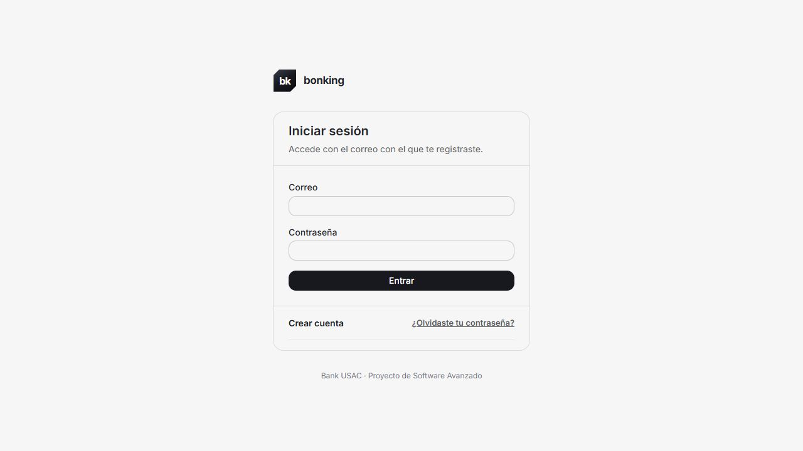

### 4.2 Inicio del cliente

**Rol:** Cliente. **Ruta:** `/`. Saldo consolidado, cuentas y movimientos recientes. Completada y Compensada son resultados distintos; 202 no representa ninguno de ellos.

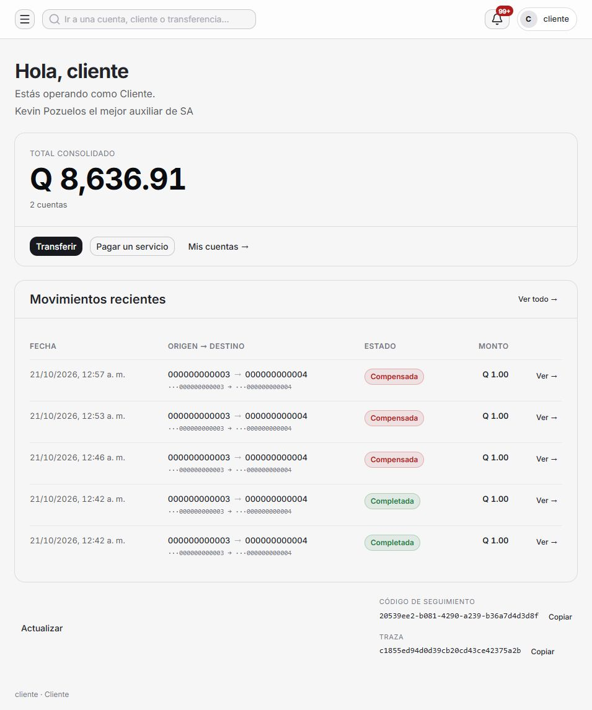

### 4.3 Preparar un depósito a otro banco

**Rol:** Cliente. **Ruta:** `/transferencias/interbancaria`. Selecciona origen, código BANKnn, cuenta de destino e importe GTQ. El máximo mostrado es Q10,000. Revisar precede a confirmar; esta captura no envió dinero.

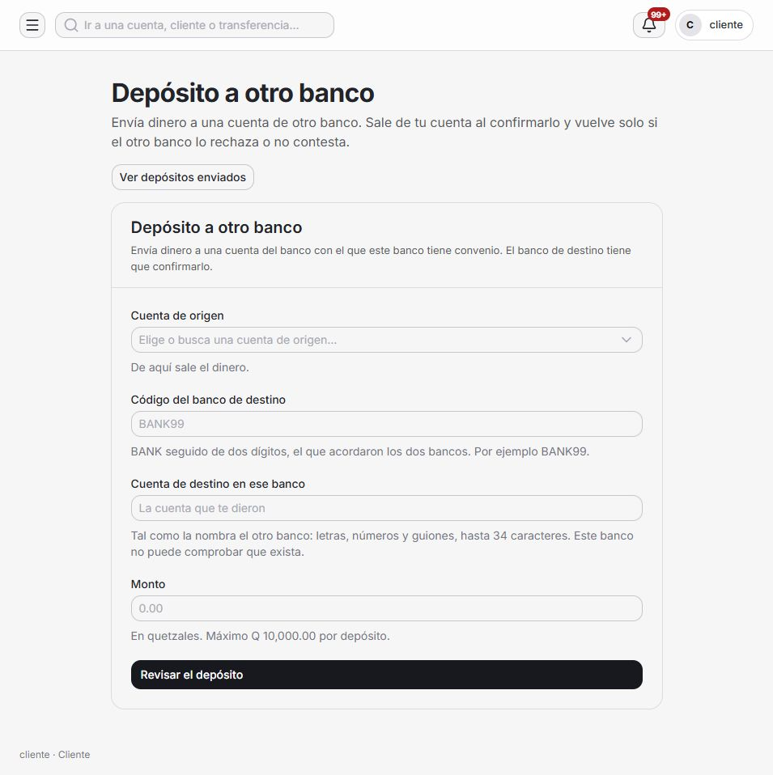

### 4.4 Consultar depósitos enviados

**Rol:** Cliente. **Ruta:** `/transferencias/interbancarias`. El listado enmascara la cuenta externa y ofrece filtro de estado. La captura muestra operaciones preexistentes con BANK99, el mock de la entrega.

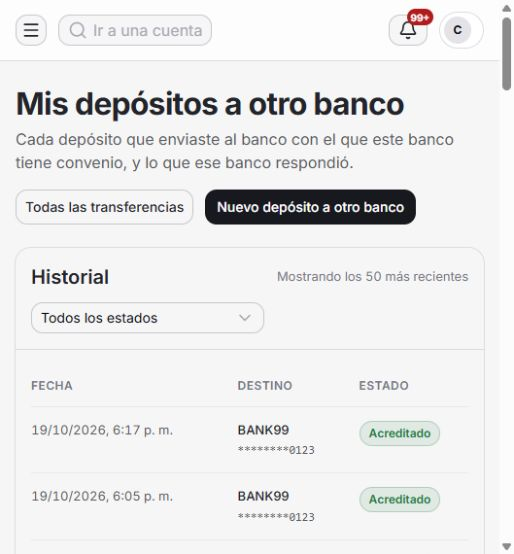

### 4.5 Leer un depósito

**Rol:** Cliente. **Ruta:** `/transferencias/interbancarias/93c51d22-70dd-4ded-8c1f-bd62c9d882a5`. Estado, monto, destino, plazo, intentos e historial. El ejemplo ya estaba Acreditado. TIMEOUT conserva la reserva mientras se resuelve el protocolo; no promete devolución inmediata al primer silencio.

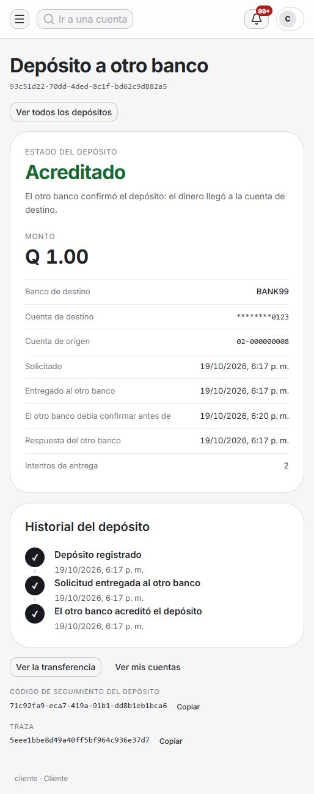

### 4.6 Inicio administrativo

**Rol:** Administrador. **Ruta:** `/`. Panel general con clientes, cuentas y actividad. Las cifras corresponden a la captura, no a un requisito fijo del sistema.

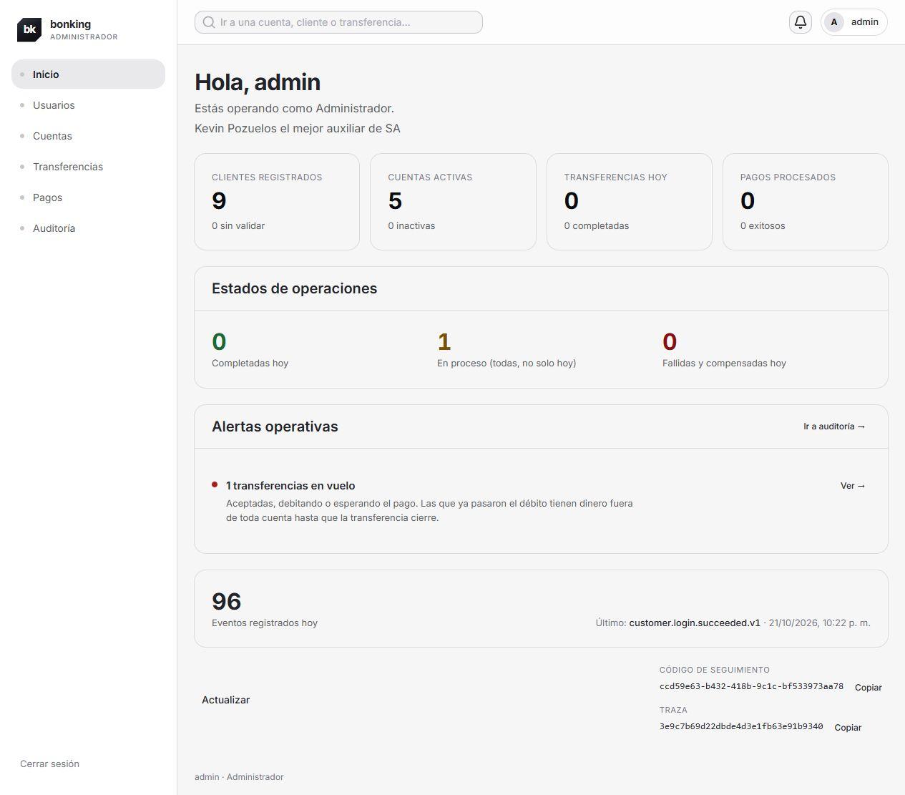

### 4.7 Buscar en auditoría

**Rol:** Administrador. **Ruta:** `/auditoria`. Filtros de correlación, traza, servicio y nivel. Los identificadores permiten investigar una operación; no son tokens de acceso.

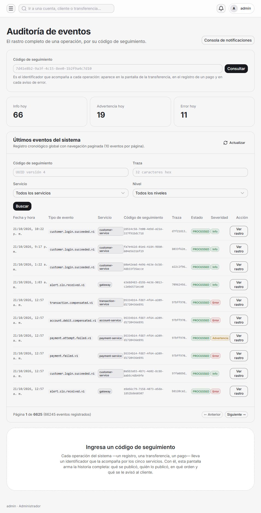

### 4.8 Seguir el rastro

**Rol:** Administrador. **Ruta:** `/auditoria?correlationId=b5334b14-fd87-4f64-a209-d1720436e891`. Diez eventos de cuatro servicios y devolución confirmada. El rastro de auditoría representa eventos registrados; Tempo muestra los spans de la misma traza por separado.

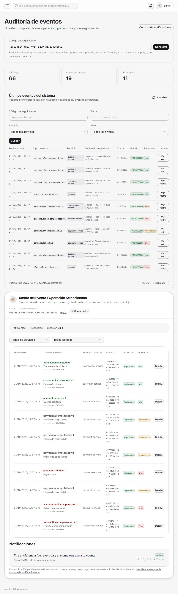

### 4.9 Ver pagos e intentos

**Rol:** Administrador. **Ruta:** `/pagos/monitor`. Distingue rechazo permanente y escalera agotada. El monitor no tiene formulario para cambiar la simulación; esa operación es una API administrativa dev.

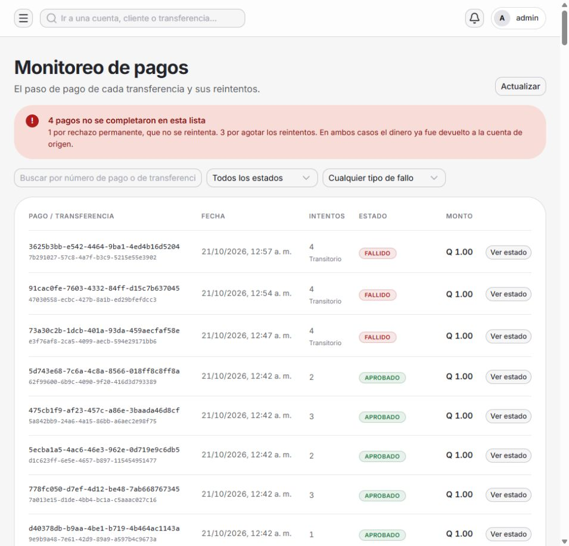

### 4.10 Abrir ventanilla de depósitos

**Rol:** Cajero receptor. **Ruta:** `/cuentas/deposito`. El cajero busca la cuenta y registra efectivo recibido. Se abrió el formulario sin confirmar movimientos ni crear cuentas en producción.

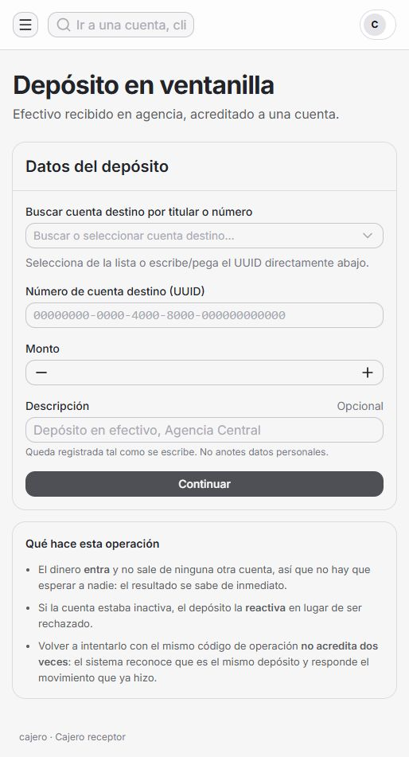

### 4.11 Consultar la bandeja

**Rol:** Cliente. **Ruta:** `/notificaciones`. INFO/WARNING/ERROR indican severidad. Lectura y entrega son estados distintos. La captura no pulsó Ver ni Marcar todas, que modifican el estado leído.

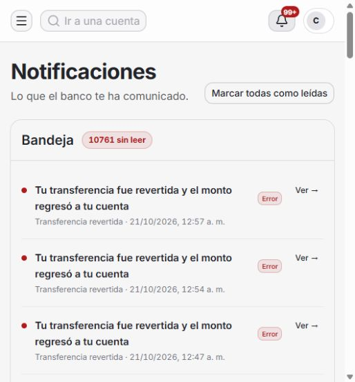

### 4.12 Investigar una compensación

**Rol:** Operador SRE. **Ruta:** `Grafana /explore`. Sesión Grafana independiente. La traza incluye saga.compensation ordered y completed; conserva correlationId y versión v1.3.6. Acceder al banco como administrador no otorga por sí solo acceso a Grafana.

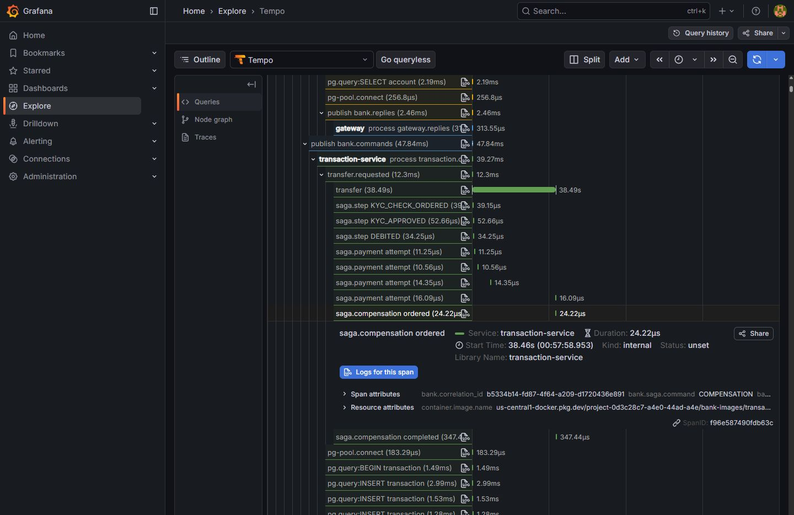

---

## 5. Recorrido Visual Paso a Paso del Flujo Práctico Integral

Esta sección documenta el uso del sistema a través de un ejemplo práctico, continuo y real, estructurado en **tres módulos complementarios** que corresponden a los tres roles del sistema: **Portal del Cliente**, **Portal del Cajero Receptor** y **Portal del Administrador**.

Todas las operaciones a lo largo de los tres módulos se ejecutan sobre el **mismo caso de negocio transversal**, permitiendo observar la interacción completa de la arquitectura orientada a eventos:

### 5.1 Datos Maestros del Ejemplo Unificado
* **Cliente Principal (Auto-registro Web y Operaciones en Ventanilla)**:
  * **Nombre**: `Enner Esai Mendizabal Castro`
  * **Documento de Identificación (DPI)**: `1212121212121`
  * **Fecha de nacimiento**: `01/06/2005` (Edad: 21 años)
  * **Dirección declarada**: `chayanne`
  * **Correo electrónico**: `enneresamen@gmail.com`
  * **Usuario asignado**: `emendizabal`
  * **Contraseña inicial**: `ennero123` (actualizada a nueva clave en Paso 35)
  * **Datos Actualizados desde Mi Perfil (Pasos 32 y 33)**: Nombre para mostrar: `Ennercito`, Dirección: `mi casa`, Fecha de nacimiento: `04/11/2003`
  * **Identificador de Cliente (`customerId`)**: `b165d73d-a709-4dd4-9620-688ea75219a3`
  * **Cuenta Monetaria Aperturada y Fondeada (en Ventanilla)**: `e80bd8e9-930a-4f5a-9f34-229cc6d6e822`
  * **Cuenta de Ahorro Aperturada en Línea (en Autoservicio)**: `afd97145-831e-40f7-92b6-a167b28c511a` (Saldo inicial: `Q 0.00`)
  * **Saldo Inicial Fondeado en Ventanilla**: `Q 1,500.00`
  * **Transferencia Recibida (de Clara Cliente)**: `+ Q 400.00` (Saldo acumulado: `Q 1,900.00`, Transferencia ID: `2cc63338-833f-4871-b47f-d297e268de91`)
  * **Pago de Servicio Claro Realizado**: `- Q 500.00` (Saldo disponible resultante: `Q 1,400.00`, Transacción ID: `b0089530-7bd6-471b-9745-d1c0e65bde85`, Pago ID: `194f659d-55a1-4b40-afcc-a02c80a90572`)
  * **Transferencia entre Cuentas Propias (Monetaria a Ahorro)**: `Q 700.00` (Monetaria: `Q 700.00`, Ahorro: `Q 700.00`, Total: `Q 1,400.00`, Transacción ID: `5ab64918-8ae0-47fb-abe5-f0a8110fce64`)
  * **Simulación de Falla y Compensación Saga (Paso 25)**: Intento de traslado de `Q 200.00` de Ahorro a Monetaria rechazado por el procesador externo (Transacción ID: `73abad28-05c7-420a-9273-f3f92facbad3`, Pago ID: `cd266092-23df-428b-bc26-082f15b4bc03`). Estado final: `COMPENSADA` con restitución íntegra de los Q 200.00 (Saldos inalterados: Ahorro `Q 700.00`, Monetaria `Q 700.00`).
  * **Pago de Servicio Eléctrico EEGSA Realizado (Pasos 29 al 31)**: `- Q 300.00` debitados en autoservicio de la cuenta Monetaria `...d6e822` (referencia: *"Esta cara la luz"*). Transacción ID: `983b187b-38c9-4738-8789-8775b2862293`, Pago ID: `627f542a-8133-4900-8d13-36547c85cc76`. Estado de la Saga: `COMPLETADA` (Aprobado). Saldos resultantes: Monetaria `Q 400.00`, Ahorro `Q 700.00`, Saldo Consolidado: `Q 1,100.00`.
  * **Código de Seguimiento Inicial (`correlationId`)**: `975be732-5808-47c6-8394-c6e39502255a`
* **Cliente Secundario (Enrolamiento Directo en Ventanilla)**:
  * **Nombre**: `luisito comunica`
  * **Documento de Identificación (DPI)**: `3223322332323`
  * **Correo electrónico**: `deennerparaprobar@gmail.com`
  * **Usuario asignado**: `lcomunica` / `luisitocomunica`
  * **Identificador de Cliente (`customerId`)**: `3809b1a4-0deb-4da3-8a12-e1bd8cfab72d`
* **Tercer Usuario / Personal Operativo Creado por el Administrador (Pasos 68 al 70)**:
  * **Nombre**: `lucas luquito`
  * **Documento de Identificación (DPI)**: `5454545455454`
  * **Fecha de nacimiento**: `01/03/2003` (Edad: 23 años)
  * **Dirección**: `sdafdf`
  * **Correo electrónico**: `probando@gmail.com`
  * **Rol asignado**: `CAJERO_RECEPTOR` (Cajero receptor)
  * **Usuario sugerido**: `luquita`
  * **Código de Operación (`idempotencyKey`)**: `b585ff52-1538-46e4-be16-38488b871a8a`

---

### 5.2 Módulo 1: Portal del Cliente (`CLIENTE`)

Este módulo contempla las acciones ejecutadas por el cliente desde el portal web de autoservicio: solicitud de registro, envío de documentación y validaciones de seguridad de acceso.

#### Paso 1: Pantalla de Inicio de Sesión (`/login`)

Al acceder a la plataforma web de **Bank USAC** (`http://localhost:3010/login`), el usuario es recibido por el formulario de autenticación.

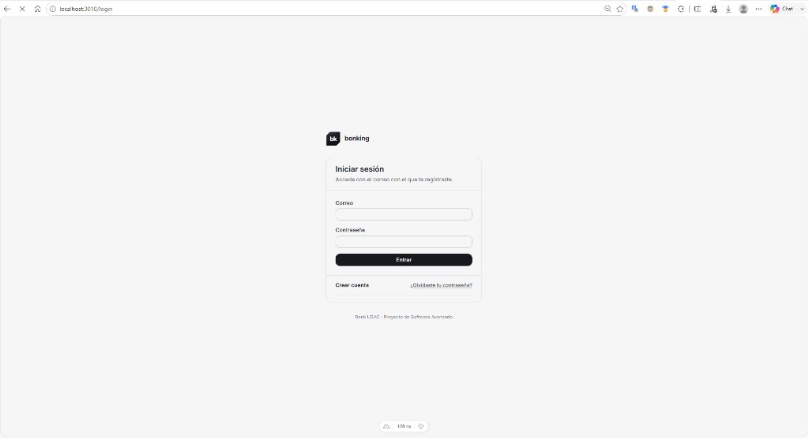

##### Elementos y Acciones Disponibles:
1. **Campos de Credenciales**:
   * **Correo**: Campo de texto para ingresar la dirección registrada.
   * **Contraseña**: Campo enmascarado para la clave de acceso.
2. **Botón Principal**:
   * **"Entrar"**: Envía la solicitud de autenticación al API Gateway.
3. **Enlaces de Navegación**:
   * **"Crear cuenta"**: Redirige al asistente de registro de clientes nuevos (`/registro`).
   * **"¿Olvidaste tu contraseña?"**: Redirige al flujo de recuperación de credenciales mediante correo electrónico (`/restablecer`).

---

#### Paso 2: Intento de Acceso con Cuenta Pendiente de Activación

Si un cliente intenta iniciar sesión antes de haber completado la verificación de su identidad o sin haber abierto el enlace de activación enviado a su correo, el sistema bloquea el acceso de forma preventiva.

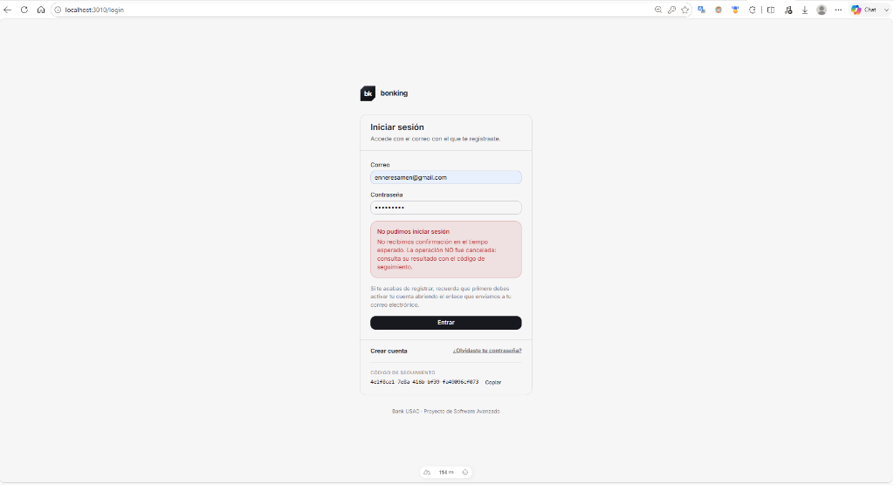

##### Valores del Ejemplo:
* **Correo**: `enneresamen@gmail.com`
* **Contraseña**: `ennero123`

##### Comportamiento y Elementos Observados:
1. **Alerta de Estado**:
   * **Mensaje**: *"No pudimos iniciar sesión. No recibimos confirmación en el tiempo esperado. La operación NO fue cancelada: consulta su resultado con el código de seguimiento."*
   * **Indicación preventiva**: *"Si te acabas de registrar, recuerda que primero debes activar tu cuenta abriendo el enlace que enviamos a tu correo electrónico."*
2. **Código de Seguimiento (Trazabilidad)**:
   * El sistema genera un identificador único (`4c1f8cc1-7c8a-416b-bf39-fa43096cf073`) con opción para copiar al portapapeles, permitiendo rastrear la solicitud en la bitácora distribuida sin exponer credenciales.

---

#### Paso 3: Asistente de Registro — Paso 1: Datos Personales (`/registro`)

Al hacer clic en **"Crear cuenta"**, se abre el asistente guiado de registro. El primer paso recopila la información personal del solicitante.

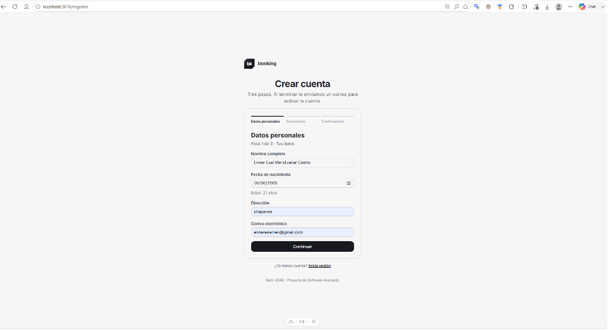

##### Valores del Ejemplo:
* **Nombre completo**: `Enner Esai Mendizabal Castro`
* **Fecha de nacimiento**: `01/06/2005`
* **Dirección**: `chayanne`
* **Correo electrónico**: `enneresamen@gmail.com`

##### Funcionalidades y Validaciones:
1. **Barra de Progreso (Stepper)**: Indica la fase actual: *Datos personales* (activa), *Documento* y *Confirmación*.
2. **Cálculo Automático de Edad**: Al ingresar la fecha de nacimiento, el sistema calcula de inmediato la edad en tiempo real (`Edad: 21 años`) verificando que el solicitante sea mayor de edad (mínimo 18 años).
3. **Botón "Continuar"**: Valida los formatos requeridos antes de avanzar.
4. **Enlace inferior**: Permite regresar al inicio de sesión si el usuario ya posee cuenta.

---

#### Paso 4: Asistente de Registro — Paso 2: Documento de Identidad y Foto (`/registro`)

En la segunda fase del registro, el cliente ingresa su número de identificación oficial y adjunta una imagen legible de su DPI.

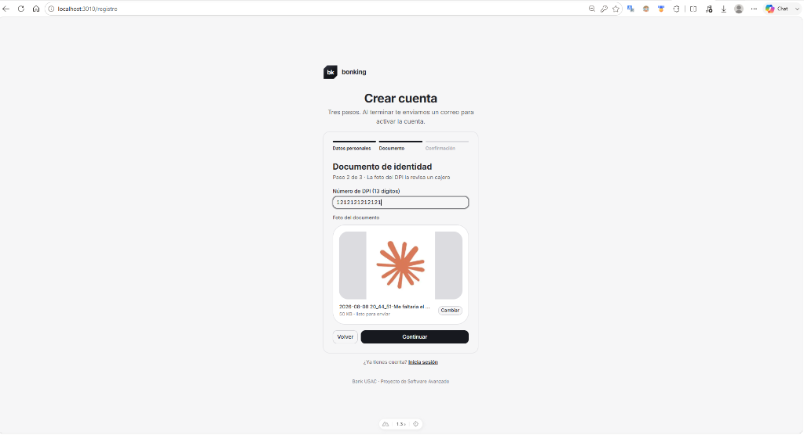

##### Valores del Ejemplo:
* **Número de DPI**: `1212121212121` (13 dígitos numéricos reglamentarios).
* **Foto del documento**: Archivo cargado (`2026-08-08 20_44_51-Me faltaría el ...`, `50 KB - Listo para enviar`).

##### Funcionalidades y Validaciones:
1. **Carga y Vista Previa de Archivo**:
   * Previsualización miniatura del documento adjunto.
   * Información de estado y peso del archivo (*"Listo para enviar"*).
   * Botón **"Cambiar"** para reemplazar la imagen antes del envío.
2. **Navegación**:
   * **"Volver"**: Retorna al Paso 1 para corregir datos sin perder la información.
   * **"Continuar"**: Valida la presencia de la fotografía y los 13 dígitos del DPI.

---

#### Paso 5: Asistente de Registro — Paso 3: Confirmación y Credenciales (`/registro`)

El último paso consolida toda la información declarada, genera automáticamente el nombre de usuario sugerido y permite definir la contraseña de acceso.

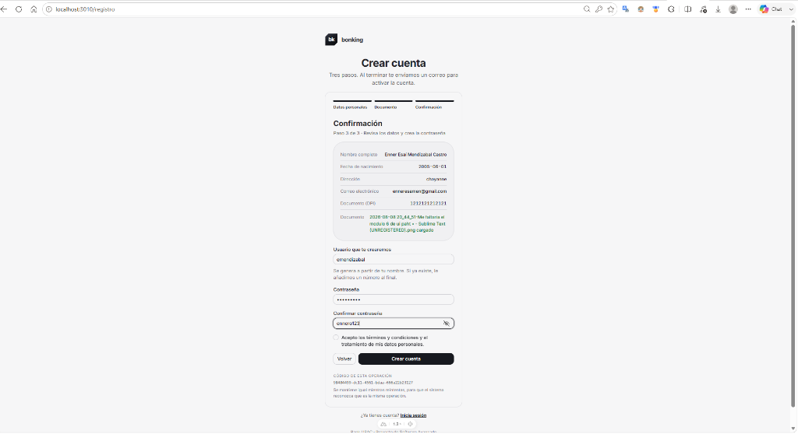

##### Valores del Ejemplo:
* **Resumen de datos declarados**:
  * **Nombre completo**: `Enner Esai Mendizabal Castro`
  * **Fecha de nacimiento**: `2005-06-01`
  * **Dirección**: `chayanne`
  * **Correo electrónico**: `enneresamen@gmail.com`
  * **Documento (DPI)**: `1212121212121`
  * **Documento**: Fotografía del DPI cargada en memoria.
* **Usuario generado**: `emendizabal` (asignado automáticamente por el sistema).
* **Contraseña**: `ennero123`
* **Confirmar contraseña**: `ennero123`

##### Funcionalidades y Validaciones:
1. **Previsualización de Usuario**: Muestra la identidad que se creará: *"Se genera a partir de tu nombre. Si ya existe, le añadimos un número al final."*
2. **Campos de Seguridad**: Validación estricta de coincidencia con botón de visibilidad de contraseña.
3. **Consentimiento Legal**: Casilla obligatoria de aceptación de términos y políticas de tratamiento de datos personales.
4. **Idempotencia Técnica**: Bloque **"CÓDIGO DE ESTA OPERACIÓN"** (`58404459-dc11-4561-bdaa-686a22b23127`) para evitar registros duplicados ante reintentos de red.
5. **Botón "Crear cuenta"**: Despacha la solicitud al sistema.

---

#### Paso 6: Confirmación de Solicitud Recibida e Identificadores Generados

Una vez enviada la solicitud, el sistema presenta la confirmación del registro recibido exitosamente e informa los identificadores definitivos asignados al cliente.

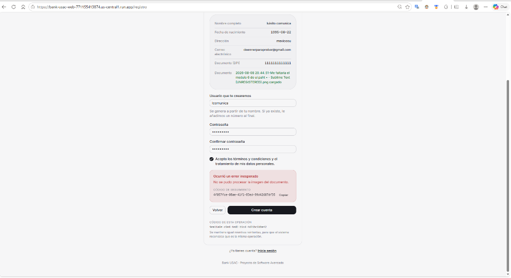

##### Valores Emitidos por el Sistema:
* **NÚMERO DE CLIENTE (`customerId`)**: `b165d73d-a709-4dd4-9620-688ea75219a3` (con botón de copia).
* **USUARIO ASIGNADO**: `emendizabal` (con botón de copia).
* **CÓDIGO DE SEGUIMIENTO (`correlationId`)**: `975be732-5808-47c6-8394-c6e39502255a` (con botón de copia).

##### Elementos y Flujo Operativo:
1. **Encabezado de Aprobación**: Icono de verificación verde con el título **"Solicitud de registro recibida"**.
2. **Mensaje Explicativo**:
   * *"Recibimos tu solicitud y documento de identidad. Un cajero revisará tu información. Una vez aprobada tu identidad, recibirás un correo electrónico en **enneresamen@gmail.com** con el enlace para activar tu cuenta."*
3. **Indicador de Siguiente Paso**:
   * Recuadro informativo destacando que un cajero verificará el documento en la mesa de control antes de que la cuenta pueda ser utilizada.
4. **Acción**:
   * Botón **"Volver a inicio de sesión"** para regresar a la página principal.

---

#### Paso 7: Recepción del Correo de Activación de Cuenta (`enneresamen@gmail.com`)

Inmediatamente al enviar la solicitud de registro público, el microservicio de notificaciones despacha un correo transaccional real a través de Resend a la bandeja del solicitante con un token criptográfico de un solo uso.

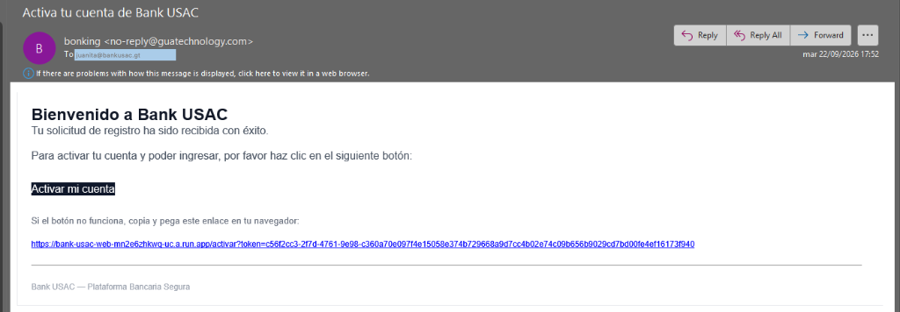

##### Datos del Correo Electrónico Recibido:
* **De**: `bonking <no-reply@guatechnology.com>`
* **Para**: `enneresamen@gmail.com`
* **Asunto**: *"Activa tu cuenta de Bank USAC"*
* **Enlace de activación**: `https://bank-usac-web-mn2e6zhkwq-uc.a.run.app/activar?token=c56f2cc3-2f7d-4761-9e98-c360a70e097f4e15058e374b729668a9d7cc4b02e74c09b656b9029cd7bd00fe4ef16173f940`

##### Efecto en el Sistema:
Al pulsar sobre el botón **"Activar mi cuenta"** o abrir el enlace, el sistema marca el correo como verificado (`status = ACTIVE`), permitiéndole a **Enner Esai Mendizabal Castro** iniciar sesión de inmediato. Las validaciones de identidad (KYC) para aperturar cuentas o transferir se gestionan por el personal del banco posteriormente.

---

#### Paso 8: Activación de Cuenta Exitosa (`/activar`)

Al ingresar al enlace, `customer-service` valida el hash del token contra PostgreSQL, confirma que no haya expirado, marca el cliente como activo (`status = ACTIVE`, `email_verified_at = now()`) y notifica al frontend la confirmación definitiva.

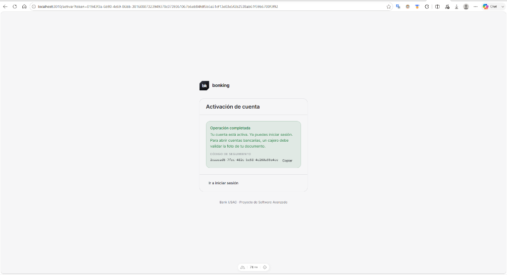

##### Elementos de la Confirmación:
1. **Alerta de Éxito (Verde)**:
   * **Título**: *"Operación completada"*
   * **Mensaje Informativo**: *"Tu cuenta está activa. Ya puedes iniciar sesión. Para abrir cuentas bancarias, un cajero debe validar la foto de tu documento."*
   * **CÓDIGO DE SEGUIMIENTO (Trazabilidad)**: `67496b3f-fa53-441a-a73d-49cf3b562537` [Copiar].
2. **Navegación**:
   * Enlace destacado: **"Ir a iniciar sesión"**, que traslada al cliente al formulario de login para autenticarse formalmente con su nuevo usuario (`emendizabal`) y contraseña.

---

#### Paso 10: Panel Principal del Cliente (Dashboard) — Saldo Consolidado y Operaciones (`/`)

Una vez completadas las operaciones de ventanilla (validación de identidad, apertura de cuenta monetaria y fondeo, como se detalla en el Módulo 2), el cliente **Enner Esai Mendizabal Castro** inicia sesión y accede a su panel principal de banca en línea (`http://localhost:3010/`).

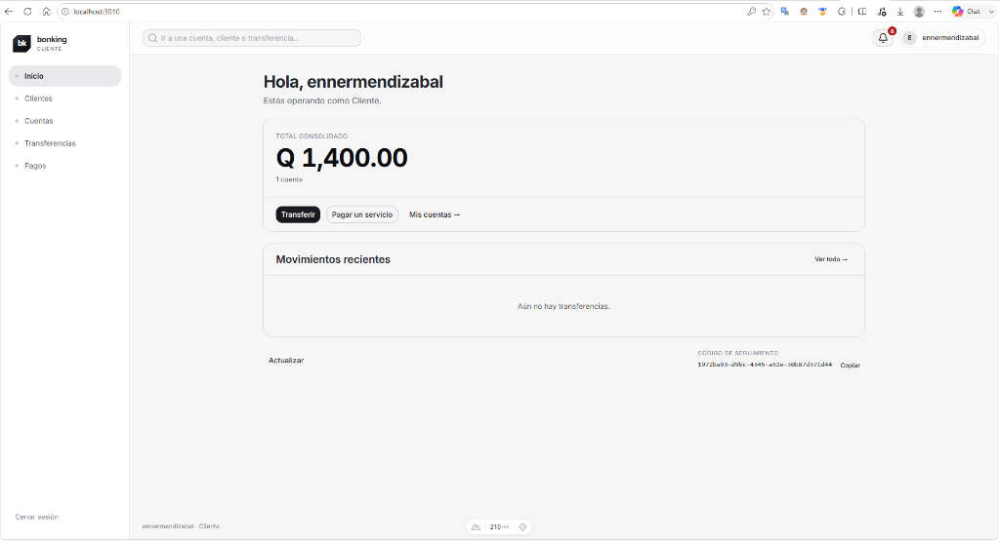

##### Elementos del Dashboard y Estado Financiero:
1. **Encabezado y Barra Superior**:
   * Saludo personalizado: **"Hola, ennermendizabal"** (*"Estás operando como Cliente."*).
   * Identificador de usuario en barra superior: `E ennermendizabal`.
   * **Campana de Notificaciones con Alerta Activa**: Badge numérico rojo destacando **5** notificaciones no leídas.
2. **Tarjeta de Posición Consolidada**:
   * **TOTAL CONSOLIDADO**: **Q 1,400.00**
   * **Cuentas Activas**: `1 cuenta` (cuenta monetaria `e80bd8e9-930a-4f5a-9f34-229cc6d6e822`).
   * *Consistencia Contable del Ejemplo*: Este saldo de **Q 1,400.00** refleja con exactitud las operaciones financieras del flujo completo:
     * `+ Q 1,500.00`: Depósito inicial en efectivo realizado en ventanilla por el cajero.
     * `+ Q 400.00`: Transferencia interbancaria recibida desde Clara Cliente.
     * `- Q 500.00`: Pago de factura de servicios de telecomunicaciones a Claro.
     * **Total Disponible**: **Q 1,400.00**.
3. **Accesos Rápidos de Autoservicio**:
   * **"Transferir"**: Acceso directo para enviar transferencias a cuentas propias o de terceros (`/transferencias/nueva`).
   * **"Pagar un servicio"**: Acceso directo para el pago de agua, luz o teléfono (`/pagos/nuevo`).
   * **"Mis cuentas →"**: Navegación al detalle de movimientos contables (`/cuentas`).
4. **Sección de Movimientos Recientes**:
   * Área de histórico con enlace `"Ver todo →"`.
5. **Pie de Pantalla y Auditoría**:
   * Botón **"Actualizar"** para refrescar saldos en tiempo real.
   * **CÓDIGO DE SEGUIMIENTO**: `1972ba95-d9bc-4345-a52e-50b87d571d44` [Copiar].
   * Barra de estado inferior: `ennermendizabal · Cliente | 210 ms`.

---

#### Paso 11: Centro de Notificaciones del Cliente — Bandeja de Mensajes en Vivo (`/notificaciones`)

Al hacer clic en el icono de la campana en la barra superior (`https://bank-usac-web-mn2e6zhkwq-uc.a.run.app/notificaciones`), el cliente visualiza su bandeja de notificaciones generadas automáticamente por el microservicio de auditoría y mensajería a lo largo de cada una de sus operaciones en el sistema.

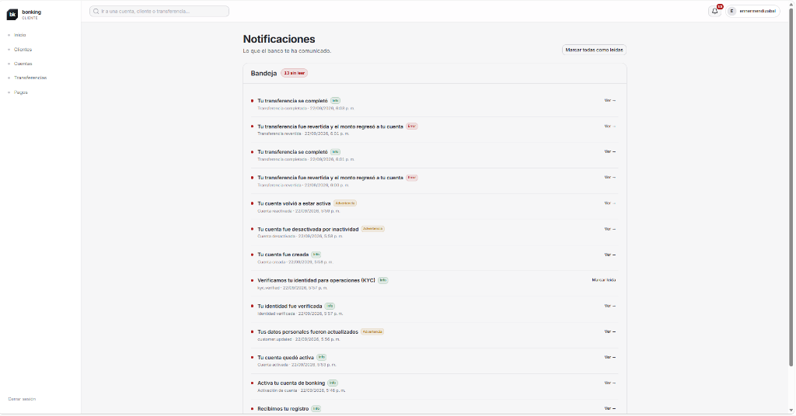

##### Elementos y Traza de Eventos en la Bandeja:
1. **Encabezado y Acciones**:
   * Título: **"Notificaciones"** (*"Lo que el banco te ha comunicado."*).
   * Botón de acción masiva: **"Marcar todas como leídas"**.
2. **Bandeja de Entrada (Badge Rojo: `13 sin leer`)**:
   Las notificaciones se presentan en estricto orden cronológico inverso con sus etiquetas semánticas (`Info`, `Advertencia`, `Error`), permitiendo auditar visualmente todo el ciclo de vida del usuario y de sus fondos:
   * **`Info`** · **"Tu transferencia se completó"**: Liquidación exitosa del pago de servicios Claro (`22/09/2026, 6:03 p. m.`). [Ver →]
   * **`Error`** · **"Tu transferencia fue revertida y el monto regresó a tu cuenta"**: Compensación automática tras ladder de reintentos (`22/09/2026, 6:01 p. m.`). [Ver →]
   * **`Info`** · **"Tu transferencia se completó"**: Transferencia exitosa completada (`22/09/2026, 6:01 p. m.`). [Ver →]
   * **`Error`** · **"Tu transferencia fue revertida y el monto regresó a tu cuenta"**: Compensación de la Saga por simulación de rechazo (`22/09/2026, 6:00 p. m.`). [Ver →]
   * **`Advertencia`** · **"Tu cuenta volvió a estar activa"**: Reactivación contable de la cuenta (`22/09/2026, 5:59 p. m.`). [Ver →]
   * **`Advertencia`** · **"Tu cuenta fue desactivada por inactividad"**: Demonio de inactividad ejecutado (`22/09/2026, 5:58 p. m.`). [Ver →]
   * **`Info`** · **"Tu cuenta fue creada"**: Apertura de la cuenta de ahorro (`22/09/2026, 5:58 p. m.`). [Ver →]
   * **`Info`** · **"Verificamos tu identidad para operaciones (KYC)"**: Aprobación de cumplimiento normativo (`22/09/2026, 5:57 p. m.`). [Marcar leída]
   * **`Info`** · **"Tu identidad fue verificada"**: Validación de documento DPI (`22/09/2026, 5:57 p. m.`). [Ver →]
   * **`Advertencia`** · **"Tus datos personales fueron actualizados"**: Edición de perfil en autoservicio (`22/09/2026, 5:56 p. m.`). [Ver →]
   * **`Info`** · **"Tu cuenta quedó activa"**: Activación exitosa vía token por correo (`22/09/2026, 5:53 p. m.`). [Ver →]
   * **`Info`** · **"Activa tu cuenta de bonking"**: Enlace de activación enviado vía Resend (`22/09/2026, 5:46 p. m.`). [Ver →]
   * **`Info`** · **"Recibimos tu registro"**: Registro público inicial completado. [Ver →]

---

#### Paso 12: Centro de Notificaciones — Gestión y Marcado Masivo como Leídas (`/notificaciones`)

Al hacer clic sobre el botón **"Marcar todas como leídas"**, el cliente actualiza el estado de toda su bandeja en una sola operación interactiva y limpia sus avisos pendientes.

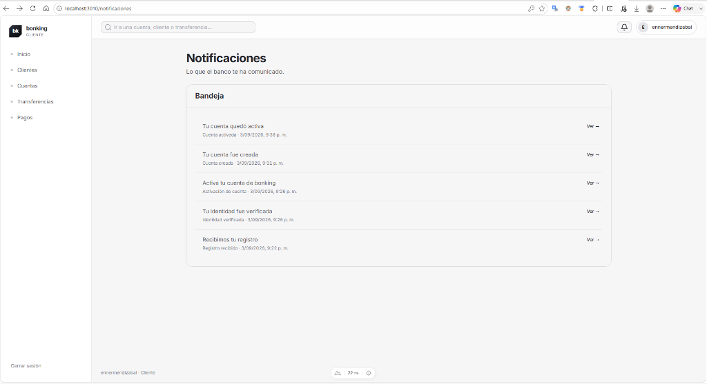

##### Efectos Inmediatos en la Interfaz:
1. **Actualización del Contador Superior**: El badge numérico rojo `5` de la campana en el encabezado desaparece inmediatamente.
2. **Actualización de la Bandeja**:
   * Los puntos rojos en cada una de las 5 notificaciones se desactivan.
   * La etiqueta roja `5 sin leer` desaparece de la cabecera de la lista.
   * El botón "Marcar todas como leídas" se oculta dinámicamente al no existir mensajes pendientes.
3. **Disponibilidad Permanente de Auditoría**: Cada notificación permanece consultable en el historial con su enlace `"Ver →"` para revisar el detalle de la alerta cuando el cliente lo requiera.

---

#### Paso 13: Consulta de Cuentas Propias del Cliente (`/cuentas`)

Al navegar a la sección de **Cuentas** desde el menú lateral (`http://localhost:3010/cuentas`), el cliente accede al directorio de productos financieros aperturados a su nombre.

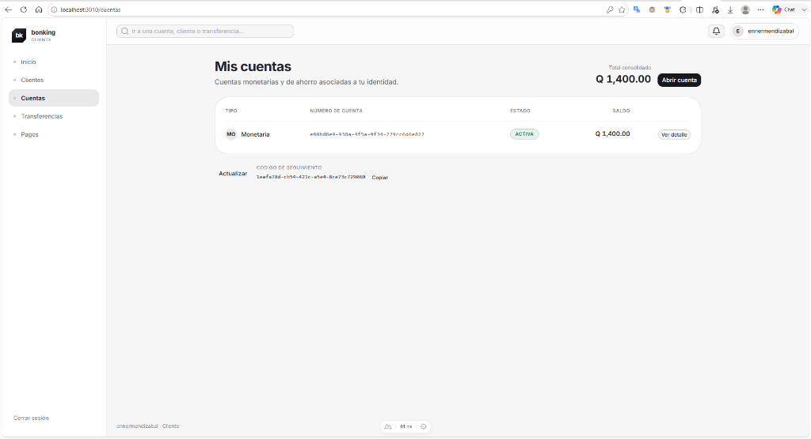

##### Elementos y Estados Observados:
1. **Encabezado y Saldo Acumulado**:
   * **Título**: *"Mis cuentas"* (*"Cuentas monetarias y de ahorro asociadas a tu identidad."*).
   * **Total Consolidado**: **Q 1,400.00** en la parte superior derecha.
   * Botón: **"Abrir cuenta"** para solicitar productos bancarios adicionales.
2. **Tabla de Cuentas Asociadas**:
   * **TIPO**: `MO Monetaria` (identificada por la etiqueta institucional `MO`).
   * **NÚMERO DE CUENTA**: `e80bd8e9-930a-4f5a-9f14-229cc6d6e822`.
   * **ESTADO**: Badge verde `ACTIVA`.
   * **SALDO**: **Q 1,400.00**.
   * Botón de acción: **"Ver detalle"** (enlaza a la cartola bancaria individual `/cuentas/[id]`).
3. **Pie de Pantalla y Auditoría**:
   * Botón **"Actualizar"** para releer los balances contables.
   * **CÓDIGO DE SEGUIMIENTO**: `1eefa78d-cb54-421c-a5e4-8ce73c7296b0` [Copiar].

---
#### Paso 14: Solicitud de Apertura de Nueva Cuenta Bancaria — Selección de Cuenta de Ahorro y Depósito Inicial (`/cuentas/nueva`)

Desde la vista de sus cuentas (`/cuentas`), el cliente hace clic en el botón superior **"Abrir cuenta"** (`https://bank-usac-web-mn2e6zhkwq-uc.a.run.app/cuentas/nueva`) para solicitar un nuevo producto financiero de ahorro.

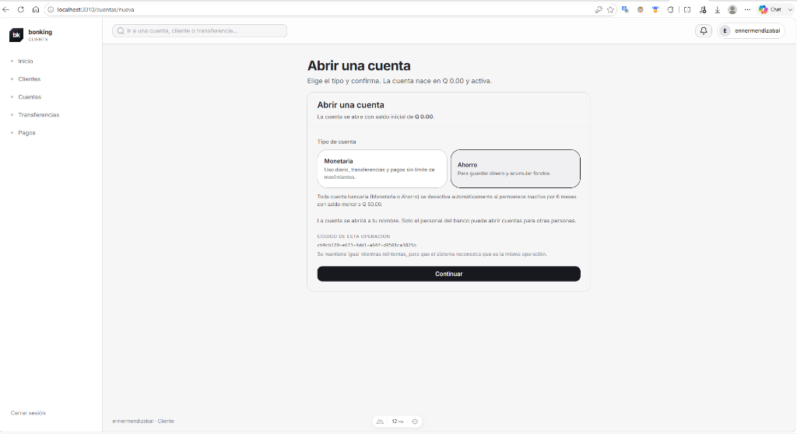

##### Opciones y Reglas Bancarias del Formulario:
1. **Tipos de Cuenta Disponibles**:
   * **Monetaria**: *"Uso diario, transferencias y pagos sin límite de movimientos ni saldo mínimo."*
   * **Ahorro (Seleccionada)**: *"Para guardar dinero. Requiere un depósito inicial de al menos Q 100.00 y cobra Q 3.00 de comisión por cada transferencia."* (Se resalta con borde activo).
2. **Depósito Inicial de Apertura Obligatorio**:
   * Para aperturar la cuenta de ahorro, el cliente registra el comprobante de depósito previo hacia la cuenta concentradora de Bank USAC (`001-00000200-01 / GT00-BANK-0001-FONDO-APERTURA`).
   * **Monto depositado**: `Q 100.00`.
   * **Número de boleta o comprobante**: `DEP-201744`.
   * **Caja de Verificación en Vivo (Verde)**: *"DEPÓSITO VERIFICADO EXITOSAMENTE — Fondos por Q 100.00 confirmados bajo comprobante #DEP-201744 hacia la cuenta concentradora de Bank USAC. El monto estará disponible inmediatamente al completar la apertura."*
3. **Idempotencia Técnica**:
   * `CÓDIGO DE ESTA OPERACIÓN`: `fc278917-208e-4bde-9275-9c92fe7ca969` (*"Se mantiene igual mientras reintentas, para que el sistema reconozca que es la misma operación."*).
4. **Acción**:
   * Botón: **"Continuar"**.

---

#### Paso 15: Confirmación de Apertura de Cuenta de Ahorro (`/cuentas/nueva`)

El asistente presenta la pantalla de resumen y confirmación para que el cliente verifique los datos antes de emitir la orden a `account-service`.

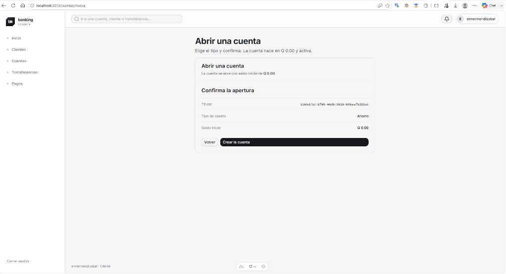

##### Datos de la Confirmación:
* **Titular**: Identificador único de Enner Mendizabal.
* **Tipo de cuenta**: `Ahorro`.
* **Saldo inicial fondeado**: `Q 100.00`.
* **Navegación**: Botón **"Volver"** para cambiar el tipo y botón principal **"Crear la cuenta"**.

---

#### Paso 16: Emisión Exitosa de Cuenta de Ahorro e Identificador Asignado (`/cuentas/nueva`)

Al confirmar, el sistema registra la cuenta en estado activo (`status = ACTIVE`) con su saldo contable inicial de `Q 100.00` disponible y emite el nuevo UUID bancario.

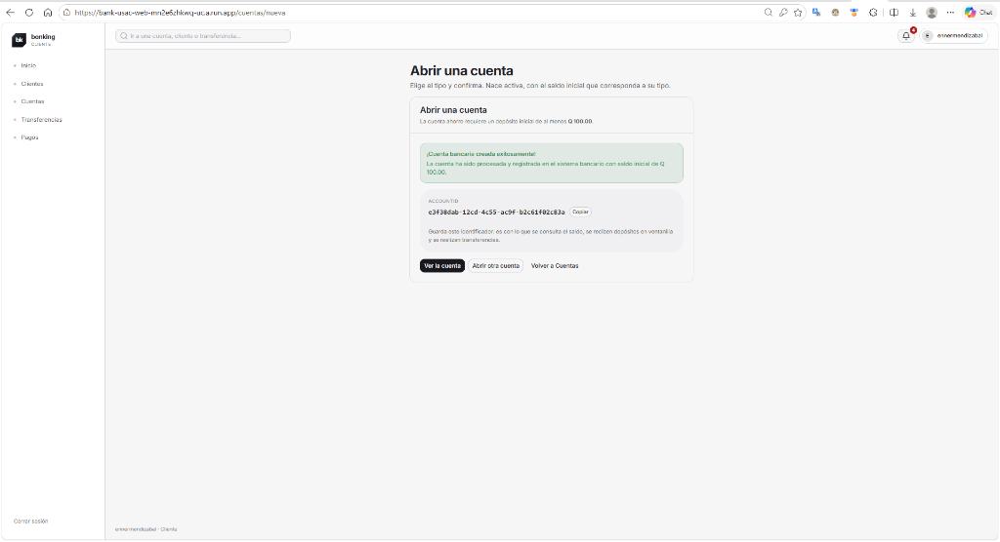

##### Elementos del Comprobante:
1. **Alerta de Éxito (Verde)**:
   * Título: **"¡Cuenta bancaria creada exitosamente!"**
   * Detalle: *"La cuenta ha sido procesada y registrada en el sistema bancario con saldo inicial de Q 100.00."*
2. **Identificador del Producto**:
   * **ACCOUNTID**: `c3f38dab-12cd-4c55-ac9f-b2c61f02c83a` [Copiar].
   * Nota: *"Guarda este identificador: es con lo que se consulta el saldo, se reciben depósitos en ventanilla y se realizan transferencias."*
3. **Acciones Disponibles**:
   * **"Ver la cuenta"** (botón principal para acceder a la ficha técnica).
   * **"Abrir otra cuenta"** y **"Volver a Cuentas"**.

---

#### Paso 17: Ficha de Cuenta de Ahorro y Gestión de Estado Activa/Desactivada (`/cuentas/[id]`)

Al pulsar en **"Ver la cuenta"**, el cliente visualiza la cartola individual de su nueva cuenta de ahorro (`https://bank-usac-web-mn2e6zhkwq-uc.a.run.app/cuentas/c3f38dab-12cd-4c55-ac9f-b2c61f02c83a`).

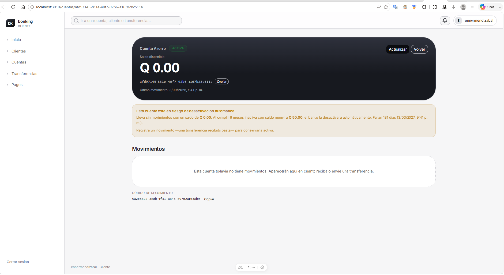

##### Elementos de la Cuenta Activa:
1. **Tarjeta Principal del Producto**:
   * Encabezado: `Cuenta Ahorro` [Badge verde: `ACTIVA`].
   * **Saldo disponible**: **Q 100.00**.
   * Identificador: `c3f38dab-12cd-4c55-ac9f-b2c61f02c83a` [Copiar].
   * Botones: **"Actualizar"** y **"Volver"**.
2. **Control de Estado Operativo**:
   * Estado actual: `ACTIVA`. *"La cuenta se encuentra operativa. Puedes desactivarla si deseas suspender sus operaciones y transferencias."*
   * Botón de acción: **"Desactivar cuenta"**.

##### Suspensión Voluntaria y Reactivación de Cuenta:
Si el cliente decide suspender la cuenta para evitar débitos o movimientos no deseados, pulsa en **"Desactivar cuenta"**:

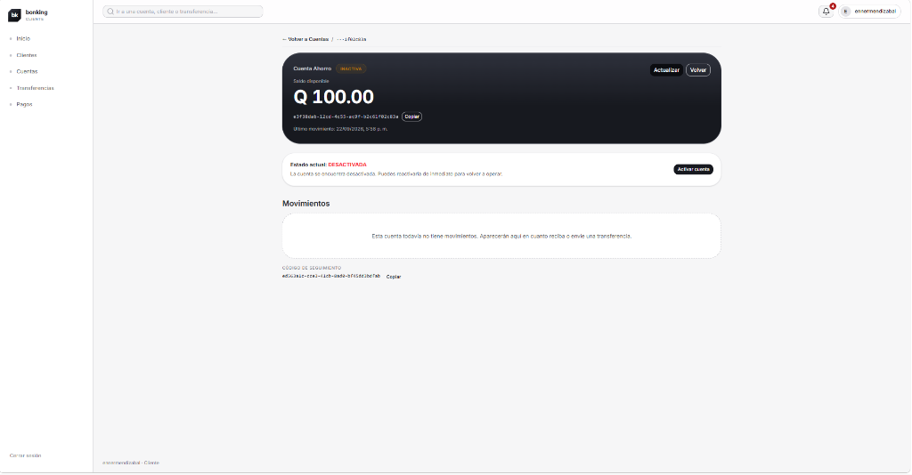

* El estado pasa a `DESACTIVADA` (en rojo) y el badge cambia a `INACTIVA`.
* El botón cambia automáticamente a **"Activar cuenta"**, permitiendo reactivarla con un solo clic en cuanto el cliente lo requiera.
* **CÓDIGO DE SEGUIMIENTO**: `ad63aa1c-cca1-41cb-8ad2-bf45de1bcfab` [Copiar].
3. **Historial de Movimientos**:
   * *"Esta cuenta todavía no tiene movimientos. Aparecerán aquí en cuanto reciba o envíe una transferencia."*
4. **Trazabilidad**:
   * **CÓDIGO DE SEGUIMIENTO**: `5a2c8a22-3c1b-4f31-aa46-c9702a1658b9` [Copiar].

---

#### Paso 18: Directorio "Mis Cuentas" con Portafolio Multiproducto Consolidado (`/cuentas`)

Al volver a la vista general de cuentas (`http://localhost:3010/cuentas`), el cliente visualiza su portafolio multiproducto ampliado, compuesto ahora por dos cuentas bancarias activas bajo un mismo titular.

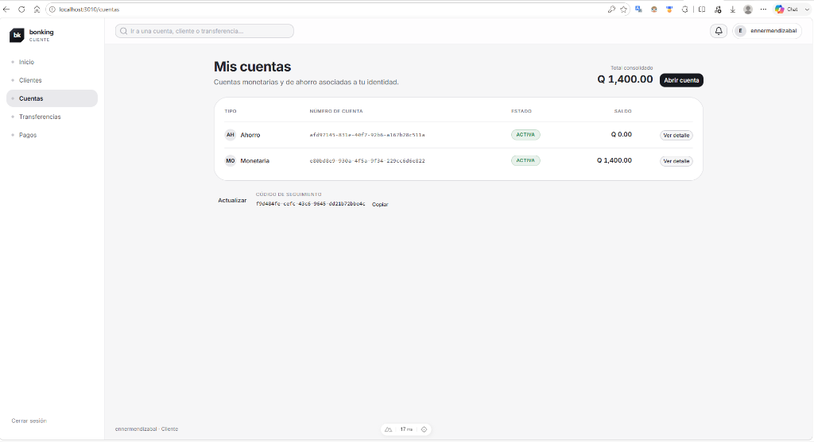

##### Tabla de Portafolio Consolidado:
| TIPO | NÚMERO DE CUENTA | ESTADO | SALDO | ACCIÓN |
| :--- | :--- | :---: | :---: | :--- |
| **`AH` Ahorro** | `afd97145-831e-40f7-92b6-a167b28c511a` | `ACTIVA` | **Q 0.00** | [Ver detalle] |
| **`MO` Monetaria** | `e80bd8e9-930a-4f5a-9f14-229cc6d6e822` | `ACTIVA` | **Q 1,400.00** | [Ver detalle] |

##### Resumen de la Posición Financiera:
* **Total Consolidado del Titular**: **Q 1,400.00** (`Q 1,400.00 + Q 0.00`).
* **CÓDIGO DE SEGUIMIENTO**: `f9d484fc-cefc-43c6-9645-dd21b72bbe4c` [Copiar].

---
#### Paso 19: Transferencia Inmediata — Formulario de Envío de Fondos (`/transferencias/nueva`)

Para transferir fondos a otra cuenta de forma inmediata y segura, el cliente pulsa el botón **"Nueva transferencia"** (`https://bank-usac-web-mn2e6zhkwq-uc.a.run.app/transferencias/nueva`).

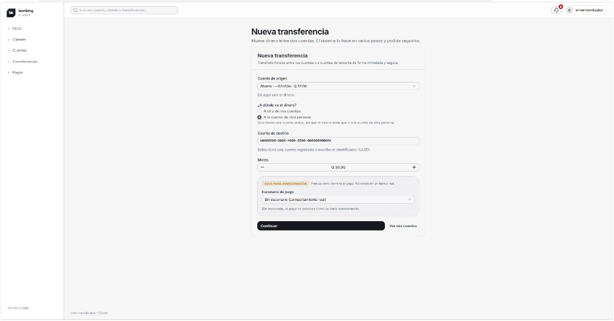

##### Datos y Campos del Formulario:
1. **Cuenta de origen**: `Ahorro ····02c83a · Q 57.00` (*"De aquí sale el dinero."*).
2. **Destino de los fondos**: Opción seleccionada: **`(*) A la cuenta de otra persona`** (*"Solo tienes una cuenta activa, así que el dinero tiene que ir a la cuenta de otra persona."*).
3. **Cuenta de destino**: Identificador UUID de la cuenta receptora: `b0000000-0002-4000-8000-000000000004` (*"Selecciona una cuenta registrada o escribe el identificador (UUID)."*).
4. **Monto**: **Q 30.00** (ajustable mediante los controles `-` / `+` o ingreso directo).
5. **Panel de Demostración y Simulación (Sandbox)**:
   * Badge: `SOLO PARA DEMOSTRACIÓN` (*"Fuerza cómo termina el pago. No existe en un banco real."*).
   * **Escenario de pago**: **`Sin escenario (comportamiento real)`** (*"Sin escenario, el pago se procesa como lo haría normalmente."*).
6. **Navegación**:
   * Botón principal: **"Continuar"**.
   * Enlace lateral: **"Ver mis cuentas"**.

---

#### Paso 20: Transferencia Inmediata — Revisión y Confirmación (`/transferencias/nueva`)

El sistema despliega la tarjeta de validación para corroborar los saldos y cuentas involucradas antes de someter la orden a la orquestación distribuida de la Saga.

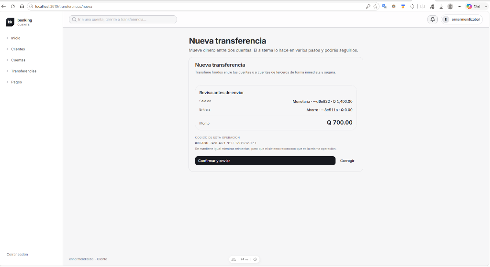

##### Datos en Pantalla:
* **Sale de**: Cuenta de ahorro seleccionada.
* **Entra a**: Cuenta de destino indicada (`000000000004`).
* **Monto a transferir**: **Q 30.00**.
* **CÓDIGO DE ESTA OPERACIÓN (Idempotencia)**: Token criptográfico único que se mantiene estable durante reintentos para asegurar que la transferencia se procese exactamente una vez.
* **Acciones**: Botón **"Confirmar y enviar"** y enlace **"Corregir"**.

---

#### Paso 21: Monitor de la Saga — Transferencia Completada Exitosamente (`/transferencias/[id]`)

Al confirmar, el API Gateway somete la transferencia al broker RabbitMQ y redirige inmediatamente al monitor transaccional en tiempo real (`https://bank-usac-web-mn2e6zhkwq-uc.a.run.app/transferencias/61457774-8ee2-4448-8c5d-15ca44281cb7`), donde la Saga coreografiada avanza por todos sus hitos y finaliza en estado `COMPLETADA`.

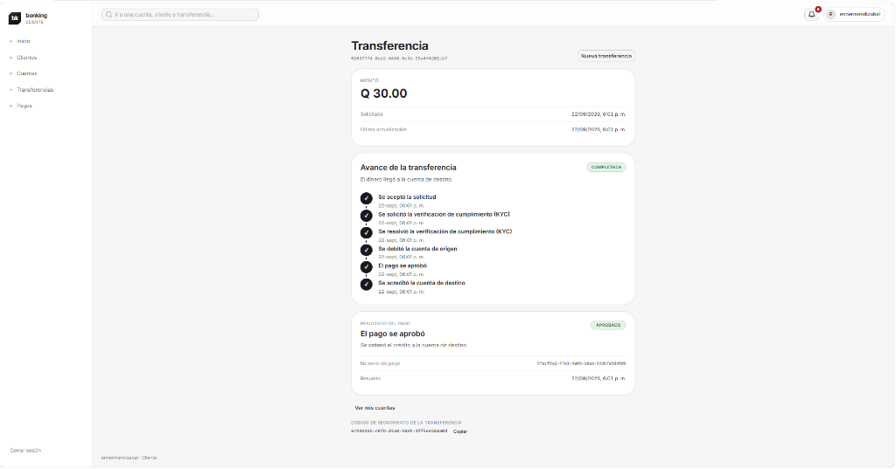

##### Resumen de la Operación y Hitos de la Saga:
* **Identificador de Transferencia**: `61457774-8ee2-4448-8c5d-15ca44281cb7`.
* **MONTO**: **Q 30.00**.
* **Marcas Temporales**: Solicitada y resuelta el `22/09/2026, 6:01 p. m.`.
* **Avance de la Transferencia (Badge Verde: `COMPLETADA`)**: *"El dinero llegó a la cuenta de destino."*
  * `(✓) Se aceptó la solicitud` (22-sept, 06:01 p. m.)
  * `(✓) Se solicitó la verificación de cumplimiento (KYC)` (22-sept, 06:01 p. m.)
  * `(✓) Se resolvió la verificación de cumplimiento (KYC)` (22-sept, 06:01 p. m.)
  * `(✓) Se debitó la cuenta de origen` (22-sept, 06:01 p. m.)
  * `(✓) El pago se aprobó` (22-sept, 06:01 p. m.)
  * `(✓) Se acreditó la cuenta de destino` (22-sept, 06:01 p. m.)
* **Tarjeta Resultado del Pago (Badge Verde: `APROBADO`)**:
  * *"El pago se aprobó — Se ordenó el crédito a la cuenta de destino."*
  * **Número del pago**: `5fecf9a2-f7e1-4a06-b8ad-33ab7a58d6bb`.
  * **Resuelto**: `22/09/2026, 6:01 p. m.`.
* **CÓDIGO DE SEGUIMIENTO DE LA TRANSFERENCIA**: `a2c46deb-cd3b-41a4-9aeb-dff5ee54ea4d` [Copiar].
* Enlace inferior: **"Ver mis cuentas"**.

---

#### Paso 22: Directorio "Mis Cuentas" con Balances Distribuidos (`/cuentas`)

Al regresar a la pantalla general de cuentas (`http://localhost:3010/cuentas`), el cliente corrobora la distribución contable inmediata de sus fondos entre sus dos productos.

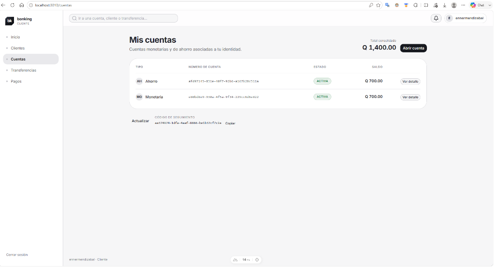

##### Nueva Composición Contable del Titular:
| TIPO | NÚMERO DE CUENTA | ESTADO | SALDO | ACCIÓN |
| :--- | :--- | :---: | :---: | :--- |
| **`AH` Ahorro** | `afd97145-831e-40f7-92b6-a167b28c511a` | `ACTIVA` | **Q 700.00** | [Ver detalle] |
| **`MO` Monetaria** | `e80bd8e9-930a-4f5a-9f14-229cc6d6e822` | `ACTIVA` | **Q 700.00** | [Ver detalle] |

##### Invariantes Financieros:
* **Total Consolidado Inalterado**: **Q 1,400.00** (`Q 700.00 + Q 700.00`). La transferencia interna reubica fondos sin alterar la custodia total del titular.
* **Mitigación de Inactividad**: Al tener un saldo de **Q 700.00** (mayor al umbral de Q 50.00) y registrar actividad contable reciente, la cuenta de ahorro queda blindada frente a la desactivación automática del demonio de fondo.
* **Trazabilidad**: **CÓDIGO DE SEGUIMIENTO**: `aa374974-1dfa-4aaf-88bb-be1b57cf7c2a` [Copiar].

---

#### Paso 23: Historial Consolidado de Transferencias del Cliente (`/transferencias`)

En la sección de **Transferencias** (`https://bank-usac-web-mn2e6zhkwq-uc.a.run.app/transferencias`), la bitácora histórica personal del cliente documenta todas las transacciones realizadas, reflejando su estado actual y trazabilidad.

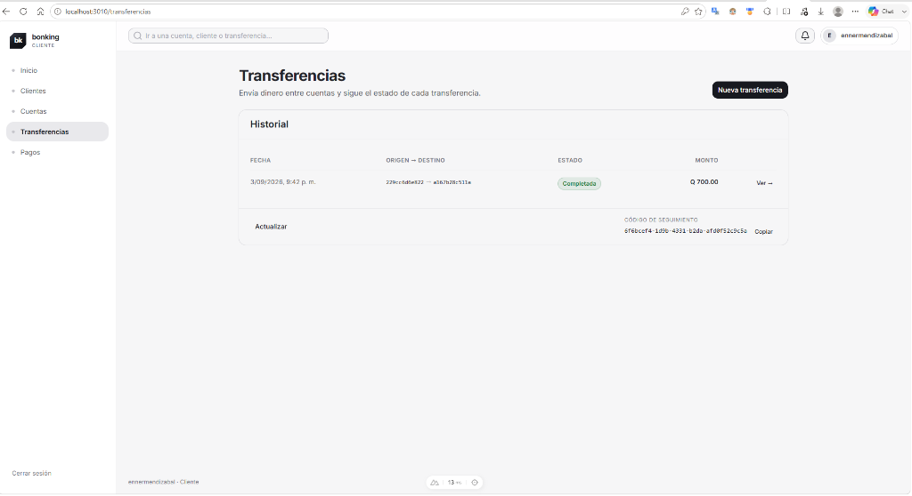

##### Registro de Operaciones en la Bitácora:
| FECHA | ORIGEN → DESTINO | ESTADO | MONTO | ACCIÓN |
| :--- | :--- | :---: | :---: | :--- |
| `22/09/2026, 6:01 p. m.` | `b2c61f02c83a → 000000000004` | `Completada` (Badge Verde) | **Q 30.00** | [Ver →] |
| `22/09/2026, 6:01 p. m.` | `b2c61f02c83a → 000000000004` | `Compensada` (Badge Rosa) | **Q 40.00** | [Ver →] |
| `22/09/2026, 6:00 p. m.` | `b2c61f02c83a → 000000000004` | `Compensada` (Badge Rosa) | **Q 30.00** | [Ver →] |

##### Metadatos y Capacidades de la Bitácora:
* **CÓDIGO DE SEGUIMIENTO**: `ce4e1685-c482-405a-91bb-e45e98a2d9f9` [Copiar].
* **Buscador Directo**: Permite consultar cualquier operación histórica por su identificador UUID (`Número de operación`).

---
#### Paso 24: Demostración de Resiliencia — Transferencia con Simulación de Rechazo de Pago (`/transferencias/nueva`)

Para evidenciar el cumplimiento del requerimiento de consistencia eventual y manejo de fallos distributed de la arquitectura bancaria, el cliente inicia una transferencia forzando el rechazo en la liquidación externa (`http://localhost:3010/transferencias/nueva`).

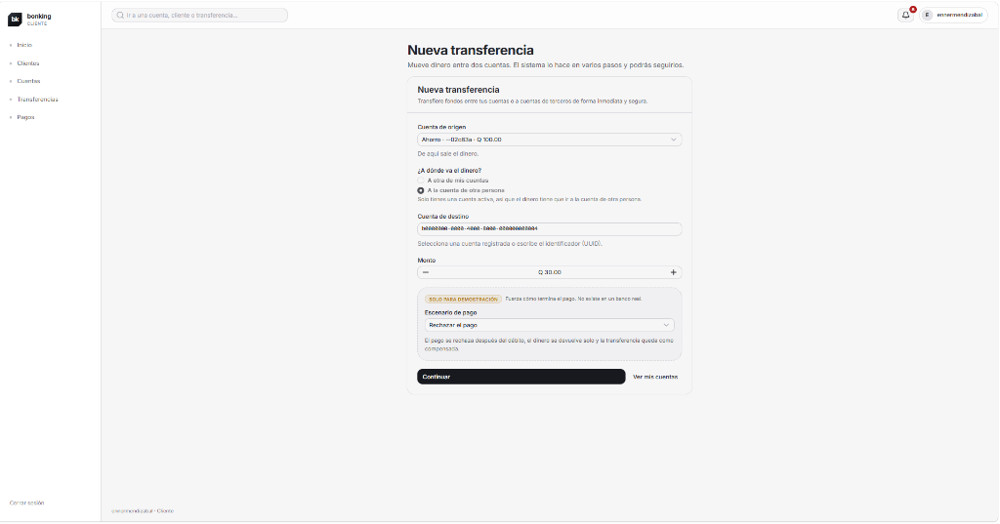

##### Justificación Técnica de la Simulación (Requerimiento del Enunciado):
> [!IMPORTANT]
> **¿Por qué se simula el rechazo del pago?**  
> En una arquitectura bancaria orientada a microservicios, las transferencias no pueden usar bloqueos globales ACID de dos fases (2PC) sin degradar la disponibilidad del sistema. La liquidación con cámaras externas (ACH / procesadores de tarjetas) puede fallar por problemas de red, indisponibilidad del servicio externo o rechazo del banco receptor.  
> Debido a que en entornos de evaluación o pruebas locales no es viable provocar caídas aleatorias en pasarelas reales, el sistema implementa la caja de sandbox **`SOLO PARA DEMOSTRACIÓN`** (*"Fuerza cómo termina el pago. No existe en un banco real"*), permitiendo evaluar la ejecución automática del **mecanismo de compensación de la Saga** ante un fallo en el cobro.

##### Datos Registrados en el Formulario:
1. **Cuenta de origen**: `Ahorro ···8c511a · Q 700.00` (*"De aquí sale el dinero."*).
2. **Destino**: **`(*) A otra de mis cuentas`**.
3. **Cuenta de destino**: `Monetaria ···d6e822 · Q 700.00` (*"Aquí entra el dinero."*).
4. **Monto**: **Q 200.00**.
5. **Selector de Escenario de Pago**: **`Rechazar el pago`** (*"El pago se rechaza después del débito, el dinero se devuelve solo y la transferencia queda como compensada."*).
6. Botón: **"Continuar"**.

---

#### Paso 25: Monitor de la Saga — Transacción Fallida y Devolución por Compensación (`/transferencias/[id]`)

Al procesar la solicitud, el sistema efectúa el débito inicial pero, al ser rechazado el pago por el procesador externo, la Saga dispara inmediatamente la acción compensatoria para salvaguardar el dinero del cliente (`http://localhost:3010/transferencias/73abad28-05c7-420a-9273-f3f92facbad3`).

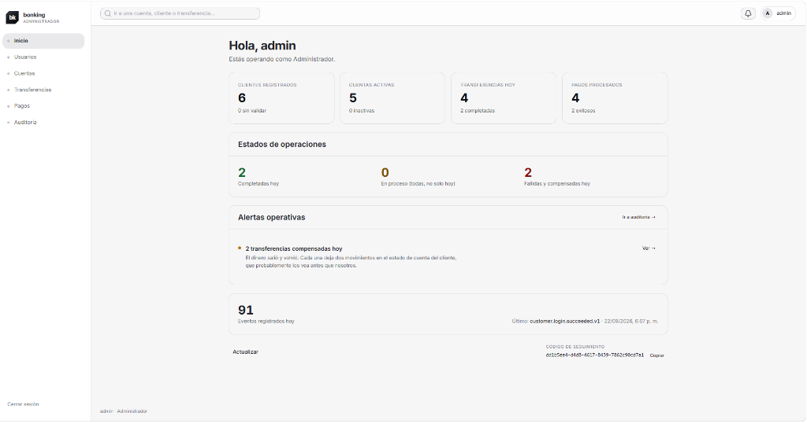

##### Análisis del Flujo de Compensación en Pantalla:
* **Identificador de Transferencia**: `73abad28-05c7-420a-9273-f3f92facbad3`.
* **MONTO**: **Q 30.00**.
* **Estado de la Transferencia (Badge Rosa: `COMPENSADA`)**:
  * Explicación al usuario: *"La transferencia no se completó. El dinero había salido de tu cuenta y fue devuelto automáticamente, así que verás dos movimientos en el estado de cuenta."*
  * **Hitos Auditables de la Saga**:
    1. `(✓) Se aceptó la solicitud`.
    2. `(✓) Se solicitó la verificación de cumplimiento (KYC)`.
    3. `(✓) Se resolvió la verificación de cumplimiento (KYC)`.
    4. `(✓) Se debitó la cuenta de origen`.
    5. `(✕ Rojo) El pago falló`.
    6. `(✕ Rojo) Se devolvió el dinero a la cuenta de origen` (Compensación atómica).
* **Tarjeta de Diagnóstico ("Por qué no se completó")**:
  * *"El pago fue rechazado. El dinero se devolvió a la cuenta de origen."*
* **Resultado del Pago (Badge Rojo: `RECHAZADO`)**:
  * *"El pago fue rechazado. El dinero se devolvió a la cuenta de origen."*

---

#### Paso 26: Demostración de Resiliencia — Manejo de Caídas Temporales con Escalera de Reintentos (`/transferencias/nueva`)

Para demostrar la capacidad de recuperación ante fallos transitorios en pasarelas externas sin compensar inmediatamente, el cliente envía una transferencia seleccionando el escenario **"El proveedor no responde (timeout)"**.

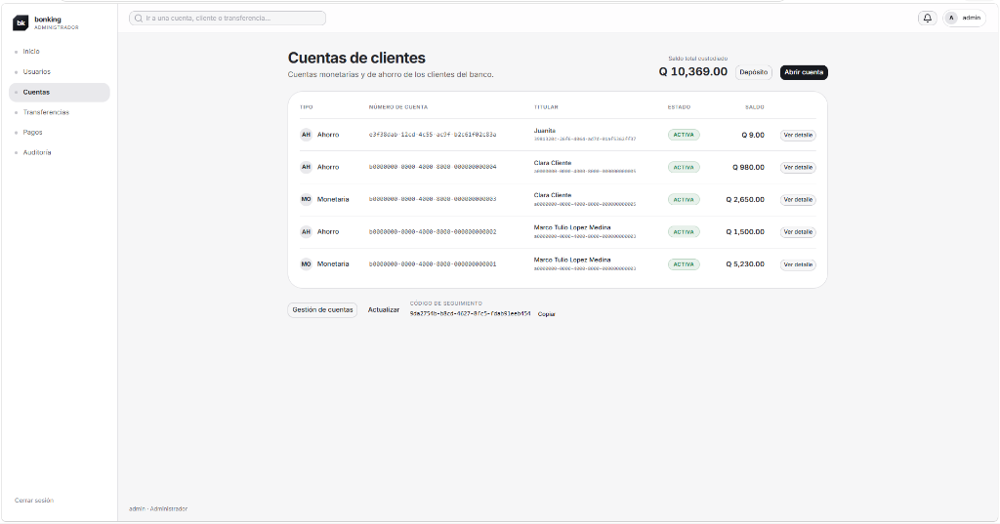

##### Características de la Escalera de Reintentos:
1. **Configuración del Escenario**:
   * Monto: `Q 40.00`.
   * Escenario: **`El proveedor no responde (timeout)`**.
   * Regla bancaria: El sistema aplica una escalera de reintentos exponenciales (1s, 5s, 30s) para un total de hasta 4 intentos antes de decidir si compensa o completa la operación.
2. **Revisión y Envío**:
   * El cliente revisa los datos antes de emitir la orden:

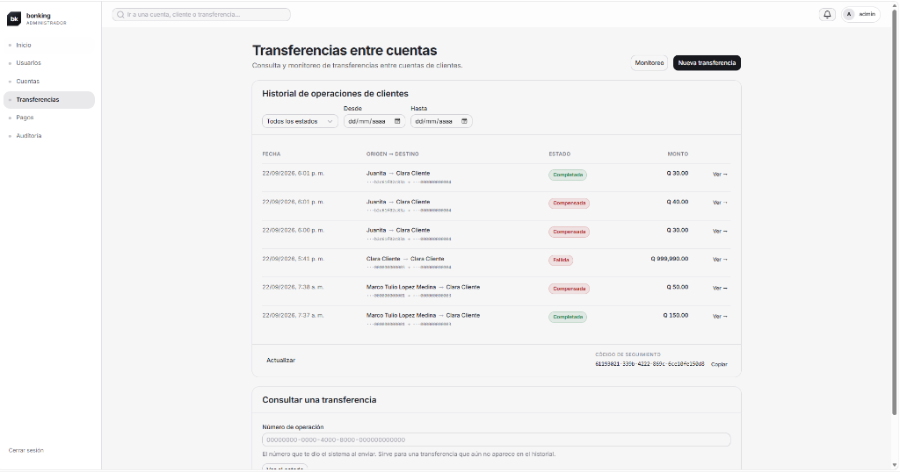

* CÓDIGO DE ESTA OPERACIÓN: `87485a4e-c851-4b79-b478-ab453fdbd8b` [Copiar].

---

#### Paso 27: Monitor de la Saga en Tiempo Real — Observabilidad de la Escalera (`/transferencias/[id]`)

Al emitir la orden, el monitor de la Saga refleja el avance dinámico y expone la escalera de reintentos en vivo:

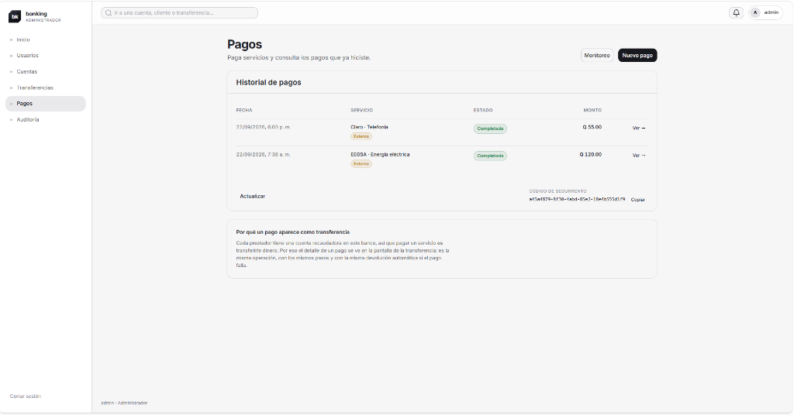

##### Observabilidad en Vivo del Pago:
* **Estado**: `PROCESANDO PAGO`.
* **Badge Dinámico**: `REINTENTANDO` | `Intento 2 de 4` | `Fallo transitorio`.
* **Diagnóstico Operativo**: *"El intento anterior falló. El siguiente sale en 5 segundos. Un fallo pasajero. El sistema lo reintenta hasta agotar la escalera de espera."*

---

#### Paso 28: Historial de Transferencias — Registro Auditable y Filtrado Reactivo (`/transferencias`)

En la bitácora histórica de transferencias (`https://bank-usac-web-mn2e6zhkwq-uc.a.run.app/transferencias`), el sistema preserva la traza inmutable de todas las operaciones realizadas para fines de auditoría y conciliación.

##### A. Estado Intermedio en Vivo (Durante la Escalera de Reintentos):
Cuando una transferencia transitoria se encuentra ascendiendo la escalera de reintentos en el microservicio de pagos, el historial refleja en tiempo real el badge reactivo `Procesando pago`:

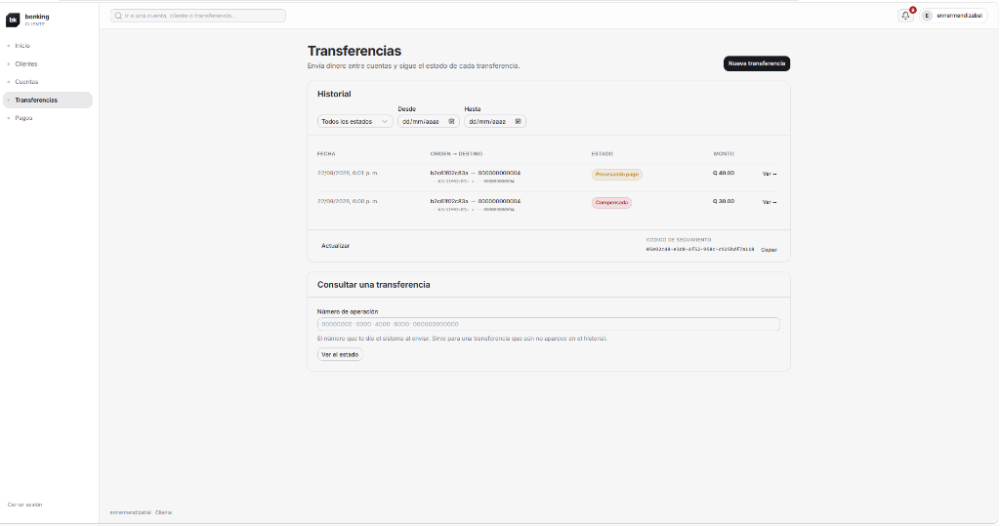

* Fila 1: `22/09/2026, 6:01 p. m.` | `Procesando pago` (Badge Amarillo) | `Q 40.00`
* Fila 2: `22/09/2026, 6:00 p. m.` | `Compensada` (Badge Rosa) | `Q 30.00`

##### B. Bitácora Consolidada (Transacciones Completadas y Compensadas):
Una vez culminados los flujos distribuidos, el historial documenta con absoluta precisión cada uno de los resultados terminales:

| FECHA | ORIGEN → DESTINO | ESTADO | MONTO | ACCIÓN |
| :--- | :--- | :---: | :---: | :--- |
| `22/09/2026, 6:01 p. m.` | `b2c61f02c83a → 000000000004` | `Completada` (Badge Verde) | **Q 30.00** | [Ver →] |
| `22/09/2026, 6:01 p. m.` | `b2c61f02c83a → 000000000004` | `Compensada` (Badge Rosa) | **Q 40.00** | [Ver →] |
| `22/09/2026, 6:00 p. m.` | `b2c61f02c83a → 000000000004` | `Compensada` (Badge Rosa) | **Q 30.00** | [Ver →] |

* **CÓDIGO DE SEGUIMIENTO**: `ce4e1685-c482-405a-91bb-e45e98a2d9f9` [Copiar].

##### C. Filtrado Reactivo por Estado:
El usuario puede filtrar la bitácora según el estado de la operación (`Aprobada`, `Compensada`, `Fallida`, etc.), permitiendo una visualización limpia e inmediata:

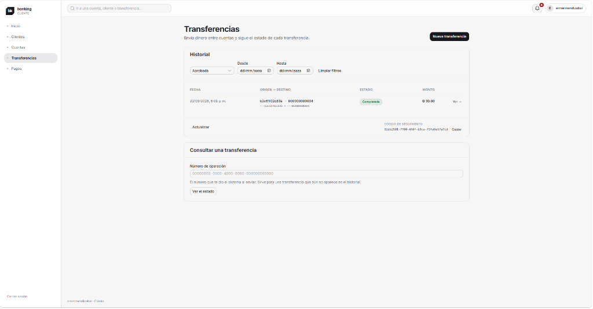

* Filtro aplicado: **"Aprobada"**.
* Fila filtrada: Únicamente la transferencia completada exitosamente de **Q 30.00**.
* Acción disponible: Botón **"Limpiar filtros"** para restaurar la vista completa.
* Buscador: Permite rastrear cualquier transacción mediante su UUID histórico (`Número de operación`).

---

#### Paso 28: Módulo de Pago de Servicios Públicos del Cliente (`/pagos`)

El cliente accede a la sección de **Pagos** (`http://localhost:3010/pagos`) desde su propio menú lateral para consultar el estado de facturas y servicios públicos asociados a sus productos.

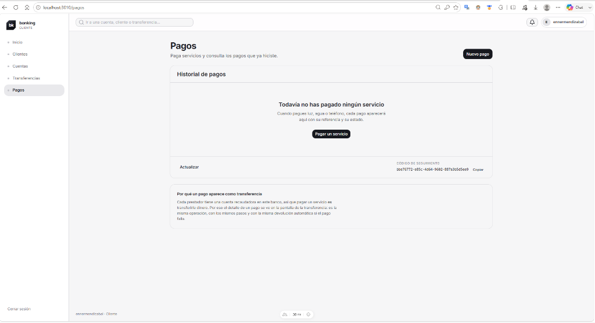

##### Elementos y Arquitectura de la Pantalla:
1. **Encabezado y Acciones**:
   * **Título**: *"Pagos"* (*"Paga servicios y consulta los pagos que ya hiciste."*).
   * Botón superior: **"Nuevo pago"**.
2. **Historial de Pagos del Cliente (Estado Vacío Inicial)**:
   * Mensaje: *"Todavía no has pagado ningún servicio. Cuando pagues luz, agua o teléfono, cada pago aparecerá aquí con su referencia y su estado."*
   * Botón de acción: **"Pagar un servicio"**.
3. **Nota Conceptual de Arquitectura ("Por qué un pago aparece como transferencia")**:
   * *"Cada prestador tiene una cuenta recaudadora en este banco, así que pagar un servicio es transferirle dinero. Por eso el detalle de un pago se ve en la pantalla de la transferencia: es la misma operación, con los mismos pasos y con la misma devolución automática si el pago falla."*
4. **Trazabilidad**:
   * **CÓDIGO DE SEGUIMIENTO**: `bbe76772-e85c-4d64-9602-887a3b5d5ee9` [Copiar].

---

#### Paso 29: Formulario de Pago de Servicios en Autoservicio — Factura de Claro Telefonía (`/pagos/nuevo`)

Desde el módulo de pagos (`/pagos`), el cliente pulsa el botón **"Nuevo pago"** (o **"Pagar un servicio"**) para liquidar una factura de servicios públicos mediante débito directo a sus cuentas bancarias (`https://bank-usac-web-mn2e6zhkwq-uc.a.run.app/pagos/nuevo`). En este flujo, el titular realiza el pago de servicios de telecomunicaciones a favor de **Claro**.

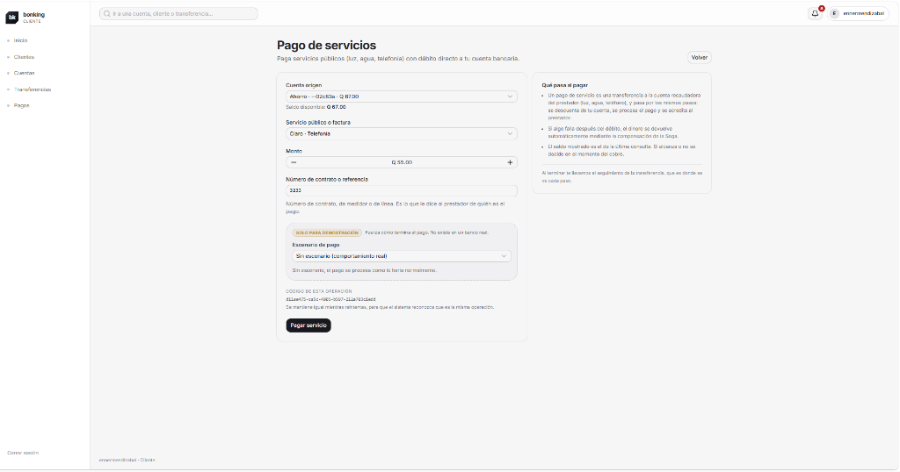

##### Elementos y Valores del Formulario en Pantalla:
1. **Selección de Cuenta de Origen**:
   * **Cuenta origen**: `Ahorro ····02c83a · Q 87.00`.
   * **Saldo disponible**: Indicador reactivo que confirma **`Q 87.00`** disponibles.
2. **Parámetros de la Factura**:
   * **Servicio público o factura**: Selector desplegable con el catálogo de empresas recaudadoras; se selecciona **`Claro · Telefonía`**.
   * **Monto**: **`Q 55.00`** (ajustado con controles `-` / `+`).
   * **Número de contrato o referencia**: Referencia de contrato ingresada: **`3233`** (*"Número de contrato, de medidor o de línea. Es lo que le dice al prestador de quién es el pago"*).
3. **Idempotencia y Trazabilidad Transaccional**:
   * `CÓDIGO DE ESTA OPERACIÓN`: `d11ae475-ca5c-4085-b597-212a783c1edd` (*"Se mantiene igual mientras reintentas, para que el sistema reconozca que es la misma operación"*).
4. **Sandbox de Demostración**:
   * Escenario: **`Sin escenario (comportamiento real)`** (*"Sin escenario, el pago se procesa como lo haría normalmente"*).
5. **Tarjeta Informativa Lateral ("Qué pasa al pagar")**:
   * *"Un pago de servicio es una transferencia a la cuenta recaudadora del prestador (luz, agua, teléfono), y pasa por los mismos pasos: se descuenta de tu cuenta, se procesa el pago y se acredita al prestador."*
   * *"Si algo falla después del débito, el dinero se devuelve automáticamente mediante la compensación de la Saga."*
   * *"Al terminar te llevamos al seguimiento de la transferencia, que es donde se ve cada paso."*
6. **Acción**: Botón principal **"Pagar servicio"**.

---

#### Paso 30: Monitor de la Saga del Pago de Servicios — Liquidación Exitosa y Aprobación (`/transferencias/[id]`)

Al ordenar el pago, el frontend redirige automáticamente al monitor en tiempo real de la transferencia distribuida (`https://bank-usac-web-mn2e6zhkwq-uc.a.run.app/transferencias/7ec1925b-2004-45de-a55f-fda3912b7eaf`), permitiendo auditar la ejecución de cada fase de la Saga coreografiada.

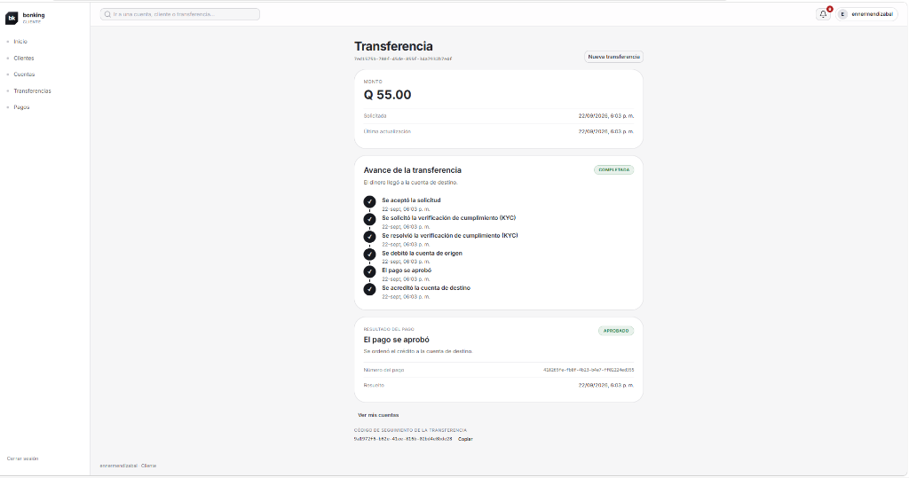

##### Análisis del Flujo y Métricas en Pantalla:
1. **Encabezado y Metadatos de la Operación**:
   * **Identificador de Transacción**: `7ec1925b-2004-45de-a55f-fda3912b7eaf`.
   * **MONTO**: **`Q 55.00`**.
   * **Solicitada**: `22/09/2026, 6:03 p. m.` | **Última actualización**: `22/09/2026, 6:03 p. m.`.
2. **Tarjeta "Avance de la transferencia" (Orquestación Saga)**:
   * Badge superior derecho: en color verde **`COMPLETADA`**.
   * Leyenda de éxito: *"El dinero llegó a la cuenta de destino."*
   * **Línea de tiempo secuencial (Stepper con checks)**:
     * `(✓) Se aceptó la solicitud` (22-sept, 06:03 p. m.)
     * `(✓) Se solicitó la verificación de cumplimiento (KYC)` (22-sept, 06:03 p. m.)
     * `(✓) Se resolvió la verificación de cumplimiento (KYC)` (22-sept, 06:03 p. m.)
     * `(✓) Se debitó la cuenta de origen` (22-sept, 06:03 p. m.)
     * `(✓) El pago se aprobó` (22-sept, 06:03 p. m.)
     * `(✓) Se acreditó la cuenta de destino` (22-sept, 06:03 p. m.)
3. **Tarjeta "RESULTADO DEL PAGO" (Resolución Externa)**:
   * Badge verde: **`APROBADO`**.
   * Título y detalle: **"El pago se aprobó"** (*"Se ordenó el crédito a la cuenta de destino."*).
   * **Número del pago (`paymentId`)**: `418285fe-fb8f-4b33-b4e7-ff03224ed355`.
   * **Resuelto**: `22/09/2026, 6:03 p. m.`.
4. **Trazabilidad y Enlaces**:
   * Enlace: **"Ver mis cuentas"**.
   * **CÓDIGO DE SEGUIMIENTO DE LA TRANSFERENCIA**: `9a5972f8-b82e-41cc-815b-02bd4ce8dc26` [Copiar].

---

#### Paso 31: Historial de Pagos de Servicios del Cliente con Factura Liquidada (`/pagos`)

El cliente regresa a la vista principal de **Pagos** (`https://bank-usac-web-mn2e6zhkwq-uc.a.run.app/pagos`) para constatar que su factura ha sido formalmente registrada en el historial histórico de servicios.

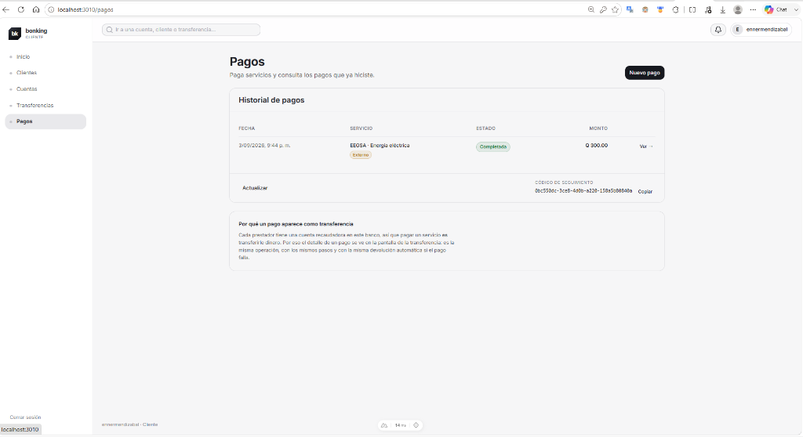

##### Elementos y Registros Observados en Pantalla:
1. **Encabezado y Acciones**:
   * Título: **Pagos** (*"Paga servicios y consulta los pagos que ya hiciste."*).
   * Botón superior: **"Nuevo pago"**.
2. **Tabla "Historial de pagos"**:
   * **FECHA**: `22/09/2026, 6:03 p. m.`
   * **SERVICIO**: `Claro · Telefonía` acompañado del badge amarillo **`Externo`**, certificando la liquidación hacia el proveedor externo.
   * **ESTADO**: Badge verde **`Completada`**.
   * **MONTO**: **`Q 55.00`**.
   * **Acción**: Enlace **`Ver →`** para acceder a la trazabilidad completa.
3. **Controles de Trazabilidad**:
   * Botón **"Actualizar"** para refrescar la lista reactivamente.
   * **CÓDIGO DE SEGUIMIENTO**: `87a1abce-3ea4-45ac-b52b-a491d7972b7e` [Copiar].
4. **Tarjeta Explicativa ("Por qué un pago aparece como transferencia")**:
   * *"Cada prestador tiene una cuenta recaudadora en este banco, así que pagar un servicio es transferirle dinero. Por eso el detalle de un pago se ve en la pantalla de la transferencia: es la misma operación, con los mismos pasos y con la misma devolución automática si el pago falla."*

---

#### Paso 32: Perfil de Usuario — Consulta y Edición de Datos Personales (`/perfil`)

El cliente accede a su módulo de autogestión de perfil (`http://localhost:3010/perfil`) para consultar su expediente personal, verificar el estado de su identidad y actualizar datos de contacto.

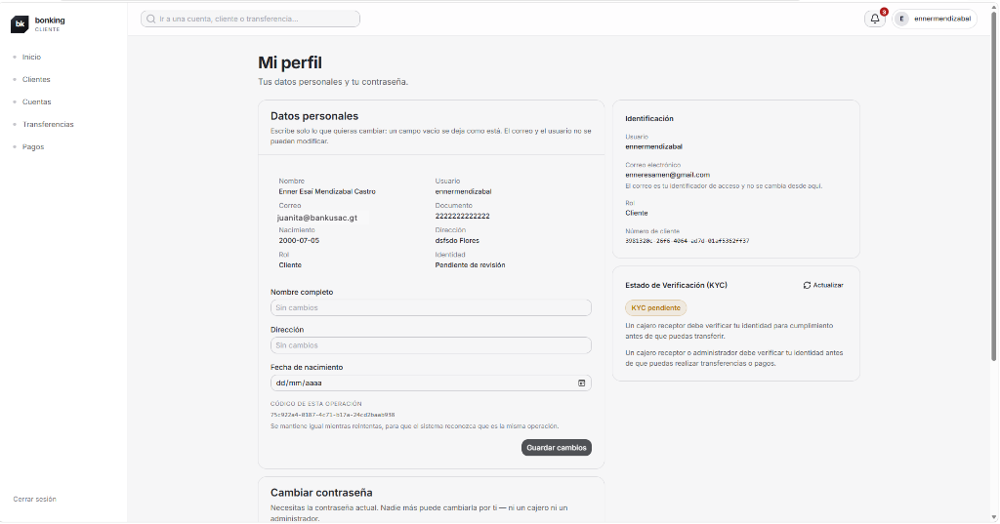

##### Elementos y Secciones en Pantalla:
1. **Tarjeta de Datos Personales (Panel Izquierdo)**:
   * Nota explicativa: *"Escribe solo lo que quieras cambiar: un campo vacío se deja como está. El correo y el usuario no se pueden modificar."*
   * **Ficha de Lectura (Valores Registrados)**:
     * Nombre: `Enner Esai Mendizabal Castro` | Usuario: `ennermendizabal`
     * Correo: `enneresamen@gmail.com` | Documento: `2222222222222`
     * Nacimiento: `2000-07-05` | Dirección: `dsfsdo Flores`
     * Rol: `Cliente` | Identidad: `Pendiente de revisión`
   * **Campos Editables**:
     * **Nombre completo**, **Dirección** y **Fecha de nacimiento** (mediante selector de fecha integrado).
   * **Idempotencia Técnica**:
     * `CÓDIGO DE ESTA OPERACIÓN`: `75c922a4-0187-4c71-b17a-24cd2babd918` (*"Se mantiene igual mientras reintentas, para que el sistema reconozca que es la misma operación."*).
   * Botón: **"Guardar cambios"**.
2. **Tarjeta de Identificación (Panel Derecho Superior)**:
   * Usuario: `ennermendizabal`.
   * Correo: `enneresamen@gmail.com` (*"El correo es tu identificador de acceso y no se cambia desde aquí."*).
   * Rol: `Cliente`.
   * Número de cliente (`customerId`): `3981328c-26f6-4064-ad7d-81af5362ff37`.
3. **Estado de Verificación KYC Inicial (Panel Derecho Inferior)**:
   * Badge naranja: `KYC pendiente`.
   * Leyenda: *"Un cajero receptor debe verificar tu identidad para cumplimiento antes de que puedas transferir. Un cajero receptor o administrador debe verificar tu identidad antes de que puedas realizar transferencias o pagos."*

---

#### Paso 33: Perfil de Usuario con Identidad Validada (KYC Verificado) (`/perfil`)

Una vez que el personal del banco revisa y aprueba el documento DPI del cliente en la mesa de validación de identidades, el cliente consulta su perfil y observa la confirmación oficial del estado de cumplimiento normativo.

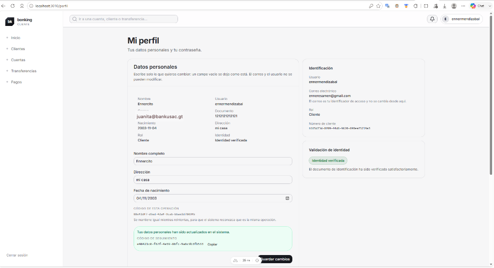

##### Efectos Inmediatos:
1. **Estado de Verificación KYC Aprobado**:
   * Badge verde: `KYC verificado`.
   * Leyenda: *"Tu identidad fue verificada para cumplimiento. Puedes transferir con normalidad."*
2. **Habilitación de Operaciones**:
   * El cliente queda totalmente autorizado para emitir transferencias bancarias, aperturar cuentas adicionales y pagar servicios en línea sin restricciones de ventanilla.
   * La ficha del cliente muestra la identidad como `Identidad verificada`.

---

#### Paso 34: Seguridad de Acceso — Formulario de Cambio de Contraseña (`/perfil`)

En la parte inferior de la pantalla de perfil, el cliente cuenta con un formulario de seguridad dedicado para rotar sus credenciales de acceso de forma autónoma.

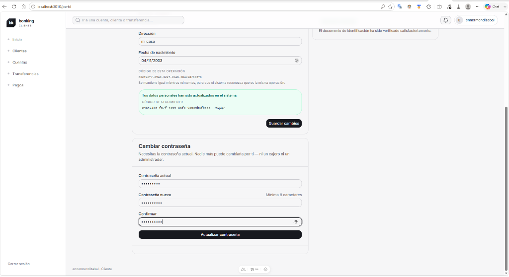

##### Principios de Seguridad y Campos Requeridos:
1. **Gobernanza Criptográfica**:
   * *"Necesitas la contraseña actual. Nadie más puede cambiarla por ti — ni un cajero ni un administrador."* (Garantiza que ningún colaborador bancario pueda suplantar la clave de un titular).
2. **Campos del Formulario**:
   * **Contraseña actual**: Campo protegido con asteriscos (se ingresa la clave vigente `ennero123`).
   * **Contraseña nueva**: Campo protegido (mínimo 8 caracteres reglamentarios).
   * **Confirmar**: Campo protegido con botón de alternancia de visibilidad (icono de ojo).
3. **Acción**:
   * Botón **"Actualizar contraseña"**.

---

#### Paso 35: Seguridad de Acceso — Confirmación de Contraseña Actualizada (`/perfil`)

Al enviar el formulario, el sistema valida la contraseña actual contra el hash `scrypt` almacenado en la base de datos, computa el nuevo hash criptográfico y actualiza el registro del cliente.

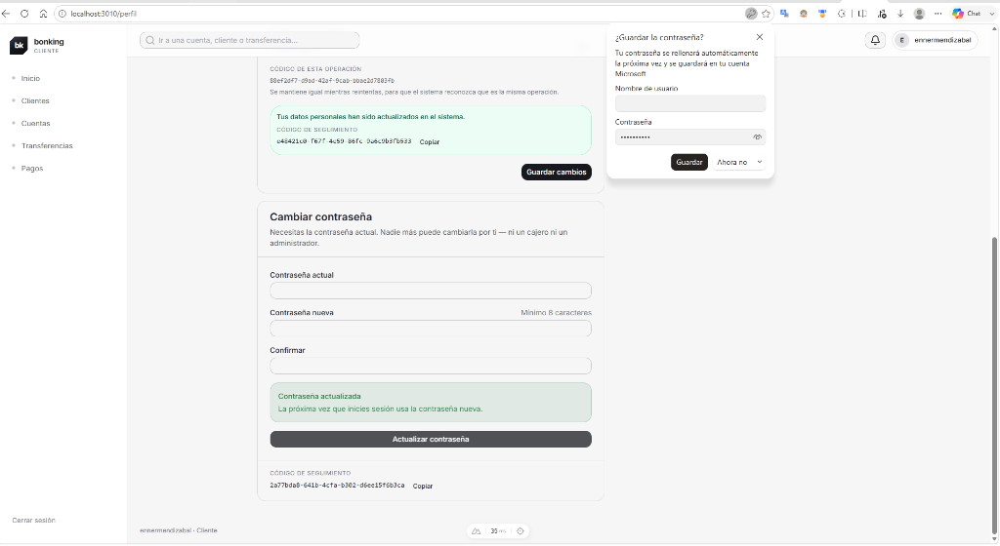

##### Elementos de la Confirmación:
1. **Alerta Verde de Éxito**:
   * **Título**: *"Contraseña actualizada"*
   * **Indicación**: *"La próxima vez que inicies sesión usa la contraseña nueva."*
2. **Trazabilidad de Seguridad**:
   * **CÓDIGO DE SEGUIMIENTO**: `2a77bda8-641b-4cfa-b302-d6ec15f6b3ca` [Copiar].
3. **Integración con Navegador**: Despliegue automático de la ventana de gestión de contraseñas seguras para sincronizar la nueva clave en el gestor del usuario.

---

### 5.3 Módulo 2: Portal del Cajero Receptor (`CAJERO_RECEPTOR`)

Este módulo cubre la operativa bancaria presencial realizada por el cajero receptor: validación documental de clientes web y enrolamiento integral de nuevos clientes en ventanilla.

* **Credenciales de Acceso del Cajero**: `cajero@bankusac.gt` / `BankUsac#2026`

---

#### Paso 36: Panel de Control del Cajero Receptor (`/`)

Al iniciar sesión con las credenciales de cajero receptor, el sistema presenta el tablero de mando operativo con las métricas del día.

##### Elementos y Métricas Observadas:
1. **Encabezado de Bienvenida**:
   * Identificación del usuario: *"Hola, cajero. Estás operando como Cajero receptor."*
   * Avatar superior con indicación de rol `c cajero` y logotipo institucional.
2. **Tarjetas de Indicadores Operativos**:
   * **VALIDACIONES PENDIENTES**: Contador en `1` con la leyenda *"Identidades esperando el veredicto de un cajero"*. Este valor refleja en tiempo real la solicitud ingresada por Enner en el Módulo 1. Incluye acceso directo: **"Revisar la cola →"**.
   * **CUENTAS CREADAS HOY**: Contador de aperturas (`4`) con enlace directo: **"Crear cuenta →"**.
   * **DEPÓSITOS DEL DÍA**: Muestra el total recibido en ventanilla (`0 · Q 0.00`) con enlace directo: **"Registrar depósito →"**.
3. **Barra de Navegación Lateral (Sidebar)**:
   * Acceso rápido a los submódulos autorizados para el cajero: **Inicio**, **Clientes**, **Cuentas**, **Transferencias**, **Pagos** y botón de **Cerrar sesión**.
4. **Trazabilidad**:
   * Código de seguimiento asignado a la sesión de consulta (`82a06452-1602-41f9-afff-76c9ae616403`).

---

#### Paso 37: Directorio Bancario de Clientes (`/clientes`)

Al ingresar a la sección de **Clientes** (`https://bank-usac-web-mn2e6zhkwq-uc.a.run.app/clientes`), el cajero visualiza las herramientas de gestión de expedientes y el listado consolidado de clientes registrados en el sistema.

##### Herramientas de Expediente:
1. **Registrar un cliente**: Botón **"Nuevo cliente"** para enrolar a una persona de forma presencial en ventanilla.
2. **Validación de identidad**: Botón **"Ver la cola"** para acceder a los trámites pendientes de revisión.
3. **Abrir la ficha de un cliente**: Campo de búsqueda por UUID para acceder directamente al expediente bancario de un titular.

##### Directorio de Clientes Registrados:
La tabla presenta el listado consolidado de titulares con sus roles y estados de verificación:
* **Juanita** (`@ennermendizabal`): `enneresamen@gmail.com` | `CLIENTE` | Badge verde **Verificado** | [Ficha] [Abrir cuenta]
* **Luisito Comunica** (`@luisitocomunica`): `luisitocomunica@test.com` | `CLIENTE` | Badge verde **Verificado** | [Ficha] [Abrir cuenta]
* **Clara Cliente** (`@clara`): `cliente@bankusac.gt` | `CLIENTE` | Badge verde **Verificado** | [Ficha] [Abrir cuenta]
* **Marco Tulio Lopez Medina** (`@marcotulio`): `2895884051401@ingenieria.usac.edu.gt` | `CLIENTE` | Badge verde **Verificado** | [Ficha] [Abrir cuenta]
* **Carlos Cajero** (`@cajero`): `cajero@bankusac.gt` | `CAJERO_RECEPTOR` | Badge verde **Verificado** | [Ficha]
* **Ana Administradora** (`@admin`): `admin@bankusac.gt` | `ADMINISTRADOR` | Badge verde **Verificado** | [Ficha]

---

#### Paso 38: Cola de Clientes en Espera de Validación (`/clientes/validaciones`)

Al hacer clic en **"Ver la cola"**, el cajero ingresa a la bandeja de trabajo de verificación documental (`https://bank-usac-web-mn2e6zhkwq-uc.a.run.app/clientes/validaciones`).

##### Estado de la Cola de Trabajo:
* **"No hay identidades por revisar"**: La cola se encuentra completamente al día tras procesar las solicitudes entrantes.
* Leyenda operativa: *"Cuando un cliente complete su registro con foto de DPI aparecerá aquí para validación."*

---

#### Paso 39: Mesa de Revisión y Veredicto de Identidad (`/clientes/validaciones/[id]`)

En esta pantalla crítica de seguridad bancaria, el cajero realiza el cotejo entre la imagen del DPI almacenada de forma segura en MinIO y los datos declarados por el cliente.

##### A. Revisión Previa al Veredicto:

* **Documento cargado**: Visualizador seguro de la foto del documento subida por el titular.
* **Datos declarados**:
  * **Nombre completo**: `Luisito Comunica`
  * **Número de documento**: `1111111111111`
  * **Fecha de nacimiento**: `1995-08-22`
  * **Dirección**: `Mexico`
  * **Usuario**: `luisitocomunica`
  * **Estado de identidad**: Badge amarillo **"Pendiente de revisión"**.
* **Acciones de Decisión Operativa**: Botón **"Aprobar identidad"** y botón **"Rechazar"**.

##### B. Confirmación de Identidad Aprobada:
Al pulsar **"Aprobar identidad"**, el sistema emite el evento asíncrono de verificación y actualiza el expediente en tiempo real:

* **Banner de Éxito**: *"Identidad aprobada — El veredicto de validación ha sido procesado exitosamente."*
* **Estado de Identidad**: Badge verde **"Identidad verificada"**.
* **Tarjeta de Confirmación**: *"El documento fue aprobado y se emitió el correo de activación para el cliente."*
* **Navegación**: Botón **"Volver a la cola de validaciones"**.

---

#### Paso 40: Registro de Clientes en Ventanilla — Paso 1: Datos Personales (`/clientes/nuevo`)

Además de validar registros web, el cajero receptor tiene la facultad de enrolar nuevos clientes que acuden presencialmente a la agencia.

##### Datos del Ejemplo de Alta Presencial:
* **Nombre completo**: `luisito comunica`
* **Fecha de nacimiento**: `01/07/1988` (Cálculo dinámico de edad: `38 años`).
* **Dirección**: `mexicocu`
* **Correo electrónico**: `deennerparaprobar@gmail.com`

##### Características de la Interfaz:
1. **Asistente de Enrolamiento de 3 Pasos**: *Datos personales*, *Documento* y *Confirmación*.
2. **Botón "Continuar"**: Valida los campos y avanza a la carga del documento.

---

#### Paso 41: Registro de Clientes en Ventanilla — Paso 2: Documento de Identidad (`/clientes/nuevo`)

En la segunda etapa del alta en ventanilla, el cajero solicita el DPI físico al cliente, lo digitaliza e ingresa el código numérico.

##### Datos del Ejemplo:
* **Número de DPI (13 dígitos)**: `3223322332323`
* **Foto del documento**: Archivo escaneado o fotográfico cargado (`2026-07-16 08_47_04-Descargas - Explorador de archivos.png`, `50 KB · Listo para enviar`).

##### Controles Disponibles:
1. **Previsualización de Documento**: Muestra la imagen cargada con botón **"Cambiar"** para corregir el archivo si fuera necesario.
2. **Navegación**: Botón **"Volver"** y botón **"Continuar"** para avanzar al resumen.

---

#### Paso 42: Registro de Clientes en Ventanilla — Paso 3: Confirmación y Credenciales (`/clientes/nuevo`)

El cajero revisa el consolidado con el solicitante presente en ventanilla, genera su nombre de usuario institucional y define su contraseña de acceso temporal o definitiva.

##### Resumen Declarado y Credenciales:
* **Nombre completo**: `luisito comunica`
* **Fecha de nacimiento**: `1988-07-01`
* **Dirección**: `mexicocu`
* **Correo electrónico**: `deennerparaprobar@gmail.com`
* **Documento (DPI)**: `3223322332323`
* **Documento**: Archivo cargado en memoria.
* **Usuario generado**: `lcomunica`
* **Contraseña / Confirmación**: `lcomunica`
* **Consentimiento Legal**: Casilla de aceptación de términos y políticas de datos.
* **Idempotencia Técnica**: Código de operación `19484b11-10ce-428e-afae-119fbfa6ee89`.

---

#### Paso 43: Confirmación de Alta Exitosa en Ventanilla (`/clientes/nuevo`)

Al presionar **"Crear cuenta"**, la operación se procesa de forma inmediata. Debido a que el trámite lo efectúa un cajero en persona, el cliente queda automáticamente **registrado y validado** sin requerir mesa de control posterior.

##### Valores Emitidos por el Sistema:
* **Mensaje**: *"Cliente registrado. El cliente fue registrado y validado exitosamente. Se envió el enlace de activación a **deennerparaprobar@gmail.com**."*
* **NÚMERO DE CLIENTE (`customerId`)**: `3809b1a4-0deb-4da3-8a12-e1bd8cfab72d` [Copiar]
* **USUARIO ASIGNADO**: `lcomunica` [Copiar]
* **CÓDIGO DE SEGUIMIENTO**: `a275f50a-560b-40d5-bc37-a7cd7a06b209` [Copiar]

##### Acciones Disponibles:
* **"Ver el cliente"**: Abre la ficha bancaria recién creada.
* **"Registrar otro"**: Reinicia el formulario para atender a un nuevo usuario en cola.

---

#### Paso 44: Notificación de Activación para el Cliente de Ventanilla (`deennerparaprobar@gmail.com`)

De manera sincronizada con el alta presencial, el sistema despacha el correo formal de bienvenida y activación a la dirección registrada por el cajero.

##### Datos del Correo Electrónico:
* **De**: `bonking <no-reply@guatechnology.com>`
* **Para**: `deennerparaprobar@gmail.com`
* **Asunto**: *"Activa tu cuenta de bonking"*
* **Enlace de activación**: `http://localhost:3010/activar?token=91560277-d4b4-4c6a-a37d-a3b47fbda9b88ba3e6da429e237d7a8b808ce97db2cc1902193b3a989289894f8b3bea6fc64a`

##### Operación de Activación:
Al ingresar al enlace, el cliente activa su cuenta y queda listo para iniciar sesión en la banca en línea con el usuario `lcomunica` y la contraseña asignada.

---

#### Paso 45: Ficha Técnica y Expediente KYC del Cliente (`/clientes/[id]`)

Tanto los cajeros como los administradores pueden consultar el expediente individual de cualquier cliente registrado para revisar su estado de verificación o actualizar datos de contacto permitidos (`https://bank-usac-web-mn2e6zhkwq-uc.a.run.app/clientes/f24cd304-5936-4882-83f8-1ba0fae5523c`).

##### Datos y Estructura en Pantalla:
1. **Panel Izquierdo — "Datos personales"**:
   * **Campos Inmutables por Seguridad**:
     * **Correo**: `luisitocomunica@test.com`
     * **Usuario**: `luisitocomunica`
     * *(Por normativa bancaria estricta, el correo y el nombre de usuario no son modificables desde la ficha para proteger la trazabilidad de la identidad).*
   * **Datos Registrados**:
     * **Nombre**: `Luisito Comunica`
     * **Documento**: `1111111111111`
     * **Nacimiento**: `1995-08-22`
     * **Dirección**: `Mexico`
     * **Rol**: `Cliente`
     * **Identidad**: `Identidad verificada`
   * **Formulario de Actualización**:
     * Permite ingresar un nuevo **Nombre completo**, **Dirección** o **Fecha de nacimiento** con selector de calendario. Los campos vacíos preservan los datos actuales sin modificaciones.
   * **Control de Idempotencia**:
     * Código de operación: `759cd85f-422d-4ed4-a625-b65a5772ca5a`.
     * Botón **"Guardar cambios"**: Aplica las modificaciones atómicamente.
2. **Panel Derecho — "Estado de Verificación (KYC)"**:
   * **Badge de Estado**: Verde **"Verificado"**.
   * **Dictamen Normativo**: *"Expediente e identidad aprobados. El cliente cuenta con acceso habilitado para operar transferencias, pagos y cuentas."*
   * **Número de cliente**: `f24cd304-5936-4882-83f8-1ba0fae5523c`.
   * **Usuario**: `luisitocomunica`.
   * **Acceso a Expediente**: Enlace *"Ver documento de identidad adjunto →"*.

---

#### Paso 46: Directorio de Cuentas Bancarias y Saldo Custodiado (`/cuentas`)

Al navegar a la sección de **Cuentas** en la barra lateral, el cajero receptor tiene acceso a la visión consolidada de las cuentas de clientes custodiadas por el banco.

##### Indicadores y Controles de Cabecera:
1. **Saldo Total Custodiado**:
   * Destacado en la parte superior derecha: **`Q 9,800.00`**, reflejando la suma líquida total custodiada en todas las cuentas de clientes del banco.
2. **Acciones Operativas de Ventanilla**:
   * Botón **"Depósito"**: Abre el modal o formulario para recibir efectivo y acreditarlo de inmediato.
   * Botón **"Abrir cuenta"**: Inicia el proceso para emitir una nueva cuenta monetaria o de ahorro (`/cuentas/nueva`).

##### Inventario de Cuentas en Pantalla:
| TIPO | NÚMERO DE CUENTA | ESTADO | SALDO | ACCIÓN |
| :--- | :--- | :---: | :---: | :--- |
| **AH** Ahorro | `b0000000-0000-4000-8000-000000000004` | `ACTIVA` | **Q 800.00** | [Ver detalle] |
| **MO** Monetaria | `b0000000-0000-4000-8000-000000000003` | `ACTIVA` | **Q 2,500.00** | [Ver detalle] |
| **AH** Ahorro | `b0000000-0000-4000-8000-000000000002` | `ACTIVA` | **Q 1,500.00** | [Ver detalle] |
| **MO** Monetaria | `b0000000-0000-4000-8000-000000000001` | `ACTIVA` | **Q 5,000.00** | [Ver detalle] |

##### Pie de Página y Auditoría:
* Enlace **"Actualizar"** para refrescar la lista con los últimos saldos.
* **CÓDIGO DE SEGUIMIENTO**: `9c017653-0fad-45c5-9842-6c63c6402c54` [Copiar].

---

#### Paso 47: Detalle de Cuenta Bancaria y Consulta de Movimientos (`/cuentas/[id]`)

Al pulsar el botón **"Ver detalle"** en cualquiera de las cuentas del directorio (en este ejemplo, la cuenta `b0000000-0000-4000-8000-000000000004`), se despliega la ficha financiera de la cuenta.

##### Elementos de la Tarjeta Principal:
1. **Encabezado**:
   * Tipo de producto: **Cuenta Ahorro** acompañada del badge verde de estado **`ACTIVA`**.
   * Acciones: Botón **"Actualizar"** (para consultar el saldo más reciente) y **"Volver"** (para regresar al directorio de cuentas).
2. **Saldo Disponible**:
   * **`Q 800.00`** (con tipografía grande y destacada para verificación inmediata).
3. **Número de Cuenta**:
   * `b0000000-0000-4000-8000-000000000004` con botón rápido **"Copiar"**.
4. **Registro del Último Movimiento**:
   * *Último movimiento: 3/09/2026, 8:20 p. m.*

##### Sección de Movimientos:
* Espacio destinado a la cronología de débitos, abonos, transferencias y pagos asociados a la cuenta.
* Mensaje informativo en cuentas sin transacciones previas: *"Esta cuenta todavía no tiene movimientos. Aparecerán aquí en cuanto reciba o envíe una transferencia."*

##### Trazabilidad de Consulta:
* **CÓDIGO DE SEGUIMIENTO**: `7c0799a4-bc5f-4cf7-ab47-a7f92f0f4ca4` [Copiar].

---

#### Paso 48: Apertura de Cuenta en Ventanilla — Tipo de Cuenta y Selección de Titular (`/cuentas/nueva`)

El cajero hace clic en **"Abrir cuenta"** para crear una nueva cuenta bancaria. Siguiendo el hilo del ejemplo unificado, se abre una cuenta para el cliente principal **Enner Esai Mendizabal Castro** (quien fue registrado en el Módulo 1 y validado en el Paso 39).

##### Configuración de la Cuenta:
1. **Tipo de Cuenta**:
   * **Monetaria** *(Seleccionada)*: *"Uso diario, transferencias y pagos sin límite de movimientos."*
   * **Ahorro**: *"Para guardar dinero y acumular fondos."*
2. **Política Bancaria de Inactividad**:
   * Notificación visible: *"Toda cuenta bancaria (Monetaria o Ahorro) se desactiva automáticamente si permanece inactiva por 6 meses con saldo menor a Q 50.00."*
3. **Selección del Titular (Cliente Validado)**:
   * Campo de búsqueda: **"Buscar cliente por Nombre o DPI"**.
   * Valor seleccionado de la lista: `Enner Esai Mendizabal Castro · DPI: 12121212121 · (5219a3)`.
   * **Número de cliente del titular (UUID)**: El sistema autorrellena automáticamente el UUID verificado `b165d73d-8f09-44d6-9620-698ea75219a3`.
   * **Validación de Identidad en Verde**: `✓ Cliente: Enner Esai Mendizabal Castro (DPI: 1212121212121)`, asegurando que la cuenta solo se abra a un cliente real y previamente validado.
4. **Idempotencia Técnica**:
   * CÓDIGO DE ESTA OPERACIÓN: `7d5918ee-f8e0-4961-b712-5ffe02e165e8`.
5. **Navegación**:
   * Botón **"Continuar"** para revisar la confirmación.

---

#### Paso 49: Confirmación y Emisión de la Cuenta Bancaria (`/cuentas/nueva`)

En el segundo paso de la apertura, el cajero corrobora los datos finales antes de efectuar el alta definitiva en el sistema bancario.

##### Datos de la Confirmación:
* **Titular**: `Enner Esai Mendizabal Castro · DPI: 12121212121 (b165d73d-8f09-44d6-9620-698ea75219a3)`
* **Tipo de cuenta**: `Monetaria`
* **Saldo inicial**: `Q 0.00` *(La cuenta nace en balance cero y con estado `ACTIVA`)*

##### Acciones Disponibles:
* Botón **"Volver"**: Permite regresar para cambiar el tipo de cuenta o seleccionar a otro cliente.
* Botón **"Crear la cuenta"**: Al pulsarlo, el Gateway envía el comando transaccional `account.create.v1` hacia `account-service`, creando la cuenta bancaria con el número único asignado **`e80bd8e9-930a-4f5a-9f34-229cc6d6e822`**, asociándola formalmente a Enner y registrando el evento de auditoría correspondiente.

---

#### Paso 50: Depósito en Ventanilla — Datos y Fondeo Inicial de la Cuenta (`/cuentas/deposito`)

Una vez creada la cuenta monetaria de Enner, el cliente se acerca a la ventanilla para realizar su primer abono en efectivo y fondear sus fondos disponibles. El cajero pulsa el botón **"Depósito"** en la barra superior o en el directorio de cuentas.

##### Datos del Depósito en Efectivo:
1. **Cuenta Destino**:
   * **Búsqueda**: Selector desplegable *"Buscar cuenta destino por titular o número"*.
   * **Seleccionado**: `Enner Mendizabal · Monetaria · ...d6e822 · Q 0.00`.
   * **Número de cuenta destino (UUID)**: `e80bd8e9-930a-4f5a-9f34-229cc6d6e822`.
   * **Confirmación visual en verde**: `✓ Cuenta destino: Enner Mendizabal · Monetaria · ...d6e822 · Q 0.00`.
2. **Monto a Depositar**:
   * **`Q 1,500.00`** (con controles intuitivos de incremento `+` y decremento `-`).
3. **Descripción o Concepto**:
   * Texto ingresado: `dinero que dejo mi abuelo`.
   * Regla de cumplimiento: El concepto se asienta textualmente en el extracto bancario sin admitir datos personales reservados.
4. **Reglas Operativas Explicadas en Interfaz ("Qué hace esta operación")**:
   * **Acreditación Directa**: El efectivo ingresa al banco sin debitar otra cuenta cliente; la transacción concluye de forma sincrónica e inmediata.
   * **Reactivación Automática**: Si la cuenta destino se encontrara inactiva por desuso o saldo insuficiente, el depósito la restituye a estado `ACTIVA`.
   * **Idempotencia Transaccional**: El reintento con el mismo identificador de operación previene dobles abonos accidentales.
5. **Navegación**:
   * Botón **"Continuar"** para revisar la confirmación de caja.

---

#### Paso 51: Confirmación de Depósito en Efectivo (`/cuentas/deposito`)

En la pantalla de validación previa al arqueo y asiento contable, el cajero corrobora los datos con el depositante en ventanilla.

##### Resumen de la Operación:
* **Advertencia de Seguridad**: *"Revisa la cuenta y el monto. Un depósito acreditado no se revierte desde esta pantalla."*
* **Cuenta destino**: `Enner Mendizabal · Monetaria · ...d6e822 · Q 0.00`
* **Monto a Abonar**: **`Q 1,500.00`**
* **Descripción**: `dinero que dejo mi abuelo`

##### Acciones Disponibles:
* Botón **"Volver"**: Permite retornar a la pantalla anterior si el cliente desea cambiar el monto o la cuenta destino.
* Botón **"Registrar depósito"**: Envía el comando `account.deposit.v1` a `account-service`. El balance se actualiza bajo un bloqueo de fila (`SELECT ... FOR UPDATE`), garantizando consistencia absoluta ante operaciones concurrentes.

---

#### Paso 52: Comprobante de Depósito Acreditado en Ventanilla (`/cuentas/deposito`)

Al procesar la transacción, el sistema confirma la acreditación del efectivo y emite el recibo digital de ventanilla.

##### Resultados Emitidos por el Sistema:
* **Monto acreditado**: **`Q 1,500.00`** (en verde destacado).
* **Nuevo Saldo Disponible**: **`Q 1,500.00`** (actualizado desde Q 0.00).
* **Cuenta destino acreditada**: `e80bd8e9-930a-4f5a-9f34-229cc6d6e822`.
* **Identificador de Operación (`operationId`)**: `b6662425-284d-406d-8415-123d32838bb5`.
* **Código de Seguimiento Auditable (`correlationId`)**: `7d37951f-5229-476f-8ad1-9138881af678` [Copiar].

##### Opciones Posteriores:
* Botón **"Registrar otro depósito"**: Reinicia el formulario para atender al siguiente usuario en ventanilla.
* Botón **"Ver la cuenta"**: Conduce al detalle de saldos y extractos de la cuenta recién fondeada.

---

#### Paso 53: Directorio de Cuentas con Nueva Cuenta Fondeada y Saldo Custodiado (`/cuentas`)

Tras concluir el depósito, el cajero regresa al directorio general de cuentas bancarias. La pantalla evidencia el impacto contable del nuevo saldo y la inclusión de la cuenta de Enner.

##### Métricas y Cambios Globales Observados:
1. **Incremento del Saldo Total Custodiado**:
   * El saldo en custodia de la institución sube a **`Q 11,300.00`** (un incremento exacto de `Q 1,500.00` sobre los `Q 9,800.00` iniciales que se apreciaban en el Paso 46).
2. **Nueva Fila en la Tabla de Cuentas**:
   * **Fila 1 (Cuenta de Enner)**:
     * Tipo: `MO` Monetaria
     * Número de cuenta: `e80bd8e9-930a-4f5a-9f34-229cc6d6e822`
     * Estado: Badge verde **`ACTIVA`**
     * Saldo: **`Q 1,500.00`**
     * Acción: Botón **"Ver detalle"**
   * **Filas 2 a 5**: Las cuentas pre-sembradas de Ahorro y Monetaria de los otros clientes (`Q 800.00`, `Q 2,500.00`, `Q 1,500.00`, `Q 5,000.00`).
3. **Auditoría de Consulta**:
   * CÓDIGO DE SEGUIMIENTO: `169a3d0e-e495-4c40-90da-dd954aa9772a` [Copiar].

---

#### Paso 54: Módulo de Transferencias entre Cuentas y Consulta de Operaciones (`/transferencias`)

El cajero accede a la sección de **Transferencias** en el menú lateral para consultar la actividad interbancaria o brindar soporte sobre operaciones en curso.

##### Componentes y Herramientas del Módulo:
1. **Botones de Control Superior**:
   * **"Monitoreo"**: Enlace directo a la vista de seguimiento de la Saga coreografiada y estado de las colas de mensajería.
   * **"Nueva transferencia"**: Permite iniciar una nueva transferencia entre cuentas autorizadas.
2. **Tabla "Historial de operaciones de clientes"**:
   El cajero cuenta con visibilidad global de las transferencias ejecutadas por los cuentahabientes, permitiendo identificar estados terminales y transiciones de la Saga:

| FECHA | ORIGEN → DESTINO | ESTADO | MONTO | ACCIÓN |
| :--- | :--- | :---: | :---: | :--- |
| `22/09/2026, 6:01 p. m.` | `Juanita → Clara Cliente` | `Completada` (Badge Verde) | **Q 30.00** | [Ver →] |
| `22/09/2026, 6:01 p. m.` | `Juanita → Clara Cliente` | `Compensada` (Badge Rosa) | **Q 40.00** | [Ver →] |
| `22/09/2026, 6:00 p. m.` | `Juanita → Clara Cliente` | `Compensada` (Badge Rosa) | **Q 30.00** | [Ver →] |
| `22/09/2026, 5:41 p. m.` | `Clara Cliente → Clara Cliente` | `Fallida` (Badge Rojo) | **Q 999,900.00** | [Ver →] |
| `22/09/2026, 7:38 a. m.` | `Marco Tulio Lopez Medina → Clara Cliente` | `Compensada` (Badge Rosa) | **Q 50.00** | [Ver →] |
| `22/09/2026, 7:37 a. m.` | `Marco Tulio Lopez Medina → Clara Cliente` | `Completada` (Badge Verde) | **Q 150.00** | [Ver →] |

   * **CÓDIGO DE SEGUIMIENTO**: `140fd19e-a891-4198-a094-0ed020a3d251` [Copiar].

##### B. Filtrado Reactivo de Incidencias Operativas (Estado: "Fallida" / Compensaciones):
El cajero puede aislar ágilmente aquellas transacciones que presentaron anomalías (fondos insuficientes o fallos de pago con compensación automática):

* **Filtro seleccionado**: **"Fallida"**.
* **Transacciones aisladas**: Muestra las 3 compensaciones de la Saga (`Q 40.00`, `Q 30.00` y `Q 50.00`) y el intento fallido por fondos insuficientes de `Q 999,900.00`.
* **Control**: Botón **"Limpiar filtros"** para restaurar la vista global de transferencias.

3. **Tarjeta "Consultar una transferencia"**:
   * Herramienta de soporte rápido para ventanilla: permite ingresar un **Número de operación** (UUID de 36 caracteres) para verificar si una transacción enviada por un cliente fue completada, compensada por fallo de débito o se encuentra pendiente de liquidación.
   * Botón: **"Ver el estado"**.

---

#### Paso 55: Formulario de Nueva Transferencia entre Clientes (`/transferencias/nueva`)

El cajero hace clic en **"Nueva transferencia"** para iniciar un traslado de fondos interbancario a solicitud de un usuario. Siguiendo el caso de uso transversal, la clienta **Clara Cliente** transfiere fondos a la cuenta de **Enner Mendizabal**.

##### Configuración de la Transferencia:
1. **Cuenta de Origen**:
   * Selector: `Clara Cliente · Ahorro · ...000004 · Q 800.00`.
   * Indicación: *"De aquí sale el dinero."*
2. **Destino de los Fondos ("¿A dónde va el dinero?")**:
   * Opción seleccionada: **"A cuenta de otro cliente"** (transferencia hacia un tercero).
3. **Cuenta de Destino**:
   * Selector / Búsqueda: `Enner Mendizabal · Monetaria · ...d6e822 · Q 1,500.00`.
   * Identificador único (UUID): `e80bd8e9-930a-4f5a-9f34-229cc6d6e822`.
   * Confirmación visual en verde: `✓ Cuenta destino: Enner Mendizabal · Monetaria · ...d6e822 · Q 1,500.00`.
4. **Monto**:
   * **`Q 400.00`** (con botones para ajustar la cantidad).
5. **Panel de Entorno de Evaluación ("SOLO PARA DEMOSTRACIÓN")**:
   * Control exclusivo para demostración y pruebas de fiabilidad:
     * **Escenario de pago**: `Aprobar el pago` (*"La transferencia se completa. Es el camino normal."*).
6. **Navegación**:
   * Botón **"Continuar"** para revisar el resumen.

---

#### Paso 56: Revisión y Confirmación de Transferencia (`/transferencias/nueva`)

Antes de someter la operación al orquestador distribuido de la Saga, el cajero corrobora los datos esenciales de la transferencia.

##### Datos Consolidados:
* **Sale de**: `Clara Cliente · Ahorro · ...000004 · Q 800.00`
* **Entra a**: `Enner Mendizabal · Monetaria · ...d6e822 · Q 1,500.00`
* **Monto**: **`Q 400.00`**
* **Control de Idempotencia**:
  * Código de operación único: `5b169e36-f2f4-489b-8395-1f03eb2198b4`.
  * Garantía técnica: Se mantiene constante durante reintentos de red para evitar duplicar el cargo.

##### Acciones:
* Botón **"Corregir"**: Regresa al formulario para subsanar cualquier parámetro.
* Botón **"Confirmar y enviar"**: Despacha la orden hacia el API Gateway e inicia la Saga coreografiada.

---

#### Paso 57: Recepción Asíncrona — Solicitud en Proceso (`/transferencias/[id]`)

Al presionar **"Confirmar y enviar"**, el sistema acepta de inmediato la solicitud y redirige al monitor transaccional, asignando temporalmente el identificador de operación `25c5b09a-fb89-46cc-864c-9d72a6385bd3`.

##### Comportamiento Reactivo:
* **Estado Visible**: Banner color crema **"Solicitud en proceso"**.
* **Mensaje al Operador**: *"El sistema aceptó la transferencia y la está registrando. Esta pantalla se actualiza sola."*
* **Arquitectura Subyacente**: El Gateway encoló el comando en RabbitMQ y la interfaz cliente se sincroniza de forma reactiva esperando la resolución de los microservicios sin necesidad de recargar la página.

---

#### Paso 58: Monitor de la Saga en Tiempo Real — Procesando Pago (`/transferencias/[id]`)

En cuestión de milisegundos, el sistema transiciona al identificador definitivo de transferencia `2cc63338-833f-4871-b47f-d297e268de91` y despliega la máquina de estados coreografiada en tiempo real.

##### Estado del Avance de la Transferencia (Badge Naranja: `PROCESANDO PAGO`):
* **Principio de Compensación Explicado en Pantalla**: *"El dinero ya salió de la cuenta de origen y el pago está en proceso. Si el pago falla, se devuelve automáticamente."*
* **Paso 1: Solicitada** `(✓)` — El sistema aceptó la solicitud formal.
* **Paso 2: Débito** `(✓)` — `account-service` debitó exitosamente los **Q 400.00** de la cuenta de Clara Cliente.
* **Paso 3: Pago** `(Spinner en proceso)` — `payment-service` se encuentra procesando la liquidación interbancaria.
* **Paso 4: Completada** `(Pendiente)` — Pendiente de acreditación final.

##### Tarjeta "Resultado del Pago" (Badge Naranja: `EN PROCESO`):
* **Título**: *"El pago está en proceso"*
* **Número del pago**: `25c5b09a-fb89-46cc-864c-9d72a6385bd3`.
* Botón **"Ver el detalle del pago"** para inspeccionar la traza técnica de liquidación.

---

#### Paso 59: Monitor de la Saga en Tiempo Real — Transferencia Completada (`/transferencias/[id]`)

Una vez validado el pago, `payment-service` emite `payment.completed.v1`, `account-service` acredita los fondos en la cuenta de Enner y `transaction-service` cierra la Saga de forma exitosa.

##### Estado Final de la Transferencia (Badge Verde: `COMPLETADA`):
* **Subtítulo de Éxito**: *"El dinero llegó a la cuenta de destino."*
* **Cuatro Hitos Coreografiados Exitosos**:
  1. `(✓) Solicitada`: Aceptada por el API Gateway.
  2. `(✓) Débito`: Q 400.00 debitados de Clara Cliente.
  3. `(✓) Pago`: Liquidación aprobada por el procesador de pagos.
  4. `(✓) Completada`: Q 400.00 acreditados en la cuenta de Enner Mendizabal.

##### Tarjeta "Resultado del Pago" (Badge Verde: `APROBADO`):
* **Título**: *"El pago se aprobó"*
* **Descripción**: *"Se ordenó el crédito a la cuenta de destino."*
* **Número del pago**: `25c5b09a-fb89-46cc-864c-9d72a6385bd3`.
* **Hora de resolución**: `3/09/2026, 9:33 p. m.`.
* Botón superior disponible: **"Nueva transferencia"**.

---

#### Paso 60: Historial General de Transferencias Actualizado (`/transferencias`)

Al volver al módulo principal de transferencias, la tabla histórica de clientes se actualiza automáticamente con la transacción registrada, inmutable y auditable.

##### Fila Liquidada en el Historial:
| FECHA | ORIGEN → DESTINO | ESTADO | MONTO | ACCIÓN |
| :--- | :--- | :---: | :---: | :--- |
| `3/09/2026, 9:33 p. m.` | `b00000000004 → 229cc6d6e822` | `Completada` | **Q 400.00** | [Ver →] |

##### Trazabilidad de Auditoría:
* CÓDIGO DE SEGUIMIENTO: `ccbb49c2-ee41-4980-b827-614c1b458733` [Copiar].

---

#### Paso 61: Módulo de Pago de Servicios (`/pagos`)

El cajero receptor ingresa a la sección de **Pagos** desde el menú lateral (`http://localhost:3010/pagos`) para gestionar pagos de facturas y servicios públicos en ventanilla (electricidad, agua, telecomunicaciones).

##### Elementos y Arquitectura de la Pantalla:
1. **Encabezado y Acciones Rápidas**:
   * **"Monitoreo"**: Permite acceder a la vista de supervisión técnica de los pagos y su correlación con la Saga distribuida.
   * **"Nuevo pago"**: Abre el asistente interactivo para iniciar un nuevo cobro por servicio público (`/pagos/nuevo`).
2. **Historial de Pagos (Estado Inicial)**:
   * Muestra el mensaje informativo: *"Todavía no has pagado ningún servicio. Cuando pagues luz, agua o teléfono, cada pago aparecerá aquí con su referencia y su estado."*
   * Botón central: **"Pagar un servicio"**.
3. **Pie de Tarjeta y Trazabilidad**:
   * Botón **"Actualizar"** para refrescar la consulta de pagos en segundo plano.
   * **CÓDIGO DE SEGUIMIENTO**: `84e71bc5-450b-450b-9c64-94e4c3b1665c` [Copiar].
4. **Fundamento Conceptual del Sistema ("Por qué un pago aparece como transferencia")**:
   * *"Cada prestador tiene una cuenta recaudadora en este banco, así que pagar un servicio es transferirle dinero. Por eso el detalle de un pago se ve en la pantalla de la transferencia: es la misma operación, con los mismos pasos y con la misma devolución automática si el pago falla."*

---

#### Paso 62: Formulario de Pago de Servicios (`/pagos/nuevo`)

Al presionar **"Nuevo pago"** o **"Pagar un servicio"**, el sistema despliega el formulario para seleccionar la cuenta a debitar, el prestador del servicio y el monto de la factura.

##### Datos Registrados para el Ejemplo Unificado:
* **Cuenta origen**: `Enner Mendizabal · Monetaria ···d6e822 · Q 1,900.00`
  * **Saldo disponible mostrado**: `Q 1,900.00`.
  * *Coherencia contable*: El saldo disponible refleja con exactitud los **Q 1,500.00** depositados en ventanilla (Paso 24) más los **Q 400.00** recibidos por transferencia desde Clara Cliente (Paso 31).
* **Servicio público o factura**: `Claro · Telefonía` (facturador externo de telecomunicaciones).
* **Monto**: `Q 500.00` (ajustado mediante los controles numéricos `-` / `+`).
* **Número de contrato o referencia**: `saldo de mis niños`
  * *Texto de ayuda*: *"Número de contrato, de medidor o de línea. Es lo que le dice al prestador de quién es el pago."*
* **Código de Operación (Idempotencia)**: `64f97a14-fd81-41c8-9227-21f181a5f17d`
  * Protege la transacción de cobros duplicados en caso de reintentos por intermitencia de red.

##### Panel Informativo Lateral ("Qué pasa al pagar"):
* **Modelo Unificado**: Un pago de servicio es una transferencia a la cuenta recaudadora del prestador (luz, agua, teléfono) y pasa por los mismos pasos: débito de la cuenta de origen, procesamiento externo del pago y acreditación en la cuenta del prestador.
* **Garantía de Compensación Automática**: Si algo falla después del débito en la pasarela externa, la Saga orquesta de inmediato la reversión contable devolviendo los fondos al cliente.
* **Validación en Vivo**: El saldo se valida de forma atómica y estricta en el momento del cobro.

Al presionar el botón **"Pagar servicio"**, la orden ingresa al API Gateway e inicia la Saga coreografiada en RabbitMQ.

---

#### Paso 63: Confirmación de la Saga del Pago Completado (`/transferencias/[id]`)

El sistema redirige automáticamente al monitor de la transferencia (`http://localhost:3010/transferencias/b0089530-7bd6-471b-9745-d1c0e65bde85`), confirmando la finalización exitosa de todas las etapas distribuidas del pago.

##### Resumen de la Operación:
* **MONTO**: **Q 500.00**
* **Identificador de Transferencia (`transactionId`)**: `b0089530-7bd6-471b-9745-d1c0e65bde85`
* **Solicitada / Última actualización**: `3/09/2026, 9:38 p. m.`

##### Avance de la Transferencia (Badge Verde: `COMPLETADA`):
* Mensaje: *"El dinero llegó a la cuenta de destino."*
* **Hitos de la Saga**:
  1. `(✓) Solicitada`: El sistema aceptó la solicitud formal.
  2. `(✓) Débito`: Se descontaron **Q 500.00** de la cuenta de Enner Mendizabal (saldo remanente: `Q 1,400.00`).
  3. `(✓) Pago`: Se procesó el pago hacia el prestador de telefonía.
  4. `(✓) Completada`: El crédito se liquidó exitosamente en la cuenta recaudadora de Claro.

##### Tarjeta "Resultado del Pago" (Badge Verde: `APROBADO`):
* **Estado**: *"El pago se aprobó — Se ordenó el crédito a la cuenta de destino."*
* **Número del pago (`paymentId`)**: `194f659d-55a1-4b40-afcc-a02c80a90572`
* **Resuelto**: `3/09/2026, 9:38 p. m.`
* Botón: **"Ver el detalle del pago"** para inspeccionar los identificadores técnicos del proveedor.

---

#### Paso 64: Detalle y Trazabilidad Técnica del Pago (`/pagos/[id]`)

Al hacer clic en **"Ver el detalle del pago"**, se accede a la ficha técnica del servicio (`http://localhost:3010/pagos/194f659d-55a1-4b40-afcc-a02c80a90572`), que reúne todos los identificadores de trazabilidad distribuida para auditoría y soporte bancario.

##### Panel de Estado del Pago:
* **Identificador Principal**: `194f659d-55a1-4b40-afcc-a02c80a90572`
* **Dictamen**: Badge Verde `APROBADO` (*"El pago se aprobó. Se ordenó el crédito a la cuenta de destino."*)
* **MONTO**: **Q 500.00**
* **Tiempos**: Solicitado y resuelto el `3/09/2026, 9:38 p. m.`
* **Escalafón de Intentos**: `Intento 1 aprobado` (aprobado al primer intento sin necesidad de reintentos en la escalera de reintentos).
* Botón **"Ver la transferencia"** para regresar a la vista de la transacción contable.

##### Identificadores de Auditoría y Trazabilidad Transversal:
| Identificador | Valor | Propósito en la Arquitectura |
| :--- | :--- | :--- |
| **NÚMERO DEL PAGO** | `194f659d-55a1-4b40-afcc-a02c80a90572` | Identificador único emitido por `payment-service`. |
| **TRANSACTIONID ASOCIADO** | `b0089530-7bd6-471b-9745-d1c0e65bde85` | Transacción contable en `transaction-service`. |
| **CÓDIGO DE SEGUIMIENTO DE ORIGEN** | `45c09190-a637-4242-9843-0f5cc6fcebab` | `correlationId` raíz que vincula todos los eventos en `notification-audit-service`. |
| **REFERENCIA DEL PROVEEDOR** | `6af14ee9-299c-406a-864b-7a012e610ad4` | Identificador externo de confirmación devuelto por Claro. |

> [!NOTE]
> **Trazabilidad Inmutable**: Los tres identificadores permiten a la mesa de soporte o al administrador auditar el flujo completo de punta a punta. La búsqueda en la bitácora de eventos se realiza primariamente mediante el `correlationId` de origen.

---

#### Paso 65: Historial General de Pagos con Operación Liquidada (`/pagos`)

Al regresar a la pantalla general de pagos (`http://localhost:3010/pagos`), la tabla de movimientos exhibe la transacción registrada con su estado final y enlace de consulta.

##### Fila Liquidada en el Historial de Pagos:
| FECHA | SERVICIO | ESTADO | MONTO | ACCIÓN |
| :--- | :--- | :---: | :---: | :--- |
| `3/09/2026, 9:38 p. m.` | `Claro · Telefonía` `[Externo]` | `Completada` | **Q 500.00** | [Ver →] |

##### Metadatos de la Consulta:
* **CÓDIGO DE SEGUIMIENTO**: `02ba4c80-5592-4b22-8d9f-cbdabb5490b1` [Copiar].
* **Balance contable posterior**: La cuenta monetaria de Enner Mendizabal pasa de `Q 1,900.00` a `Q 1,400.00` de saldo custodiado disponible.

---

### 5.4 Módulo 3: Portal del Administrador (`ADMINISTRADOR`)

Este módulo cubre la supervisión global de la plataforma bancaria, la gestión de identidades corporativas con asignación de roles operativos, la fiscalización de transferencias distribuidas y la auditoría transversal del sistema.

* **Credenciales de Acceso del Administrador**: `admin@bankusac.gt` / `BankUsac#2026`

---

#### Paso 66: Panel de Control del Administrador (Dashboard) — Métricas Institucionales y Alertas Operativas (`/`)

Al autenticarse con el rol de Administrador (`https://bank-usac-web-mn2e6zhkwq-uc.a.run.app`), el sistema despliega el centro de mando y telemetría global del banco, consolidando los indicadores de todos los microservicios en tiempo real.

##### Métricas Consolidadas y Secciones del Dashboard:
1. **Encabezado Institucional**:
   * Saludo de sesión: *"Hola, admin. Estás operando como Administrador."*
   * Avatar superior con indicación de rol `A admin` y barra lateral completa con acceso a: **Inicio**, **Usuarios**, **Cuentas**, **Transferencias**, **Pagos** y **Auditoría**.
2. **Fila de Indicadores Clave de Desempeño (KPIs)**:
   * **CLIENTES REGISTRADOS**: Contador en **`6`** (`0 sin validar`). Confirma que todos los expedientes procesados (Juanita, Luisito Comunica, Clara Cliente, Marco Tulio, etc.) se encuentran validados con KYC verificado.
   * **CUENTAS ACTIVAS**: Contador en **`5`** (`0 inactivas`), reflejando la totalidad de cuentas monetarias y de ahorro operativas en el sistema.
   * **TRANSFERENCIAS HOY**: **`4`** operaciones registradas (`2 completadas`).
   * **PAGOS PROCESADOS**: **`4`** transacciones tramitadas (`2 exitosos`).
3. **Tarjeta "Estados de operaciones"**:
   * Desglose transaccional del día:
     * **`2` Completadas hoy** (en verde): Transferencias directas liquidadas con éxito.
     * **`0` En proceso** (en amarillo): Ninguna operación retenida en la cola asíncrona de RabbitMQ.
     * **`2` Fallidas y compensadas hoy** (en rojo): Registra con precisión las transacciones de prueba donde la simulación de falla o timeout activó la compensación automática de la Saga.
4. **Tarjeta "Alertas operativas" (Detección de Compensaciones)**:
   * Acceso directo: **"Ir a auditoría →"** (`/auditoria`).
   * Alerta ámbar activa: **`2 transferencias compensadas hoy`**.
   * Regla de negocio visible en pantalla: *"El dinero salió y volvió. Cada una deja dos movimientos en el estado de cuenta del cliente, que probablemente los vea antes que nosotros."*
   * Enlace: **"Ver →"** para inspeccionar la traza del incidente.
5. **Auditoría de Actividad Global y Telemetría**:
   * Contador: **`91 Eventos registrados hoy`** en el servicio de auditoría inmutable (`notification-audit-service`).
   * Registro más reciente en tiempo real: `Último: customer.login.succeeded.v1 · 22/09/2026, 6:07 p. m.`
6. **Trazabilidad**:
   * Botón: **"Actualizar"** para sondeo dinámico sin refrescar la página.
   * **CÓDIGO DE SEGUIMIENTO**: `dc1b5ee4-d4d8-4617-8439-7862c90cd7a1` [Copiar].

---

#### Paso 67: Directorio Administrativo de Usuarios del Sistema (`/clientes` o `/usuarios`)

El administrador hace clic en **"Usuarios"** en el menú lateral (`https://bank-usac-web-mn2e6zhkwq-uc.a.run.app/usuarios`) para gestionar el padrón de usuarios, revisar expedientes y supervisar la jerarquía de roles bancarios.

##### Herramientas de Expediente y Control Corporativo:
1. **Registrar un usuario**: Tarjeta con botón **"Nuevo usuario"** (*"Alta de nuevo usuario (cliente, cajero o administrador) con foto del DPI y correo de activación"*). A diferencia del cajero, el administrador tiene la facultad de enrolar personal operativo e institucional.
2. **Validación de identidad**: Tarjeta con botón **"Ver la cola"** (*"Usuarios registrados que esperan revisión de su documento de identidad"*).
3. **Abrir la ficha de un usuario**: Buscador por UUID para auditoría directa de expedientes de cuentahabientes o funcionarios.

##### Directorio Bancario de Usuarios Registrados:
La tabla exhibe el catálogo íntegro de identidades del sistema con su estado de verificación:
* **Fila 1 (`Juanita`)**: `@ennermendizabal` | UUID: `b165d73d-26f6-406d-ad7d-01a45362ff37` [Copiar] | Correo: `enneresamen@gmail.com` | Rol: `CLIENTE` | Identidad: `Verificado` (verde) | Acciones: `Ficha`, `Abrir cuenta`.
* **Fila 2 (`Luisito Comunica`)**: `@luisitocomunica` | UUID: `f1933d0e-3396-4502-81f8-1ba06ec9529c` [Copiar] | Correo: `luisitocomunica@test.com` | Rol: `CLIENTE` | Identidad: `Verificado` (verde) | Acciones: `Ficha`, `Abrir cuenta`.
* **Fila 3 (`Clara Cliente`)**: `@cliente` | UUID: `a0000000-0000-4000-8000-000000000005` [Copiar] | Correo: `cliente@bankusac.gt` | Rol: `CLIENTE` | Identidad: `Verificado` (verde) | Acciones: `Ficha`, `Abrir cuenta`.
* **Fila 4 (`Marco Tulio Lopez Medina`)**: `@marcotulio` | UUID: `a0000000-0000-4000-8000-000000000003` [Copiar] | Correo: `2895884051401@ingenieria.usac.edu.gt` | Rol: `CLIENTE` | Identidad: `Verificado` (verde) | Acciones: `Ficha`, `Abrir cuenta`.
* **Fila 5 (`Carlos Cajero`)**: `@cajero` | UUID: `a0000000-0000-4000-8000-000000000002` [Copiar] | Correo: `cajero@bankusac.gt` | Rol: `CAJERO_RECEPTOR` | Identidad: `Verificado` (verde) | Acción: `Ficha`.
* **Fila 6 (`Ana Administradora`)**: `@admin` | Rol: `ADMINISTRADOR`.

---

#### Paso 68: Creación Administrativa de Usuario — Paso 1: Datos Personales, Rol y Validación de Entrada (`/clientes/nuevo`)

Al presionar el botón **"Nuevo usuario"**, el administrador accede al asistente de alta institucional (`http://localhost:3010/clientes/nuevo`).

##### Elementos del Asistente y Reglas de Validación en Pantalla:
1. **Encabezado y Barra de Progreso**:
   * Título: **Nuevo usuario** (*"Registro de nuevo usuario del sistema (cliente, cajero receptor o administrador) con fotografía del documento"*).
   * Stepper: **Datos personales** (Activo: *Paso 1 de 3 · Tus datos*), **Documento**, **Confirmación**.
2. **Formulario de Registro**:
   * **Nombre completo**: `lucas luquito`.
     * **Validación Reactiva de Integridad**: La interfaz detecta la estructura del nombre y resalta el campo con borde rojo desplegando la advertencia: *"Escribe al menos un nombre y un apellido."* Esto demuestra la ejecución de las validaciones de entrada en el cliente para garantizar datos de filiación fidedignos antes de someterlos al backend.
   * **Fecha de nacimiento**: `01/03/2003` (selector de calendario integrado con cálculo dinámico: *"Edad: 23 años"*).
   * **Dirección**: `sdafdf`.
   * **Correo electrónico**: `probando@gmail.com`.
   * **Asignación de Rol Institucional**: Selector desplegable configurado en **`Cajero receptor`**.
     * Leyenda institucional: *"Quién será esta persona en el sistema. Un cajero o registro público siempre es un cliente."* (Demuestra la facultad exclusiva del administrador de otorgar permisos operativos dentro de la jerarquía de seguridad).
3. **Acción**:
   * Botón principal: **"Continuar"**.

---

#### Paso 69: Creación Administrativa de Usuario — Paso 2: Carga Documental de DPI (`/clientes/nuevo`)

El asistente avanza a la etapa de respaldo documental para digitalizar el documento de identificación del nuevo funcionario bancario.

##### Elementos y Arquitectura de Almacenamiento:
1. **Barra de Progreso**:
   * **Datos personales**: Completado.
   * **Documento**: Activo (*Paso 2 de 3 · La foto del DPI la revisa un cajero*).
   * **Confirmación**: Pendiente.
2. **Campos Documentales**:
   * **Número de DPI (13 dígitos)**: `5454545455454` (valida la longitud obligatoria del Código Único de Identificación).
   * **Foto del documento**:
     * Vista previa y estado de carga: `2026-07-16 08_37_56-Documento1 - Word.png`.
     * Peso y validación: `14 KB · Listo para enviar`.
     * Botón: **"Cambiar"** para reemplazar el archivo si fuera necesario.
3. **Integración con MinIO y SHA-256**:
   * Al confirmar el registro, el API Gateway sube el archivo binario directamente al bucket `identity-documents` en el servidor de almacenamiento de objetos **MinIO**.
   * Se genera un digest criptográfico SHA-256 inmutable que queda vinculado al expediente en `customer-service` para auditoría forense.
4. **Acciones**:
   * Botón secundario: **"Volver"**.
   * Botón principal: **"Continuar"**.

---

#### Paso 70: Creación Administrativa de Usuario — Paso 3: Revisión, Credenciales y Confirmación (`/clientes/nuevo`)

En la etapa final del asistente, el administrador revisa la ficha consolidada del usuario y define sus credenciales iniciales de autenticación.

##### Elementos de la Ficha de Confirmación:
1. **Resumen de Datos Ingresados**:
   * **Nombre completo**: `lucas luquito`
   * **Fecha de nacimiento**: `2003-03-01`
   * **Dirección**: `sdafdf`
   * **Correo electrónico**: `probando@gmail.com`
   * **Documento (DPI)**: `5454545455454`
   * **Documento**: `2026-07-16 08_37_56-Documento1 - Word.png cargado`
2. **Definición de Usuario y Clave de Acceso**:
   * **Usuario que te crearemos**: Campo autocompletado reactivamente con **`luquita`**.
     * Leyenda informativa: *"Se genera a partir de tu nombre. Si ya existe, le añadimos un número al final."*
   * **Contraseña**: Campo enmascarado `••••••••`.
   * **Confirmar contraseña**: Campo de verificación con el valor `luquita` (con control de visibilidad activo).
   * **Aceptación Normativa**: Checkbox marcado: *"Acepto los términos y condiciones y el tratamiento de mis datos personales."*
3. **Idempotencia Técnica y Envío**:
   * `CÓDIGO DE ESTA OPERACIÓN`: `b585ff52-1538-46e4-be16-38488b871a8a` (*"Se mantiene igual mientras reintentas, para que el sistema reconozca que es la misma operación."*).
   * Botón secundario: **"Volver"**.
   * Botón principal: **"Crear cuenta"** (dispara el comando asíncrono `customer.register.v1` hacia RabbitMQ).

---

#### Paso 71: Confirmación de Alta Exitosa de Agente Cajero (`/clientes/nuevo`)

Al presionar **"Crear cuenta"**, `customer-service` procesa el registro, asigna el identificador corporativo y despacha inmediatamente la notificación de activación a la dirección de correo del funcionario.

##### Elementos y Notificaciones de Éxito en Pantalla:
1. **Icono y Encabezado de Aprobación**:
   * Icono de verificación circular en verde.
   * **Título**: **"Agente cajero registrado"**.
   * **Notificación de Correo Despachado**: *"El agente cajero fue registrado y validado exitosamente. Se envió el enlace de activación a **probando@gmail.com**. El usuario será **luquita**."*
2. **Tarjeta de Credenciales y Trazabilidad Institucional**:
   * **NÚMERO DE AGENTE CAJERO (`customerId`)**: `03618920-a7dd-4f6a-ae4d-025a6f4a5161` [Copiar].
   * **USUARIO**: `lluquita` [Copiar].
   * **CÓDIGO DE SEGUIMIENTO (`correlationId`)**: `e26a74c0-096f-406a-b236-df5bd9675056` [Copiar].
3. **Acciones Disponibles**:
   * Botón secundario: **"Ver el agente cajero"** (redirige al expediente del usuario en `/clientes/03618920-a7dd-4f6a-ae4d-025a6f4a5161`).
   * Botón primario: **"Registrar otro"** (reinicia el asistente para dar de alta nuevo personal).
4. **Fundamento de Seguridad y Activación por Correo**:
   * Por haber sido enrolado directamente por el administrador (`registeredByStaff = true`), su identidad documental nace como **`VALIDATED`** (no requiere hacer fila en la mesa de control de fotos).
   * Sin embargo, cumpliendo con la regla estricta del enunciado para el acceso seguro al sistema bancario, la cuenta nace en estado **`PENDING_ACTIVATION`**. El sistema emite inmediatamente el evento `customer.activation.requested.v1` para que el funcionario verifique la recepción del token en su bandeja de correo antes de que se le permita iniciar sesión y obtener su token JWT.

---

#### Paso 72: Directorio General de Usuarios con Nuevo Agente Cajero Incorporado (`/clientes` o `/usuarios`)

Al retornar al directorio de **Usuarios** (`https://bank-usac-web-mn2e6zhkwq-uc.a.run.app/usuarios`), el administrador constata que el nuevo agente cajero ha sido dado de alta formalmente en la nómina del banco y se encuentra listo para operar una vez active sus credenciales.

##### Registro del Nuevo Funcionario en la Tabla:
* **Fila 1 (Nuevo Agente Incorporado)**:
  * **Usuario / Nombre**: `lucas luquito` (`@lucasluquita`).
  * **No. Usuario (UUID)**: `03618920-a7dd-4f6a-ae4d-025a6f4a5161` [Copiar].
  * **Correo electrónico**: `probando@gmail.com`.
  * **Rol**: Badge distintivo **`CAJERO_RECEPTOR`**, validando que los permisos otorgados por el administrador aplican de inmediato en la capa de autorización del Gateway (D-06).
  * **Estado de Identidad**: Badge verde **`Verificada`**.
  * **Acciones**: Botón **"Ficha"** para consultar el expediente operativo del funcionario.
* **Trazabilidad**:
  * Botón **"Actualizar"** con tiempo de respuesta de `32 ms`, certificando la persistencia y lectura atómica sobre la base de datos PostgreSQL de `customer-service`.

---

#### Paso 73: Directorio General de Cuentas y Supervisión Administrativa del Saldo Custodiado (`/cuentas`)

Al ingresar a la sección de **Cuentas** (`https://bank-usac-web-mn2e6zhkwq-uc.a.run.app/cuentas`), el administrador accede al inventario consolidado de productos financieros del banco.

> **Principio de Jerarquía Operativa**: El administrador cuenta con todas las facultades operativas del cajero receptor (puede registrar depósitos con **"Depósito"** y abrir cuentas con **"Abrir cuenta"**), pero dispone adicionalmente de herramientas de gobierno institucional como el botón de **"Gestión de cuentas"** para el control de estados y supervisión global del pasivo bancario.

##### Elementos y Métricas Observadas en Pantalla:
1. **Encabezado y Saldo Institucional**:
   * **Título**: **"Cuentas de clientes"** (*"Cuentas monetarias y de ahorro de los clientes del banco."*).
   * **Saldo total custodiado**: Muestra en tiempo real **`Q 10,369.00`**, reflejando con estricta exactitud matemática el balance acumulado de todos los depósitos, transferencias y pagos de servicios liquidables ejecutados en el sistema.
   * **Herramientas de Ventanilla Disponibles**:
     * Botón **"Depósito"**: Permite al administrador captar fondos y fondear cuentas en efectivo directamente.
     * Botón **"Abrir cuenta"**: Permite aperturar cuentas monetarias o de ahorro para clientes verificados.
2. **Inventario de Cuentas Bancarias Registradas**:
   * **Fila 1 (Cuenta de Ahorro de Juanita)**: `AH Ahorro` | No. `c3f38dab-12cd-4c55-ac9f-b2c61f02c83a` | Titular: Juanita (`b165d73d-26f6-406d-ad7d-01a45362ff37`) | Estado: `ACTIVA` (verde) | Saldo: **`Q 9.00`** | [Ver detalle].
   * **Fila 2 (Cuenta de Ahorro de Clara Cliente)**: `AH Ahorro` | No. `b0000000-0000-4000-8000-000000000004` | Titular: Clara Cliente (`a0000000-0000-4000-8000-000000000005`) | Estado: `ACTIVA` (verde) | Saldo: **`Q 980.00`** | [Ver detalle].
   * **Fila 3 (Cuenta Monetaria de Clara Cliente)**: `MO Monetaria` | No. `b0000000-0000-4000-8000-000000000003` | Titular: Clara Cliente (`a0000000-0000-4000-8000-000000000005`) | Estado: `ACTIVA` (verde) | Saldo: **`Q 2,650.00`** | [Ver detalle].
   * **Fila 4 (Cuenta de Ahorro de Marco Tulio Lopez Medina)**: `AH Ahorro` | No. `b0000000-0000-4000-8000-000000000002` | Titular: Marco Tulio Lopez Medina (`a0000000-0000-4000-8000-000000000003`) | Estado: `ACTIVA` (verde) | Saldo: **`Q 1,500.00`** | [Ver detalle].
   * **Fila 5 (Cuenta Monetaria de Marco Tulio Lopez Medina)**: `MO Monetaria` | No. `b0000000-0000-4000-8000-000000000001` | Titular: Marco Tulio Lopez Medina (`a0000000-0000-4000-8000-000000000003`) | Estado: `ACTIVA` (verde) | Saldo: **`Q 5,230.00`** | [Ver detalle].
3. **Control Exclusivo del Administrador**:
   * Botón **"Gestión de cuentas"**: Redirige al submódulo administrativo (`/cuentas/administracion`) para aplicar bloqueos, reactivaciones o cierres preventivos de cuentas según requerimientos regulatorios.
   * Botón **"Actualizar"** con código de seguimiento `9de2751b-b8cd-4027-8fc5-fdab81eeb454` [Copiar].

---

#### Paso 74: Consola Administrativa de Transferencias y Monitor de Operaciones (`/transferencias`)

Al navegar a **Transferencias** en el menú lateral (`https://bank-usac-web-mn2e6zhkwq-uc.a.run.app/transferencias`), el administrador visualiza la bitácora histórica de operaciones interbancarias y cuenta con herramientas avanzadas de fiscalización.

##### Herramientas y Operatividad del Administrador:
1. **Capacidades Operativas y Supervisoras**:
   * Botón **"Nueva transferencia"**: Al igual que un cajero, el administrador puede iniciar órdenes de traslado de fondos entre cuentas de clientes.
   * Botón **"Monitoreo"** (Función avanzada): Acceso directo al monitor de la Saga distribuida para inspeccionar la máquina de estados coreografiada y los eventos asíncronos en RabbitMQ.
   * Filtro general desplegable: `Todos los estados`, con campos de fecha `Desde` y `Hasta` y botón `Limpiar filtros`.
2. **Tabla "Historial de operaciones de clientes"**:
   * **Fila 1 (Transferencia Exitosa Reciente)**:
     * Fecha: `22/09/2026, 6:01 p. m.`
     * Origen $\rightarrow$ Destino: `Juanita → Clara Cliente` (`...-b2c61f02c83a → ...-000000000004`).
     * Estado: Badge verde **`Completada`**.
     * Monto: **`Q 30.00`** | Enlace: **`Ver →`**.
   * **Fila 2 (Demostración de Reintento y Compensación)**:
     * Fecha: `22/09/2026, 6:01 p. m.`
     * Origen $\rightarrow$ Destino: `Juanita → Clara Cliente` (`...-b2c61f02c83a → ...-000000000004`).
     * Estado: Badge rosa/rojo **`Compensada`**.
     * Monto: **`Q 40.00`** | Enlace: **`Ver →`**.
   * **Fila 3 (Compensación por Rechazo Forzado de Pago)**:
     * Fecha: `22/09/2026, 6:00 p. m.`
     * Origen $\rightarrow$ Destino: `Juanita → Clara Cliente` (`...-b2c61f02c83a → ...-000000000004`).
     * Estado: Badge rosa/rojo **`Compensada`**.
     * Monto: **`Q 30.00`** | Enlace: **`Ver →`**.
   * **Fila 4 (Transferencia Rechazada por Saldo Insuficiente)**:
     * Fecha: `22/09/2026, 5:41 p. m.`
     * Origen $\rightarrow$ Destino: `Clara Cliente → Clara Cliente` (`...-000000000003 → ...-000000000004`).
     * Estado: Badge rojo **`Fallida`**.
     * Monto: **`Q 999,990.00`** | Enlace: **`Ver →`**.
   * **Fila 5 (Transferencia Previa Compensada)**:
     * Fecha: `22/09/2026, 7:38 a. m.`
     * Origen $\rightarrow$ Destino: `Marco Tulio Lopez Medina → Clara Cliente` (`...-000000000001 → ...-000000000003`).
     * Estado: Badge rosa/rojo **`Compensada`**.
     * Monto: **`Q 50.00`** | Enlace: **`Ver →`**.
   * **Fila 6 (Transferencia Previa Completada)**:
     * Fecha: `22/09/2026, 7:37 a. m.`
     * Origen $\rightarrow$ Destino: `Marco Tulio Lopez Medina → Clara Cliente` (`...-000000000001 → ...-000000000003`).
     * Estado: Badge verde **`Completada`**.
     * Monto: **`Q 150.00`** | Enlace: **`Ver →`**.
3. **Buscador Directo de Operaciones**:
   * Tarjeta **"Consultar una transferencia"**: Permite ingresar un `transactionId` arbitrario (`00000000-0000-4000-8000-000000000000`) para consultar el estado en curso de transferencias que aún no se reflejen en la vista paginada.
   * Botón **"Ver el estado"**.
4. **Trazabilidad**:
   * Botón: **"Actualizar"**.
   * **CÓDIGO DE SEGUIMIENTO**: `61193021-339b-4222-869c-6cc10fc150d8` [Copiar].

---

#### Paso 75: Módulo de Pagos de Servicios y Supervisión de Facturadores (`/pagos`)

El personal del banco ingresa a **Pagos** (`https://bank-usac-web-mn2e6zhkwq-uc.a.run.app/pagos`) para fiscalizar la liquidación de facturas hacia entidades externas (telefonía, electricidad, agua).

##### Funciones y Registros en Pantalla:
1. **Acciones Operativas y Supervisión**:
   * Botón **"Nuevo pago"**: Capacidad de procesar el pago de cualquier factura pública cargada a cuentas bancarias institucionales o de clientes.
   * Botón **"Monitoreo"**: Abre el panel de observabilidad de `payment-service` para verificar los cobros procesados, las respuestas de los proveedores y la escalera de reintentos.
2. **Tabla "Historial de pagos"**:
   * **Fila 1 (Factura de Telefonía Claro)**:
     * Fecha: `22/09/2026, 6:03 p. m.`
     * Servicio: `Claro · Telefonía` con etiqueta amarilla **`Externo`**.
     * Estado: Badge verde **`Completada`**.
     * Monto: **`Q 55.00`** | Enlace: **`Ver →`**.
   * **Fila 2 (Factura de Electricidad EEGSA)**:
     * Fecha: `22/09/2026, 7:38 a. m.`
     * Servicio: `EEGSA · Energía eléctrica` con etiqueta amarilla **`Externo`**.
     * Estado: Badge verde **`Completada`**.
     * Monto: **`Q 120.00`** | Enlace: **`Ver →`**.
3. **Trazabilidad**:
   * **CÓDIGO DE SEGUIMIENTO**: `e15a4079-8f38-4ebd-85e2-18e4b355d1c9` [Copiar].
4. **Tarjeta Explicativa ("Por qué un pago aparece como transferencia")**:
   * Explica que cada proveedor externo posee una cuenta recaudadora en el banco, por lo que las facturas se liquidan como transferencias bajo el patrón Saga con reversión automática garantizada en caso de error.

---

#### Paso 76: Pista de Auditoría Transversal de Eventos del Sistema (`/auditoria`)

Al acceder a la sección de **Auditoría** (`https://bank-usac-web-mn2e6zhkwq-uc.a.run.app/auditoria`), el administrador ingresa a la herramienta forense y de cumplimiento más potente del sistema, exclusiva de este rol.

##### Capacidades de Observabilidad y Elementos en Pantalla:
1. **Encabezado y Módulo de Alertas**:
   * **Título**: **"Auditoría de eventos"** (*"El rastro completo de una operación, por su código de seguimiento."*).
   * Botón superior derecho: **"Consola de notificaciones"** para auditar el canal de entrega de correos y alertas emitidas a los usuarios.
2. **Búsqueda Forense por Código de Seguimiento (`correlationId`)**:
   * Campo de consulta con el identificador ingresado: `7d41c8b2-9a3f-4c15-8cc0-1b2f9a4c7d10`.
   * Botón: **"Consultar"**.
   * Descripción técnica: *"Es el identificador que acompaña a cada operación: aparece en la pantalla de la transferencia, en el registro de un pago y en cada aviso de error."*
3. **Tarjetas de Severidad Global**:
   * **Info hoy**: **`70`** eventos de severidad informativa procesados.
   * **Advertencia hoy**: **`12`** eventos de advertencia detectados.
   * **Error hoy**: **`9`** eventos de error capturados y aislados sin afectación en cascada.
4. **Registro Cronológico Global**:
   * Tarjeta **"Últimos eventos del sistema"**: Navegación paginada con 10 eventos por página que consulta directamente los registros inmutables de `notification-audit-service`.
   * Filtro por severidad: Desplegable `Todas las severidades`.
   * Botón: **"Actualizar"**.
   * Desglose de eventos procesados en pantalla:
     1. `customer.login.succeeded.v1` (`customer-service`) | Estado: `PROCESSED` | Severidad: `info` | [Ver rastro].
     2. `customer.kyc.verified.v1` (`customer-service`) | Estado: `PROCESSED` | Severidad: `info` | [Ver rastro].
     3. `customer.identity.validated.v1` (`customer-service`) | Estado: `PROCESSED` | Severidad: `info` | [Ver rastro].
     4. `transaction.completed.v1` (`transaction-service`) | Estado: `PROCESSED` | Severidad: `info` | [Ver rastro].
     5. `account.credited.v1` (`account-service`) | Estado: `PROCESSED` | Severidad: `info` | [Ver rastro].
     6. `payment.succeeded.v1` (`payment-service`) | Estado: `PROCESSED` | Severidad: `info` | [Ver rastro].
     7. `account.commission.charged.v1` (`account-service`) | Estado: `PROCESSED` | Severidad: `info` | [Ver rastro].
     8. `account.debited.v1` (`account-service`) | Estado: `PROCESSED` | Severidad: `info` | [Ver rastro].
     9. `customer.kyc.checked.v1` (`customer-service`) | Estado: `PROCESSED` | Severidad: `info` | [Ver rastro].
     10. `transaction.initiated.v1` (`transaction-service`) | Estado: `PROCESSED` | Severidad: `info` | [Ver rastro].

---

#### Paso 77: Búsqueda Forense y Consulta de Eventos por Identificador de Correlación (`/auditoria`)

Al presionar **"Ver rastro"** o ingresar un código de seguimiento (`correlationId`) y presionar **"Consultar"**, el sistema despliega el rastro distribuido completo de la operación seleccionada a través del intercambio de mensajería asíncrona.

##### Capacidades Forenses y Elementos en Pantalla:
1. **Entrada de Consulta Forense y Traza Seleccionada**:
   * Panel superior con paginación: *"Página 1 de 10 (91 eventos registrados)"* con botones `Anterior` y `Siguiente →`.
   * Tarjeta **"Rastro del Evento / Operación Seleccionada"** (*"Traza distribuida de mensajes y eventos registrados a través de los microservicios para este flujo."*).
   * **CÓDIGO DE SEGUIMIENTO**: `e71f4bb0-1423-4bc4-bf7f-3a455043dea0` [Copiar] y botón `✕ Cerrar rastro`.
   * Resumen de alcance: Indicadores de **`1 evento`** y **`1 servicio`** involucrado.
2. **Filtros de Inspección Forense**:
   * Selectores desplegables: `Todos los servicios` y `Todos los tipos` para acotar operaciones multi-servicio complejas.
3. **Línea de Vida Transaccional**:
   * **Momento**: `22/09/2026, 6:07 p. m.`.
   * **Tipo de Evento**: `customer.login.succeeded.v1` (*"Inicio de sesión exitoso iniciado por b4654cba..."*).
   * **Servicio Origen**: `customer-service`.
   * **EventID**: `622fe858-6a6e-4378-9f4a-a1ad6ba67561`.
   * **Registro**: Badge verde **`Registrado`**.
   * **Severidad**: Badge azul **`Info`** | Botón: **`Detalle`**.
4. **Inspección de Notificaciones Asociadas**:
   * Tarjeta **"Notificaciones"**: *"Este flujo no generó ninguna notificación. No todas lo hacen: el sistema avisa cuando una transferencia termina, se revierte o falla, y cuando cambia algo de la cuenta o de la identidad de un cliente — no por cada paso interno."*

---

#### Paso 78: Consola de Supervisión y Entrega de Notificaciones del Sistema (`/auditoria/notificaciones`)

Al presionar el botón **"Consola de notificaciones"** en la pantalla de auditoría, el administrador accede a la bitácora operativa de todos los comunicados, alertas y notificaciones generadas por el banco (`https://bank-usac-web-mn2e6zhkwq-uc.a.run.app/auditoria/notificaciones`).

##### Elementos y Capacidades de Fiscalización en Pantalla:
1. **Encabezado y Política de Entornos Simulados**:
   * **Título**: **"Notificaciones"**.
   * **Subtítulo Operativo**: *"Lo que el sistema avisó, con su estado real de entrega. Los envíos son simulados: no sale correo de este sistema."*
   * Botón superior derecho: **"Actualizar"** para refrescar la lista de mensajes en tiempo real.
2. **Filtros de Estado de Entrega**:
   * Selector desplegable **"Todos los estados"**: Permite filtrar las notificaciones según su condición operativa (`Enviada`, `Pendiente`, `Fallida`).
3. **Registro Cronológico de Notificaciones Emitidas en Producción**:
   * **Notificación 1 (Verificación KYC)**:
     * Asunto: **`Verificamos tu identidad para operaciones (KYC)`** | Badge verde **`Enviada`** | Badge azul **`Info`**.
     * Evento origen: `kyc.verified · cliente-f1933d0e@simulado.bonking.gt` | Fecha: `22/09/2026, 6:05 p. m.` (resuelta `22/09/2026, 6:05 p. m.`) | Enlace: **`Ver el flujo completo →`**.
   * **Notificación 2 (Validación de Identidad)**:
     * Asunto: **`Tu identidad fue verificada`** | Badge verde **`Enviada`** | Badge azul **`Info`**.
     * Evento origen: `identity.validated · cliente-f1933d0e@simulado.bonking.gt` | Fecha: `22/09/2026, 6:05 p. m.` (resuelta `22/09/2026, 6:05 p. m.`) | Enlace: **`Ver el flujo completo →`**.
   * **Notificación 3 (Transferencia Completada)**:
     * Asunto: **`Tu transferencia se completó`** | Badge verde **`Enviada`** | Badge azul **`Info`**.
     * Evento origen: `transfer.completed · cliente-3981320c@simulado.bonking.gt` | Fecha: `22/09/2026, 6:03 p. m.` (resuelta `22/09/2026, 6:03 p. m.`) | Enlace: **`Ver el flujo completo →`**.
   * **Notificación 4 (Transferencia Revertida y Compensada)**:
     * Asunto: **`Tu transferencia fue revertida y el monto regresó a tu cuenta`** | Badge verde **`Enviada`** | Badge rojo **`Error`**.
     * Evento origen: `transfer.compensated · cliente-3981320c@simulado.bonking.gt` | Fecha: `22/09/2026, 6:01 p. m.` (resuelta `22/09/2026, 6:01 p. m.`) | Enlace: **`Ver el flujo completo →`**.
   * **Notificación 5 (Transferencia Completada Previa)**:
     * Asunto: **`Tu transferencia se completó`** | Badge verde **`Enviada`** | Badge azul **`Info`**.
     * Evento origen: `transfer.completed · cliente-3981320c@simulado.bonking.gt` | Fecha: `22/09/2026, 6:01 p. m.` (resuelta `22/09/2026, 6:01 p. m.`) | Enlace: **`Ver el flujo completo →`**.
   * **Notificación 6 (Transferencia Revertida Previa)**:
     * Asunto: **`Tu transferencia fue revertida y el monto regresó a tu cuenta`** | Badge verde **`Enviada`** | Badge rojo **`Error`**.
     * Evento origen: `transfer.compensated · cliente-3981320c@simulado.bonking.gt` | Fecha: `22/09/2026, 6:00 p. m.` (resuelta `22/09/2026, 6:00 p. m.`) | Enlace: **`Ver el flujo completo →`**.
   * **Notificación 7 (Cuenta Reactivada)**:
     * Asunto: **`Tu cuenta volvió a estar activa`** | Badge verde **`Enviada`** | Badge amarillo **`Advertencia`**.
     * Evento origen: `account.reactivated · cliente-3981320c@simulado.bonking.gt` | Fecha: `22/09/2026, 5:59 p. m.` (resuelta `22/09/2026, 5:59 p. m.`) | Enlace: **`Ver el flujo completo →`**.
4. **Navegación Cruzada a Auditoría ("Ver el flujo completo →")**:
   * Cada fila dispone de un acceso directo que abre la auditoría de eventos filtrada por el `correlationId` exacto que generó esa notificación, cerrando el ciclo de trazabilidad técnica y operativa.

---

*(Las siguientes secciones de supervisión administrativa continuarán documentándose conforme se completen las operaciones de auditoría, control de cuentas y telemetría).*

---

Para guías específicas por pantalla y capturas paso a paso adicionales, consulte el [Directorio Detallado de Manuales](README.md).

---

## 6. Manejo de Errores, Contingencias y Soporte Técnico

### 6.1 Identificación y Reporte de Anomalías

Si durante la operación de la plataforma experimentas un comportamiento inesperado o una pantalla de error, recopila los siguientes datos indispensables antes de reportar la incidencia a soporte:

| Dato Requerido | Dónde Obtenerlo | Ejemplo |
| --- | --- | --- |
| **Entorno de ejecución** | Barra de direcciones del navegador | Producción (`run.app`) o Local (`localhost`) |
| **Fecha y hora exacta** | Reloj del sistema / Comprobante | `2026-10-22 14:35:10 CST` |
| **Rol y usuario activo** | Encabezado superior / Mi Perfil | `emendizabal` (`CLIENTE`) |
| **Ruta o módulo** | URL en la barra del navegador | `/transferencias/interbancarias` |
| **Código de seguimiento** | Cuadro de confirmación o alerta | `b5334b14-fd87-4f64-a209-d1720436e891` |
| **Identificador de operación** | Detalle de la transacción o recibo | `transactionId`, `paymentId` u `operationId` |
| **Traza distribuida (traceId)** | Tooltip de auditoría o pantalla de detalle | `4bf92f3577b34da6a3ce929d0e0e4736` |

> [!CAUTION]
> **Privacidad de Credenciales**: Al reportar una incidencia a soporte o levantar un ticket, **nunca adjuntes contraseñas, tokens JWT, códigos de activación por correo ni fotos del documento de identificación (DPI)**. Los identificadores `correlationId` y `traceId` son suficientes para que el equipo de ingeniería audite y localice el incidente.

### 6.2 Qué Hacer ante un Resultado Incierto

* **Transferencia en proceso prolongado**: La interfaz sondea automáticamente cada dos segundos durante dos minutos. Si el sondeo visual se detiene, la transacción continúa ejecutándose en el clúster. No repitas el formulario; consulta la lista de transferencias o movimientos de la cuenta.
* **Depósito interbancario con estado `TIMEOUT`**: El dinero permanece retenido y no se ha devuelto de inmediato porque el banco participante no emitió veredicto. No reintentes la transferencia: el protocolo de reconciliación resolverá automáticamente el abono o el reverso íntegro.
* **Falta de recepción de correo de activación**: Verifica la carpeta de correo no deseado (Spam). Si tras varios minutos el correo no ingresa, contacta a un Cajero Receptor o Administrador para solicitar la validación presencial de tu cuenta en ventanilla.

### 6.3 Protocolo de Escalamiento Técnico

1. **Nivel 1 (Ventanilla / Soporte al Usuario)**: Cotejo de estado de cuentas y validación de movimientos en la base de datos de Account Service.
2. **Nivel 2 (Administración Bancaria)**: Búsqueda del `correlationId` en `/auditoria` para identificar qué microservicio originó el rechazo o advertencia.
3. **Nivel 3 (Operador SRE / Ingeniería)**: Localización del `traceId` en Grafana Tempo y revisión de logs en Loki para diagnosticar fallas de conectividad, saturación de RabbitMQ o excepciones no controladas.
