# Recorrido real de Fase III

Capturas obtenidas en el navegador de la aplicación desplegada el **21 de
octubre de 2026, Guatemala**, usando los tres roles de demostración. Producción
se recorrió en lectura: no se crearon clientes, cuentas o transferencias, no se
cambiaron contraseñas ni se marcaron avisos. Los datos que aparecen son de la
entrega académica. El ancho de captura varía al usar el panel del navegador;
no son mockups ni pantallas generadas por el editor de imágenes.

Web: [Bank USAC](https://bank-usac-web-mn2e6zhkwq-uc.a.run.app).
Grafana: [Observabilidad](http://35.255.103.13). No se incluyen claves de
infraestructura. El [registro de capturas](../images/fase3/README.md) conserva
URL, rol, dimensiones y huella de archivo. Los casos mutantes pendientes se
mantienen en [la guía de validación](../qa/guia-validacion-manual-fase3.md).

## 1. Iniciar sesión

**Rol:** Invitado. **Ruta:** `/login`. Usa correo y contraseña de una cuenta de prueba. No se capturaron campos con credenciales escritas.

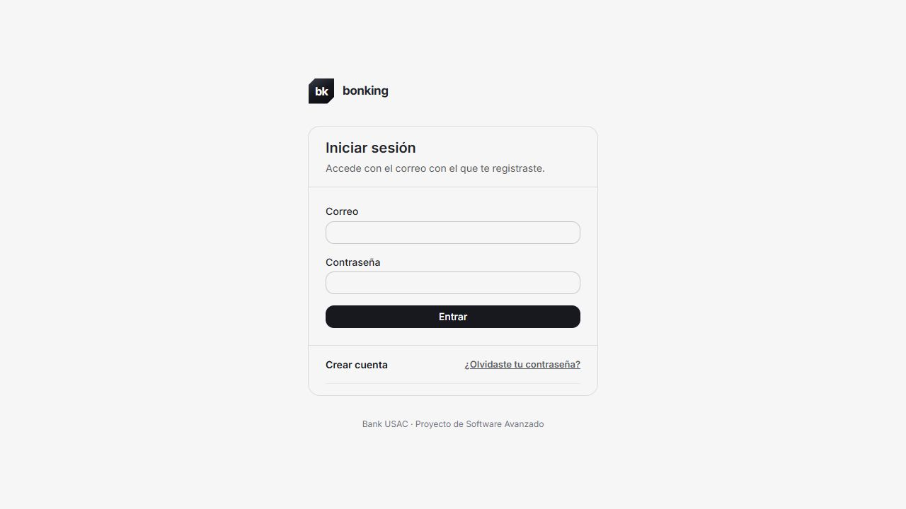

## 2. Inicio del cliente

**Rol:** Cliente. **Ruta:** `/`. Saldo consolidado, cuentas y movimientos recientes. Completada y Compensada son resultados distintos; 202 no representa ninguno de ellos.

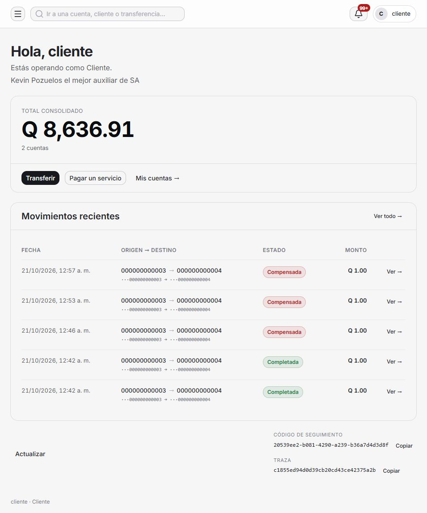

## 3. Preparar un depósito a otro banco

**Rol:** Cliente. **Ruta:** `/transferencias/interbancaria`. Selecciona origen, código BANKnn, cuenta de destino e importe GTQ. El máximo mostrado es Q10,000. Revisar precede a confirmar; esta captura no envió dinero.

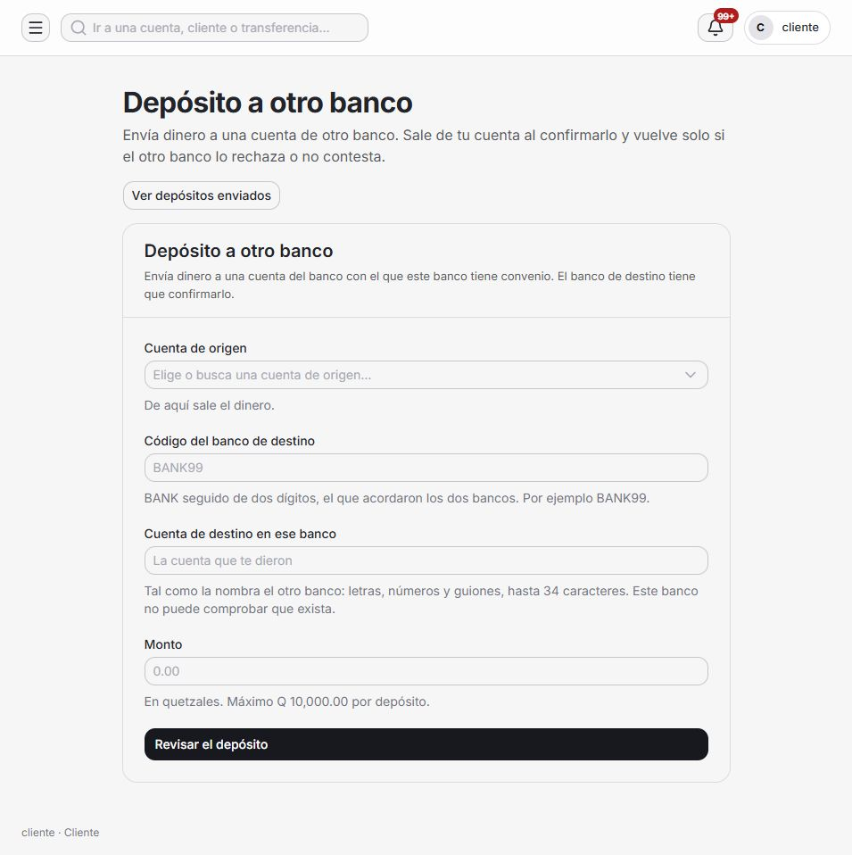

## 4. Consultar depósitos enviados

**Rol:** Cliente. **Ruta:** `/transferencias/interbancarias`. El listado enmascara la cuenta externa y ofrece filtro de estado. La captura muestra operaciones preexistentes con BANK99, el mock de la entrega.

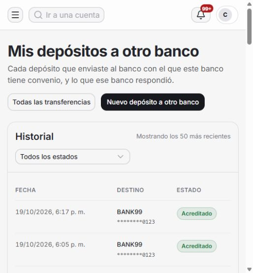

## 5. Leer un depósito

**Rol:** Cliente. **Ruta:** `/transferencias/interbancarias/93c51d22-70dd-4ded-8c1f-bd62c9d882a5`. Estado, monto, destino, plazo, intentos e historial. El ejemplo ya estaba Acreditado. TIMEOUT conserva la reserva mientras se resuelve el protocolo; no promete devolución inmediata al primer silencio.

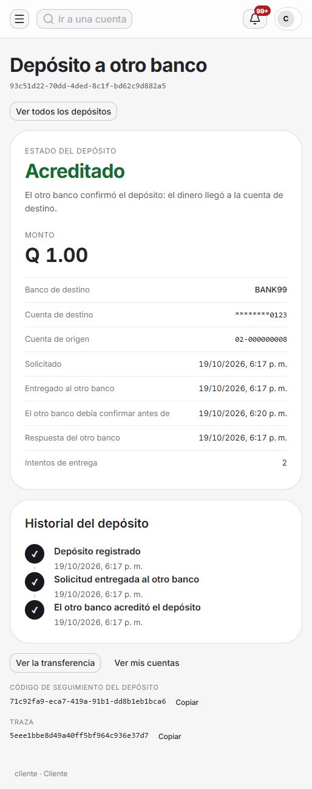

## 6. Inicio administrativo

**Rol:** Administrador. **Ruta:** `/`. Panel general con clientes, cuentas y actividad. Las cifras corresponden a la captura, no a un requisito fijo del sistema.

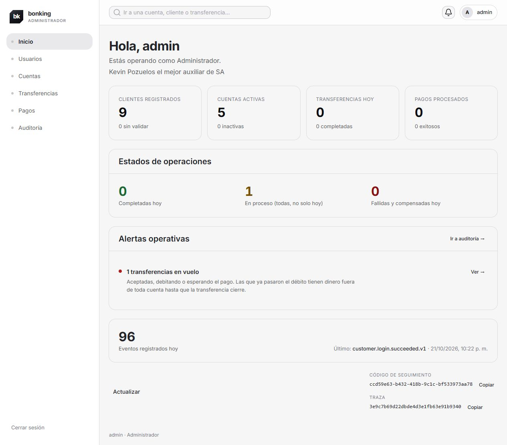

## 7. Buscar en auditoría

**Rol:** Administrador. **Ruta:** `/auditoria`. Filtros de correlación, traza, servicio y nivel. Los identificadores permiten investigar una operación; no son tokens de acceso.

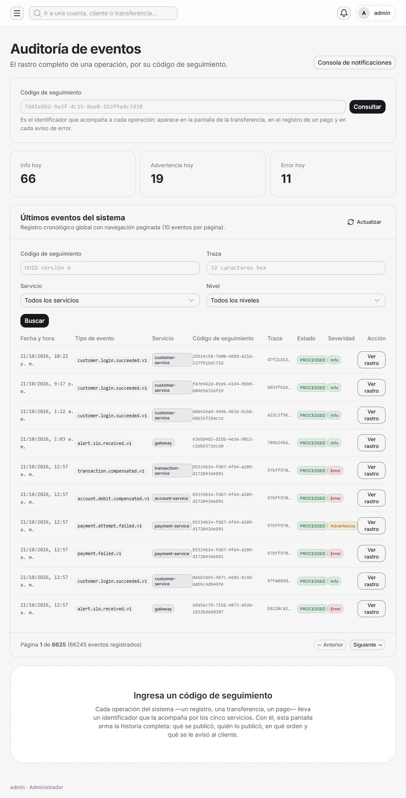

## 8. Seguir el rastro

**Rol:** Administrador. **Ruta:** `/auditoria?correlationId=b5334b14-fd87-4f64-a209-d1720436e891`. Diez eventos de cuatro servicios y devolución confirmada. El rastro de auditoría representa eventos registrados; Tempo muestra los spans de la misma traza por separado.

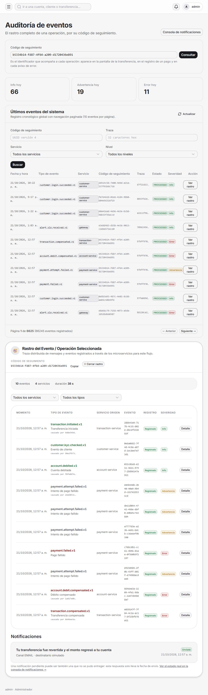

## 9. Ver pagos e intentos

**Rol:** Administrador. **Ruta:** `/pagos/monitor`. Distingue rechazo permanente y escalera agotada. El monitor no tiene formulario para cambiar la simulación; esa operación es una API administrativa dev.

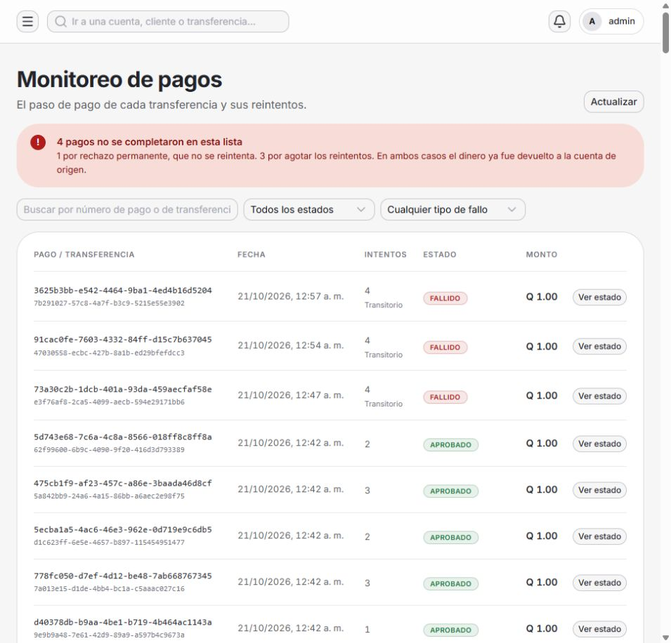

## 10. Abrir ventanilla de depósitos

**Rol:** Cajero receptor. **Ruta:** `/cuentas/deposito`. El cajero busca la cuenta y registra efectivo recibido. Se abrió el formulario sin confirmar movimientos ni crear cuentas en producción.

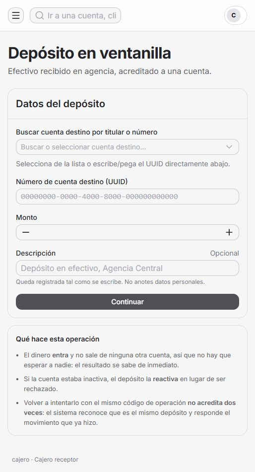

## 11. Consultar la bandeja

**Rol:** Cliente. **Ruta:** `/notificaciones`. INFO/WARNING/ERROR indican severidad. Lectura y entrega son estados distintos. La captura no pulsó Ver ni Marcar todas, que modifican el estado leído.

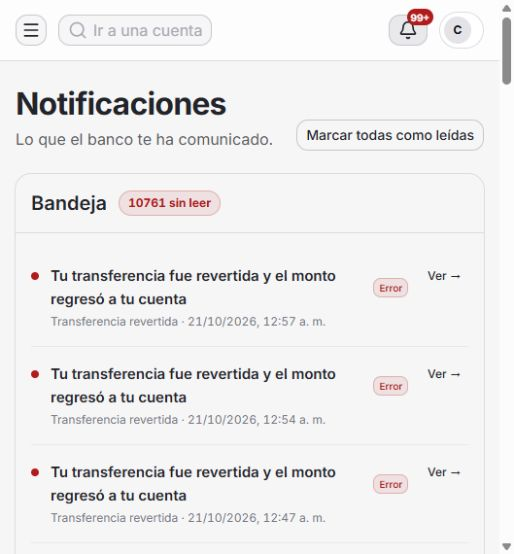

## 12. Investigar una compensación

**Rol:** Operador SRE. **Ruta:** `Grafana /explore`. Sesión Grafana independiente. La traza incluye saga.compensation ordered y completed; conserva correlationId y versión v1.3.6. Acceder al banco como administrador no otorga por sí solo acceso a Grafana.

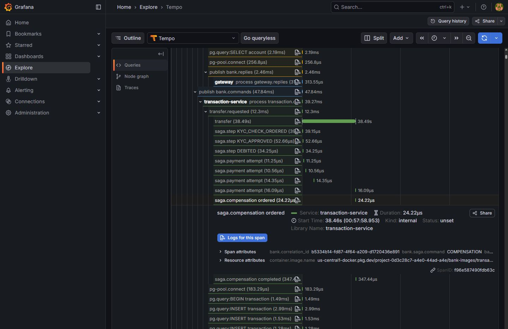

## Qué hacer ante un resultado incierto

Conservar entorno, hora, identificador de operación, correlación y traza;
consultar el detalle antes de reenviar una operación. No compartir JWT,
contraseña, token de activación ni foto del documento. La guía técnica
interbancaria explica los plazos y reversos; el operador usa los runbooks para
investigar. El envío de una solicitud no demuestra la entrega de correo ni
la confirmación de un banco participante.

Volver al [índice](README.md) o consultar [la evidencia cloud](../qa/backend/T-60-cloud-evidence.md).
