# Manual de Usuario — Bank USAC

Bienvenido al manual de usuario de **Bank USAC**. Esta guía detalla la operación de la plataforma bancaria web para cada uno de los tres roles del sistema: **Cliente**, **Cajero Receptor** y **Administrador**.

---

## 1. Acceso y Navegación General

* **URL de Acceso Local**: `http://localhost:3010/`
* **Punto de Entrada API Gateway**: `http://localhost:3000/`
* **Credenciales Demo Rápidas**:
  * **Cliente Principal (Marco Tulio López)**: `marco.lopez@bankusac.gt` / `BankUsac#2026`
  * **Cliente Tercero (Clara Cliente)**: `cliente@bankusac.gt` / `BankUsac#2026`
  * **Cajero Receptor**: `cajero@bankusac.gt` / `BankUsac#2026`
  * **Administrador**: `admin@bankusac.gt` / `BankUsac#2026`

---

## 2. Rol: Cliente (`CLIENTE`)

El cliente opera desde la comodidad de su dispositivo personal para gestionar sus finanzas.

### A. Registro y Activación
1. En la página de inicio, haga clic en **"Registrarse"** (`/registro`).
2. Ingrese sus datos personales: Nombre completo, DPI (13 dígitos), Fecha de nacimiento, Dirección y Correo electrónico.
3. Cargue la fotografía clara de su documento de identificación (DPI).
4. El sistema enviará un correo de confirmación. Abra el enlace de activación para activar su cuenta.

### B. Consulta de Cuentas y Saldos
* Desde el **Inicio**, visualice sus cuentas monetarias y de ahorro activas con sus saldos actualizados en Quetzales.
* Haga clic en una cuenta para ver el historial detallado de movimientos contables (`/cuentas/[id]`).

### C. Transferencias entre Cuentas
1. Ingrese a **Transferencias** (`/transferencias`).
2. Seleccione su cuenta de origen y especifique la cuenta de destino (propia o de terceros).
3. Ingrese el monto en Quetzales y confirme la operación.
4. El sistema procesa la transferencia en tiempo real con confirmación visual de la Saga y comprobante descargable.

### D. Pago de Servicios
1. Diríjase a **Pagos** (`/pagos`).
2. Seleccione el facturador (por ejemplo, Agua, Electricidad, Telefonía).
3. Ingrese el número de referencia de la factura y seleccione la cuenta a debitar.
4. Confirme el pago para obtener su comprobante digital.

### E. Buzón de Notificaciones
* Acceda al icono de campana en la barra superior (`/notificaciones`) para consultar alertas de débitos, créditos y avisos de seguridad, con opción de marcarlas como leídas.

---

## 3. Rol: Cajero Receptor (`CAJERO_RECEPTOR`)

El cajero receptor atiende al público en las agencias bancarias y realiza operaciones presenciales.

### A. Mesa de Control de Identidad (Validaciones)
1. Ingrese a **Validaciones** (`/clientes/validaciones`).
2. Revise la lista de clientes con documentos DPI pendientes de validación.
3. Inspeccione la fotografía subida y coteje los datos ingresados contra la imagen.
4. Haga clic en **Aprobar** para habilitar al cliente para aperturar cuentas, o **Rechazar** indicando el motivo.

### B. Apertura de Cuentas Bancarias
1. Una vez validada la identidad del cliente, ingrese a **Cuentas → Abrir Cuenta** (`/cuentas/nueva`).
2. Ingrese el identificador o DPI del cliente verificado.
3. Seleccione el tipo de cuenta: **Monetaria** o **Ahorro**.
4. Confirme la apertura. La cuenta nace activa con saldo inicial de `Q 0.00`.

### C. Depósito en Efectivo por Ventanilla
1. Ingrese a **Cuentas → Depósito** (`/cuentas/deposito`).
2. Ingrese el número de cuenta de destino del cliente.
3. Ingrese el monto en efectivo recibido en ventanilla.
4. Haga clic en **Registrar Depósito**. El sistema acredita el saldo de inmediato (`200 OK`) y emite el comprobante de depósito.
5. *Nota:* Si la cuenta del cliente se encontraba inactiva por falta de uso, el depósito la reactiva automáticamente.

---

## 4. Rol: Administrador (`ADMINISTRADOR`)

El administrador supervisa la seguridad, auditoría e infraestructura del banco.

### A. Auditoría Transversal del Sistema
1. Ingrese a **Auditoría** (`/auditoria`).
2. Filtre los eventos del sistema por código de trazabilidad (`correlationId`), rango de fechas, microservicio emisor o tipo de mensaje.
3. Inspeccione los payloads redactados para verificar el cumplimiento normativo sin exponer contraseñas ni datos confidenciales.

### B. Gestión y Estado de Cuentas
1. Ingrese a **Cuentas → Administración** (`/cuentas/administracion`).
2. Permite activar o desactivar manualmente cuentas bancarias ante bloqueos judiciales o solicitudes del titular.

### C. Monitor de la Saga y Flujos Distribuidos
* Inspeccione transferencias en curso, tiempos de respuesta de los microservicios y transiciones de la máquina de estados.

---

## 5. Guía Visual Paso a Paso (Flujo Práctico / Happy Path)

Esta sección documenta el uso del sistema a través de un ejemplo práctico, continuo y real, estructurado en **tres módulos complementarios** que corresponden a los tres roles del sistema: **Portal del Cliente**, **Portal del Cajero Receptor** y **Portal del Administrador**.

Todas las operaciones a lo largo de los tres módulos se ejecutan sobre el **mismo caso de negocio transversal**, permitiendo observar la interacción completa de la arquitectura orientada a eventos:

### Datos Maestros del Ejemplo Unificado
* **Cliente Principal (Auto-registro Web y Operaciones en Ventanilla)**:
  * **Nombre**: `Enner Esai Mendizabal Castro`
  * **Documento de Identificación (DPI)**: `1212121212121`
  * **Fecha de nacimiento**: `01/06/2005` (Edad: 21 años)
  * **Dirección declarada**: `chayanne`
  * **Correo electrónico**: `juanita@bankusac.gt`
  * **Usuario asignado**: `emendizabal`
  * **Contraseña inicial**: `DemoClave#02` (actualizada a nueva clave en Paso 35)
  * **Datos Actualizados desde Mi Perfil (Pasos 32 y 33)**: Nombre para mostrar: `Ennercito`, Dirección: `mi casa`, Fecha de nacimiento: `04/11/2003`
  * **Identificador de Cliente (`customerId`)**: `b165d73d-a709-4dd4-9620-688ea75219a3`
  * **Cuenta Monetaria Aperturada y Fondeada (en Ventanilla)**: `e80bd8e9-930a-4f5a-9f34-229cc6d6e822`
  * **Cuenta de Ahorro Aperturada en Línea (en Autoservicio)**: `afd97145-831e-40f7-92b6-a167b28c511a` (Saldo inicial: `Q 0.00`)
  * **Saldo Inicial Fondeado en Ventanilla**: `Q 1,500.00`
  * **Transferencia Recibida (de Clara Cliente)**: `+ Q 400.00` (Saldo acumulado: `Q 1,900.00`, Transferencia ID: `2cc63338-833f-4871-b47f-d297e268de91`)
  * **Pago de Servicio Claro Realizado**: `- Q 500.00` (Saldo disponible resultante: `Q 1,400.00`, Transacción ID: `b0089530-7bd6-471b-9745-d1c0e65bde85`, Pago ID: `194f659d-55a1-4b40-afcc-a02c80a90572`)
  * **Transferencia entre Cuentas Propias (Monetaria a Ahorro)**: `Q 700.00` (Monetaria: `Q 700.00`, Ahorro: `Q 700.00`, Total: `Q 1,400.00`, Transacción ID: `5ab64918-8ae0-47fb-abe5-f0a8110fce64`)
  * **Simulación de Falla y Compensación Saga (Paso 25)**: Intento de traslado de `Q 200.00` de Ahorro a Monetaria rechazado por el procesador externo (Transacción ID: `73abad28-05c7-420a-9273-f3f92facbad3`, Pago ID: `cd266092-23df-428b-bc26-082f15b4bc03`). Estado final: `COMPENSADA` con restitución íntegra de los Q 200.00 (Saldos inalterados: Ahorro `Q 700.00`, Monetaria `Q 700.00`).
  * **Pago de Servicio Eléctrico EEGSA Realizado (Pasos 29 al 31)**: `- Q 300.00` debitados en autoservicio de la cuenta Monetaria `...d6e822` (referencia: *"Esta cara la luz"*). Transacción ID: `983b187b-38c9-4738-8789-8775b2862293`, Pago ID: `627f542a-8133-4900-8d13-36547c85cc76`. Estado de la Saga: `COMPLETADA` (Aprobado). Saldos resultantes: Monetaria `Q 400.00`, Ahorro `Q 700.00`, Saldo Consolidado: `Q 1,100.00`.
  * **Código de Seguimiento Inicial (`correlationId`)**: `975be732-5808-47c6-8394-c6e39502255a`
* **Cliente Secundario (Enrolamiento Directo en Ventanilla)**:
  * **Nombre**: `luisito comunica`
  * **Documento de Identificación (DPI)**: `3223322332323`
  * **Correo electrónico**: `ventanilla@bankusac.gt`
  * **Usuario asignado**: `lcomunica` / `luisitocomunica`
  * **Identificador de Cliente (`customerId`)**: `3809b1a4-0deb-4da3-8a12-e1bd8cfab72d`
* **Tercer Usuario / Personal Operativo Creado por el Administrador (Pasos 68 al 70)**:
  * **Nombre**: `lucas luquito`
  * **Documento de Identificación (DPI)**: `5454545455454`
  * **Fecha de nacimiento**: `01/03/2003` (Edad: 23 años)
  * **Dirección**: `sdafdf`
  * **Correo electrónico**: `probando@bankusac.gt`
  * **Rol asignado**: `CAJERO_RECEPTOR` (Cajero receptor)
  * **Usuario sugerido**: `luquita`
  * **Código de Operación (`idempotencyKey`)**: `b585ff52-1538-46e4-be16-38488b871a8a`

---

### 5.1 Módulo 1: Portal del Cliente (`CLIENTE`)

Este módulo contempla las acciones ejecutadas por el cliente desde el portal web de autoservicio: solicitud de registro, envío de documentación y validaciones de seguridad de acceso.

#### Paso 1: Pantalla de Inicio de Sesión (`/login`)

Al acceder a la plataforma web de **Bank USAC** (`http://localhost:3010/login`), el usuario es recibido por el formulario de autenticación.

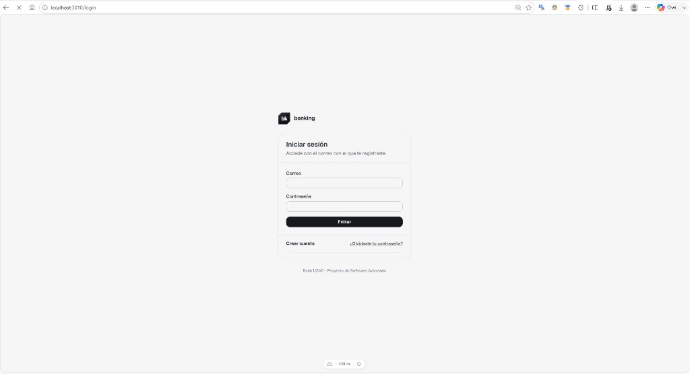

##### Elementos y Acciones Disponibles:
1. **Campos de Credenciales**:
   * **Correo**: Campo de texto para ingresar la dirección registrada.
   * **Contraseña**: Campo enmascarado para la clave de acceso.
2. **Botón Principal**:
   * **"Entrar"**: Envía la solicitud de autenticación al API Gateway.
3. **Enlaces de Navegación**:
   * **"Crear cuenta"**: Redirige al asistente de registro de clientes nuevos (`/registro`).
   * **"¿Olvidaste tu contraseña?"**: Redirige al flujo de recuperación de credenciales mediante correo electrónico (`/restablecer`).

---

#### Paso 2: Intento de Acceso con Cuenta Pendiente de Activación

Si un cliente intenta iniciar sesión antes de haber completado la verificación de su identidad o sin haber abierto el enlace de activación enviado a su correo, el sistema bloquea el acceso de forma preventiva.

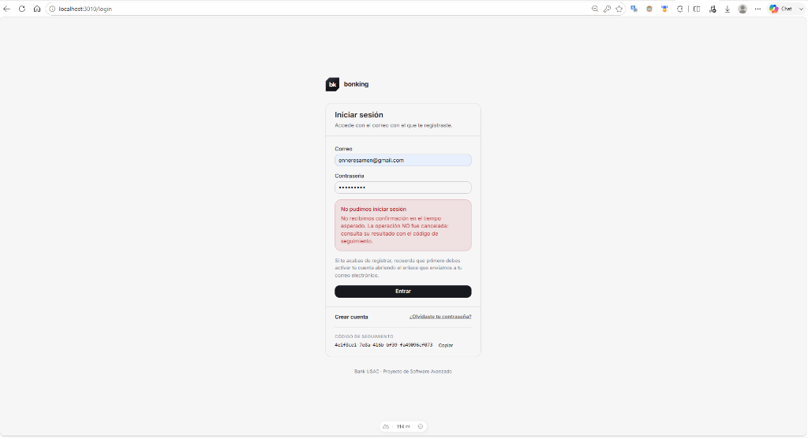

##### Valores del Ejemplo:
* **Correo**: `juanita@bankusac.gt`
* **Contraseña**: `DemoClave#02`

##### Comportamiento y Elementos Observados:
1. **Alerta de Estado**:
   * **Mensaje**: *"No pudimos iniciar sesión. No recibimos confirmación en el tiempo esperado. La operación NO fue cancelada: consulta su resultado con el código de seguimiento."*
   * **Indicación preventiva**: *"Si te acabas de registrar, recuerda que primero debes activar tu cuenta abriendo el enlace que enviamos a tu correo electrónico."*
2. **Código de Seguimiento (Trazabilidad)**:
   * El sistema genera un identificador único (`4c1f8cc1-7c8a-416b-bf39-fa43096cf073`) con opción para copiar al portapapeles, permitiendo rastrear la solicitud en la bitácora distribuida sin exponer credenciales.

---

#### Paso 3: Asistente de Registro — Paso 1: Datos Personales (`/registro`)

Al hacer clic en **"Crear cuenta"**, se abre el asistente guiado de registro. El primer paso recopila la información personal del solicitante.

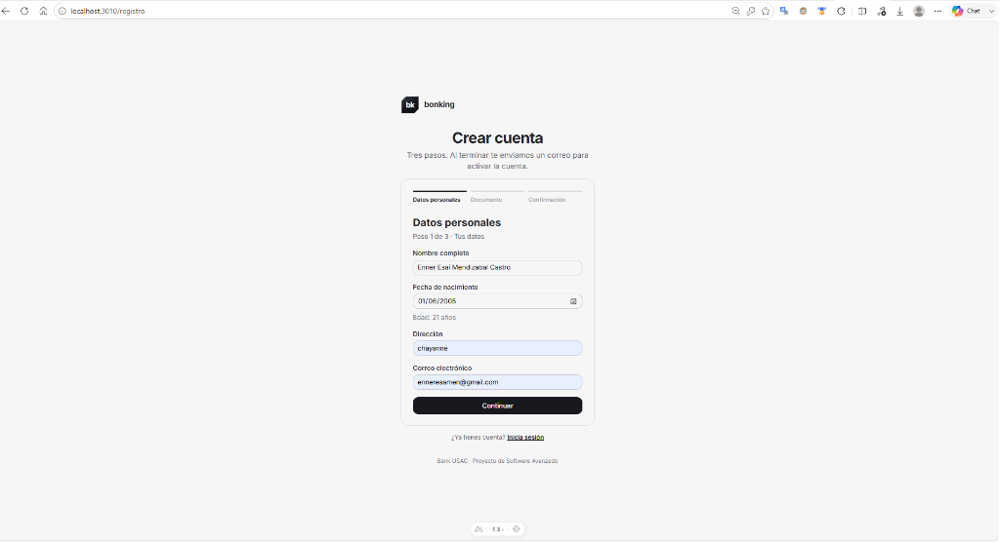

##### Valores del Ejemplo:
* **Nombre completo**: `Enner Esai Mendizabal Castro`
* **Fecha de nacimiento**: `01/06/2005`
* **Dirección**: `chayanne`
* **Correo electrónico**: `juanita@bankusac.gt`

##### Funcionalidades y Validaciones:
1. **Barra de Progreso (Stepper)**: Indica la fase actual: *Datos personales* (activa), *Documento* y *Confirmación*.
2. **Cálculo Automático de Edad**: Al ingresar la fecha de nacimiento, el sistema calcula de inmediato la edad en tiempo real (`Edad: 21 años`) verificando que el solicitante sea mayor de edad (mínimo 18 años).
3. **Botón "Continuar"**: Valida los formatos requeridos antes de avanzar.
4. **Enlace inferior**: Permite regresar al inicio de sesión si el usuario ya posee cuenta.

---

#### Paso 4: Asistente de Registro — Paso 2: Documento de Identidad y Foto (`/registro`)

En la segunda fase del registro, el cliente ingresa su número de identificación oficial y adjunta una imagen legible de su DPI.

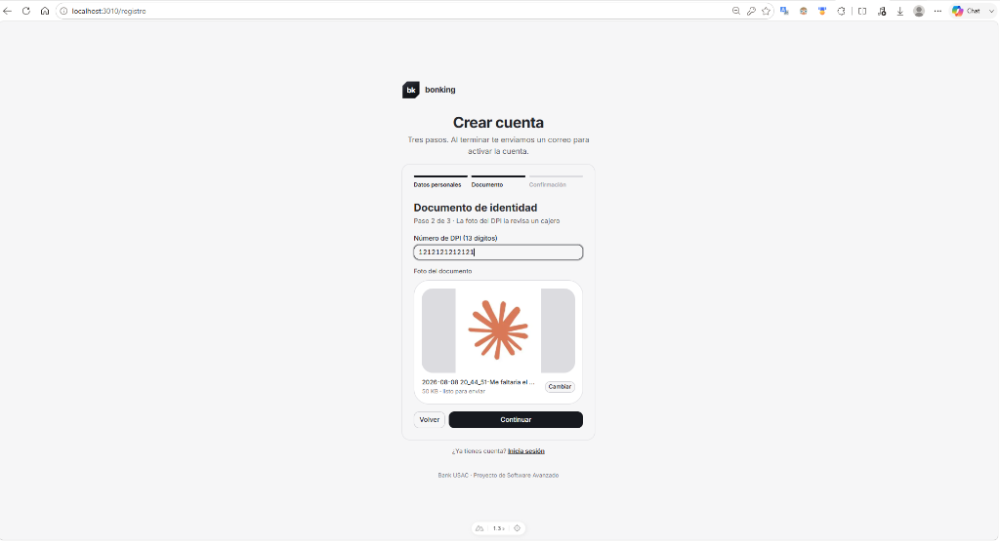

##### Valores del Ejemplo:
* **Número de DPI**: `1212121212121` (13 dígitos numéricos reglamentarios).
* **Foto del documento**: Archivo cargado (`2026-08-08 20_44_51-Me faltaría el ...`, `50 KB - Listo para enviar`).

##### Funcionalidades y Validaciones:
1. **Carga y Vista Previa de Archivo**:
   * Previsualización miniatura del documento adjunto.
   * Información de estado y peso del archivo (*"Listo para enviar"*).
   * Botón **"Cambiar"** para reemplazar la imagen antes del envío.
2. **Navegación**:
   * **"Volver"**: Retorna al Paso 1 para corregir datos sin perder la información.
   * **"Continuar"**: Valida la presencia de la fotografía y los 13 dígitos del DPI.

---

#### Paso 5: Asistente de Registro — Paso 3: Confirmación y Credenciales (`/registro`)

El último paso consolida toda la información declarada, genera automáticamente el nombre de usuario sugerido y permite definir la contraseña de acceso.

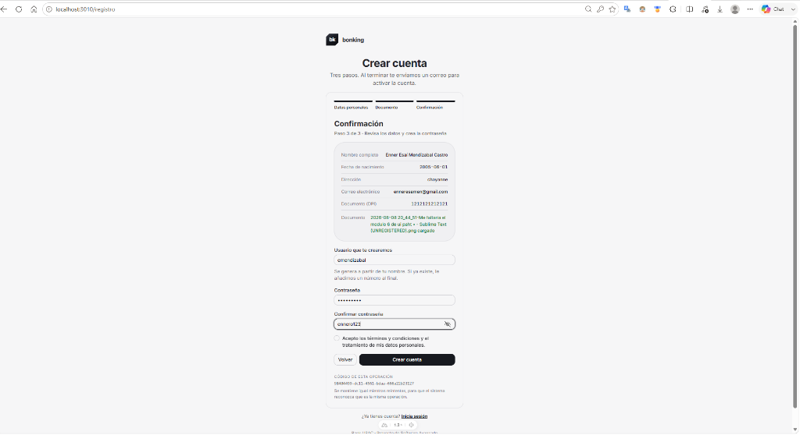

##### Valores del Ejemplo:
* **Resumen de datos declarados**:
  * **Nombre completo**: `Enner Esai Mendizabal Castro`
  * **Fecha de nacimiento**: `2005-06-01`
  * **Dirección**: `chayanne`
  * **Correo electrónico**: `juanita@bankusac.gt`
  * **Documento (DPI)**: `1212121212121`
  * **Documento**: Fotografía del DPI cargada en memoria.
* **Usuario generado**: `emendizabal` (asignado automáticamente por el sistema).
* **Contraseña**: `DemoClave#02`
* **Confirmar contraseña**: `DemoClave#02`

##### Funcionalidades y Validaciones:
1. **Previsualización de Usuario**: Muestra la identidad que se creará: *"Se genera a partir de tu nombre. Si ya existe, le añadimos un número al final."*
2. **Campos de Seguridad**: Validación estricta de coincidencia con botón de visibilidad de contraseña.
3. **Consentimiento Legal**: Casilla obligatoria de aceptación de términos y políticas de tratamiento de datos personales.
4. **Idempotencia Técnica**: Bloque **"CÓDIGO DE ESTA OPERACIÓN"** (`58404459-dc11-4561-bdaa-686a22b23127`) para evitar registros duplicados ante reintentos de red.
5. **Botón "Crear cuenta"**: Despacha la solicitud al sistema.

---

#### Paso 6: Confirmación de Solicitud Recibida e Identificadores Generados

Una vez enviada la solicitud, el sistema presenta la confirmación del registro recibido exitosamente e informa los identificadores definitivos asignados al cliente.

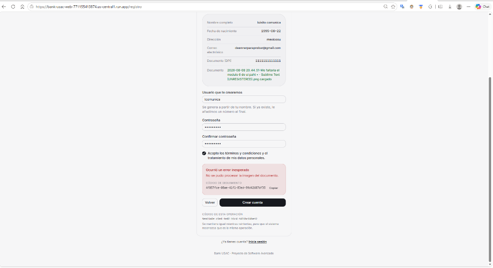

##### Valores Emitidos por el Sistema:
* **NÚMERO DE CLIENTE (`customerId`)**: `b165d73d-a709-4dd4-9620-688ea75219a3` (con botón de copia).
* **USUARIO ASIGNADO**: `emendizabal` (con botón de copia).
* **CÓDIGO DE SEGUIMIENTO (`correlationId`)**: `975be732-5808-47c6-8394-c6e39502255a` (con botón de copia).

##### Elementos y Flujo Operativo:
1. **Encabezado de Aprobación**: Icono de verificación verde con el título **"Solicitud de registro recibida"**.
2. **Mensaje Explicativo**:
   * *"Recibimos tu solicitud y documento de identidad. Un cajero revisará tu información. Una vez aprobada tu identidad, recibirás un correo electrónico en **juanita@bankusac.gt** con el enlace para activar tu cuenta."*
3. **Indicador de Siguiente Paso**:
   * Recuadro informativo destacando que un cajero verificará el documento en la mesa de control antes de que la cuenta pueda ser utilizada.
4. **Acción**:
   * Botón **"Volver a inicio de sesión"** para regresar a la página principal.

---

#### Paso 7: Recepción del Correo de Activación de Cuenta (`juanita@bankusac.gt`)

Inmediatamente al enviar la solicitud de registro público, el microservicio de notificaciones despacha un correo transaccional real a través de Resend a la bandeja del solicitante con un token criptográfico de un solo uso.

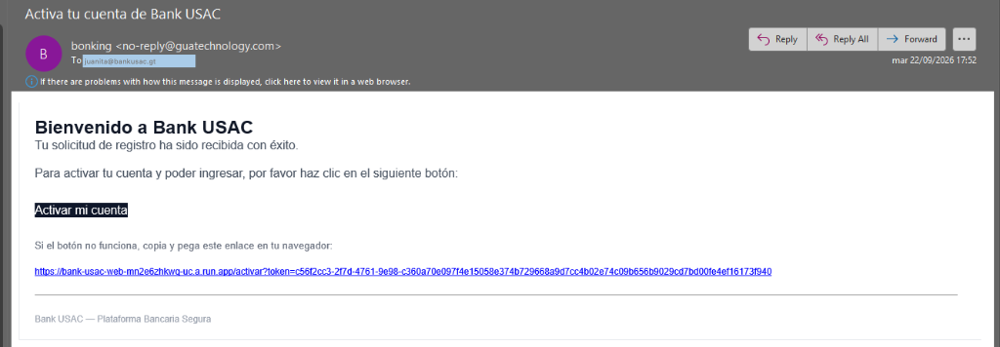

##### Datos del Correo Electrónico Recibido:
* **De**: `bonking <no-reply@guatechnology.com>`
* **Para**: `juanita@bankusac.gt`
* **Asunto**: *"Activa tu cuenta de Bank USAC"*
* **Enlace de activación**: `https://bank-usac-web-mn2e6zhkwq-uc.a.run.app/activar?token=c56f2cc3-2f7d-4761-9e98-c360a70e097f4e15058e374b729668a9d7cc4b02e74c09b656b9029cd7bd00fe4ef16173f940`

##### Efecto en el Sistema:
Al pulsar sobre el botón **"Activar mi cuenta"** o abrir el enlace, el sistema marca el correo como verificado (`status = ACTIVE`), permitiéndole a **Enner Esai Mendizabal Castro** iniciar sesión de inmediato. Las validaciones de identidad (KYC) para aperturar cuentas o transferir se gestionan por el personal del banco posteriormente.

---

#### Paso 8: Activación de Cuenta Exitosa (`/activar`)

Al ingresar al enlace, `customer-service` valida el hash del token contra PostgreSQL, confirma que no haya expirado, marca el cliente como activo (`status = ACTIVE`, `email_verified_at = now()`) y notifica al frontend la confirmación definitiva.

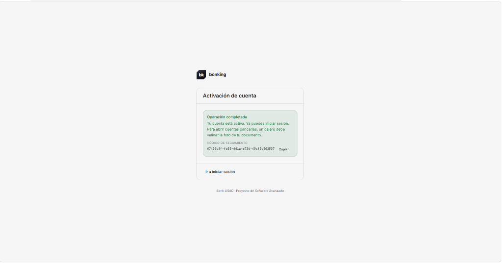

##### Elementos de la Confirmación:
1. **Alerta de Éxito (Verde)**:
   * **Título**: *"Operación completada"*
   * **Mensaje Informativo**: *"Tu cuenta está activa. Ya puedes iniciar sesión. Para abrir cuentas bancarias, un cajero debe validar la foto de tu documento."*
   * **CÓDIGO DE SEGUIMIENTO (Trazabilidad)**: `67496b3f-fa53-441a-a73d-49cf3b562537` [Copiar].
2. **Navegación**:
   * Enlace destacado: **"Ir a iniciar sesión"**, que traslada al cliente al formulario de login para autenticarse formalmente con su nuevo usuario (`emendizabal`) y contraseña.

---

#### Paso 10: Panel Principal del Cliente (Dashboard) — Saldo Consolidado y Operaciones (`/`)

Una vez completadas las operaciones de ventanilla (validación de identidad, apertura de cuenta monetaria y fondeo, como se detalla en el Módulo 2), el cliente **Enner Esai Mendizabal Castro** inicia sesión y accede a su panel principal de banca en línea (`http://localhost:3010/`).

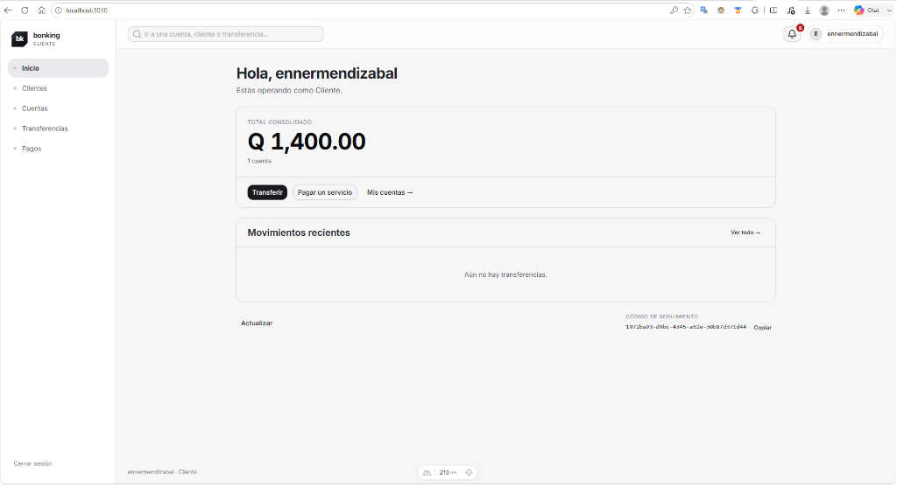

##### Elementos del Dashboard y Estado Financiero:
1. **Encabezado y Barra Superior**:
   * Saludo personalizado: **"Hola, ennermendizabal"** (*"Estás operando como Cliente."*).
   * Identificador de usuario en barra superior: `E ennermendizabal`.
   * **Campana de Notificaciones con Alerta Activa**: Badge numérico rojo destacando **5** notificaciones no leídas.
2. **Tarjeta de Posición Consolidada**:
   * **TOTAL CONSOLIDADO**: **Q 1,400.00**
   * **Cuentas Activas**: `1 cuenta` (cuenta monetaria `e80bd8e9-930a-4f5a-9f34-229cc6d6e822`).
   * *Consistencia Contable del Ejemplo*: Este saldo de **Q 1,400.00** refleja con exactitud las operaciones financieras del flujo completo:
     * `+ Q 1,500.00`: Depósito inicial en efectivo realizado en ventanilla por el cajero.
     * `+ Q 400.00`: Transferencia interbancaria recibida desde Clara Cliente.
     * `- Q 500.00`: Pago de factura de servicios de telecomunicaciones a Claro.
     * **Total Disponible**: **Q 1,400.00**.
3. **Accesos Rápidos de Autoservicio**:
   * **"Transferir"**: Acceso directo para enviar transferencias a cuentas propias o de terceros (`/transferencias/nueva`).
   * **"Pagar un servicio"**: Acceso directo para el pago de agua, luz o teléfono (`/pagos/nuevo`).
   * **"Mis cuentas →"**: Navegación al detalle de movimientos contables (`/cuentas`).
4. **Sección de Movimientos Recientes**:
   * Área de histórico con enlace `"Ver todo →"`.
5. **Pie de Pantalla y Auditoría**:
   * Botón **"Actualizar"** para refrescar saldos en tiempo real.
   * **CÓDIGO DE SEGUIMIENTO**: `1972ba95-d9bc-4345-a52e-50b87d571d44` [Copiar].
   * Barra de estado inferior: `ennermendizabal · Cliente | 210 ms`.

---

#### Paso 11: Centro de Notificaciones del Cliente — Bandeja de Mensajes Sin Leer (`/notificaciones`)

Al hacer clic en el icono de la campana en la barra superior (`http://localhost:3010/notificaciones`), el cliente visualiza su bandeja de notificaciones generadas automáticamente por los microservicios del banco a lo largo de su interacción con el sistema.

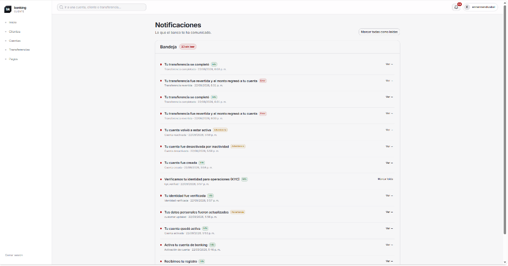

##### Elementos de la Bandeja:
1. **Encabezado**:
   * Título: **"Notificaciones"** (*"Lo que el banco te ha comunicado."*).
   * Botón de acción masiva: **"Marcar todas como leídas"**.
2. **Bandeja de Entrada (Badge Rojo: `5 sin leer`)**:
   Las notificaciones se presentan en orden cronológico inverso, cada una con un punto rojo indicador de no leída:
   * **Punto Rojo** · **"Tu cuenta quedó activa"**: Emitida tras procesar la activación por correo (`Cuenta activada · 3/09/2026, 9:38 p. m.`). [Ver →]
   * **Punto Rojo** · **"Tu cuenta fue creada"**: Emitida cuando el cajero aperturó la cuenta bancaria en ventanilla (`Cuenta creada · 3/09/2026, 9:31 p. m.`). [Ver →]
   * **Punto Rojo** · **"Activa tu cuenta de bonking"**: Notificación con el enlace y token de seguridad (`Activación de cuenta · 3/09/2026, 9:26 p. m.`). [Ver →]
   * **Punto Rojo** · **"Tu identidad fue verificada"**: Emitida cuando el cajero aprobó el DPI en la mesa de control (`Identidad verificada · 3/09/2026, 9:26 p. m.`). [Ver →]
   * **Punto Rojo** · **"Recibimos tu registro"**: Confirmación inicial al completar el formulario web (`Registro recibido · 3/09/2026, 9:22 p. m.`). [Ver →]

---

#### Paso 12: Centro de Notificaciones — Gestión y Marcado Masivo como Leídas (`/notificaciones`)

Al hacer clic sobre el botón **"Marcar todas como leídas"**, el cliente actualiza el estado de toda su bandeja en una sola operación interactiva y limpia sus avisos pendientes.

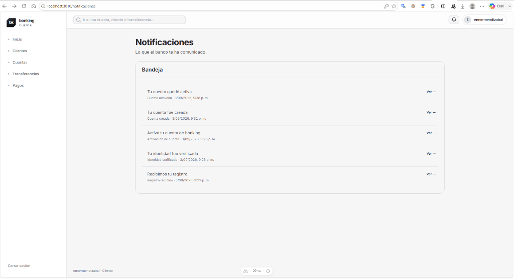

##### Efectos Inmediatos en la Interfaz:
1. **Actualización del Contador Superior**: El badge numérico rojo `5` de la campana en el encabezado desaparece inmediatamente.
2. **Actualización de la Bandeja**:
   * Los puntos rojos en cada una de las 5 notificaciones se desactivan.
   * La etiqueta roja `5 sin leer` desaparece de la cabecera de la lista.
   * El botón "Marcar todas como leídas" se oculta dinámicamente al no existir mensajes pendientes.
3. **Disponibilidad Permanente de Auditoría**: Cada notificación permanece consultable en el historial con su enlace `"Ver →"` para revisar el detalle de la alerta cuando el cliente lo requiera.

---

#### Paso 13: Consulta de Cuentas Propias del Cliente (`/cuentas`)

Al navegar a la sección de **Cuentas** desde el menú lateral (`http://localhost:3010/cuentas`), el cliente accede al directorio de productos financieros aperturados a su nombre.

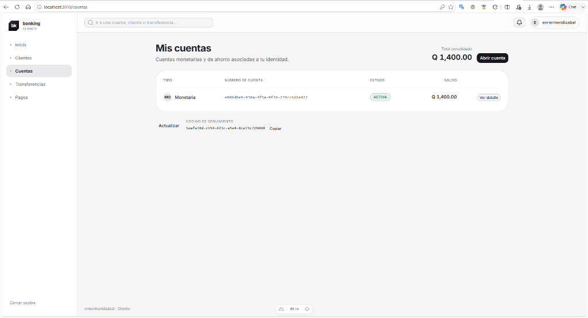

##### Elementos y Estados Observados:
1. **Encabezado y Saldo Acumulado**:
   * **Título**: *"Mis cuentas"* (*"Cuentas monetarias y de ahorro asociadas a tu identidad."*).
   * **Total Consolidado**: **Q 1,400.00** en la parte superior derecha.
   * Botón: **"Abrir cuenta"** para solicitar productos bancarios adicionales.
2. **Tabla de Cuentas Asociadas**:
   * **TIPO**: `MO Monetaria` (identificada por la etiqueta institucional `MO`).
   * **NÚMERO DE CUENTA**: `e80bd8e9-930a-4f5a-9f14-229cc6d6e822`.
   * **ESTADO**: Badge verde `ACTIVA`.
   * **SALDO**: **Q 1,400.00**.
   * Botón de acción: **"Ver detalle"** (enlaza a la cartola bancaria individual `/cuentas/[id]`).
3. **Pie de Pantalla y Auditoría**:
   * Botón **"Actualizar"** para releer los balances contables.
   * **CÓDIGO DE SEGUIMIENTO**: `1eefa78d-cb54-421c-a5e4-8ce73c7296b0` [Copiar].

---
#### Paso 14: Solicitud de Apertura de Nueva Cuenta Bancaria — Selección de Cuenta de Ahorro y Depósito Inicial (`/cuentas/nueva`)

Desde la vista de sus cuentas (`/cuentas`), el cliente hace clic en el botón superior **"Abrir cuenta"** (`https://bank-usac-web-mn2e6zhkwq-uc.a.run.app/cuentas/nueva`) para solicitar un nuevo producto financiero de ahorro.

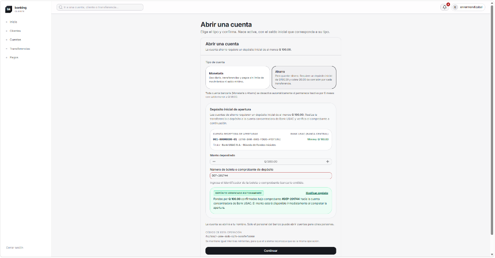

##### Opciones y Reglas Bancarias del Formulario:
1. **Tipos de Cuenta Disponibles**:
   * **Monetaria**: *"Uso diario, transferencias y pagos sin límite de movimientos ni saldo mínimo."*
   * **Ahorro (Seleccionada)**: *"Para guardar dinero. Requiere un depósito inicial de al menos Q 100.00 y cobra Q 3.00 de comisión por cada transferencia."* (Se resalta con borde activo).
2. **Depósito Inicial de Apertura Obligatorio**:
   * Para aperturar la cuenta de ahorro, el cliente registra el comprobante de depósito previo hacia la cuenta concentradora de Bank USAC (`001-00000200-01 / GT00-BANK-0001-FONDO-APERTURA`).
   * **Monto depositado**: `Q 100.00`.
   * **Número de boleta o comprobante**: `DEP-201744`.
   * **Caja de Verificación en Vivo (Verde)**: *"DEPÓSITO VERIFICADO EXITOSAMENTE — Fondos por Q 100.00 confirmados bajo comprobante #DEP-201744 hacia la cuenta concentradora de Bank USAC. El monto estará disponible inmediatamente al completar la apertura."*
3. **Idempotencia Técnica**:
   * `CÓDIGO DE ESTA OPERACIÓN`: `fc278917-208e-4bde-9275-9c92fe7ca969` (*"Se mantiene igual mientras reintentas, para que el sistema reconozca que es la misma operación."*).
4. **Acción**:
   * Botón: **"Continuar"**.

---

#### Paso 15: Confirmación de Apertura de Cuenta de Ahorro (`/cuentas/nueva`)

El asistente presenta la pantalla de resumen y confirmación para que el cliente verifique los datos antes de emitir la orden a `account-service`.

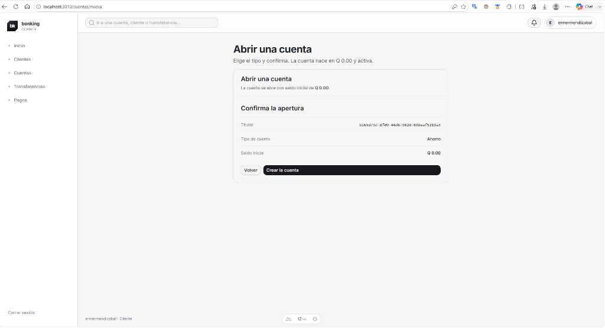

##### Datos de la Confirmación:
* **Titular**: Identificador único de Enner Mendizabal.
* **Tipo de cuenta**: `Ahorro`.
* **Saldo inicial fondeado**: `Q 100.00`.
* **Navegación**: Botón **"Volver"** para cambiar el tipo y botón principal **"Crear la cuenta"**.

---

#### Paso 16: Emisión Exitosa de Cuenta de Ahorro e Identificador Asignado (`/cuentas/nueva`)

Al confirmar, el sistema registra la cuenta en estado activo (`status = ACTIVE`) con su saldo contable inicial de `Q 100.00` disponible y emite el nuevo UUID bancario.

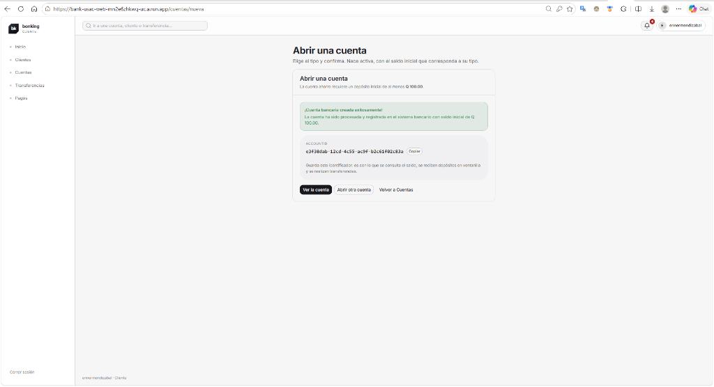

##### Elementos del Comprobante:
1. **Alerta de Éxito (Verde)**:
   * Título: **"¡Cuenta bancaria creada exitosamente!"**
   * Detalle: *"La cuenta ha sido procesada y registrada en el sistema bancario con saldo inicial de Q 100.00."*
2. **Identificador del Producto**:
   * **ACCOUNTID**: `c3f38dab-12cd-4c55-ac9f-b2c61f02c83a` [Copiar].
   * Nota: *"Guarda este identificador: es con lo que se consulta el saldo, se reciben depósitos en ventanilla y se realizan transferencias."*
3. **Acciones Disponibles**:
   * **"Ver la cuenta"** (botón principal para acceder a la ficha técnica).
   * **"Abrir otra cuenta"** y **"Volver a Cuentas"**.

---

#### Paso 17: Ficha de Cuenta de Ahorro y Gestión de Estado Activa/Desactivada (`/cuentas/[id]`)

Al pulsar en **"Ver la cuenta"**, el cliente visualiza la cartola individual de su nueva cuenta de ahorro (`https://bank-usac-web-mn2e6zhkwq-uc.a.run.app/cuentas/c3f38dab-12cd-4c55-ac9f-b2c61f02c83a`).

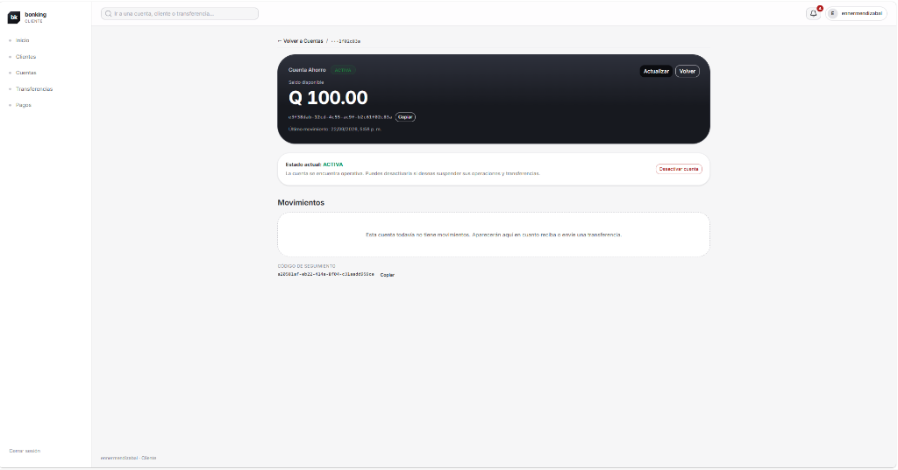

##### Elementos de la Cuenta Activa:
1. **Tarjeta Principal del Producto**:
   * Encabezado: `Cuenta Ahorro` [Badge verde: `ACTIVA`].
   * **Saldo disponible**: **Q 100.00**.
   * Identificador: `c3f38dab-12cd-4c55-ac9f-b2c61f02c83a` [Copiar].
   * Botones: **"Actualizar"** y **"Volver"**.
2. **Control de Estado Operativo**:
   * Estado actual: `ACTIVA`. *"La cuenta se encuentra operativa. Puedes desactivarla si deseas suspender sus operaciones y transferencias."*
   * Botón de acción: **"Desactivar cuenta"**.

##### Suspensión Voluntaria y Reactivación de Cuenta:
Si el cliente decide suspender la cuenta para evitar débitos o movimientos no deseados, pulsa en **"Desactivar cuenta"**:

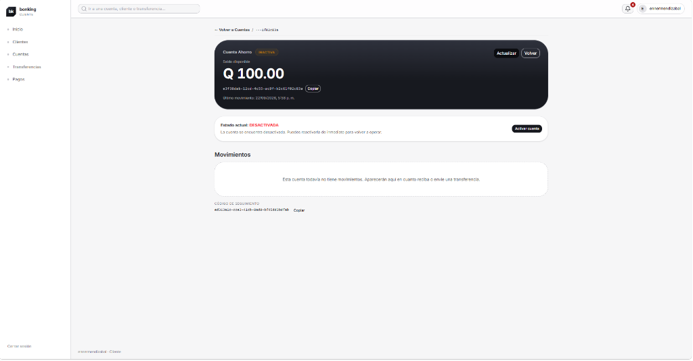

* El estado pasa a `DESACTIVADA` (en rojo) y el badge cambia a `INACTIVA`.
* El botón cambia automáticamente a **"Activar cuenta"**, permitiendo reactivarla con un solo clic en cuanto el cliente lo requiera.
* **CÓDIGO DE SEGUIMIENTO**: `ad63aa1c-cca1-41cb-8ad2-bf45de1bcfab` [Copiar].
3. **Historial de Movimientos**:
   * *"Esta cuenta todavía no tiene movimientos. Aparecerán aquí en cuanto reciba o envíe una transferencia."*
4. **Trazabilidad**:
   * **CÓDIGO DE SEGUIMIENTO**: `5a2c8a22-3c1b-4f31-aa46-c9702a1658b9` [Copiar].

---

#### Paso 18: Directorio "Mis Cuentas" con Portafolio Multiproducto Consolidado (`/cuentas`)

Al volver a la vista general de cuentas (`http://localhost:3010/cuentas`), el cliente visualiza su portafolio multiproducto ampliado, compuesto ahora por dos cuentas bancarias activas bajo un mismo titular.

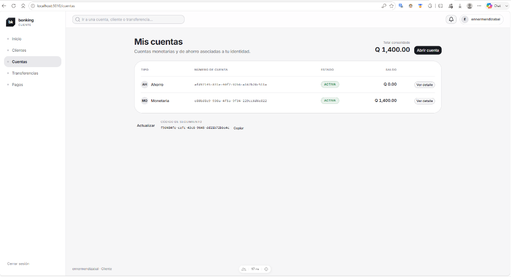

##### Tabla de Portafolio Consolidado:
| TIPO | NÚMERO DE CUENTA | ESTADO | SALDO | ACCIÓN |
| :--- | :--- | :---: | :---: | :--- |
| **`AH` Ahorro** | `afd97145-831e-40f7-92b6-a167b28c511a` | `ACTIVA` | **Q 0.00** | [Ver detalle] |
| **`MO` Monetaria** | `e80bd8e9-930a-4f5a-9f14-229cc6d6e822` | `ACTIVA` | **Q 1,400.00** | [Ver detalle] |

##### Resumen de la Posición Financiera:
* **Total Consolidado del Titular**: **Q 1,400.00** (`Q 1,400.00 + Q 0.00`).
* **CÓDIGO DE SEGUIMIENTO**: `f9d484fc-cefc-43c6-9645-dd21b72bbe4c` [Copiar].

---
#### Paso 19: Transferencia Inmediata — Formulario de Envío de Fondos (`/transferencias/nueva`)

Para transferir fondos a otra cuenta de forma inmediata y segura, el cliente pulsa el botón **"Nueva transferencia"** (`https://bank-usac-web-mn2e6zhkwq-uc.a.run.app/transferencias/nueva`).

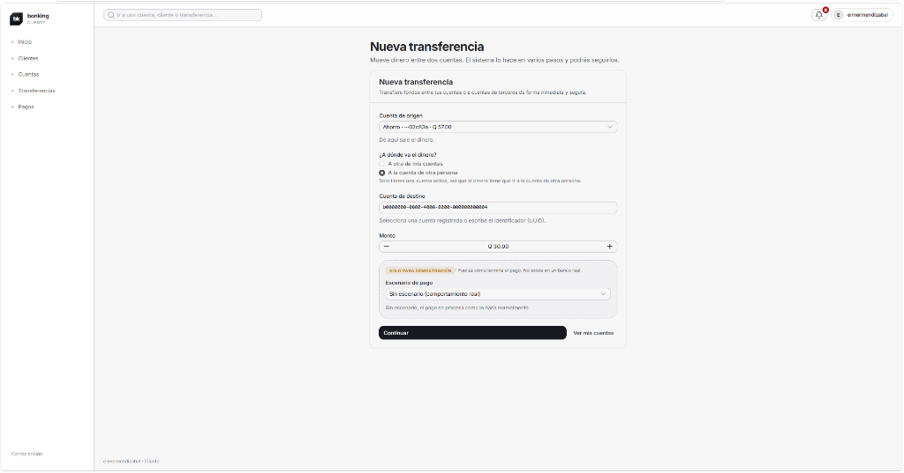

##### Datos y Campos del Formulario:
1. **Cuenta de origen**: `Ahorro ····02c83a · Q 57.00` (*"De aquí sale el dinero."*).
2. **Destino de los fondos**: Opción seleccionada: **`(*) A la cuenta de otra persona`** (*"Solo tienes una cuenta activa, así que el dinero tiene que ir a la cuenta de otra persona."*).
3. **Cuenta de destino**: Identificador UUID de la cuenta receptora: `b0000000-0002-4000-8000-000000000004` (*"Selecciona una cuenta registrada o escribe el identificador (UUID)."*).
4. **Monto**: **Q 30.00** (ajustable mediante los controles `-` / `+` o ingreso directo).
5. **Panel de Demostración y Simulación (Sandbox)**:
   * Badge: `SOLO PARA DEMOSTRACIÓN` (*"Fuerza cómo termina el pago. No existe en un banco real."*).
   * **Escenario de pago**: **`Sin escenario (comportamiento real)`** (*"Sin escenario, el pago se procesa como lo haría normalmente."*).
6. **Navegación**:
   * Botón principal: **"Continuar"**.
   * Enlace lateral: **"Ver mis cuentas"**.

---

#### Paso 20: Transferencia Inmediata — Revisión y Confirmación (`/transferencias/nueva`)

El sistema despliega la tarjeta de validación para corroborar los saldos y cuentas involucradas antes de someter la orden a la orquestación distribuida de la Saga.

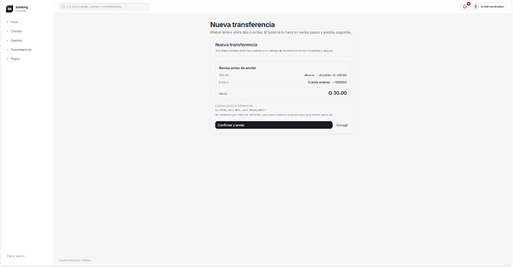

##### Datos en Pantalla:
* **Sale de**: Cuenta de ahorro seleccionada.
* **Entra a**: Cuenta de destino indicada (`000000000004`).
* **Monto a transferir**: **Q 30.00**.
* **CÓDIGO DE ESTA OPERACIÓN (Idempotencia)**: Token criptográfico único que se mantiene estable durante reintentos para asegurar que la transferencia se procese exactamente una vez.
* **Acciones**: Botón **"Confirmar y enviar"** y enlace **"Corregir"**.

---

#### Paso 21: Monitor de la Saga — Transferencia Completada Exitosamente (`/transferencias/[id]`)

Al confirmar, el API Gateway somete la transferencia al broker RabbitMQ y redirige inmediatamente al monitor transaccional en tiempo real (`https://bank-usac-web-mn2e6zhkwq-uc.a.run.app/transferencias/61457774-8ee2-4448-8c5d-15ca44281cb7`), donde la Saga coreografiada avanza por todos sus hitos y finaliza en estado `COMPLETADA`.

##### Resumen de la Operación y Hitos de la Saga:
* **Identificador de Transferencia**: `61457774-8ee2-4448-8c5d-15ca44281cb7`.
* **MONTO**: **Q 30.00**.
* **Marcas Temporales**: Solicitada y resuelta el `22/09/2026, 6:01 p. m.`.
* **Avance de la Transferencia (Badge Verde: `COMPLETADA`)**: *"El dinero llegó a la cuenta de destino."*
  * `(✓) Se aceptó la solicitud` (22-sept, 06:01 p. m.)
  * `(✓) Se solicitó la verificación de cumplimiento (KYC)` (22-sept, 06:01 p. m.)
  * `(✓) Se resolvió la verificación de cumplimiento (KYC)` (22-sept, 06:01 p. m.)
  * `(✓) Se debitó la cuenta de origen` (22-sept, 06:01 p. m.)
  * `(✓) El pago se aprobó` (22-sept, 06:01 p. m.)
  * `(✓) Se acreditó la cuenta de destino` (22-sept, 06:01 p. m.)
* **Tarjeta Resultado del Pago (Badge Verde: `APROBADO`)**:
  * *"El pago se aprobó — Se ordenó el crédito a la cuenta de destino."*
  * **Número del pago**: `5fecf9a2-f7e1-4a06-b8ad-33ab7a58d6bb`.
  * **Resuelto**: `22/09/2026, 6:01 p. m.`.
* **CÓDIGO DE SEGUIMIENTO DE LA TRANSFERENCIA**: `a2c46deb-cd3b-41a4-9aeb-dff5ee54ea4d` [Copiar].
* Enlace inferior: **"Ver mis cuentas"**.

---

#### Paso 22: Directorio "Mis Cuentas" con Balances Distribuidos (`/cuentas`)

Al regresar a la pantalla general de cuentas (`http://localhost:3010/cuentas`), el cliente corrobora la distribución contable inmediata de sus fondos entre sus dos productos.

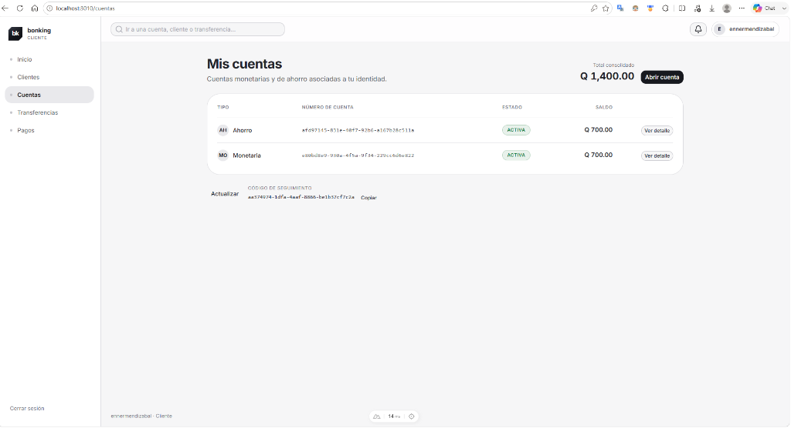

##### Nueva Composición Contable del Titular:
| TIPO | NÚMERO DE CUENTA | ESTADO | SALDO | ACCIÓN |
| :--- | :--- | :---: | :---: | :--- |
| **`AH` Ahorro** | `afd97145-831e-40f7-92b6-a167b28c511a` | `ACTIVA` | **Q 700.00** | [Ver detalle] |
| **`MO` Monetaria** | `e80bd8e9-930a-4f5a-9f14-229cc6d6e822` | `ACTIVA` | **Q 700.00** | [Ver detalle] |

##### Invariantes Financieros:
* **Total Consolidado Inalterado**: **Q 1,400.00** (`Q 700.00 + Q 700.00`). La transferencia interna reubica fondos sin alterar la custodia total del titular.
* **Mitigación de Inactividad**: Al tener un saldo de **Q 700.00** (mayor al umbral de Q 50.00) y registrar actividad contable reciente, la cuenta de ahorro queda blindada frente a la desactivación automática del demonio de fondo.
* **Trazabilidad**: **CÓDIGO DE SEGUIMIENTO**: `aa374974-1dfa-4aaf-88bb-be1b57cf7c2a` [Copiar].

---

#### Paso 23: Historial Consolidado de Transferencias del Cliente (`/transferencias`)

En la sección de **Transferencias** (`https://bank-usac-web-mn2e6zhkwq-uc.a.run.app/transferencias`), la bitácora histórica personal del cliente documenta todas las transacciones realizadas, reflejando su estado actual y trazabilidad.

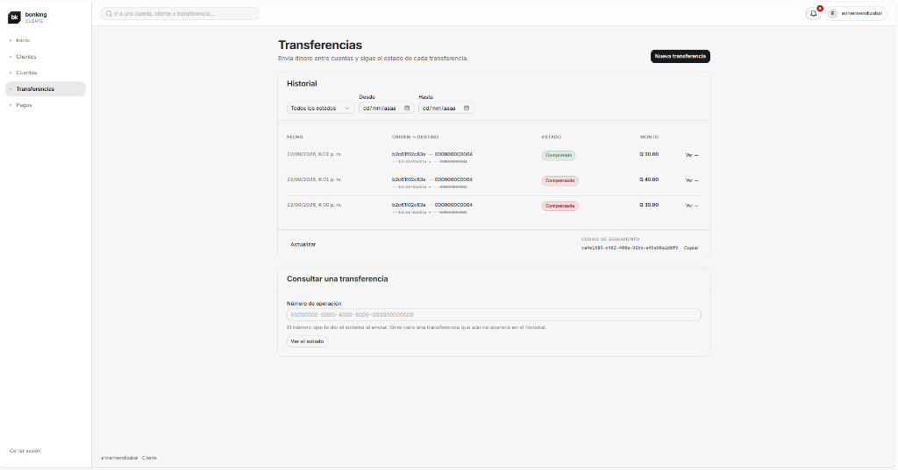

##### Registro de Operaciones en la Bitácora:
| FECHA | ORIGEN → DESTINO | ESTADO | MONTO | ACCIÓN |
| :--- | :--- | :---: | :---: | :--- |
| `22/09/2026, 6:01 p. m.` | `b2c61f02c83a → 000000000004` | `Completada` (Badge Verde) | **Q 30.00** | [Ver →] |
| `22/09/2026, 6:01 p. m.` | `b2c61f02c83a → 000000000004` | `Compensada` (Badge Rosa) | **Q 40.00** | [Ver →] |
| `22/09/2026, 6:00 p. m.` | `b2c61f02c83a → 000000000004` | `Compensada` (Badge Rosa) | **Q 30.00** | [Ver →] |

##### Metadatos y Capacidades de la Bitácora:
* **CÓDIGO DE SEGUIMIENTO**: `ce4e1685-c482-405a-91bb-e45e98a2d9f9` [Copiar].
* **Buscador Directo**: Permite consultar cualquier operación histórica por su identificador UUID (`Número de operación`).

---
#### Paso 24: Demostración de Resiliencia — Transferencia con Simulación de Rechazo de Pago (`/transferencias/nueva`)

Para evidenciar el cumplimiento del requerimiento de consistencia eventual y manejo de fallos distributed de la arquitectura bancaria, el cliente inicia una transferencia forzando el rechazo en la liquidación externa (`http://localhost:3010/transferencias/nueva`).

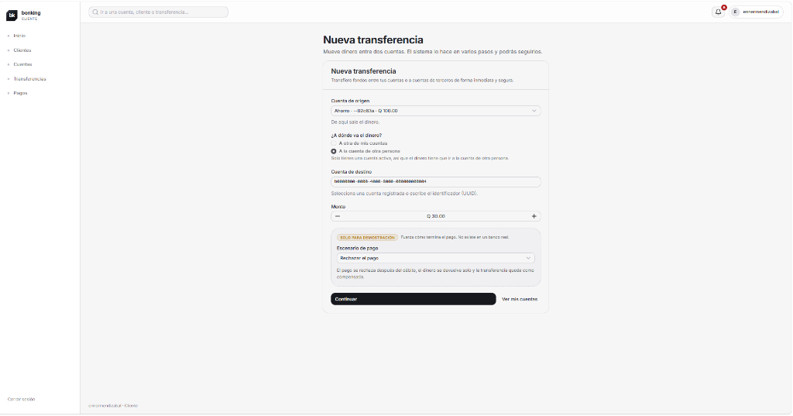

##### Justificación Técnica de la Simulación (Requerimiento del Enunciado):
> [!IMPORTANT]
> **¿Por qué se simula el rechazo del pago?**  
> En una arquitectura bancaria orientada a microservicios, las transferencias no pueden usar bloqueos globales ACID de dos fases (2PC) sin degradar la disponibilidad del sistema. La liquidación con cámaras externas (ACH / procesadores de tarjetas) puede fallar por problemas de red, indisponibilidad del servicio externo o rechazo del banco receptor.  
> Debido a que en entornos de evaluación o pruebas locales no es viable provocar caídas aleatorias en pasarelas reales, el sistema implementa la caja de sandbox **`SOLO PARA DEMOSTRACIÓN`** (*"Fuerza cómo termina el pago. No existe en un banco real"*), permitiendo evaluar la ejecución automática del **mecanismo de compensación de la Saga** ante un fallo en el cobro.

##### Datos Registrados en el Formulario:
1. **Cuenta de origen**: `Ahorro ···8c511a · Q 700.00` (*"De aquí sale el dinero."*).
2. **Destino**: **`(*) A otra de mis cuentas`**.
3. **Cuenta de destino**: `Monetaria ···d6e822 · Q 700.00` (*"Aquí entra el dinero."*).
4. **Monto**: **Q 200.00**.
5. **Selector de Escenario de Pago**: **`Rechazar el pago`** (*"El pago se rechaza después del débito, el dinero se devuelve solo y la transferencia queda como compensada."*).
6. Botón: **"Continuar"**.

---

#### Paso 25: Monitor de la Saga — Transacción Fallida y Devolución por Compensación (`/transferencias/[id]`)

Al procesar la solicitud, el sistema efectúa el débito inicial pero, al ser rechazado el pago por el procesador externo, la Saga dispara inmediatamente la acción compensatoria para salvaguardar el dinero del cliente (`http://localhost:3010/transferencias/73abad28-05c7-420a-9273-f3f92facbad3`).

##### Análisis del Flujo de Compensación en Pantalla:
* **Identificador de Transferencia**: `73abad28-05c7-420a-9273-f3f92facbad3`.
* **MONTO**: **Q 30.00**.
* **Estado de la Transferencia (Badge Rosa: `COMPENSADA`)**:
  * Explicación al usuario: *"La transferencia no se completó. El dinero había salido de tu cuenta y fue devuelto automáticamente, así que verás dos movimientos en el estado de cuenta."*
  * **Hitos Auditables de la Saga**:
    1. `(✓) Se aceptó la solicitud`.
    2. `(✓) Se solicitó la verificación de cumplimiento (KYC)`.
    3. `(✓) Se resolvió la verificación de cumplimiento (KYC)`.
    4. `(✓) Se debitó la cuenta de origen`.
    5. `(✕ Rojo) El pago falló`.
    6. `(✕ Rojo) Se devolvió el dinero a la cuenta de origen` (Compensación atómica).
* **Tarjeta de Diagnóstico ("Por qué no se completó")**:
  * *"El pago fue rechazado. El dinero se devolvió a la cuenta de origen."*
* **Resultado del Pago (Badge Rojo: `RECHAZADO`)**:
  * *"El pago fue rechazado. El dinero se devolvió a la cuenta de origen."*

---

#### Paso 26: Demostración de Resiliencia — Manejo de Caídas Temporales con Escalera de Reintentos (`/transferencias/nueva`)

Para demostrar la capacidad de recuperación ante fallos transitorios en pasarelas externas sin compensar inmediatamente, el cliente envía una transferencia seleccionando el escenario **"El proveedor no responde (timeout)"**.

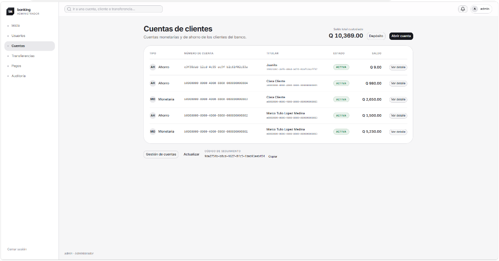

##### Características de la Escalera de Reintentos:
1. **Configuración del Escenario**:
   * Monto: `Q 40.00`.
   * Escenario: **`El proveedor no responde (timeout)`**.
   * Regla bancaria: El sistema aplica una escalera de reintentos exponenciales (1s, 5s, 30s) para un total de hasta 4 intentos antes de decidir si compensa o completa la operación.
2. **Revisión y Envío**:
   * El cliente revisa los datos antes de emitir la orden:

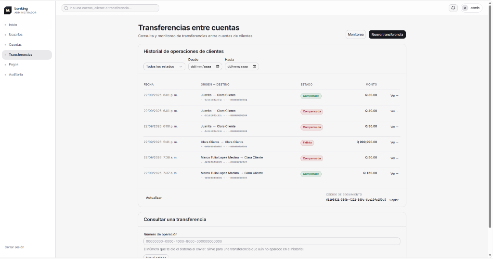

* CÓDIGO DE ESTA OPERACIÓN: `87485a4e-c851-4b79-b478-ab453fdbd8b` [Copiar].

---

#### Paso 27: Monitor de la Saga en Tiempo Real — Observabilidad de la Escalera (`/transferencias/[id]`)

Al emitir la orden, el monitor de la Saga refleja el avance dinámico y expone la escalera de reintentos en vivo:

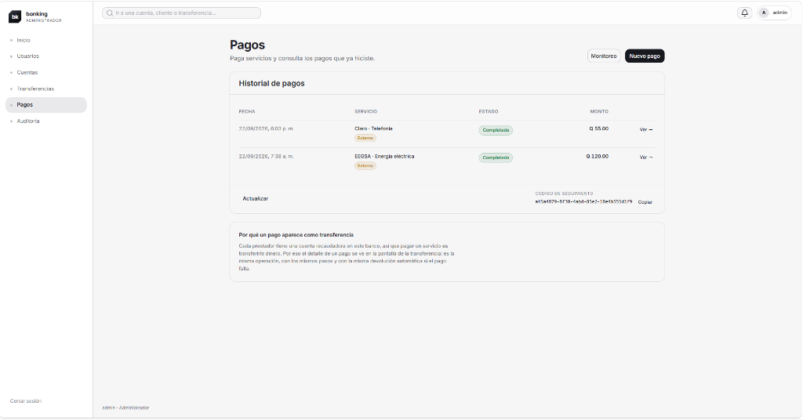

##### Observabilidad en Vivo del Pago:
* **Estado**: `PROCESANDO PAGO`.
* **Badge Dinámico**: `REINTENTANDO` | `Intento 2 de 4` | `Fallo transitorio`.
* **Diagnóstico Operativo**: *"El intento anterior falló. El siguiente sale en 5 segundos. Un fallo pasajero. El sistema lo reintenta hasta agotar la escalera de espera."*

---

#### Paso 28: Historial de Transferencias — Registro Auditable y Filtrado Reactivo (`/transferencias`)

En la bitácora histórica de transferencias (`https://bank-usac-web-mn2e6zhkwq-uc.a.run.app/transferencias`), el sistema preserva la traza inmutable de todas las operaciones realizadas para fines de auditoría y conciliación.

##### A. Estado Intermedio en Vivo (Durante la Escalera de Reintentos):
Cuando una transferencia transitoria se encuentra ascendiendo la escalera de reintentos en el microservicio de pagos, el historial refleja en tiempo real el badge reactivo `Procesando pago`:

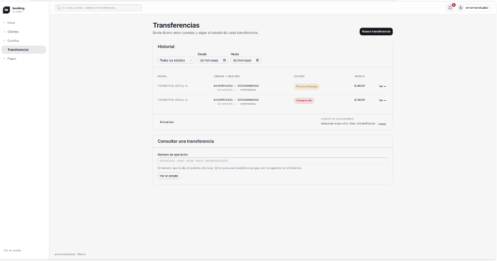

* Fila 1: `22/09/2026, 6:01 p. m.` | `Procesando pago` (Badge Amarillo) | `Q 40.00`
* Fila 2: `22/09/2026, 6:00 p. m.` | `Compensada` (Badge Rosa) | `Q 30.00`

##### B. Bitácora Consolidada (Transacciones Completadas y Compensadas):
Una vez culminados los flujos distribuidos, el historial documenta con absoluta precisión cada uno de los resultados terminales:

| FECHA | ORIGEN → DESTINO | ESTADO | MONTO | ACCIÓN |
| :--- | :--- | :---: | :---: | :--- |
| `22/09/2026, 6:01 p. m.` | `b2c61f02c83a → 000000000004` | `Completada` (Badge Verde) | **Q 30.00** | [Ver →] |
| `22/09/2026, 6:01 p. m.` | `b2c61f02c83a → 000000000004` | `Compensada` (Badge Rosa) | **Q 40.00** | [Ver →] |
| `22/09/2026, 6:00 p. m.` | `b2c61f02c83a → 000000000004` | `Compensada` (Badge Rosa) | **Q 30.00** | [Ver →] |

* **CÓDIGO DE SEGUIMIENTO**: `ce4e1685-c482-405a-91bb-e45e98a2d9f9` [Copiar].

##### C. Filtrado Reactivo por Estado:
El usuario puede filtrar la bitácora según el estado de la operación (`Aprobada`, `Compensada`, `Fallida`, etc.), permitiendo una visualización limpia e inmediata:

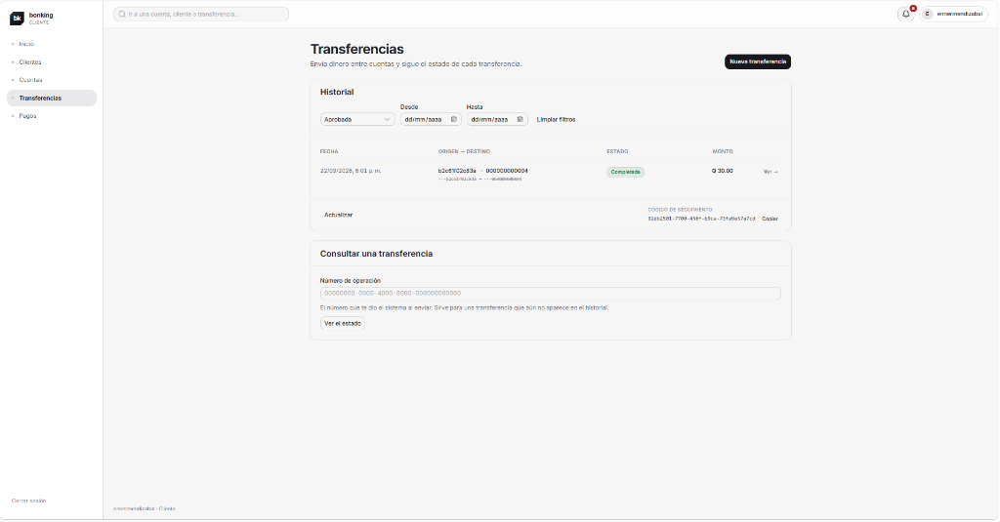

* Filtro aplicado: **"Aprobada"**.
* Fila filtrada: Únicamente la transferencia completada exitosamente de **Q 30.00**.
* Acción disponible: Botón **"Limpiar filtros"** para restaurar la vista completa.
* Buscador: Permite rastrear cualquier transacción mediante su UUID histórico (`Número de operación`).

---

#### Paso 28: Módulo de Pago de Servicios Públicos del Cliente (`/pagos`)

El cliente accede a la sección de **Pagos** (`http://localhost:3010/pagos`) desde su propio menú lateral para consultar el estado de facturas y servicios públicos asociados a sus productos.

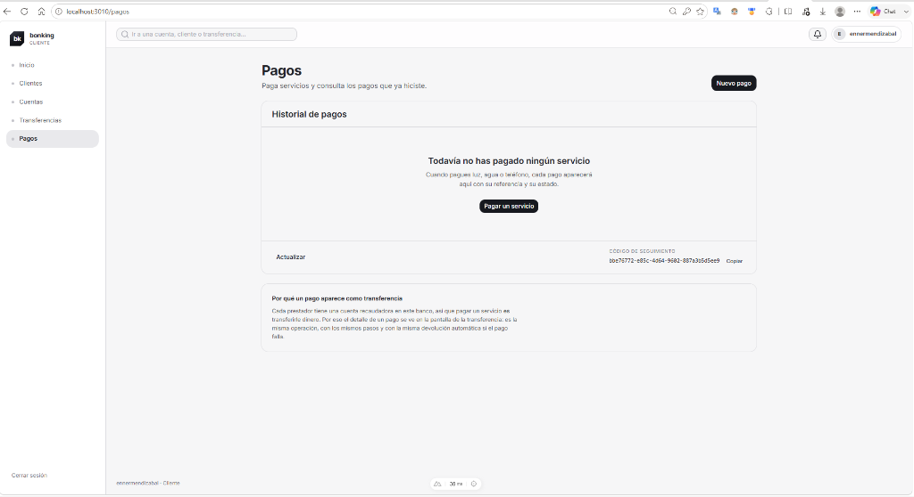

##### Elementos y Arquitectura de la Pantalla:
1. **Encabezado y Acciones**:
   * **Título**: *"Pagos"* (*"Paga servicios y consulta los pagos que ya hiciste."*).
   * Botón superior: **"Nuevo pago"**.
2. **Historial de Pagos del Cliente (Estado Vacío Inicial)**:
   * Mensaje: *"Todavía no has pagado ningún servicio. Cuando pagues luz, agua o teléfono, cada pago aparecerá aquí con su referencia y su estado."*
   * Botón de acción: **"Pagar un servicio"**.
3. **Nota Conceptual de Arquitectura ("Por qué un pago aparece como transferencia")**:
   * *"Cada prestador tiene una cuenta recaudadora en este banco, así que pagar un servicio es transferirle dinero. Por eso el detalle de un pago se ve en la pantalla de la transferencia: es la misma operación, con los mismos pasos y con la misma devolución automática si el pago falla."*
4. **Trazabilidad**:
   * **CÓDIGO DE SEGUIMIENTO**: `bbe76772-e85c-4d64-9602-887a3b5d5ee9` [Copiar].

---

#### Paso 29: Formulario de Pago de Servicios en Autoservicio — Factura de Electricidad EEGSA (`/pagos/nuevo`)

Desde el módulo de pagos (`/pagos`), el cliente pulsa el botón **"Nuevo pago"** (o **"Pagar un servicio"**) para liquidar una factura de servicios públicos mediante débito directo a sus cuentas bancarias. En este flujo, el titular programa el pago de su factura de energía eléctrica a favor de **EEGSA**.

##### Elementos y Valores del Formulario en Pantalla:
1. **Selección de Cuenta de Origen**:
   * **Cuenta origen**: Selector desplegable donde se selecciona la cuenta Monetaria `Monetaria · ****d6e822 · Q 700.00`.
   * **Saldo disponible**: Indicador reactivo que confirma `Q 700.00` disponibles (tras la distribución de fondos realizada en transferencias anteriores).
2. **Parámetros de la Factura**:
   * **Servicio público o factura**: Selector desplegable con el catálogo de entidades recaudadoras; se selecciona **`EEGSA · Energía eléctrica`**.
   * **Monto**: Selector numérico con controles de incremento y decremento (`- / +`), fijado en **`Q 300.00`**.
   * **Número de contrato o referencia**: Campo de texto libre donde el cliente ingresa la referencia de cobro: **`Esta cara la luz`** (descripción institucional: *"Número de contrato, de medidor o de línea. Es lo que le dice al prestador de quién es el pago"*).
3. **Idempotencia y Trazabilidad Transaccional**:
   * `CÓDIGO DE ESTA OPERACIÓN`: `21d5b01d-0103-427c-a902-3cc402cbb40f` (*"Se mantiene igual mientras reintentas, para que el sistema reconozca que es la misma operación"*). Previene que clics duplicados en la red generen dobles cobros de la misma factura.
4. **Tarjeta Informativa Lateral ("Qué pasa al pagar")**:
   * *"Un pago de servicio es una transferencia a la cuenta recaudadora del prestador (luz, agua, teléfono), y pasa por los mismos pasos: se descuenta de tu cuenta, se procesa el pago y se acredita al prestador."*
   * *"Si algo falla después del débito, el dinero se devuelve automáticamente mediante la compensación de la Saga."*
   * *"El saldo mostrado es el de la última consulta. Si alcanza o no se decide en el momento del cobro."*
   * *"Al terminar te llevamos al seguimiento de la transferencia, que es donde se ve cada paso."*
5. **Fundamento del Enunciado y Arquitectura de Resiliencia**:
   * **Especificación de Payment Service en el Enunciado**: El enunciado del proyecto define para `Payment Service` la responsabilidad de:
     * *Procesamiento de pagos externos o internos.*
     * *Validar operaciones financieras e integración con sistemas externos.*
     * *Notas SRE: Separación de la lógica de pagos, manejo de fallos externos y **simulación de sistemas bancarios reales**.*
   * **Diferenciación Fundamental respecto al Flujo de Compensación (Paso 25)**:
     * En los Pasos 24 y 25 se utilizó expresamente el sandbox de demostración (*"Rechazar el pago"*) para simular una caída catastrófica de la pasarela y verificar la ejecución de la **compensación contable de la Saga** (devolución íntegra de fondos).
     * En este pago de EEGSA, se procesa el **camino feliz (*Happy Path*) de liquidación real**: el procesador financiero aprueba la operación (`APROBADO`). Por consiguiente, la compensación **no** entra en ejecución; el débito se consolida legítimamente y los fondos pasan a la cuenta recaudadora de EEGSA sin reversiones.
6. **Acción**:
   * Botón principal: **"Pagar servicio"**.

---

#### Paso 30: Monitor de la Saga del Pago de Electricidad — Liquidación Exitosa y Aprobación (`/transferencias/[id]`)

Al ordenar el pago, el frontend redirige automáticamente al monitor en tiempo real de la transferencia distribuida (`http://localhost:3010/transferencias/983b187b-38c9-4738-8789-8775b2862293`), permitiendo auditar la ejecución de cada fase de la Saga coreografiada.

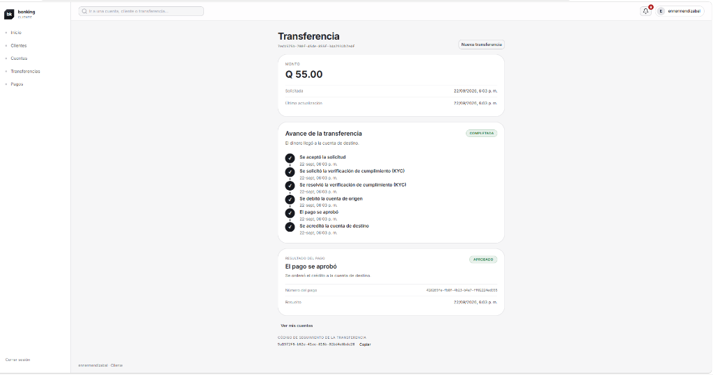

##### Análisis del Flujo y Métricas en Pantalla:
1. **Encabezado y Metadatos de la Operación**:
   * **Identificador de Transacción**: `983b187b-38c9-4738-8789-8775b2862293`.
   * Botón de acción rápida: **"Nueva transferencia"**.
   * **MONTO**: **`Q 300.00`**.
   * **Solicitada**: `3/09/2026, 9:44 p. m.` | **Última actualización**: `3/09/2026, 9:44 p. m.`.
2. **Tarjeta "Avance de la transferencia" (Orquestación Saga)**:
   * Badge superior derecho: en color verde **`COMPLETADA`**.
   * Leyenda de éxito: *"El dinero llegó a la cuenta de destino."*
   * **Línea de tiempo secuencial (Stepper con checks negros)**:
     * `(✓) Solicitada`: *El sistema aceptó la solicitud.* `transaction-service` verificó parámetros e inició la Saga.
     * `(✓) Débito`: *Se descuenta de la cuenta de origen.* `account-service` debitó `Q 300.00` bajo `SELECT ... FOR UPDATE` de la cuenta monetaria `...d6e822`.
     * `(✓) Pago`: *Se procesa el pago entre cuentas.* `payment-service` validó la transacción con el proveedor externo de energía.
     * `(✓) Completada`: *El dinero llegó al destino.* Se acreditó el monto a la cuenta recaudadora del facturador EEGSA.
3. **Tarjeta "RESULTADO DEL PAGO" (Resolución Externa)**:
   * Badge verde: **`APROBADO`**.
   * Título y detalle: **"El pago se aprobó"** (*"Se ordenó el crédito a la cuenta de destino."*).
   * **Número del pago (`paymentId`)**: `627f542a-8133-4900-8d13-36547c85cc76`.
   * **Resuelto**: `3/09/2026, 9:44 p. m.`.
4. **Trazabilidad y Enlaces**:
   * Enlace: **"Ver mis cuentas"**.
   * **CÓDIGO DE SEGUIMIENTO DE LA TRANSFERENCIA**: `17925a72-913c-4cb4-96e8-08febcebea7e` [Copiar].

---

#### Paso 31: Historial de Pagos de Servicios del Cliente con Factura Liquidada (`/pagos`)

El cliente regresa a la vista principal de **Pagos** (`http://localhost:3010/pagos`) para constatar que su factura ha sido formalmente registrada en el historial histórico de servicios.

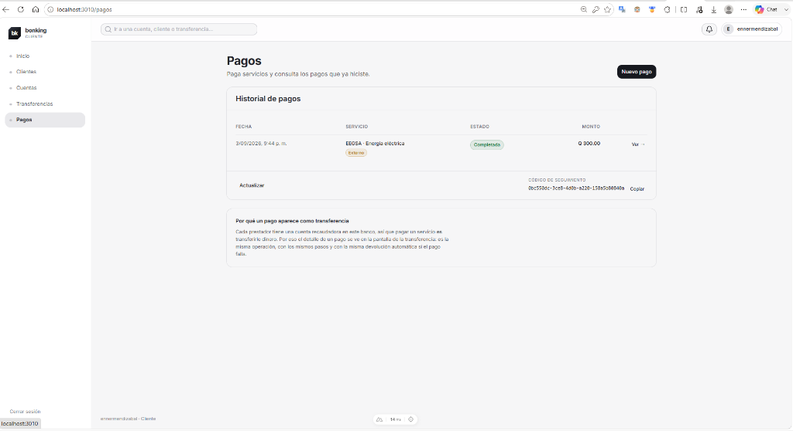

##### Elementos y Registros Observados en Pantalla:
1. **Encabezado y Acciones**:
   * Título: **Pagos** (*"Paga servicios y consulta los pagos que ya hiciste."*).
   * Botón superior: **"Nuevo pago"**.
2. **Tabla "Historial de pagos"**:
   * **FECHA**: `3/09/2026, 9:44 p. m.`
   * **SERVICIO**: `EEGSA · Energía eléctrica` acompañado del badge amarillo **`Externo`**, certificando que la liquidación se ejecutó hacia una empresa prestadora externa de servicios.
   * **ESTADO**: Badge verde **`Completada`**.
   * **MONTO**: **`Q 300.00`**.
   * **Acción**: Enlace **`Ver →`** que permite abrir en cualquier momento el monitor y comprobante de la transferencia.
3. **Controles de Trazabilidad**:
   * Botón **"Actualizar"** para refrescar la lista reactivamente sin recargar la página.
   * **CÓDIGO DE SEGUIMIENTO**: `0bc550dc-3ce8-4d9b-a228-158a5c80840a` [Copiar].
4. **Tarjeta Explicativa ("Por qué un pago aparece como transferencia")**:
   * *"Cada prestador tiene una cuenta recaudadora en este banco, así que pagar un servicio es transferirle dinero. Por eso el detalle de un pago se ve en la pantalla de la transferencia: es la misma operación, con los mismos pasos y con la misma devolución automática si el pago falla."*
5. **Efecto Neto en el Balance del Cliente**:
   * **Cuenta Monetaria (`...d6e822`)**: Saldo previo `Q 700.00` - `Q 300.00` = **`Q 400.00`**.
   * **Cuenta de Ahorro (`afd97145...`)**: Saldo intacto en **`Q 700.00`** (sin afectación por tratarse de cuentas bancarias aisladas).
   * **Patrimonio Consolidado**: **`Q 1,100.00`** en custodia institucional.

---

#### Paso 32: Perfil de Usuario — Consulta y Edición de Datos Personales (`/perfil`)

El cliente accede a su módulo de autogestión de perfil (`http://localhost:3010/perfil`) para consultar su expediente personal, verificar el estado de su identidad y actualizar datos de contacto.

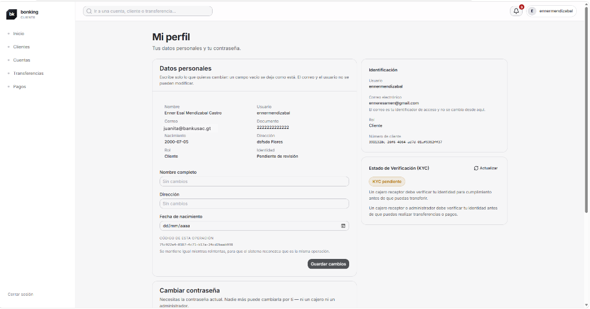

##### Elementos y Secciones en Pantalla:
1. **Tarjeta de Datos Personales (Panel Izquierdo)**:
   * Nota explicativa: *"Escribe solo lo que quieras cambiar: un campo vacío se deja como está. El correo y el usuario no se pueden modificar."*
   * **Ficha de Lectura (Valores Registrados)**:
     * Nombre: `Enner Esai Mendizabal Castro` | Usuario: `ennermendizabal`
     * Correo: `juanita@bankusac.gt` | Documento: `2222222222222`
     * Nacimiento: `2000-07-05` | Dirección: `dsfsdo Flores`
     * Rol: `Cliente` | Identidad: `Pendiente de revisión`
   * **Campos Editables**:
     * **Nombre completo**, **Dirección** y **Fecha de nacimiento** (mediante selector de fecha integrado).
   * **Idempotencia Técnica**:
     * `CÓDIGO DE ESTA OPERACIÓN`: `75c922a4-0187-4c71-b17a-24cd2babd918` (*"Se mantiene igual mientras reintentas, para que el sistema reconozca que es la misma operación."*).
   * Botón: **"Guardar cambios"**.
2. **Tarjeta de Identificación (Panel Derecho Superior)**:
   * Usuario: `ennermendizabal`.
   * Correo: `juanita@bankusac.gt` (*"El correo es tu identificador de acceso y no se cambia desde aquí."*).
   * Rol: `Cliente`.
   * Número de cliente (`customerId`): `3981328c-26f6-4064-ad7d-81af5362ff37`.
3. **Estado de Verificación KYC Inicial (Panel Derecho Inferior)**:
   * Badge naranja: `KYC pendiente`.
   * Leyenda: *"Un cajero receptor debe verificar tu identidad para cumplimiento antes de que puedas transferir. Un cajero receptor o administrador debe verificar tu identidad antes de que puedas realizar transferencias o pagos."*

---

#### Paso 33: Perfil de Usuario con Identidad Validada (KYC Verificado) (`/perfil`)

Una vez que el personal del banco revisa y aprueba el documento DPI del cliente en la mesa de validación de identidades, el cliente consulta su perfil y observa la confirmación oficial del estado de cumplimiento normativo.

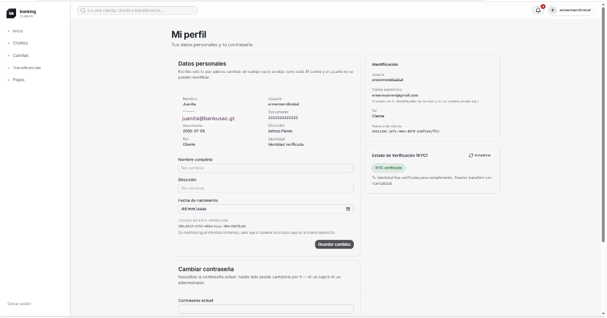

##### Efectos Inmediatos:
1. **Estado de Verificación KYC Aprobado**:
   * Badge verde: `KYC verificado`.
   * Leyenda: *"Tu identidad fue verificada para cumplimiento. Puedes transferir con normalidad."*
2. **Habilitación de Operaciones**:
   * El cliente queda totalmente autorizado para emitir transferencias bancarias, aperturar cuentas adicionales y pagar servicios en línea sin restricciones de ventanilla.
   * La ficha del cliente muestra la identidad como `Identidad verificada`.

---

#### Paso 34: Seguridad de Acceso — Formulario de Cambio de Contraseña (`/perfil`)

En la parte inferior de la pantalla de perfil, el cliente cuenta con un formulario de seguridad dedicado para rotar sus credenciales de acceso de forma autónoma.

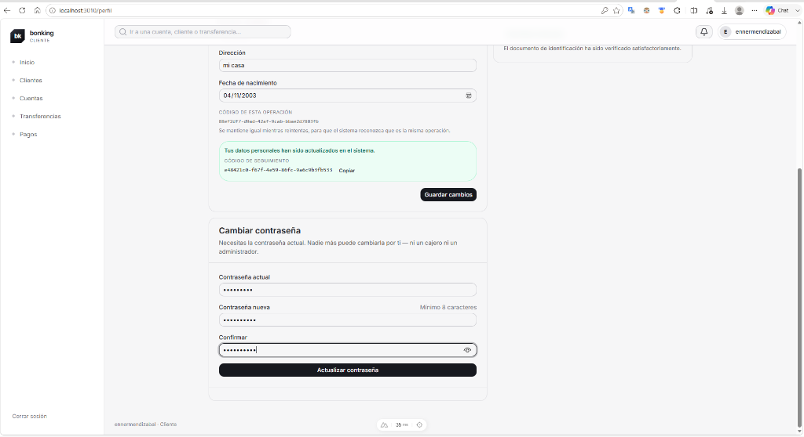

##### Principios de Seguridad y Campos Requeridos:
1. **Gobernanza Criptográfica**:
   * *"Necesitas la contraseña actual. Nadie más puede cambiarla por ti — ni un cajero ni un administrador."* (Garantiza que ningún colaborador bancario pueda suplantar la clave de un titular).
2. **Campos del Formulario**:
   * **Contraseña actual**: Campo protegido con asteriscos (se ingresa la clave vigente `DemoClave#02`).
   * **Contraseña nueva**: Campo protegido (mínimo 8 caracteres reglamentarios).
   * **Confirmar**: Campo protegido con botón de alternancia de visibilidad (icono de ojo).
3. **Acción**:
   * Botón **"Actualizar contraseña"**.

---

#### Paso 35: Seguridad de Acceso — Confirmación de Contraseña Actualizada (`/perfil`)

Al enviar el formulario, el sistema valida la contraseña actual contra el hash `scrypt` almacenado en la base de datos, computa el nuevo hash criptográfico y actualiza el registro del cliente.

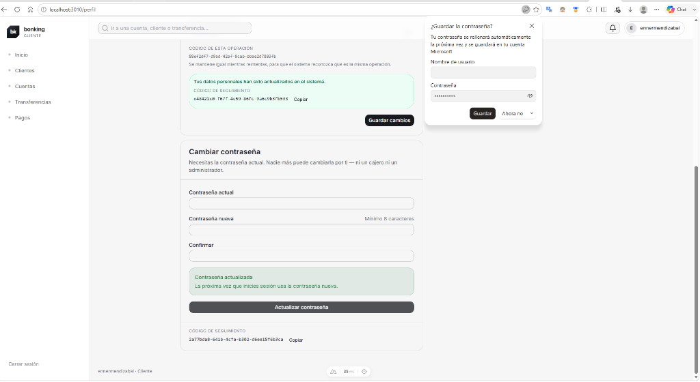

##### Elementos de la Confirmación:
1. **Alerta Verde de Éxito**:
   * **Título**: *"Contraseña actualizada"*
   * **Indicación**: *"La próxima vez que inicies sesión usa la contraseña nueva."*
2. **Trazabilidad de Seguridad**:
   * **CÓDIGO DE SEGUIMIENTO**: `2a77bda8-641b-4cfa-b302-d6ec15f6b3ca` [Copiar].
3. **Integración con Navegador**: Despliegue automático de la ventana de gestión de contraseñas seguras para sincronizar la nueva clave en el gestor del usuario.

---

### 5.2 Módulo 2: Portal del Cajero Receptor (`CAJERO_RECEPTOR`)

Este módulo cubre la operativa bancaria presencial realizada por el cajero receptor: validación documental de clientes web y enrolamiento integral de nuevos clientes en ventanilla.

* **Credenciales de Acceso del Cajero**: `cajero@bankusac.gt` / `BankUsac#2026`

---

#### Paso 36: Panel de Control del Cajero Receptor (`/`)

Al iniciar sesión con las credenciales de cajero receptor, el sistema presenta el tablero de mando operativo con las métricas del día.

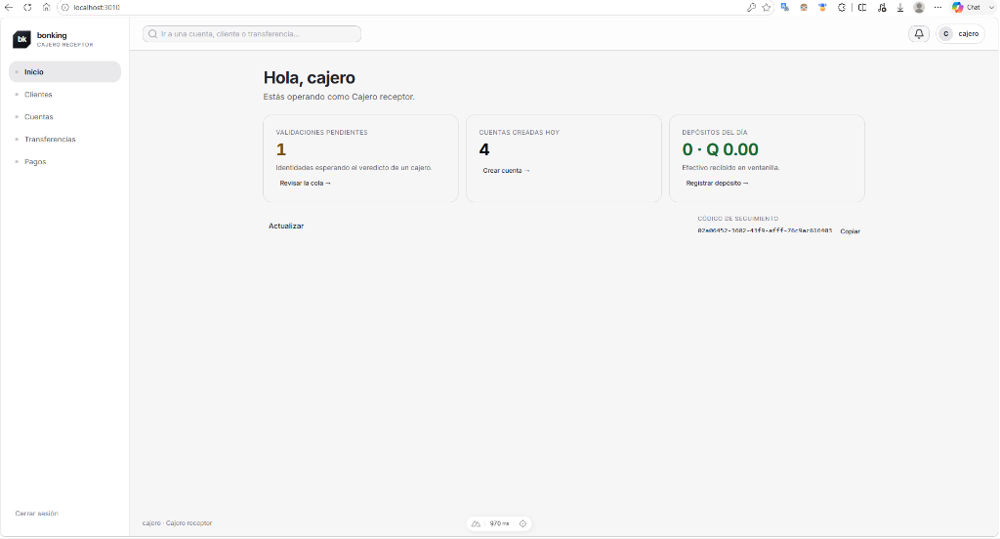

##### Elementos y Métricas Observadas:
1. **Encabezado de Bienvenida**:
   * Identificación del usuario: *"Hola, cajero. Estás operando como Cajero receptor."*
   * Avatar superior con indicación de rol `c cajero` y logotipo institucional.
2. **Tarjetas de Indicadores Operativos**:
   * **VALIDACIONES PENDIENTES**: Contador en `1` con la leyenda *"Identidades esperando el veredicto de un cajero"*. Este valor refleja en tiempo real la solicitud ingresada por Enner en el Módulo 1. Incluye acceso directo: **"Revisar la cola →"**.
   * **CUENTAS CREADAS HOY**: Contador de aperturas (`4`) con enlace directo: **"Crear cuenta →"**.
   * **DEPÓSITOS DEL DÍA**: Muestra el total recibido en ventanilla (`0 · Q 0.00`) con enlace directo: **"Registrar depósito →"**.
3. **Barra de Navegación Lateral (Sidebar)**:
   * Acceso rápido a los submódulos autorizados para el cajero: **Inicio**, **Clientes**, **Cuentas**, **Transferencias**, **Pagos** y botón de **Cerrar sesión**.
4. **Trazabilidad**:
   * Código de seguimiento asignado a la sesión de consulta (`82a06452-1602-41f9-afff-76c9ae616403`).

---

#### Paso 37: Directorio Bancario de Clientes (`/clientes`)

Al ingresar a la sección de **Clientes**, el cajero visualiza tanto las herramientas de gestión de expedientes como el listado completo de clientes registrados.

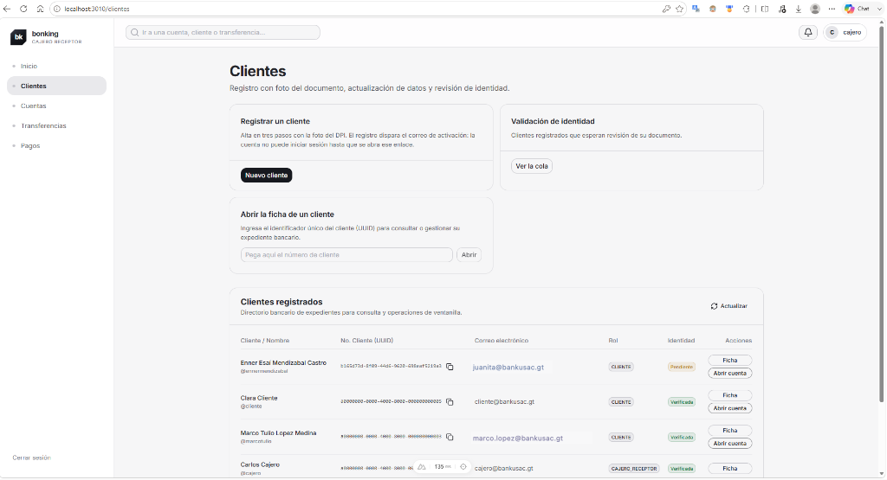

##### Herramientas de Expediente:
1. **Registrar un cliente**: Botón **"Nuevo cliente"** para enrolar a una persona de forma presencial en ventanilla.
2. **Validación de identidad**: Botón **"Ver la cola"** para acceder a los trámites pendientes de revisión.
3. **Abrir la ficha de un cliente**: Campo de búsqueda por UUID para acceder directamente al expediente bancario de un titular.

##### Directorio de Clientes Registrados:
* La tabla presenta el listado consolidado de titulares:
  * **Fila 1 (Cliente del Ejemplo Principal)**:
    * **Cliente / Nombre**: `Enner Esai Mendizabal Castro` (`@ennermendizabal`).
    * **No. Cliente (UUID)**: `b165d73d-a709-4dd4-9620-688ea75219a3` (con botón de copia rápida).
    * **Correo electrónico**: `juanita@bankusac.gt`.
    * **Rol**: `CLIENTE`.
    * **Estado de Identidad**: Badge en color amarillo **"Pendiente"**, confirmando que su documento aún no ha sido dictaminado.
    * **Acciones disponibles**: Botones **"Ficha"** y **"Abrir cuenta"**.
  * **Filas 2, 3 y 4 (Clientes Pre-sembrados y Staff)**:
    * Muestra a `Clara Cliente`, `Marco Tulio Lopez Medina` y `Carlos Cajero` con su respectivo badge verde **"Verificada"**.

---

#### Paso 38: Cola de Clientes en Espera de Validación (`/clientes/validaciones`)

Al hacer clic en **"Revisar la cola"** o **"Ver la cola"**, el cajero ingresa a la bandeja de trabajo de verificación documental.

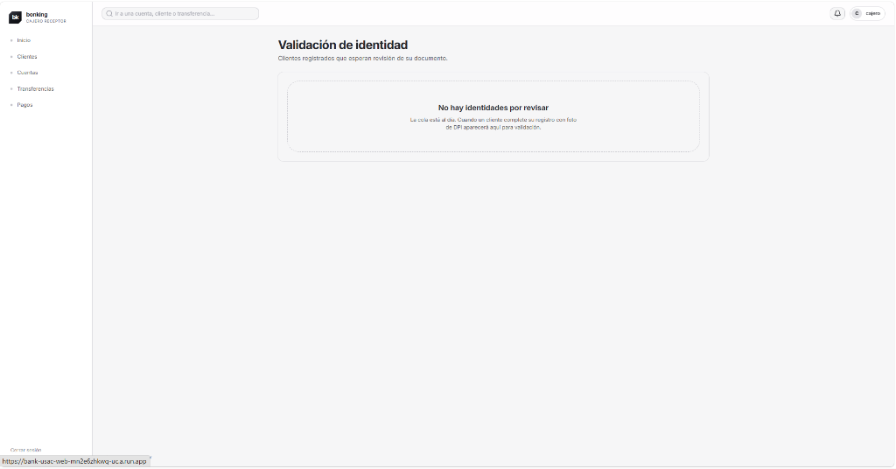

##### Elementos y Acciones:
1. **Título y Descripción**:
   * **"Validación de identidad"** — *"Clientes registrados que esperan revisión de su documento."*
2. **Tarjeta de Solicitud**:
   * Muestra el nombre del solicitante: **Enner Esai Mendizabal Castro** y su correo registrado `juanita@bankusac.gt`.
3. **Acción**:
   * Botón **"Revisar →"**: Abre el expediente específico de validación (`/clientes/validaciones/b165d73d-a709-4dd4-9620-688ea75219a3`).

---

#### Paso 39: Mesa de Revisión y Veredicto de Identidad (`/clientes/validaciones/[id]`)

En esta pantalla crítica de seguridad bancaria, el cajero realiza el cotejo entre la imagen del DPI almacenada en MinIO y los datos ingresados en el formulario.

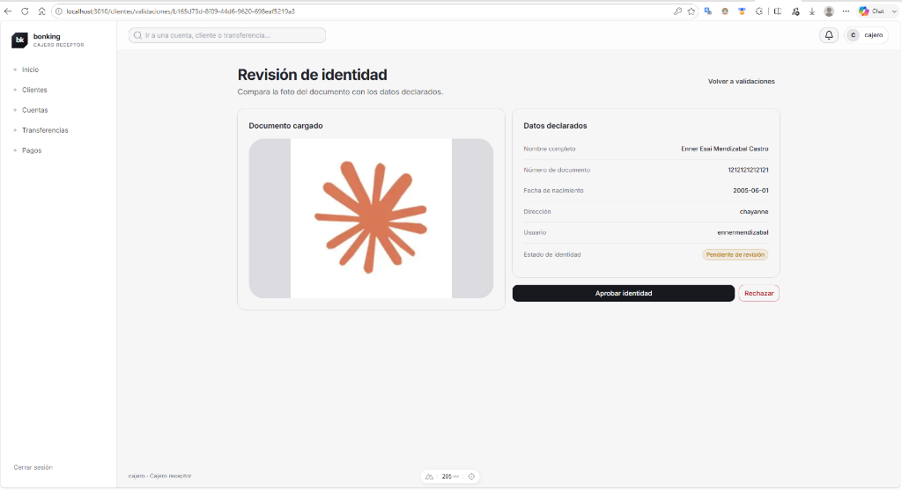

##### Datos y Elementos en Pantalla:
1. **Panel Izquierdo — "Documento cargado"**:
   * Renderiza la imagen digitalizada del DPI enviada por el cliente desde el almacenamiento de objetos seguro (MinIO).
2. **Panel Derecho — "Datos declarados"**:
   * **Nombre completo**: `Enner Esai Mendizabal Castro`
   * **Número de documento**: `1212121212121`
   * **Fecha de nacimiento**: `2005-06-01`
   * **Dirección**: `chayanne`
   * **Usuario**: `ennermendizabal`
   * **Estado de identidad**: Badge **"Pendiente de revisión"** (amarillo).
3. **Acciones de Decisión Operativa**:
   * **"Aprobar identidad"** (botón principal): Emite el evento `customer.identity.validated.v1`, actualiza el estado del cliente a `VALIDATED` y activa la emisión del token de activación por correo electrónico (recibido en el Paso 7).
   * **"Rechazar"** (botón secundario rojo): Deniega la solicitud en caso de ilegibilidad o falsedad documental, notificando el motivo al cliente.
   * **"Volver a validaciones"**: Permite regresar a la cola sin emitir veredicto.

---

#### Paso 40: Registro de Clientes en Ventanilla — Paso 1: Datos Personales (`/clientes/nuevo`)

Además de validar registros web, el cajero receptor tiene la facultad de enrolar nuevos clientes que acuden presencialmente a la agencia.

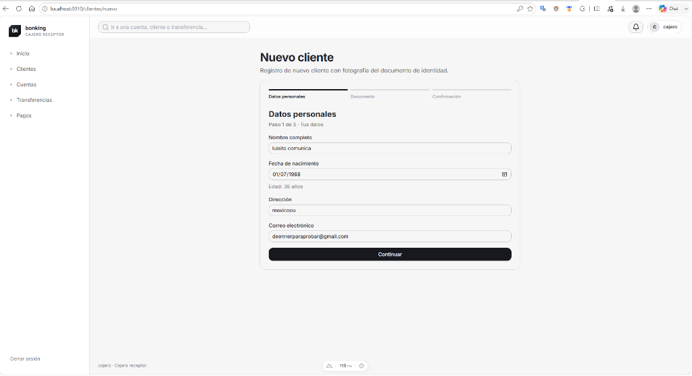

##### Datos del Ejemplo de Alta Presencial:
* **Nombre completo**: `luisito comunica`
* **Fecha de nacimiento**: `01/07/1988` (Cálculo dinámico de edad: `38 años`).
* **Dirección**: `mexicocu`
* **Correo electrónico**: `ventanilla@bankusac.gt`

##### Características de la Interfaz:
1. **Asistente de Enrolamiento de 3 Pasos**: *Datos personales*, *Documento* y *Confirmación*.
2. **Botón "Continuar"**: Valida los campos y avanza a la carga del documento.

---

#### Paso 41: Registro de Clientes en Ventanilla — Paso 2: Documento de Identidad (`/clientes/nuevo`)

En la segunda etapa del alta en ventanilla, el cajero solicita el DPI físico al cliente, lo digitaliza e ingresa el código numérico.

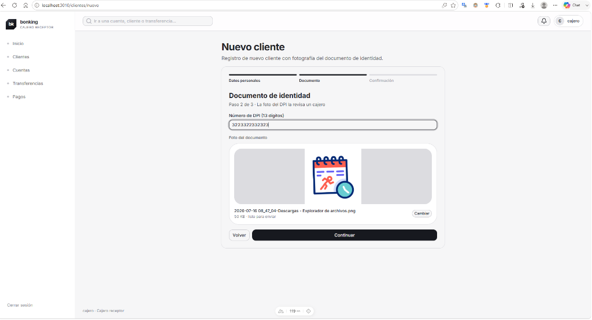

##### Datos del Ejemplo:
* **Número de DPI (13 dígitos)**: `3223322332323`
* **Foto del documento**: Archivo escaneado o fotográfico cargado (`2026-07-16 08_47_04-Descargas - Explorador de archivos.png`, `50 KB · Listo para enviar`).

##### Controles Disponibles:
1. **Previsualización de Documento**: Muestra la imagen cargada con botón **"Cambiar"** para corregir el archivo si fuera necesario.
2. **Navegación**: Botón **"Volver"** y botón **"Continuar"** para avanzar al resumen.

---

#### Paso 42: Registro de Clientes en Ventanilla — Paso 3: Confirmación y Credenciales (`/clientes/nuevo`)

El cajero revisa el consolidado con el solicitante presente en ventanilla, genera su nombre de usuario institucional y define su contraseña de acceso temporal o definitiva.

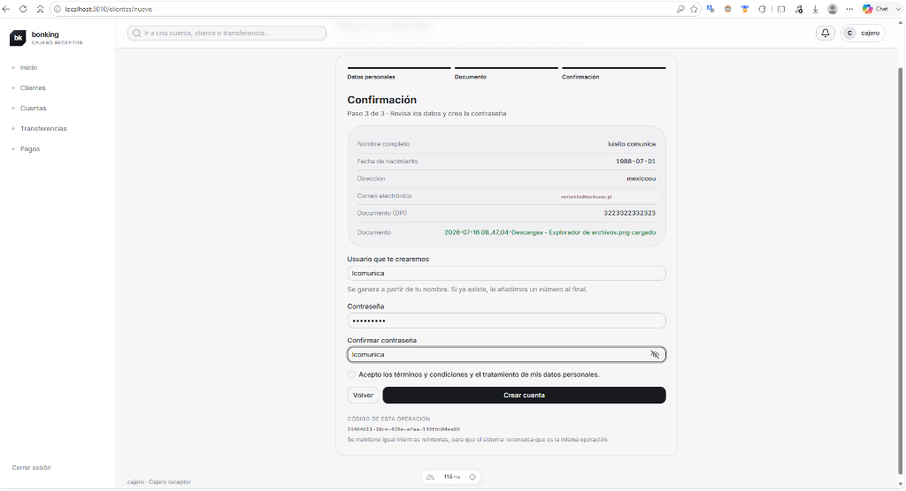

##### Resumen Declarado y Credenciales:
* **Nombre completo**: `luisito comunica`
* **Fecha de nacimiento**: `1988-07-01`
* **Dirección**: `mexicocu`
* **Correo electrónico**: `ventanilla@bankusac.gt`
* **Documento (DPI)**: `3223322332323`
* **Documento**: Archivo cargado en memoria.
* **Usuario generado**: `lcomunica`
* **Contraseña / Confirmación**: `lcomunica`
* **Consentimiento Legal**: Casilla de aceptación de términos y políticas de datos.
* **Idempotencia Técnica**: Código de operación `19484b11-10ce-428e-afae-119fbfa6ee89`.

---

#### Paso 43: Confirmación de Alta Exitosa en Ventanilla (`/clientes/nuevo`)

Al presionar **"Crear cuenta"**, la operación se procesa de forma inmediata. Debido a que el trámite lo efectúa un cajero en persona, el cliente queda automáticamente **registrado y validado** sin requerir mesa de control posterior.

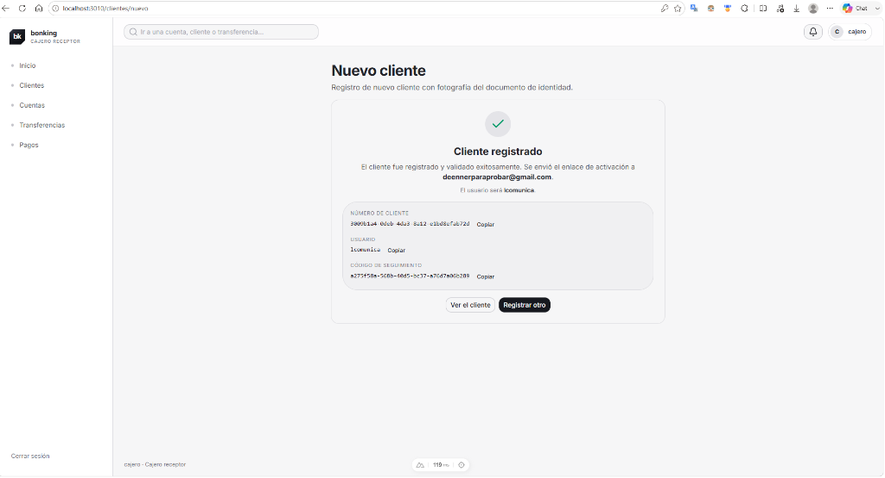

##### Valores Emitidos por el Sistema:
* **Mensaje**: *"Cliente registrado. El cliente fue registrado y validado exitosamente. Se envió el enlace de activación a **ventanilla@bankusac.gt**."*
* **NÚMERO DE CLIENTE (`customerId`)**: `3809b1a4-0deb-4da3-8a12-e1bd8cfab72d` [Copiar]
* **USUARIO ASIGNADO**: `lcomunica` [Copiar]
* **CÓDIGO DE SEGUIMIENTO**: `a275f50a-560b-40d5-bc37-a7cd7a06b209` [Copiar]

##### Acciones Disponibles:
* **"Ver el cliente"**: Abre la ficha bancaria recién creada.
* **"Registrar otro"**: Reinicia el formulario para atender a un nuevo usuario en cola.

---

#### Paso 44: Notificación de Activación para el Cliente de Ventanilla (`ventanilla@bankusac.gt`)

De manera sincronizada con el alta presencial, el sistema despacha el correo formal de bienvenida y activación a la dirección registrada por el cajero.

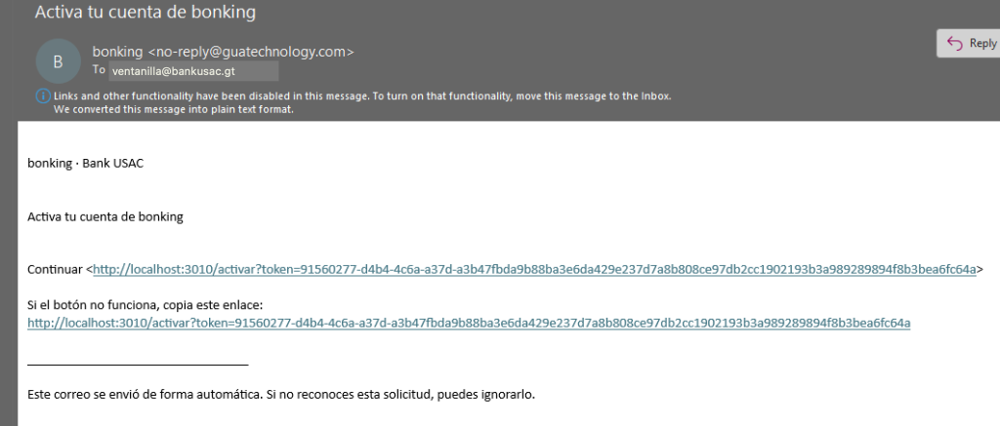

##### Datos del Correo Electrónico:
* **De**: `bonking <no-reply@guatechnology.com>`
* **Para**: `ventanilla@bankusac.gt`
* **Asunto**: *"Activa tu cuenta de bonking"*
* **Enlace de activación**: `http://localhost:3010/activar?token=91560277-d4b4-4c6a-a37d-a3b47fbda9b88ba3e6da429e237d7a8b808ce97db2cc1902193b3a989289894f8b3bea6fc64a`

##### Operación de Activación:
Al ingresar al enlace, el cliente activa su cuenta y queda listo para iniciar sesión en la banca en línea con el usuario `lcomunica` y la contraseña asignada.

---

#### Paso 45: Ficha Técnica y Modificación de Datos del Cliente (`/clientes/[id]`)

Tanto los cajeros como los administradores pueden consultar el expediente individual de cualquier cliente registrado para revisar su estado de validación o actualizar datos de contacto permitidos.

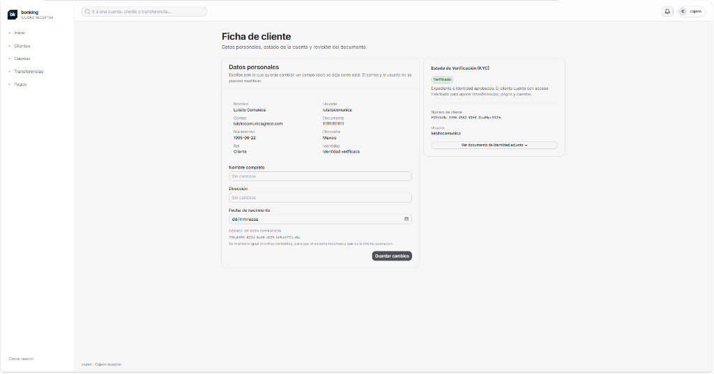

##### Datos y Estructura en Pantalla:
1. **Panel Izquierdo — "Datos personales"**:
   * **Campos Inmutables por Seguridad**:
     * **Correo**: `ventanilla@bankusac.gt`
     * **Usuario**: `luisitocomunica`
     * *(Por normativa bancaria estricta, el correo y el nombre de usuario no son modificables desde la ficha para proteger la identidad del titular).*
   * **Datos Registrados**:
     * **Nombre**: `luisito comunica`
     * **Documento**: `3223322332323`
     * **Nacimiento**: `1988-07-01`
     * **Dirección**: `mexicocu`
     * **Rol**: `Cliente`
     * **Identidad**: `Identidad verificada`
   * **Formulario de Actualización**:
     * Permite ingresar un nuevo **Nombre completo**, **Dirección** o **Fecha de nacimiento** con selector de calendario. Los campos vacíos preservan los datos actuales sin cambios.
   * **Control de Idempotencia**:
     * Código de operación: `45bd6735-01b4-4573-a36a-877b1c082a31`.
     * Botón **"Guardar cambios"**: Aplica las modificaciones de forma segura.
2. **Panel Derecho — "Validación de identidad"**:
   * **Badge de Estado**: Verde **"Identidad verificada"**.
   * **Descripción**: *"El documento de identificación ha sido verificado satisfactoriamente."*
   * **Número de cliente**: `3809b1a4-0deb-4da3-8a12-e1bd8cfab72d`.
   * **Usuario**: `luisitocomunica`.

---

#### Paso 46: Directorio de Cuentas Bancarias y Saldo Custodiado (`/cuentas`)

Al navegar a la sección de **Cuentas** en la barra lateral, el cajero receptor tiene acceso a la visión consolidada de las cuentas de clientes custodiadas por el banco.

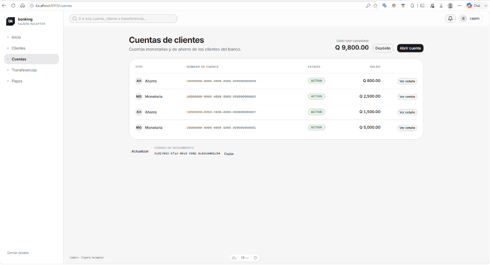

##### Indicadores y Controles de Cabecera:
1. **Saldo Total Custodiado**:
   * Destacado en la parte superior derecha: **`Q 9,800.00`**, reflejando la suma líquida total custodiada en todas las cuentas de clientes del banco.
2. **Acciones Operativas de Ventanilla**:
   * Botón **"Depósito"**: Abre el modal o formulario para recibir efectivo y acreditarlo de inmediato.
   * Botón **"Abrir cuenta"**: Inicia el proceso para emitir una nueva cuenta monetaria o de ahorro (`/cuentas/nueva`).

##### Inventario de Cuentas en Pantalla:
| TIPO | NÚMERO DE CUENTA | ESTADO | SALDO | ACCIÓN |
| :--- | :--- | :---: | :---: | :--- |
| **AH** Ahorro | `b0000000-0000-4000-8000-000000000004` | `ACTIVA` | **Q 800.00** | [Ver detalle] |
| **MO** Monetaria | `b0000000-0000-4000-8000-000000000003` | `ACTIVA` | **Q 2,500.00** | [Ver detalle] |
| **AH** Ahorro | `b0000000-0000-4000-8000-000000000002` | `ACTIVA` | **Q 1,500.00** | [Ver detalle] |
| **MO** Monetaria | `b0000000-0000-4000-8000-000000000001` | `ACTIVA` | **Q 5,000.00** | [Ver detalle] |

##### Pie de Página y Auditoría:
* Enlace **"Actualizar"** para refrescar la lista con los últimos saldos.
* **CÓDIGO DE SEGUIMIENTO**: `9c017653-0fad-45c5-9842-6c63c6402c54` [Copiar].

---

#### Paso 47: Detalle de Cuenta Bancaria y Consulta de Movimientos (`/cuentas/[id]`)

Al pulsar el botón **"Ver detalle"** en cualquiera de las cuentas del directorio (en este ejemplo, la cuenta `b0000000-0000-4000-8000-000000000004`), se despliega la ficha financiera de la cuenta.

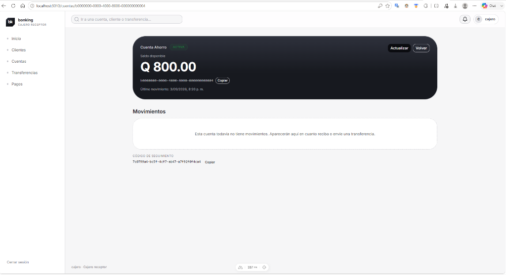

##### Elementos de la Tarjeta Principal:
1. **Encabezado**:
   * Tipo de producto: **Cuenta Ahorro** acompañada del badge verde de estado **`ACTIVA`**.
   * Acciones: Botón **"Actualizar"** (para consultar el saldo más reciente) y **"Volver"** (para regresar al directorio de cuentas).
2. **Saldo Disponible**:
   * **`Q 800.00`** (con tipografía grande y destacada para verificación inmediata).
3. **Número de Cuenta**:
   * `b0000000-0000-4000-8000-000000000004` con botón rápido **"Copiar"**.
4. **Registro del Último Movimiento**:
   * *Último movimiento: 3/09/2026, 8:20 p. m.*

##### Sección de Movimientos:
* Espacio destinado a la cronología de débitos, abonos, transferencias y pagos asociados a la cuenta.
* Mensaje informativo en cuentas sin transacciones previas: *"Esta cuenta todavía no tiene movimientos. Aparecerán aquí en cuanto reciba o envíe una transferencia."*

##### Trazabilidad de Consulta:
* **CÓDIGO DE SEGUIMIENTO**: `7c0799a4-bc5f-4cf7-ab47-a7f92f0f4ca4` [Copiar].

---

#### Paso 48: Apertura de Cuenta en Ventanilla — Tipo de Cuenta y Selección de Titular (`/cuentas/nueva`)

El cajero hace clic en **"Abrir cuenta"** para crear una nueva cuenta bancaria. Siguiendo el hilo del ejemplo unificado, se abre una cuenta para el cliente principal **Enner Esai Mendizabal Castro** (quien fue registrado en el Módulo 1 y validado en el Paso 39).

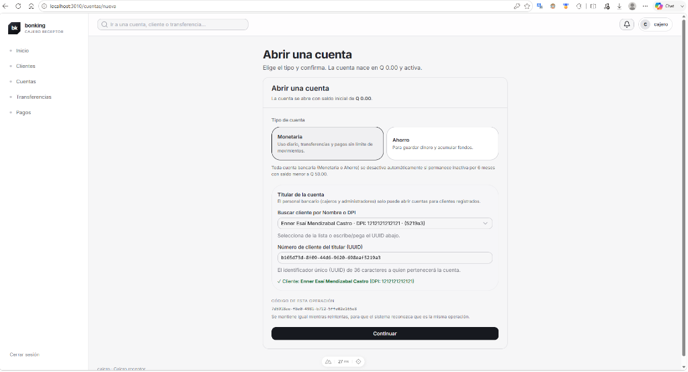

##### Configuración de la Cuenta:
1. **Tipo de Cuenta**:
   * **Monetaria** *(Seleccionada)*: *"Uso diario, transferencias y pagos sin límite de movimientos."*
   * **Ahorro**: *"Para guardar dinero y acumular fondos."*
2. **Política Bancaria de Inactividad**:
   * Notificación visible: *"Toda cuenta bancaria (Monetaria o Ahorro) se desactiva automáticamente si permanece inactiva por 6 meses con saldo menor a Q 50.00."*
3. **Selección del Titular (Cliente Validado)**:
   * Campo de búsqueda: **"Buscar cliente por Nombre o DPI"**.
   * Valor seleccionado de la lista: `Enner Esai Mendizabal Castro · DPI: 12121212121 · (5219a3)`.
   * **Número de cliente del titular (UUID)**: El sistema autorrellena automáticamente el UUID verificado `b165d73d-8f09-44d6-9620-698ea75219a3`.
   * **Validación de Identidad en Verde**: `✓ Cliente: Enner Esai Mendizabal Castro (DPI: 1212121212121)`, asegurando que la cuenta solo se abra a un cliente real y previamente validado.
4. **Idempotencia Técnica**:
   * CÓDIGO DE ESTA OPERACIÓN: `7d5918ee-f8e0-4961-b712-5ffe02e165e8`.
5. **Navegación**:
   * Botón **"Continuar"** para revisar la confirmación.

---

#### Paso 49: Confirmación y Emisión de la Cuenta Bancaria (`/cuentas/nueva`)

En el segundo paso de la apertura, el cajero corrobora los datos finales antes de efectuar el alta definitiva en el sistema bancario.

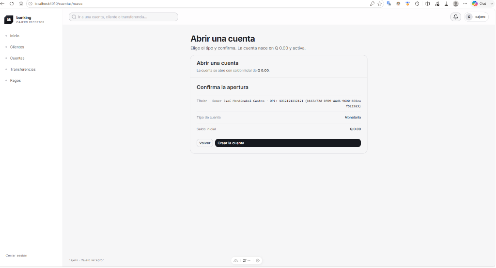

##### Datos de la Confirmación:
* **Titular**: `Enner Esai Mendizabal Castro · DPI: 12121212121 (b165d73d-8f09-44d6-9620-698ea75219a3)`
* **Tipo de cuenta**: `Monetaria`
* **Saldo inicial**: `Q 0.00` *(La cuenta nace en balance cero y con estado `ACTIVA`)*

##### Acciones Disponibles:
* Botón **"Volver"**: Permite regresar para cambiar el tipo de cuenta o seleccionar a otro cliente.
* Botón **"Crear la cuenta"**: Al pulsarlo, el Gateway envía el comando transaccional `account.create.v1` hacia `account-service`, creando la cuenta bancaria con el número único asignado **`e80bd8e9-930a-4f5a-9f34-229cc6d6e822`**, asociándola formalmente a Enner y registrando el evento de auditoría correspondiente.

---

#### Paso 50: Depósito en Ventanilla — Datos y Fondeo Inicial de la Cuenta (`/cuentas/deposito`)

Una vez creada la cuenta monetaria de Enner, el cliente se acerca a la ventanilla para realizar su primer abono en efectivo y fondear sus fondos disponibles. El cajero pulsa el botón **"Depósito"** en la barra superior o en el directorio de cuentas.

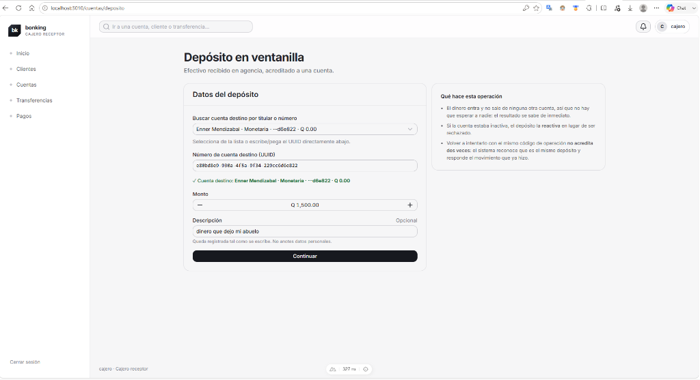

##### Datos del Depósito en Efectivo:
1. **Cuenta Destino**:
   * **Búsqueda**: Selector desplegable *"Buscar cuenta destino por titular o número"*.
   * **Seleccionado**: `Enner Mendizabal · Monetaria · ...d6e822 · Q 0.00`.
   * **Número de cuenta destino (UUID)**: `e80bd8e9-930a-4f5a-9f34-229cc6d6e822`.
   * **Confirmación visual en verde**: `✓ Cuenta destino: Enner Mendizabal · Monetaria · ...d6e822 · Q 0.00`.
2. **Monto a Depositar**:
   * **`Q 1,500.00`** (con controles intuitivos de incremento `+` y decremento `-`).
3. **Descripción o Concepto**:
   * Texto ingresado: `dinero que dejo mi abuelo`.
   * Regla de cumplimiento: El concepto se asienta textualmente en el extracto bancario sin admitir datos personales reservados.
4. **Reglas Operativas Explicadas en Interfaz ("Qué hace esta operación")**:
   * **Acreditación Directa**: El efectivo ingresa al banco sin debitar otra cuenta cliente; la transacción concluye de forma sincrónica e inmediata.
   * **Reactivación Automática**: Si la cuenta destino se encontrara inactiva por desuso o saldo insuficiente, el depósito la restituye a estado `ACTIVA`.
   * **Idempotencia Transaccional**: El reintento con el mismo identificador de operación previene dobles abonos accidentales.
5. **Navegación**:
   * Botón **"Continuar"** para revisar la confirmación de caja.

---

#### Paso 51: Confirmación de Depósito en Efectivo (`/cuentas/deposito`)

En la pantalla de validación previa al arqueo y asiento contable, el cajero corrobora los datos con el depositante en ventanilla.

##### Resumen de la Operación:
* **Advertencia de Seguridad**: *"Revisa la cuenta y el monto. Un depósito acreditado no se revierte desde esta pantalla."*
* **Cuenta destino**: `Enner Mendizabal · Monetaria · ...d6e822 · Q 0.00`
* **Monto a Abonar**: **`Q 1,500.00`**
* **Descripción**: `dinero que dejo mi abuelo`

##### Acciones Disponibles:
* Botón **"Volver"**: Permite retornar a la pantalla anterior si el cliente desea cambiar el monto o la cuenta destino.
* Botón **"Registrar depósito"**: Envía el comando `account.deposit.v1` a `account-service`. El balance se actualiza bajo un bloqueo de fila (`SELECT ... FOR UPDATE`), garantizando consistencia absoluta ante operaciones concurrentes.

---

#### Paso 52: Comprobante de Depósito Acreditado en Ventanilla (`/cuentas/deposito`)

Al procesar la transacción, el sistema confirma la acreditación del efectivo y emite el recibo digital de ventanilla.

##### Resultados Emitidos por el Sistema:
* **Monto acreditado**: **`Q 1,500.00`** (en verde destacado).
* **Nuevo Saldo Disponible**: **`Q 1,500.00`** (actualizado desde Q 0.00).
* **Cuenta destino acreditada**: `e80bd8e9-930a-4f5a-9f34-229cc6d6e822`.
* **Identificador de Operación (`operationId`)**: `b6662425-284d-406d-8415-123d32838bb5`.
* **Código de Seguimiento Auditable (`correlationId`)**: `7d37951f-5229-476f-8ad1-9138881af678` [Copiar].

##### Opciones Posteriores:
* Botón **"Registrar otro depósito"**: Reinicia el formulario para atender al siguiente usuario en ventanilla.
* Botón **"Ver la cuenta"**: Conduce al detalle de saldos y extractos de la cuenta recién fondeada.

---

#### Paso 53: Directorio de Cuentas con Nueva Cuenta Fondeada y Saldo Custodiado (`/cuentas`)

Tras concluir el depósito, el cajero regresa al directorio general de cuentas bancarias. La pantalla evidencia el impacto contable del nuevo saldo y la inclusión de la cuenta de Enner.

##### Métricas y Cambios Globales Observados:
1. **Incremento del Saldo Total Custodiado**:
   * El saldo en custodia de la institución sube a **`Q 11,300.00`** (un incremento exacto de `Q 1,500.00` sobre los `Q 9,800.00` iniciales que se apreciaban en el Paso 46).
2. **Nueva Fila en la Tabla de Cuentas**:
   * **Fila 1 (Cuenta de Enner)**:
     * Tipo: `MO` Monetaria
     * Número de cuenta: `e80bd8e9-930a-4f5a-9f34-229cc6d6e822`
     * Estado: Badge verde **`ACTIVA`**
     * Saldo: **`Q 1,500.00`**
     * Acción: Botón **"Ver detalle"**
   * **Filas 2 a 5**: Las cuentas pre-sembradas de Ahorro y Monetaria de los otros clientes (`Q 800.00`, `Q 2,500.00`, `Q 1,500.00`, `Q 5,000.00`).
3. **Auditoría de Consulta**:
   * CÓDIGO DE SEGUIMIENTO: `169a3d0e-e495-4c40-90da-dd954aa9772a` [Copiar].

---

#### Paso 54: Módulo de Transferencias entre Cuentas y Consulta de Operaciones (`/transferencias`)

El cajero accede a la sección de **Transferencias** en el menú lateral para consultar la actividad interbancaria o brindar soporte sobre operaciones en curso.

##### Componentes y Herramientas del Módulo:
1. **Botones de Control Superior**:
   * **"Monitoreo"**: Enlace directo a la vista de seguimiento de la Saga coreografiada y estado de las colas de mensajería.
   * **"Nueva transferencia"**: Permite iniciar una nueva transferencia entre cuentas autorizadas.
2. **Tarjeta "Historial de operaciones de clientes"**:
   * En este momento inicial no se han efectuado transferencias entre clientes: *"No hay transferencias registradas. Aún no se han procesado movimientos de transferencia entre cuentahabientes en el sistema."*
   * Botón interior: **"Registrar transferencia"**.
   * CÓDIGO DE SEGUIMIENTO: `db13f64e-0fbf-4ded-b52b-5e6d7fe4f5ab` [Copiar].
3. **Tarjeta "Consultar una transferencia"**:
   * Herramienta de soporte rápido para ventanilla: permite ingresar un **Número de operación** (UUID de 36 caracteres) para verificar si una transacción enviada por un cliente fue completada, compensada por fallo de débito o se encuentra pendiente de liquidación.
   * Botón: **"Ver el estado"**.

---

#### Paso 55: Formulario de Nueva Transferencia entre Clientes (`/transferencias/nueva`)

El cajero hace clic en **"Nueva transferencia"** para iniciar un traslado de fondos interbancario a solicitud de un usuario. Siguiendo el caso de uso transversal, la clienta **Clara Cliente** transfiere fondos a la cuenta de **Enner Mendizabal**.

##### Configuración de la Transferencia:
1. **Cuenta de Origen**:
   * Selector: `Clara Cliente · Ahorro · ...000004 · Q 800.00`.
   * Indicación: *"De aquí sale el dinero."*
2. **Destino de los Fondos ("¿A dónde va el dinero?")**:
   * Opción seleccionada: **"A cuenta de otro cliente"** (transferencia hacia un tercero).
3. **Cuenta de Destino**:
   * Selector / Búsqueda: `Enner Mendizabal · Monetaria · ...d6e822 · Q 1,500.00`.
   * Identificador único (UUID): `e80bd8e9-930a-4f5a-9f34-229cc6d6e822`.
   * Confirmación visual en verde: `✓ Cuenta destino: Enner Mendizabal · Monetaria · ...d6e822 · Q 1,500.00`.
4. **Monto**:
   * **`Q 400.00`** (con botones para ajustar la cantidad).
5. **Panel de Entorno de Evaluación ("SOLO PARA DEMOSTRACIÓN")**:
   * Control exclusivo para demostración y pruebas de fiabilidad:
     * **Escenario de pago**: `Aprobar el pago` (*"La transferencia se completa. Es el camino normal."*).
6. **Navegación**:
   * Botón **"Continuar"** para revisar el resumen.

---

#### Paso 56: Revisión y Confirmación de Transferencia (`/transferencias/nueva`)

Antes de someter la operación al orquestador distribuido de la Saga, el cajero corrobora los datos esenciales de la transferencia.

##### Datos Consolidados:
* **Sale de**: `Clara Cliente · Ahorro · ...000004 · Q 800.00`
* **Entra a**: `Enner Mendizabal · Monetaria · ...d6e822 · Q 1,500.00`
* **Monto**: **`Q 400.00`**
* **Control de Idempotencia**:
  * Código de operación único: `5b169e36-f2f4-489b-8395-1f03eb2198b4`.
  * Garantía técnica: Se mantiene constante durante reintentos de red para evitar duplicar el cargo.

##### Acciones:
* Botón **"Corregir"**: Regresa al formulario para subsanar cualquier parámetro.
* Botón **"Confirmar y enviar"**: Despacha la orden hacia el API Gateway e inicia la Saga coreografiada.

---

#### Paso 57: Recepción Asíncrona — Solicitud en Proceso (`/transferencias/[id]`)

Al presionar **"Confirmar y enviar"**, el sistema acepta de inmediato la solicitud y redirige al monitor transaccional, asignando temporalmente el identificador de operación `25c5b09a-fb89-46cc-864c-9d72a6385bd3`.

##### Comportamiento Reactivo:
* **Estado Visible**: Banner color crema **"Solicitud en proceso"**.
* **Mensaje al Operador**: *"El sistema aceptó la transferencia y la está registrando. Esta pantalla se actualiza sola."*
* **Arquitectura Subyacente**: El Gateway encoló el comando en RabbitMQ y la interfaz cliente se sincroniza de forma reactiva esperando la resolución de los microservicios sin necesidad de recargar la página.

---

#### Paso 58: Monitor de la Saga en Tiempo Real — Procesando Pago (`/transferencias/[id]`)

En cuestión de milisegundos, el sistema transiciona al identificador definitivo de transferencia `2cc63338-833f-4871-b47f-d297e268de91` y despliega la máquina de estados coreografiada en tiempo real.

##### Estado del Avance de la Transferencia (Badge Naranja: `PROCESANDO PAGO`):
* **Principio de Compensación Explicado en Pantalla**: *"El dinero ya salió de la cuenta de origen y el pago está en proceso. Si el pago falla, se devuelve automáticamente."*
* **Paso 1: Solicitada** `(✓)` — El sistema aceptó la solicitud formal.
* **Paso 2: Débito** `(✓)` — `account-service` debitó exitosamente los **Q 400.00** de la cuenta de Clara Cliente.
* **Paso 3: Pago** `(Spinner en proceso)` — `payment-service` se encuentra procesando la liquidación interbancaria.
* **Paso 4: Completada** `(Pendiente)` — Pendiente de acreditación final.

##### Tarjeta "Resultado del Pago" (Badge Naranja: `EN PROCESO`):
* **Título**: *"El pago está en proceso"*
* **Número del pago**: `25c5b09a-fb89-46cc-864c-9d72a6385bd3`.
* Botón **"Ver el detalle del pago"** para inspeccionar la traza técnica de liquidación.

---

#### Paso 59: Monitor de la Saga en Tiempo Real — Transferencia Completada (`/transferencias/[id]`)

Una vez validado el pago, `payment-service` emite `payment.completed.v1`, `account-service` acredita los fondos en la cuenta de Enner y `transaction-service` cierra la Saga de forma exitosa.

##### Estado Final de la Transferencia (Badge Verde: `COMPLETADA`):
* **Subtítulo de Éxito**: *"El dinero llegó a la cuenta de destino."*
* **Cuatro Hitos Coreografiados Exitosos**:
  1. `(✓) Solicitada`: Aceptada por el API Gateway.
  2. `(✓) Débito`: Q 400.00 debitados de Clara Cliente.
  3. `(✓) Pago`: Liquidación aprobada por el procesador de pagos.
  4. `(✓) Completada`: Q 400.00 acreditados en la cuenta de Enner Mendizabal.

##### Tarjeta "Resultado del Pago" (Badge Verde: `APROBADO`):
* **Título**: *"El pago se aprobó"*
* **Descripción**: *"Se ordenó el crédito a la cuenta de destino."*
* **Número del pago**: `25c5b09a-fb89-46cc-864c-9d72a6385bd3`.
* **Hora de resolución**: `3/09/2026, 9:33 p. m.`.
* Botón superior disponible: **"Nueva transferencia"**.

---

#### Paso 60: Historial General de Transferencias Actualizado (`/transferencias`)

Al volver al módulo principal de transferencias, la tabla histórica de clientes se actualiza automáticamente con la transacción registrada, inmutable y auditable.

##### Fila Liquidada en el Historial:
| FECHA | ORIGEN → DESTINO | ESTADO | MONTO | ACCIÓN |
| :--- | :--- | :---: | :---: | :--- |
| `3/09/2026, 9:33 p. m.` | `b00000000004 → 229cc6d6e822` | `Completada` | **Q 400.00** | [Ver →] |

##### Trazabilidad de Auditoría:
* CÓDIGO DE SEGUIMIENTO: `ccbb49c2-ee41-4980-b827-614c1b458733` [Copiar].

---

#### Paso 61: Módulo de Pago de Servicios (`/pagos`)

El cajero receptor ingresa a la sección de **Pagos** desde el menú lateral (`http://localhost:3010/pagos`) para gestionar pagos de facturas y servicios públicos en ventanilla (electricidad, agua, telecomunicaciones).

##### Elementos y Arquitectura de la Pantalla:
1. **Encabezado y Acciones Rápidas**:
   * **"Monitoreo"**: Permite acceder a la vista de supervisión técnica de los pagos y su correlación con la Saga distribuida.
   * **"Nuevo pago"**: Abre el asistente interactivo para iniciar un nuevo cobro por servicio público (`/pagos/nuevo`).
2. **Historial de Pagos (Estado Inicial)**:
   * Muestra el mensaje informativo: *"Todavía no has pagado ningún servicio. Cuando pagues luz, agua o teléfono, cada pago aparecerá aquí con su referencia y su estado."*
   * Botón central: **"Pagar un servicio"**.
3. **Pie de Tarjeta y Trazabilidad**:
   * Botón **"Actualizar"** para refrescar la consulta de pagos en segundo plano.
   * **CÓDIGO DE SEGUIMIENTO**: `84e71bc5-450b-450b-9c64-94e4c3b1665c` [Copiar].
4. **Fundamento Conceptual del Sistema ("Por qué un pago aparece como transferencia")**:
   * *"Cada prestador tiene una cuenta recaudadora en este banco, así que pagar un servicio es transferirle dinero. Por eso el detalle de un pago se ve en la pantalla de la transferencia: es la misma operación, con los mismos pasos y con la misma devolución automática si el pago falla."*

---

#### Paso 62: Formulario de Pago de Servicios (`/pagos/nuevo`)

Al presionar **"Nuevo pago"** o **"Pagar un servicio"**, el sistema despliega el formulario para seleccionar la cuenta a debitar, el prestador del servicio y el monto de la factura.

##### Datos Registrados para el Ejemplo Unificado:
* **Cuenta origen**: `Enner Mendizabal · Monetaria ···d6e822 · Q 1,900.00`
  * **Saldo disponible mostrado**: `Q 1,900.00`.
  * *Coherencia contable*: El saldo disponible refleja con exactitud los **Q 1,500.00** depositados en ventanilla (Paso 24) más los **Q 400.00** recibidos por transferencia desde Clara Cliente (Paso 31).
* **Servicio público o factura**: `Claro · Telefonía` (facturador externo de telecomunicaciones).
* **Monto**: `Q 500.00` (ajustado mediante los controles numéricos `-` / `+`).
* **Número de contrato o referencia**: `saldo de mis niños`
  * *Texto de ayuda*: *"Número de contrato, de medidor o de línea. Es lo que le dice al prestador de quién es el pago."*
* **Código de Operación (Idempotencia)**: `64f97a14-fd81-41c8-9227-21f181a5f17d`
  * Protege la transacción de cobros duplicados en caso de reintentos por intermitencia de red.

##### Panel Informativo Lateral ("Qué pasa al pagar"):
* **Modelo Unificado**: Un pago de servicio es una transferencia a la cuenta recaudadora del prestador (luz, agua, teléfono) y pasa por los mismos pasos: débito de la cuenta de origen, procesamiento externo del pago y acreditación en la cuenta del prestador.
* **Garantía de Compensación Automática**: Si algo falla después del débito en la pasarela externa, la Saga orquesta de inmediato la reversión contable devolviendo los fondos al cliente.
* **Validación en Vivo**: El saldo se valida de forma atómica y estricta en el momento del cobro.

Al presionar el botón **"Pagar servicio"**, la orden ingresa al API Gateway e inicia la Saga coreografiada en RabbitMQ.

---

#### Paso 63: Confirmación de la Saga del Pago Completado (`/transferencias/[id]`)

El sistema redirige automáticamente al monitor de la transferencia (`http://localhost:3010/transferencias/b0089530-7bd6-471b-9745-d1c0e65bde85`), confirmando la finalización exitosa de todas las etapas distribuidas del pago.

##### Resumen de la Operación:
* **MONTO**: **Q 500.00**
* **Identificador de Transferencia (`transactionId`)**: `b0089530-7bd6-471b-9745-d1c0e65bde85`
* **Solicitada / Última actualización**: `3/09/2026, 9:38 p. m.`

##### Avance de la Transferencia (Badge Verde: `COMPLETADA`):
* Mensaje: *"El dinero llegó a la cuenta de destino."*
* **Hitos de la Saga**:
  1. `(✓) Solicitada`: El sistema aceptó la solicitud formal.
  2. `(✓) Débito`: Se descontaron **Q 500.00** de la cuenta de Enner Mendizabal (saldo remanente: `Q 1,400.00`).
  3. `(✓) Pago`: Se procesó el pago hacia el prestador de telefonía.
  4. `(✓) Completada`: El crédito se liquidó exitosamente en la cuenta recaudadora de Claro.

##### Tarjeta "Resultado del Pago" (Badge Verde: `APROBADO`):
* **Estado**: *"El pago se aprobó — Se ordenó el crédito a la cuenta de destino."*
* **Número del pago (`paymentId`)**: `194f659d-55a1-4b40-afcc-a02c80a90572`
* **Resuelto**: `3/09/2026, 9:38 p. m.`
* Botón: **"Ver el detalle del pago"** para inspeccionar los identificadores técnicos del proveedor.

---

#### Paso 64: Detalle y Trazabilidad Técnica del Pago (`/pagos/[id]`)

Al hacer clic en **"Ver el detalle del pago"**, se accede a la ficha técnica del servicio (`http://localhost:3010/pagos/194f659d-55a1-4b40-afcc-a02c80a90572`), que reúne todos los identificadores de trazabilidad distribuida para auditoría y soporte bancario.

##### Panel de Estado del Pago:
* **Identificador Principal**: `194f659d-55a1-4b40-afcc-a02c80a90572`
* **Dictamen**: Badge Verde `APROBADO` (*"El pago se aprobó. Se ordenó el crédito a la cuenta de destino."*)
* **MONTO**: **Q 500.00**
* **Tiempos**: Solicitado y resuelto el `3/09/2026, 9:38 p. m.`
* **Escalafón de Intentos**: `Intento 1 aprobado` (aprobado al primer intento sin necesidad de reintentos en la escalera de reintentos).
* Botón **"Ver la transferencia"** para regresar a la vista de la transacción contable.

##### Identificadores de Auditoría y Trazabilidad Transversal:
| Identificador | Valor | Propósito en la Arquitectura |
| :--- | :--- | :--- |
| **NÚMERO DEL PAGO** | `194f659d-55a1-4b40-afcc-a02c80a90572` | Identificador único emitido por `payment-service`. |
| **TRANSACTIONID ASOCIADO** | `b0089530-7bd6-471b-9745-d1c0e65bde85` | Transacción contable en `transaction-service`. |
| **CÓDIGO DE SEGUIMIENTO DE ORIGEN** | `45c09190-a637-4242-9843-0f5cc6fcebab` | `correlationId` raíz que vincula todos los eventos en `notification-audit-service`. |
| **REFERENCIA DEL PROVEEDOR** | `6af14ee9-299c-406a-864b-7a012e610ad4` | Identificador externo de confirmación devuelto por Claro. |

> [!NOTE]
> **Trazabilidad Inmutable**: Los tres identificadores permiten a la mesa de soporte o al administrador auditar el flujo completo de punta a punta. La búsqueda en la bitácora de eventos se realiza primariamente mediante el `correlationId` de origen.

---

#### Paso 65: Historial General de Pagos con Operación Liquidada (`/pagos`)

Al regresar a la pantalla general de pagos (`http://localhost:3010/pagos`), la tabla de movimientos exhibe la transacción registrada con su estado final y enlace de consulta.

##### Fila Liquidada en el Historial de Pagos:
| FECHA | SERVICIO | ESTADO | MONTO | ACCIÓN |
| :--- | :--- | :---: | :---: | :--- |
| `3/09/2026, 9:38 p. m.` | `Claro · Telefonía` `[Externo]` | `Completada` | **Q 500.00** | [Ver →] |

##### Metadatos de la Consulta:
* **CÓDIGO DE SEGUIMIENTO**: `02ba4c80-5592-4b22-8d9f-cbdabb5490b1` [Copiar].
* **Balance contable posterior**: La cuenta monetaria de Enner Mendizabal pasa de `Q 1,900.00` a `Q 1,400.00` de saldo custodiado disponible.

---

### 5.3 Módulo 3: Portal del Administrador (`ADMINISTRADOR`)

Este módulo cubre la supervisión global de la plataforma bancaria, la gestión de identidades corporativas con asignación de roles operativos, la fiscalización de transferencias distribuidas y la auditoría transversal del sistema.

* **Credenciales de Acceso del Administrador**: `admin@bankusac.gt` / `BankUsac#2026`

---

#### Paso 66: Panel de Control del Administrador (Dashboard) — Métricas Institucionales y Alertas Operativas (`/`)

Al autenticarse con el rol de Administrador (`http://localhost:3010`), el sistema despliega el centro de mando y telemetría global del banco, consolidando los indicadores de todos los microservicios en tiempo real.

##### Métricas Consolidadas y Secciones del Dashboard:
1. **Encabezado Institucional**:
   * Saludo de sesión: *"Hola, admin. Estás operando como Administrador."*
   * Avatar superior con indicación de rol `A admin` y barra lateral completa con acceso a: **Inicio**, **Usuarios**, **Cuentas**, **Transferencias**, **Pagos** y **Auditoría**.
2. **Fila de Indicadores Clave de Desempeño (KPIs)**:
   * **CLIENTES REGISTRADOS**: Contador en **`6`** (`0 sin validar`). Confirma que todos los expedientes procesados (Enner, Luisito, Clara, Marco Tulio, etc.) se encuentran debidamente validados y verificados documentalmente.
   * **CUENTAS ACTIVAS**: Contador en **`6`** (`0 inactivas`), reflejando la totalidad de cuentas monetarias y de ahorro operativas en el sistema.
   * **TRANSFERENCIAS HOY**: **`5`** operaciones registradas (`4 completadas`).
   * **PAGOS PROCESADOS**: **`5`** transacciones tramitadas (`4 exitosos`).
3. **Tarjeta "Estados de operaciones"**:
   * Desglose transaccional del día:
     * **`4` Completadas hoy** (en verde): Transferencias directas y pagos de servicios aprobados.
     * **`0` En proceso** (en amarillo): Ninguna operación retenida en la cola asíncrona de RabbitMQ.
     * **`1` Fallidas y compensadas hoy** (en rojo): Registra con precisión la transacción de prueba evaluada en el Paso 25, donde el rechazo forzado del cobro activó la compensación automática de la Saga.
4. **Tarjeta "Alertas operativas" (Detección de Compensaciones)**:
   * Acceso directo: **"Ir a auditoría →"** (`/auditoria`).
   * Alerta ámbar activa: **`1 transferencias compensadas hoy`**.
   * Regla de negocio visible en pantalla: *"El dinero salió y volvió. Cada una deja dos movimientos en el estado de cuenta del cliente, que probablemente los vea antes que nosotros."*
   * Enlace: **"Ver →"** para inspeccionar la traza del incidente.
5. **Auditoría de Actividad Global y Telemetría**:
   * Contador: **`51 Eventos registrados hoy`** en el servicio de auditoría inmutable (`notification-audit-service`).
   * Registro más reciente en tiempo real: `Último: customer.login.succeeded.v1 · 3/09/2026, 9:45 p. m.`
6. **Trazabilidad**:
   * Botón: **"Actualizar"** para sondeo dinámico sin refrescar la página.
   * **CÓDIGO DE SEGUIMIENTO**: `204c5724-52d9-4957-a158-ce74e5b77813` [Copiar].

---

#### Paso 67: Directorio Administrativo de Usuarios del Sistema (`/clientes` o `/usuarios`)

El administrador hace clic en **"Usuarios"** en el menú lateral (`http://localhost:3010/clientes`) para gestionar el padrón de usuarios, revisar expedientes y supervisar la jerarquía de roles bancarios.

##### Herramientas de Expediente y Control Corporativo:
1. **Registrar un usuario**: Tarjeta con botón **"Nuevo usuario"** (*"Alta de nuevo usuario (cliente, cajero o administrador) con foto del DPI y correo de activación"*). A diferencia del cajero, el administrador tiene la facultad de enrolar personal operativo e institucional.
2. **Validación de identidad**: Tarjeta con botón **"Ver la cola"** (*"Usuarios registrados que esperan revisión de su documento de identidad"*).
3. **Abrir la ficha de un usuario**: Buscador por UUID para auditoría directa de expedientes de cuentahabientes o funcionarios.

##### Directorio Bancario de Usuarios Registrados:
La tabla exhibe el catálogo íntegro de identidades del sistema con su estado de verificación:
* **Fila 1 (`luisito comunica`)**: `@luisitocomunica` | UUID: `3809b1a4-0deb-4da3-8a12-e1bd8cfab72d` | Correo: `ventanilla@bankusac.gt` | Rol: `CLIENTE` | Identidad: `Verificada` (verde) | Acciones: `Ficha`, `Abrir cuenta`.
* **Fila 2 (`Ennercito`)**: `@ennermendizabal` (refleja el cambio de nombre efectuado en el Paso 33) | UUID: `b165d73d-a709-4dd4-9620-688ea75219a3` | Correo: `juanita@bankusac.gt` | Rol: `CLIENTE` | Identidad: `Verificada` (verde) | Acciones: `Ficha`, `Abrir cuenta`.
* **Fila 3 (`Clara Cliente`)**: `@cliente` | UUID: `a0000000-0000-4000-8000-000000000005` | Correo: `cliente@bankusac.gt` | Rol: `CLIENTE` | Identidad: `Verificada` (verde) | Acciones: `Ficha`, `Abrir cuenta`.
* **Fila 4 (`Marco Tulio Lopez Medina`)**: `@marcotulio` | UUID: `a0000000-0000-4000-8000-000000000003` | Correo: `marco.lopez@bankusac.gt` | Rol: `CLIENTE` | Identidad: `Verificada` (verde) | Acciones: `Ficha`, `Abrir cuenta`.
* **Fila 5 (`Carlos Cajero`)**: `@cajero` | UUID: `a0000000-0000-4000-8000-000000000002` | Correo: `cajero@bankusac.gt` | Rol: `CAJERO_RECEPTOR` | Identidad: `Verificada` (verde) | Acción: `Ficha`.
* **Fila 6 (`Ana Administradora`)**: `@admin` | Rol: `ADMINISTRADOR`.

---

#### Paso 68: Creación Administrativa de Usuario — Paso 1: Datos Personales, Rol y Validación de Entrada (`/clientes/nuevo`)

Al presionar el botón **"Nuevo usuario"**, el administrador accede al asistente de alta institucional (`http://localhost:3010/clientes/nuevo`).

##### Elementos del Asistente y Reglas de Validación en Pantalla:
1. **Encabezado y Barra de Progreso**:
   * Título: **Nuevo usuario** (*"Registro de nuevo usuario del sistema (cliente, cajero receptor o administrador) con fotografía del documento"*).
   * Stepper: **Datos personales** (Activo: *Paso 1 de 3 · Tus datos*), **Documento**, **Confirmación**.
2. **Formulario de Registro**:
   * **Nombre completo**: `lucas luquito`.
     * **Validación Reactiva de Integridad**: La interfaz detecta la estructura del nombre y resalta el campo con borde rojo desplegando la advertencia: *"Escribe al menos un nombre y un apellido."* Esto demuestra la ejecución de las validaciones de entrada en el cliente para garantizar datos de filiación fidedignos antes de someterlos al backend.
   * **Fecha de nacimiento**: `01/03/2003` (selector de calendario integrado con cálculo dinámico: *"Edad: 23 años"*).
   * **Dirección**: `sdafdf`.
   * **Correo electrónico**: `probando@bankusac.gt`.
   * **Asignación de Rol Institucional**: Selector desplegable configurado en **`Cajero receptor`**.
     * Leyenda institucional: *"Quién será esta persona en el sistema. Un cajero o registro público siempre es un cliente."* (Demuestra la facultad exclusiva del administrador de otorgar permisos operativos dentro de la jerarquía de seguridad).
3. **Acción**:
   * Botón principal: **"Continuar"**.

---

#### Paso 69: Creación Administrativa de Usuario — Paso 2: Carga Documental de DPI (`/clientes/nuevo`)

El asistente avanza a la etapa de respaldo documental para digitalizar el documento de identificación del nuevo funcionario bancario.

##### Elementos y Arquitectura de Almacenamiento:
1. **Barra de Progreso**:
   * **Datos personales**: Completado.
   * **Documento**: Activo (*Paso 2 de 3 · La foto del DPI la revisa un cajero*).
   * **Confirmación**: Pendiente.
2. **Campos Documentales**:
   * **Número de DPI (13 dígitos)**: `5454545455454` (valida la longitud obligatoria del Código Único de Identificación).
   * **Foto del documento**:
     * Vista previa y estado de carga: `2026-07-16 08_37_56-Documento1 - Word.png`.
     * Peso y validación: `14 KB · Listo para enviar`.
     * Botón: **"Cambiar"** para reemplazar el archivo si fuera necesario.
3. **Integración con MinIO y SHA-256**:
   * Al confirmar el registro, el API Gateway sube el archivo binario directamente al bucket `identity-documents` en el servidor de almacenamiento de objetos **MinIO**.
   * Se genera un digest criptográfico SHA-256 inmutable que queda vinculado al expediente en `customer-service` para auditoría forense.
4. **Acciones**:
   * Botón secundario: **"Volver"**.
   * Botón principal: **"Continuar"**.

---

#### Paso 70: Creación Administrativa de Usuario — Paso 3: Revisión, Credenciales y Confirmación (`/clientes/nuevo`)

En la etapa final del asistente, el administrador revisa la ficha consolidada del usuario y define sus credenciales iniciales de autenticación.

##### Elementos de la Ficha de Confirmación:
1. **Resumen de Datos Ingresados**:
   * **Nombre completo**: `lucas luquito`
   * **Fecha de nacimiento**: `2003-03-01`
   * **Dirección**: `sdafdf`
   * **Correo electrónico**: `probando@bankusac.gt`
   * **Documento (DPI)**: `5454545455454`
   * **Documento**: `2026-07-16 08_37_56-Documento1 - Word.png cargado`
2. **Definición de Usuario y Clave de Acceso**:
   * **Usuario que te crearemos**: Campo autocompletado reactivamente con **`luquita`**.
     * Leyenda informativa: *"Se genera a partir de tu nombre. Si ya existe, le añadimos un número al final."*
   * **Contraseña**: Campo enmascarado `••••••••`.
   * **Confirmar contraseña**: Campo de verificación con el valor `luquita` (con control de visibilidad activo).
   * **Aceptación Normativa**: Checkbox marcado: *"Acepto los términos y condiciones y el tratamiento de mis datos personales."*
3. **Idempotencia Técnica y Envío**:
   * `CÓDIGO DE ESTA OPERACIÓN`: `b585ff52-1538-46e4-be16-38488b871a8a` (*"Se mantiene igual mientras reintentas, para que el sistema reconozca que es la misma operación."*).
   * Botón secundario: **"Volver"**.
   * Botón principal: **"Crear cuenta"** (dispara el comando asíncrono `customer.register.v1` hacia RabbitMQ).

---

#### Paso 71: Confirmación de Alta Exitosa de Agente Cajero (`/clientes/nuevo`)

Al presionar **"Crear cuenta"**, `customer-service` procesa el registro, asigna el identificador corporativo y despacha inmediatamente la notificación de activación a la dirección de correo del funcionario.

##### Elementos y Notificaciones de Éxito en Pantalla:
1. **Icono y Encabezado de Aprobación**:
   * Icono de verificación circular en verde.
   * **Título**: **"Agente cajero registrado"**.
   * **Notificación de Correo Despachado**: *"El agente cajero fue registrado y validado exitosamente. Se envió el enlace de activación a **probando@bankusac.gt**. El usuario será **luquita**."*
2. **Tarjeta de Credenciales y Trazabilidad Institucional**:
   * **NÚMERO DE AGENTE CAJERO (`customerId`)**: `03618920-a7dd-4f6a-ae4d-025a6f4a5161` [Copiar].
   * **USUARIO**: `lluquita` [Copiar].
   * **CÓDIGO DE SEGUIMIENTO (`correlationId`)**: `e26a74c0-096f-406a-b236-df5bd9675056` [Copiar].
3. **Acciones Disponibles**:
   * Botón secundario: **"Ver el agente cajero"** (redirige al expediente del usuario en `/clientes/03618920-a7dd-4f6a-ae4d-025a6f4a5161`).
   * Botón primario: **"Registrar otro"** (reinicia el asistente para dar de alta nuevo personal).
4. **Fundamento de Seguridad y Activación por Correo**:
   * Por haber sido enrolado directamente por el administrador (`registeredByStaff = true`), su identidad documental nace como **`VALIDATED`** (no requiere hacer fila en la mesa de control de fotos).
   * Sin embargo, cumpliendo con la regla estricta del enunciado para el acceso seguro al sistema bancario, la cuenta nace en estado **`PENDING_ACTIVATION`**. El sistema emite inmediatamente el evento `customer.activation.requested.v1` para que el funcionario verifique la recepción del token en su bandeja de correo antes de que se le permita iniciar sesión y obtener su token JWT.

---

#### Paso 72: Directorio General de Usuarios con Nuevo Agente Cajero Incorporado (`/clientes` o `/usuarios`)

Al retornar al directorio de **Usuarios** (`http://localhost:3010/clientes`), el administrador constata que el nuevo agente cajero ha sido dado de alta formalmente en la nómina del banco y se encuentra listo para operar una vez active sus credenciales.

##### Registro del Nuevo Funcionario en la Tabla:
* **Fila 1 (Nuevo Agente Incorporado)**:
  * **Usuario / Nombre**: `lucas luquito` (`@lucasluquita`).
  * **No. Usuario (UUID)**: `03618920-a7dd-4f6a-ae4d-025a6f4a5161` [Copiar].
  * **Correo electrónico**: `probando@bankusac.gt`.
  * **Rol**: Badge distintivo **`CAJERO_RECEPTOR`**, validando que los permisos otorgados por el administrador aplican de inmediato en la capa de autorización del Gateway (D-06).
  * **Estado de Identidad**: Badge verde **`Verificada`**.
  * **Acciones**: Botón **"Ficha"** para consultar el expediente operativo del funcionario.
* **Trazabilidad**:
  * Botón **"Actualizar"** con tiempo de respuesta de `32 ms`, certificando la persistencia y lectura atómica sobre la base de datos PostgreSQL de `customer-service`.

---

#### Paso 73: Directorio General de Cuentas y Supervisión Administrativa del Saldo Custodiado (`/cuentas`)

Al ingresar a la sección de **Cuentas** (`http://localhost:3010/cuentas`), el administrador accede al inventario consolidado de productos financieros del banco.

> **Principio de Jerarquía Operativa**: El administrador cuenta con todas las facultades operativas del cajero receptor (puede registrar depósitos con **"Depósito"** y abrir cuentas con **"Abrir cuenta"**), pero dispone adicionalmente de herramientas de gobierno institucional como el botón de **"Gestión de cuentas"** para el control de estados y supervisión global del pasivo bancario.

##### Elementos y Métricas Observadas en Pantalla:
1. **Encabezado y Saldo Institucional**:
   * **Título**: **"Cuentas de clientes"** (*"Cuentas monetarias y de ahorro de los clientes del banco."*).
   * **Saldo total custodiado**: Muestra en tiempo real **`Q 10,500.00`**, reflejando con estricta exactitud matemática el balance acumulado de todos los depósitos, transferencias y pagos de servicios liquidables ejecutados en los módulos anteriores.
   * **Herramientas de Ventanilla Disponibles**:
     * Botón **"Depósito"**: Permite al administrador captar fondos y fondear cuentas en efectivo directamente.
     * Botón **"Abrir cuenta"**: Permite aperturar cuentas monetarias o de ahorro para clientes verificados.
2. **Inventario de Cuentas Bancarias Registradas**:
   * **Fila 1 (Cuenta de Ahorro de Enner)**: `AH Ahorro` | No. `afd97145-831e-40f7-92b6-a167b28c511a` | Estado: `ACTIVA` (verde) | Saldo: **`Q 700.00`** | [Ver detalle].
   * **Fila 2 (Cuenta Monetaria de Enner)**: `MO Monetaria` | No. `e80bd8e9-930a-4f5a-9f34-229cc6d6e822` | Estado: `ACTIVA` (verde) | Saldo: **`Q 400.00`** (saldo resultante exacto tras descontar la transferencia a ahorro de Q 700.00 y el pago de electricidad EEGSA de Q 300.00) | [Ver detalle].
   * **Filas 3 a 6 (Cuentas Institucionales y de Otros Clientes)**:
     * Ahorro `...0004`: `Q 400.00` (Clara Cliente).
     * Monetaria `...0005`: `Q 2,500.00`.
     * Ahorro `...0002`: `Q 1,500.00`.
     * Monetaria `...0001`: `Q 5,000.00`.
3. **Control Exclusivo del Administrador**:
   * Botón **"Gestión de cuentas"**: Redirige al submódulo administrativo (`/cuentas/administracion`) para aplicar bloqueos, reactivaciones o cierres preventivos de cuentas según requerimientos regulatorios.
   * Botón **"Actualizar"** con código de seguimiento `0f1d9f6b-eb02-4d0e-b15a-b949cd97fb7e` [Copiar].

---

#### Paso 74: Consola Administrativa de Transferencias y Monitor de Operaciones (`/transferencias`)

Al navegar a **Transferencias** en el menú lateral (`http://localhost:3010/transferencias`), el administrador visualiza la bitácora histórica de operaciones interbancarias y cuenta con herramientas avanzadas de fiscalización.

##### Herramientas y Operatividad del Administrador:
1. **Capacidades Operativas y Supervisoras**:
   * Botón **"Nueva transferencia"**: Al igual que un cajero, el administrador puede iniciar órdenes de traslado de fondos entre cuentas de clientes.
   * Botón **"Monitoreo"** (Función avanzada): Acceso directo al monitor de la Saga distribuida para inspeccionar la máquina de estados coreografiada y los eventos asíncronos en RabbitMQ.
2. **Tabla "Historial de operaciones de clientes"**:
   * **Fila 1 (Demostración de Falla y Compensación)**:
     * Fecha: `3/09/2026, 9:43 p. m.`
     * Origen $
ightarrow$ Destino: `a167b28c511a -> 229cc6d6e822` (Ahorro Enner $
ightarrow$ Monetaria Enner).
     * Estado: Badge rosa/rojo **`Compensada`** (reflejo fiel de la transacción revertida en el Paso 25).
     * Monto: **`Q 200.00`** | Enlace: **`Ver →`**.
   * **Fila 2 (Traslado entre Cuentas Propias)**:
     * Fecha: `3/09/2026, 9:42 p. m.`
     * Origen $
ightarrow$ Destino: `229cc6d6e822 -> a167b28c511a` (Monetaria $
ightarrow$ Ahorro).
     * Estado: Badge verde **`Completada`**.
     * Monto: **`Q 700.00`** | Enlace: **`Ver →`**.
   * **Fila 3 (Transferencia de Terceros)**:
     * Fecha: `3/09/2026, 9:33 p. m.`
     * Origen $
ightarrow$ Destino: `000000000004 -> 229cc6d6e822` (Clara Cliente $
ightarrow$ Enner Mendizabal).
     * Estado: Badge verde **`Completada`**.
     * Monto: **`Q 400.00`** | Enlace: **`Ver →`**.
3. **Buscador Directo de Operaciones**:
   * Tarjeta **"Consultar una transferencia"**: Permite ingresar un `transactionId` arbitrario (`00000000-0000-4000-8000-000000000000`) para consultar el estado en curso de transferencias que aún no se reflejen en la vista paginada.
   * Botón **"Ver el estado"**.
4. **Trazabilidad**:
   * **CÓDIGO DE SEGUIMIENTO**: `236d290e-165f-4328-9781-b12970fc88cc` [Copiar].

---

#### Paso 75: Módulo Administrativo de Pagos de Servicios y Supervisión de Facturadores (`/pagos`)

El administrador ingresa a **Pagos** (`http://localhost:3010/pagos`) para fiscalizar la liquidación de facturas hacia entidades externas (telefonía, electricidad, agua).

##### Funciones y Registros en Pantalla:
1. **Acciones Operativas y Supervisión**:
   * Botón **"Nuevo pago"**: Capacidad de procesar el pago de cualquier factura pública cargada a cuentas bancarias institucionales o de clientes.
   * Botón **"Monitoreo"** (Función exclusiva): Permite abrir el panel de observabilidad de `payment-service` para verificar los cobros procesados, las respuestas de los proveedores y la escalera de reintentos.
2. **Tabla "Historial de pagos"**:
   * **Fila 1 (Factura de Electricidad EEGSA)**:
     * Fecha: `3/09/2026, 9:44 p. m.`
     * Servicio: `EEGSA · Energía eléctrica` con etiqueta amarilla **`Externo`**.
     * Estado: Badge verde **`Completada`**.
     * Monto: **`Q 300.00`** | Enlace: **`Ver →`**.
   * **Fila 2 (Factura de Telefonía Claro)**:
     * Fecha: `3/09/2026, 9:38 p. m.`
     * Servicio: `Claro · Telefonía` con etiqueta amarilla **`Externo`**.
     * Estado: Badge verde **`Completada`**.
     * Monto: **`Q 500.00`** | Enlace: **`Ver →`**.
3. **Trazabilidad**:
   * **CÓDIGO DE SEGUIMIENTO**: `99c69db3-8b73-453b-805c-76bc9e08b54e` [Copiar].
4. **Tarjeta Explicativa ("Por qué un pago aparece como transferencia")**:
   * Explica que cada proveedor externo posee una cuenta recaudadora en el banco, por lo que las facturas se liquidan como transferencias bajo el patrón Saga con reversión automática garantizada en caso de error.

---

#### Paso 76: Pista de Auditoría Transversal de Eventos del Sistema (`/auditoria`)

Al acceder a la sección de **Auditoría** (`http://localhost:3010/auditoria`), el administrador ingresa a la herramienta forense y de cumplimiento más potente del sistema, exclusiva de este rol.

##### Capacidades de Observabilidad y Elementos en Pantalla:
1. **Encabezado y Módulo de Alertas**:
   * **Título**: **"Auditoría de eventos"** (*"El rastro completo de una operación, por su código de seguimiento."*).
   * Botón superior derecho: **"Consola de notificaciones"** para auditar el canal de entrega de correos y alertas emitidas a los usuarios.
2. **Búsqueda Forense por Código de Seguimiento (`correlationId`)**:
   * Campo de consulta con el identificador ingresado: `7d41e8b2-9a3f-4c15-8ee8-1b2f9a4c7d18`.
   * Botón: **"Consultar"**.
   * Descripción técnica: *"Es el identificador que acompaña a cada operación: aparece en la pantalla de la transferencia, en el registro de un pago y en cada aviso de error."*
3. **Registro Cronológico Global**:
   * Tarjeta **"Últimos eventos del sistema"**: Navegación paginada con 10 eventos por página que consulta directamente los registros inmutables de `notification-audit-service`.
   * Botón: **"Actualizar"**.
4. **Principio de Trazabilidad de Extremo a Extremo**:
   * Tarjeta informativa: *"Cada operación del sistema —un registro, una transferencia, un pago— lleva un identificador que la acompaña por los cinco servicios. Con él, esta pantalla arma la historia completa: qué se publicó, quién lo publicó, en qué orden y qué se le avisó al cliente."*
   * **Privacidad y Redacción**: Ningún payload expone contraseñas en claro, tokens desprotegidos ni información confidencial; los eventos se almacenan previamente redactados para cumplir con normativas de seguridad financiera.

---

#### Paso 77: Búsqueda Forense y Consulta de Eventos por Identificador de Correlación (`/auditoria`)

Al ingresar un código de seguimiento (`correlationId`) y presionar **"Consultar"**, el sistema reconstruye toda la traza de eventos distribuidos de la operación a través del intercambio de mensajería asíncrona en RabbitMQ.

##### Capacidades Forenses y Elementos en Pantalla:
1. **Entrada de Consulta Forense**:
   * Campo de búsqueda con el código ingresado: `7d41e8b2-9a3f-4c15-8ee8-1b2f9a4c7d18`.
   * Botón interactivo **"Consultar"**: Emite la consulta asíncrona hacia el servicio de auditoría para recolectar cronológicamente cada mensaje emitido por los 5 microservicios (`Customer`, `Account`, `Transaction`, `Payment`, `Notification`).
2. **Paginación Global y Monitoreo de Eventos**:
   * Módulo **"Últimos eventos del sistema"** (*"Registro cronológico global con navegación paginada (10 eventos por página)"*).
   * Botón **"Actualizar"**: Refresca en caliente la lista de eventos conforme ocurren transferencias, aperturas o pagos concurrentes en el banco.
   * Paginador: Navegación ordenada con controles de página anterior y siguiente para examinar auditorías históricas.
3. **Tarjeta de Orientación al Auditor**:
   * Tarjeta inferior instructiva **"Ingresa un código de seguimiento"**:
     * Detalla cómo cada operación (un registro, una transferencia o un pago) nace con un identificador único e inmutable en el API Gateway.
     * Esta pantalla arma la historia completa: qué evento se publicó en el broker, qué servicio lo produjo (`customer-service`, `transaction-service`, etc.), la marca de tiempo precisa en milisegundos y la notificación final despachada al cliente.
4. **Depuración de Tiempos y Resiliencia**:
   * En caso de incidencias de red o timeouts momentáneos en los microservicios, la herramienta de auditoría permite detectar rápidamente cuellos de botella en la respuesta de los consumidores RabbitMQ sin alterar el estado de las transacciones financieras.

---

#### Paso 78: Consola de Supervisión y Entrega de Notificaciones del Sistema (`/auditoria/notificaciones`)

Al presionar el botón **"Consola de notificaciones"** en la pantalla de auditoría, el administrador accede a la bitácora operativa de todos los comunicados, alertas y correos generados por el banco (`http://localhost:3010/auditoria/notificaciones`).

##### Elementos y Capacidades de Fiscalización en Pantalla:
1. **Encabezado y Política de Entornos Simulados**:
   * **Título**: **"Notificaciones"**.
   * **Subtítulo Operativo**: *"Lo que el sistema avisó, con su estado real de entrega. Los envíos son simulados: no sale correo de este sistema."*
   * Botón superior derecho: **"Actualizar"** para refrescar la lista de mensajes en tiempo real.
2. **Filtros de Estado de Entrega**:
   * Selector desplegable **"Todos los estados"**: Permite filtrar las notificaciones según su condición operativa (`Enviada`, `Pendiente`, `Fallida`).
3. **Registro Cronológico de Notificaciones Emitidas**:
   * **Notificación 1 (Activación de Cuenta)**:
     * Asunto: **`Activa tu cuenta de bonking`** | Badge verde **`Enviada`**.
     * Evento origen: `customer.activation` hacia destinatario protegido `cliente-03618920@simulado.bonking.gt`.
     * Fecha y resolución: `3/09/2026, 8:47 p. m.` (resuelta a las `9:47 p. m.`).
     * Detalle: *"El canal simulado la dio por entregada."* | Enlace: **`Ver el flujo completo →`**.
   * **Notificación 2 (Validación de Identidad)**:
     * Asunto: **`Tu identidad fue verificada`** | Badge verde **`Enviada`**.
     * Evento origen: `identity.validated` hacia `cliente-03618920@simulado.bonking.gt`.
     * Fecha: `3/09/2026, 9:47 p. m.`.
   * **Notificación 3 (Confirmación de Solicitud de Registro)**:
     * Asunto: **`Recibimos tu registro`** | Badge verde **`Enviada`**.
     * Evento origen: `customer.registered` hacia `cliente-03618920@simulado.bonking.gt`.
   * **Notificación 4 (Transferencia Exitosa)**:
     * Asunto: **`Tu transferencia se completó`** | Badge verde **`Enviada`**.
     * Evento origen: `transfer.completed` hacia `cliente-b165d73d@simulado.bonking.gt` (`3/09/2026, 9:44 p. m.`).
   * **Notificación 5 (Compensación Saga y Reversión de Fondos)**:
     * Asunto: **`Tu transferencia fue revertida y el monto regresó a tu cuenta`** | Badge verde **`Enviada`**.
     * Evento origen: `transfer.compensated` hacia `cliente-b165d73d@simulado.bonking.gt` (`3/09/2026, 8:43 p. m.`).
     * Evidencia en vivo de la ejecución del patrón Saga: cuando un pago o transferencia no puede concretarse en el proveedor o banco destino, el sistema notifica inmediatamente al usuario que el débito fue revertido íntegramente.
4. **Navegación Cruzada a Auditoría ("Ver el flujo completo →")**:
   * Cada fila dispone de un acceso directo que abre la auditoría de eventos filtrada por el `correlationId` exacto que generó esa notificación, cerrando el ciclo de trazabilidad técnica y operativa.

---

*(Las siguientes secciones de supervisión administrativa continuarán documentándose conforme se completen las operaciones de auditoría, control de cuentas y telemetría).*

---

Para guías específicas por pantalla y capturas paso a paso adicionales, consulte el [Directorio Detallado de Manuales](README.md).

