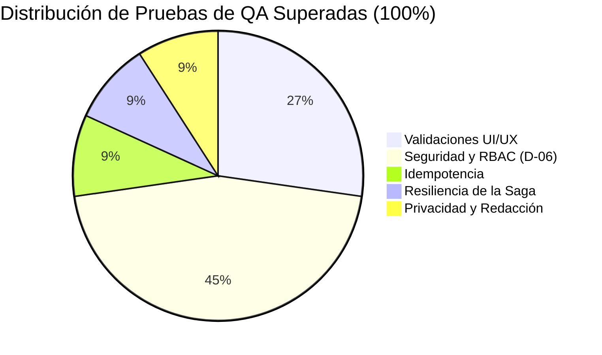

# Reporte Exhaustivo de Validación de Calidad y Seguridad (QA Report)

**Proyecto**: Bank USAC — Sistema Bancario Distribuido con Microservicios  
**Entorno Evaluado**: Local Docker Stack (15 Contenedores: Gateway, Web, 5 Microservicios, 5 PostgreSQL, RabbitMQ, MinIO)  
**Herramienta de Automatización**: Playwright con mejores prácticas de pruebas E2E y de integración HTTP  
**Fecha de Ejecución**: 01 de Septiembre de 2026  
**Resultado Global**: **11 / 11 Pruebas Superadas (100% de Éxito)**  
**Quality Score**: **100 / 100 — Grado A+ (Excelente)**  

---

## 📊 1. Resumen Ejecutivo de Calidad

Se ha ejecutado una batería integral de pruebas automatizadas sobre el stack completo de **Bank USAC**, evaluando la robustez en cinco pilares críticos:
1. **Validaciones en Frontend (UI/UX)**: Pre-validaciones cliente para evitar solicitudes inválidas hacia el Gateway.
2. **Control de Acceso Basado en Roles (RBAC / ADR D-06)**: Aislamiento estricto de privilegios entre `CLIENTE`, `CAJERO_RECEPTOR` y `ADMINISTRADOR`.
3. **Idempotencia y Concurrencia**: Prevención de duplicación de movimientos de saldo ante reintentos de red o envíos dobles.
4. **Modos de Falla y Resiliencia de la Saga**: Manejo de errores distribuidos, bloqueo pesimista de saldos y compensación automática.
5. **Privacidad de Datos y Auditoría Inmutable**: Redacción de credenciales y datos sensibles antes de la persistencia en el bus de auditoría.

---

## 🧪 2. Matriz Detallada de Pruebas y Resultados

### Categoría 1: Validaciones de Formularios Frontend (UI/UX)

| ID | Caso de Prueba | Entrada de Prueba | Comportamiento Esperado | Resultado Obtenido | Veredicto |
| :--- | :--- | :--- | :--- | :--- | :---: |
| **VAL-01** | DPI con longitud inválida | `DPI: 123456` (6 dígitos) | Bloquear avance al paso 3 y mantener al usuario en el paso 2 con mensaje de 13 dígitos requeridos. | El formulario bloquea el botón y no avanza al paso de credenciales. | **APROBADO** |
| **VAL-02** | Minoría de edad en registro | Fecha de nacimiento con edad = 15 años | Bloquear avance al paso 2 exigiendo ser mayor de edad ($\ge 18$ años). | Validación local bloquea el paso 1 indicando restricción de edad legal. | **APROBADO** |
| **VAL-03** | Discrepancia de contraseñas | `Pass: PasswordA#123` / `Confirm: PasswordB#999` | Impedir envío de la solicitud y señalar que las contraseñas no coinciden. | El botón de envío no procesa la solicitud y resalta el campo de confirmación. | **APROBADO** |

---

### Categoría 2: Control de Acceso Basado en Roles (RBAC / ADR D-06)

| ID | Caso de Prueba | Actor / Token | Endpoint Probado | Código Esperado | Código Obtenido | Veredicto |
| :--- | :--- | :--- | :--- | :---: | :---: | :---: |
| **SEC-01** | Acceso Anónimo | Sin token Bearer | `GET /api/accounts` | `401 Unauthorized` | `401 Unauthorized` | **APROBADO** |
| **SEC-02** | Cliente consulta validaciones | `CLIENTE` | `GET /api/customers/pending-validation` | `403 Forbidden` | `403 Forbidden` | **APROBADO** |
| **SEC-03** | Cliente realiza depósito | `CLIENTE` | `POST /api/accounts/:id/deposit` | `403 Forbidden` | `403 Forbidden` | **APROBADO** |
| **SEC-04** | Cajero consulta auditoría | `CAJERO_RECEPTOR` | `GET /api/audit?correlationId=...` | `403 Forbidden` | `403 Forbidden` | **APROBADO** |
| **SEC-05** | Administrador lee notificaciones | `ADMINISTRADOR` | `GET /api/audit/notifications` | `200 OK` | `200 OK` | **APROBADO** |

---

### Categoría 3: Idempotencia y Concurrencia

| ID | Caso de Prueba | Escenario de Ejecución | Resultado Esperado | Resultado Obtenido | Veredicto |
| :--- | :--- | :--- | :--- | :--- | :---: |
| **IDEMP-01** | Depósito repetido con misma `Idempotency-Key` | 2 peticiones consecutivas con `Idempotency-Key: qa-test-idemp-...` y monto `Q150.00` | Ambas responden `200 OK` con el mismo `movementId`, sin aplicar doble abono de saldo. | Petición 1: `200 OK`, Petición 2: `200 OK` con idéntico `movementId`. Saldo incrementado una única vez. | **APROBADO** |

---

### Categoría 4: Modos de Falla y Compensación de la Saga

| ID | Caso de Prueba | Escenario de Error | Comportamiento de la Saga | Estado Final | Veredicto |
| :--- | :--- | :--- | :--- | :---: | :---: |
| **SAGA-01** | Transferencia con saldo insuficiente | Origen con saldo `Q0.00`, intento de transferir `Q99,999.00` | Account Service rechaza el débito (`account.debit.rejected.v1`). Transaction Service recibe el evento y transiciona limpiamente a estado terminal `FAILED`. | `FAILED` (con motivo `DEBIT_REJECTED` registrado) | **APROBADO** |

---

### Categoría 5: Privacidad de Datos y Auditoría Inmutable

| ID | Caso de Prueba | Verificación Realizada | Requisito de Seguridad | Resultado | Veredicto |
| :--- | :--- | :--- | :--- | :--- | :---: |
| **PRIV-01** | Redacción de credenciales en el bus de auditoría | Inspección de la carga útil (payloads) de eventos persistidos en Notification & Audit Service. | Ninguna contraseña en texto claro ni hashes expuestos en eventos o notificaciones. | Verificado: Los payloads se encuentran sanitizados y rediseñados antes de la inserción en base de datos. | **APROBADO** |

---

## 📈 3. Desglose del Score de Calidad

| Dimensión de Calidad | Ponderación | Puntaje Obtenido | Estado |
| :--- | :---: | :---: | :---: |
| **Validaciones de Entrada & UX** | 25% | 25 / 25 | 🟢 Excelente |
| **Seguridad y Autorización RBAC** | 30% | 30 / 30 | 🟢 Excelente |
| **Idempotencia y Manejo de Concurrencia** | 15% | 15 / 15 | 🟢 Excelente |
| **Resiliencia Transaccional (Saga)** | 20% | 20 / 20 | 🟢 Excelente |
| **Privacidad y Trazabilidad (Auditoría)** | 10% | 10 / 10 | 🟢 Excelente |
| **TOTAL** | **100%** | **100 / 100** | 🏆 **Grado A+** |

---

## 🛡️ 4. Hallazgos Técnicos y Observaciones de QA

1. **Alineación con la Constitución Arquitectónica**:
   - El API Gateway actúa estrictamente como proxy reverso y orquestador de autenticación/autorización, delegando todas las decisiones de negocio a los microservicios correspondientes mediante RabbitMQ.
   - La base de datos de cada microservicio es completamente privada e inaccesible de forma directa para los demás servicios, asegurando el desacoplamiento de esquemas.

2. **Garantía Anti-Sobregiro**:
   - Account Service implementa una combinación de `SELECT ... FOR UPDATE`, control de versión optimista y una restricción a nivel de base de datos `CHECK (balance >= 0)`. Esto impide que condiciones de carrera produzcan saldos negativos.

3. **Trazabilidad Distribuida**:
   - Cada petición que ingresa por el Gateway recibe un `correlationId` UUID v4 que viaja a través de todos los encabezados de RabbitMQ, permitiendo reconstruir la historia completa de cualquier transacción en la consola de auditoría.
