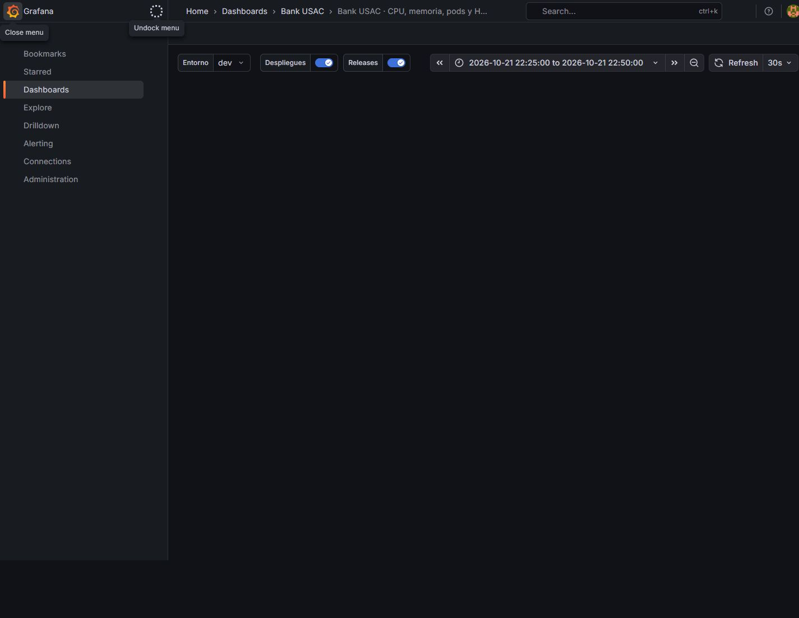

# T-60/T-61 — Evidencia cloud de Fase III

Fecha de sesión: **2026-10-21, America/Guatemala** (UTC del 22 de octubre en
los archivos). Rama documental `feature/T-61`, base `40660d5`. Lecturas de
producción; carga y fallos autorizados **solamente en dev**. No se modificó
código, charts, Terraform, reglas ni dashboards para producir resultados.

## Entorno y precondiciones

GKE `bank-usac-vpc-gke`, `us-central1-c`, tres nodos `e2-standard-2`, versión
`1.36.4-gke.1495003`; Dataplane V2 activo. Inventarios de
[prod](../load/2026-10-21-gke-prod-inventory.txt),
[dev](../load/2026-10-21-gke-dev-inventory.txt) y
[observabilidad](../load/2026-10-21-gke-observability-inventory.txt).
Prod tiene siete aplicaciones y mock BANK99 v1.3.6. Dev no tiene mock y su
`INTERBANK_PARTNER_BASE_URL` está vacía: **la prueba de caída del banco externo
en cloud dev queda pendiente de #167**, no se suplió atacando prod.

Se comprobaron diez URLs de base sin guardar credenciales:
[aislamiento](../load/2026-10-21-database-isolation.json). Los datos dev usan
`*_dev`; comparten las cinco VMs con producción. Gateway dev
`http://136.71.158.228:3000`; prod `http://34.69.101.197:3000`.
[Preflight](../load/2026-10-21-dev-preflight.json): ambos Ready, cliente de
prueba con MONETARIA Q2,500 y AHORRO Q800, simulación 0/0/0.

## Procedimiento reproducible

Se usó el script versionado `test/load/transfer.js`, sin modificarlo, con
**k6 v2.3.0**, rampa original 1→5→15→0 usuarios durante 80s. Cada transferencia
es Q1 desde MONETARIA a AHORRO del mismo titular, evitando comisión de débito
Ahorro. La aceptación y el seguimiento terminal se miden por separado.

```bash
k6 run -e GATEWAY_URL=http://136.71.158.228:3000 \
  --summary-export /tmp/baseline-summary.json test/load/transfer.js
```

Antes de cada escenario: comprobar contexto/namespace, salud de prod/dev,
bases y cuentas; obtener el GET de simulación con sesión administrativa dev.
No ejecutar si otra sesión usa ese entorno o cambió la configuración.
Durante las pruebas se tomó readiness de prod y `kubectl get hpa,pods -o wide`
de dev aproximadamente cada 15s. Una degradación del monitor habría abortado
la carga. Se esperaron 45s de drenaje antes de comparar saldos.

- **baseline:** simulación sin fallos.
- **provider:** PUT `/api/payments/simulation` dev con cuerpo completo
  `{"failureRatePercent":30,"timeoutRatePercent":10,"latencyMs":0}`;
  restauración en `finally` al cuerpo inicial 0/0/0, verificada a
  `2026-10-22T04:44:50.500Z`. Se restauraron los valores, pero quedó una fila
  de override `source=RUNTIME` con `updatedAt=2026-10-22T04:44:48.131Z`;
  el preflight usaba DEFAULTS/null. La [lectura final](../load/2026-10-22-final-readiness.json)
  confirma 0/0/0 y esa procedencia; no se borró la fila para aparentar una
  restauración del historial.
- **pod:** simulación 0/0/0; a los ~25s eliminar únicamente un pod Transaction
  de `dev`. Kubernetes repone la carga. No se eliminó Deployment, base, cola,
  PVC ni pod productivo.

La autenticación usó usuarios de demostración. La evidencia entregada no
contiene JWT utilizables, claves de API ni credenciales de infraestructura;
los tokens que exportó k6 se redactaron como se explica abajo. Los archivos
conservan identificadores y saldos **de prueba** para comprobar resultados.

## Resultados vistos desde k6

`transfer_saga_ms` comienza tras la aceptación y observa por polling: no es el
mismo reloj ni la misma muestra que el histograma interno. Duraciones en ms.

| Escenario | Iteraciones completas | HTTP | Aceptación p95 | Saga p50 | Saga p95 | Saga máx | Exit k6 |
| --- | ---: | ---: | ---: | ---: | ---: | ---: | ---: |
| baseline | 169 | 731 | 539.90 | 2996.0 | 5807.6 | 9011 | 99 |
| provider | 144 | 759 | 454.93 | 3121.5 | 10406.1 | 15991 | 99 |
| pod | 234 | 856 | 559.23 | 2469.0 | 4314.4 | 5152 | 0 |

Los tres tuvieron **0% de respuestas 5xx** según la definición de fallo SLO
del script. Baseline y provider terminaron **99** porque cruzaron el umbral
`p(95)<5000` de seguimiento; pod terminó 0. Los checks de 202 e ID pasaron.
La versión JSON de k6 expresa los umbrales cruzados con `true`; no leerlo como
“aprobado”. En provider hubo 145 solicitudes aceptadas y 144 iteraciones
completas: la salida y la base se conservan para no igualar contadores distintos.

| Dinero en centavos GTQ | Antes | Después baseline | Después provider | Después pod |
| --- | ---: | ---: | ---: | ---: |
| MONETARIA `02-000000008` | 250000 | 233100 | 218800 | 195400 |
| AHORRO `02-000000009` | 80000 | 96900 | 111200 | 134600 |
| **Suma** | **330000** | **330000** | **330000** | **330000** |

El conteo SQL posterior sobre `transaction_dev`, en transacción READ ONLY,
encontró baseline 169 COMPLETED, provider 143 COMPLETED/2 COMPENSATED y pod
234 COMPLETED al ampliar **10s el inicio** de la ventana para conservar
operaciones en la frontera. Un posible desfase de reloj es una inferencia,
no una causa confirmada por una medición de sincronización. La ventana exacta da 169, 141/2 y 233;
se conservan ambas en [conteos](../load/2026-10-21-transaction-counts.json).
No se ocultó esa diferencia de frontera ni se corrigieron filas a mano.

Datos originales: [baseline](../load/2026-10-21-baseline/k6-output.txt),
[provider](../load/2026-10-21-provider/k6-output.txt),
[pod](../load/2026-10-21-pod/k6-output.txt). Cada directorio incluye resumen,
estado antes/después, timeline y muestras de plataforma;
[resumen derivado](../load/2026-10-21-summary.json).

## Histograma de servidor, HPA y presupuestos

[Consultas y respuestas originales](../load/2026-10-21-window-metrics.json):
`histogram_quantile(p,sum by(le)(increase(bank_transfer_duration_seconds_bucket{environment="dev"}[Ns] @fin)))`.
N y fin corresponden al inicio→drenaje de cada timeline. Son cuantiles
interpolados de buckets, en **segundos**, distintos del polling k6.

| Escenario | p50 servidor | p95 servidor | p99 servidor |
| --- | ---: | ---: | ---: |
| baseline | 2.219 | 4.838 | 5.614 |
| provider | 2.259 | 9.440 | 39.903 |
| pod | 1.412 | 3.378 | 3.924 |

No convertir el p95 k6 de baseline en una afirmación de fallo del SLO interno:
son observaciones distintas. El p95 de servidor sí excede 5s en provider.
El p99 con pocos eventos y buckets amplios es aproximado, no una latencia
individual exacta. Las funciones `increase` extrapolan y pueden producir
conteos fraccionarios.

El histórico de plataforma observó HPA hasta **5 réplicas** en Gateway,
Account, Transaction y Notification & Audit; Customer, Payment y Web
permanecieron en 1. La captura muestra réplicas actuales/deseadas y CPU durante
la ventana; no se atribuyen todos los cambios del entorno compartido a un
único experimento. Account usa un lease PostgreSQL para su barrido.

La [instantánea Prometheus](../load/2026-10-21-prometheus-snapshot.json) observó
en prod disponibilidad Gateway 99.9951%, lecturas rápidas 99.8704%, comandos
rápidos ~100%, transferencias bajo 5s **38.2054%**, interbancarios enviados
aceptados **43.6082%** y recibidos 100%. Los dos presupuestos negativos
quedaron visibles. Es tráfico de una entrega académica con demostraciones y
fallos, no una estimación de producción comercial. Las reglas usan ventana
7d, pero el stack observado llevaba ~2d8h: esto **no prueba cobertura de siete
días completos**. Un panel `No data` tampoco equivale a éxito ni a cero.

### Redacción de sesiones en las salidas k6

Los resúmenes exportados por k6 incluían el JWT de sesión dev en
`setup_data.token`. Antes de entregar la evidencia se sustituyó ese campo por
`[REDACTED_SESSION_JWT]` en las tres corridas. Se comprobó igualdad del objeto
`metrics` y de `root_group` (checks) antes y después. Los umbrales, tiempos,
conteos y resultados se conservan; «salida original» describe esos datos de
ejecución, con la credencial redactada. No se versionan sesiones utilizables.

## Nueve dashboards reales

Capturas desde la sesión autenticada de Grafana GKE, sin guardar su contraseña.
Las vistas dev fijan 2026-10-22 04:25–04:50 UTC (21/oct 22:25–22:50 GT).
Las vistas prod conservan su ventana visible. No se alteraron paneles ni
anotaciones para fabricar evidencia.

| Vista | Captura | Lectura |
| --- | --- | --- |
| Banco pareja | [01](../../images/fase3/observability/01-banco-pareja-prod.jpg) | Sin tráfico reciente: varios No data; presupuesto histórico separado. |
| Consumer lag | [02](../../images/fase3/observability/02-consumer-lag-dev.jpg) | Pendientes/unacked y throughput reales de la ventana dev. |
| CPU/memoria/pods/HPA | [03](../../images/fase3/observability/03-plataforma-hpa-dev.jpg) | Escalado y reposición bajo la carga. |
| Errores | [04](../../images/fase3/observability/04-errores-dev.jpg) | 5xx/DLQ e incidentes/anomalías, no sólo “todo verde”. |
| Estado | [05](../../images/fase3/observability/05-estado-prod.jpg) | No data reciente en algunas razones de SLI. |
| Trazas | [06](../../images/fase3/observability/06-flujo-trazas-prod.jpg) | Consultas TraceQL del stack. |
| Logs | [07](../../images/fase3/observability/07-logs-prod.jpg) | Logs del stack y vínculo de traza. |
| SLI | [08](../../images/fase3/observability/08-metricas-sli-dev.jpg) | Latencias y tasas observadas en dev. |
| SLO/error budget | [09](../../images/fase3/observability/09-slo-error-budget-prod.jpg) | Presupuestos negativos conservados. |



## Trazabilidad y fallos

La auditoría productiva muestra el rastro compensado
`b5334b14-fd87-4f64-a209-d1720436e891`: diez eventos, cuatro servicios y 38s,
con intentos fallidos, `payment.failed`, devolución Account y
`transaction.compensated`. Es una operación **preexistente**, consultada sin
mover dinero: [captura](../../images/fase3/manual/08-auditoria-detalle-traza.jpg).
La comprobación posterior en Grafana **sí encontró la traza Tempo**
`97bff970a9e803898725a7722ad35608`, para la transacción
`7b291027-57c8-4a7f-b3c9-5215e55e3902`, con el mismo correlationId:

- Inicio HTTP: 21/oct/2026 00:57:20.496 GT; Gateway devolvió 202.
- El span `transfer` duró 38.49 s. El conjunto visible de la traza duró
  2 min 22 s e incluyó seis servicios y 3,007 spans con polling; ese total
  **no es la duración de la Saga**.
- `saga.compensation` ordered aparece a los 38.46 s con PAYMENT_FAILED,
  PAYMENT_RETRIES_EXHAUSTED y PAYMENT_PENDING. Completed conserva
  DEBIT_COMPENSATED, COMPENSATED y fase FAILED. Versión v1.3.6.
- La acción **Logs for this span** abrió Loki con
  `{service_name="transaction-service"} | traceId="97bff970a9e803898725a7722ad35608"`.
  Se observaron 23 líneas en la ventana 00:52:58–01:02:58 GT, incluidas
  `transfer finished`, duración 38,488 ms y estado COMPENSATED.
- Al abrir una línea aparecieron el campo derivado TraceID y los enlaces
  **Ver la traza** / **Ver el flujo completo**. Se pulsó Ver la traza con el
  panel Tempo ya abierto: no se atribuye una consulta nueva independiente
  a un cambio de pantalla que no se observó.

[Tempo y spans](../../images/fase3/observability/10-compensacion-tempo.jpg),
[traza a logs](../../images/fase3/observability/11-traza-a-logs.jpg) y
[detalle y enlaces derivados](../../images/fase3/observability/12-log-a-traza.jpg).
La lectura no creó transferencias ni modificó los datos productivos.

La [gráfica de plataforma](../../images/fase3/observability/13-marcas-despliegue-plataforma.jpg)
se abrió en prod con ventana 21/oct 00:00–08:00 UTC (20/oct 18:00–21/oct
02:00 GT), con Despliegues/Releases habilitados. Se ven marcas verticales;
no se obtuvo el detalle del tooltip que vincule cada marca a un commit o
versión. Por ello no se declara completada la correlación precisa
deploy→incidente. No se crearon anotaciones para producir la captura.

Postmortems nuevos: [baseline](../../sre/postmortems/2026-10-21-cloud-baseline-latency.md),
[proveedor](../../sre/postmortems/2026-10-21-cloud-provider.md),
[pod](../../sre/postmortems/2026-10-21-cloud-pod.md).
El [RabbitMQ real de octubre](../../sre/postmortems/2026-10-19-rabbitmq-persistence-cookie.md)
está reconstruido parcialmente de commits: no se inventan tiempos ni capturas
del incidente. Los cuatro postmortems del 15/oct son de kind y se mantienen
como evidencia histórica, con procedencia explícita.

## Pendientes que esta evidencia no cierra

- Banco participante cloud dev (mock y configuración faltantes, #167).
- Verificar una apertura independiente log→Tempo y el detalle de la anotación
  de deploy (commit/versión) en la investigación. La traza compensada y el
  salto Tempo→Loki sí quedaron observados arriba.
- TLS público, NetworkPolicies aplicadas y drift RabbitMQ.
- Siete días completos de cobertura y alertas con sus tiempos reales de
  firing/resolved; no se deducen de la configuración ni de un screenshot.
- Semántica de vencimiento en el crédito Account y el generador de catálogo.

No se cerraron #167/#168 ni se cambió su tablero desde esta sesión.
