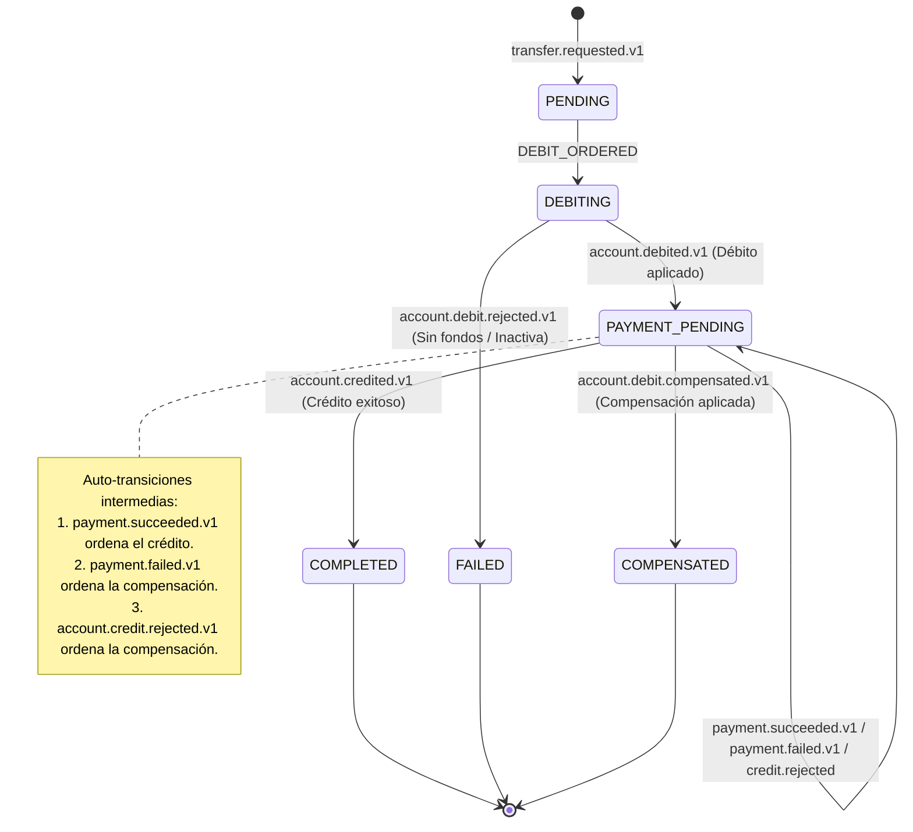

# Patrón Saga — Orquestación de Transferencias y Compensación Contable

Este documento describe la arquitectura, máquina de estados y comportamiento de fallo del patrón **Saga Coreografiada** implementado en Bank USAC para garantizar la consistencia eventual entre microservicios sin bloqueos distribuidos de dos fases (2PC).

---

## 1. Los Siete Pasos de la Coreografía

El flujo completo involucra la coordinación asíncrona de cuatro microservicios (`Transaction`, `Account`, `Payment` y `Notification & Audit`):

| Paso | Microservicio | Reacciona a | Acción de Negocio | Publica en RabbitMQ | Estado Transacción |
|---|---|---|---|---|---|
| **1** | **Transaction Service** | `transfer.requested.v1` | Valida monto > 0, cuentas distintas e idempotencia. Crea la transacción en base de datos. | `account.debit.requested.v1` | `PENDING` $\rightarrow$ `DEBITING` |
| **2** | **Account Service** | `account.debit.requested.v1` | Bloquea la cuenta origen (`SELECT ... FOR UPDATE`), verifica que esté `ACTIVE` y con fondos suficientes. Aplica el débito contable y actualiza `lastActivityAt`. | `account.debited.v1` \| `account.debit.rejected.v1` | — |
| **3** | **Transaction Service** | `account.debited.v1` | Registra el débito exitoso y solicita el cobro/pago. | `payment.requested.v1` | `PAYMENT_PENDING` |
| **4** | **Payment Service** | `payment.requested.v1` | Procesa el cobro ante el facturador externo, gestionando reintentos con backoff exponencial. | `payment.succeeded.v1` \| `payment.failed.v1` | — |
| **5** | **Transaction Service** | `payment.succeeded.v1` | Confirma el cobro y ordena la acreditación a la cuenta destino. | `account.credit.requested.v1` | `PAYMENT_PENDING` (sin cambio) |
| **6** | **Account Service** | `account.credit.requested.v1` | Acredita los fondos a la cuenta destino. Si la cuenta estaba `INACTIVE`, la reactiva automáticamente (A-3). | `account.credited.v1` \| `account.credit.rejected.v1` | — |
| **7** | **Transaction Service** | `account.credited.v1` | Finaliza exitosamente el ciclo de vida de la transacción. | `transaction.completed.v1` | `COMPLETED` |

---

## 2. Máquina de Estados Finita (Seis Estados Exactos)

La máquina de estados consta de **seis estados canónicos cerrados** protegidos por constraint `CHECK` en base de datos:

### Tabla Completa de Transiciones Válidas (`applyEvent`)

| Estado Inicial | Evento que Ingresa | Condición Válida | Comando u Orden que Emite | Estado Destino |
|---|---|---|---|---|
| — | `transfer.requested.v1` | Cumple T-1 a T-4 | `transaction.initiated.v1` | `PENDING` |
| `PENDING` | `DEBIT_ORDERED` | Inmediato en la misma transacción | `account.debit.requested.v1` | `DEBITING` |
| `DEBITING` | `account.debited.v1` | Siempre | `payment.requested.v1` | `PAYMENT_PENDING` |
| `DEBITING` | `account.debit.rejected.v1`| Siempre | `transaction.failed.v1` | **`FAILED`** |
| `PAYMENT_PENDING`| `payment.succeeded.v1` | Sin causa de fallo previa | `account.credit.requested.v1` | `PAYMENT_PENDING` |
| `PAYMENT_PENDING`| `payment.failed.v1` | Sin causa previa | Registra causa, `account.debit.compensation.requested.v1` | `PAYMENT_PENDING` |
| `PAYMENT_PENDING`| `account.credit.rejected.v1`| Sin causa previa | Registra causa, `account.debit.compensation.requested.v1` | `PAYMENT_PENDING` |
| `PAYMENT_PENDING`| `account.credited.v1` | Sin causa de fallo previa | `transaction.completed.v1` | **`COMPLETED`** |
| `PAYMENT_PENDING`| `account.debit.compensated.v1`| Causa de fallo registrada | `transaction.compensated.v1` | **`COMPENSATED`** |

*Cualquier transición no listada en esta tabla es considerada ilegal, se descarta sin modificar el estado y se audita como `ILLEGAL_TRANSITION` (T-6).*

---

## 3. Los Dos Desenlaces de Fallo: `FAILED` vs `COMPENSATED`

En Bank USAC, `FAILED` y `COMPENSATED` representan realidades operativas y financieras totalmente distintas:

### A. `FAILED` — El dinero nunca salió
* Ocurre únicamente en el **Paso 2**.
* Si la cuenta de origen no tiene fondos suficientes (`INSUFFICIENT_FUNDS`) o está inactiva (`ACCOUNT_INACTIVE`), `Account Service` emite `account.debit.rejected.v1`.
* Como el saldo de la cuenta origen jamás fue tocado, **no se ejecuta compensación** (no hay nada que deshacer).
* La transacción transiciona de `DEBITING` $\rightarrow$ `FAILED`.

### B. `COMPENSATED` — El dinero salió y fue devuelto formalmente
* Ocurre tras un débito exitoso cuando el cobro falla definitivamente (`payment.failed.v1`) o la cuenta destino es rechazada (`account.credit.rejected.v1`).
* **Flujo de Compensación**:
  1. `Transaction Service` registra la causa en `failureReason` y publica `account.debit.compensation.requested.v1`. La transacción permanece temporalmente en `PAYMENT_PENDING`.
  2. `Account Service` toma el comando, inserta un movimiento contable formal `COMPENSATION` en su libro mayor `account_operations` y restituye el saldo exacto en centavos a la cuenta de origen. Emite `account.debit.compensated.v1`.
  3. `Transaction Service` transiciona a `COMPENSATED` y emite `transaction.compensated.v1`.

> **Garantía Invariante T-7**: Toda transacción que haya superado el estado `DEBITING` con el débito aplicado finalizará estrictamente en `COMPLETED` o en `COMPENSATED`, **jamás en `FAILED`**.
