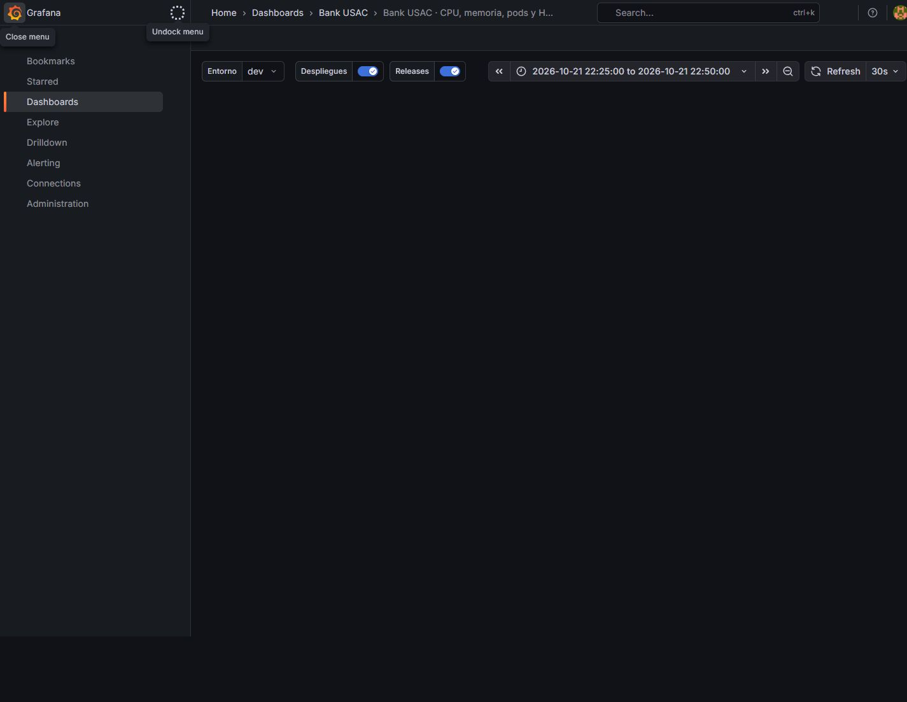

# Cloud dev — Fallos y expiraciones del proveedor simulado

**Fecha:** 21/oct/2026 GT; timestamps UTC del 22/oct. **Tipo:** experimento
autorizado de entrega académica, entorno dev GKE. Producción observada en
lectura. **Responsable de seguimiento:** Marcos Bonifasi / #167.

## Impacto observado

k6 p95 10406.1ms; servidor p95 9.440s. Dos compensaciones y 143 completadas en la ventana ampliada. Suma de saldos inalterada.

Todas las muestras del monitor productivo dieron Ready; es una muestra
periódica, no prueba de disponibilidad continua. No hubo compensaciones SQL
manuales ni truncados. El total de las cuentas de prueba se mantuvo en
330000 centavos GTQ antes/después.

## Línea temporal

| UTC | Acción observada |
| --- | --- |
| 2026-10-22T04:42:37.351Z | start |
| 2026-10-22T04:44:04.501Z | load-finished |
| 2026-10-22T04:44:49.512Z | after-drain |
| 2026-10-22T04:44:50.500Z | simulation-restored |
| 2026-10-22T04:44:50.500Z | finish |

## Causa y recuperación

Inyección dev explícita 30% FAILURE/10% TIMEOUT; la escalera persistida 1/5/30s añade latencia mientras recupera pagos.

Se esperaron 45s para drenar; la simulación de proveedor fue restaurada a
0/0/0 en el finally de su escenario. Kubernetes administra réplicas y
reposición; no se dejó un HPA deshabilitado ni un manifiesto modificado.

## Evidencia y límites

[Salida k6](../../qa/load/2026-10-21-provider/k6-output.txt),
[timeline](../../qa/load/2026-10-21-provider/timeline.json),
[estado monetario](../../qa/load/2026-10-21-provider/state.json),
[muestras plataforma](../../qa/load/2026-10-21-provider/platform-samples.json),
[cuantiles del servidor](../../qa/load/2026-10-21-window-metrics.json) y
[informe cloud](../../qa/backend/T-60-cloud-evidence.md).

Los conteos SQL usan además una ventana con 10s de margen al inicio y guardan
el conteo exacto sin margen. No son una prueba de Chaos Engineering de todas
las dependencias. No se observaron aquí tiempos firing/resolved de una alerta;
no se inventa una duración de indisponibilidad ni consumo exacto del budget.

## Acciones

Decisión pendiente TD-094 sobre SLO y reintentos; no cambiar ni ocultar el objetivo en una actualización documental.
