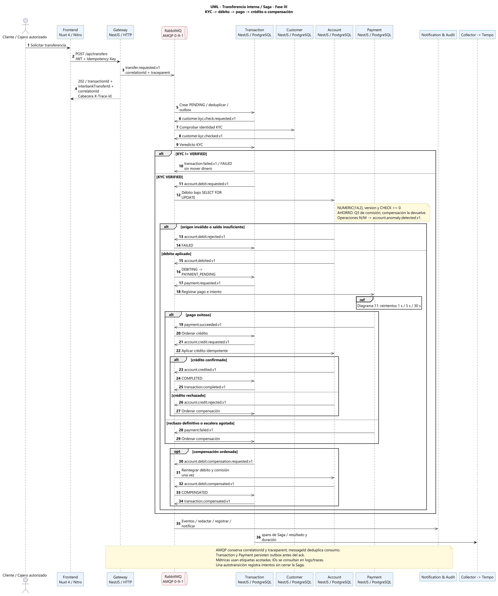

# Diagrama de Secuencia UML — Transferencia Monetaria con Saga

Este documento describe la secuencia de eventos, comandos y compensaciones del patrón **Saga Coreografiada** para transferencias monetarias en Bank USAC.

---

## 1. Diagrama de Secuencia



Fuentes de diagramación versionadas (ADR-013):
* [PlantUML (`.puml`)](../architecture/diagrams/07-uml-secuencia-transferencia.puml)
* [Mermaid (`.mmd`)](../architecture/diagrams/07-uml-secuencia-transferencia.mmd)

---

## 2. Los Tres Caminos de la Saga

La Saga se ejecuta a través de RabbitMQ mediante intercambio de comandos y eventos entre `Transaction Service`, `Account Service` y `Payment Service`:

```
[Gateway] ── POST /transfers ──> [Transaction Service]
                                      │ (Inicia Saga: PENDING)
                                      ▼
                                 [RabbitMQ]
                                      │
              ┌───────────────────────┼───────────────────────┐
              ▼                       ▼                       ▼
      [Account Service]      [Payment Service]    [Notification & Audit]
     (Débito / Crédito)      (Cobro / Reintentos)   (Auditoría inmutable)
```

### Camino 1: Transferencia Exitosa (Happy Path)
1. **Inicio**: El cliente ordena transferir fondos. El Gateway responde `202 Accepted` de inmediato.
2. **Débito**: `Transaction Service` publica comando de débito. `Account Service` bloquea la cuenta origen (`SELECT ... FOR UPDATE`), verifica fondos suficientes y aplica el débito (`status = DEBITING`).
3. **Pago/Validación**: `Payment Service` evalúa el pago (aprobado).
4. **Crédito**: `Account Service` acredita la cuenta destino.
5. **Cierre**: `Transaction Service` transiciona a `COMPLETED`.

### Camino 2: Fallo Inmediato y Compensación Contable
1. Si la cuenta no tiene fondos o el pago es rechazado permanentemente en el primer intento:
2. `Account Service` emite rechazo o `Payment Service` emite `payment.failed`.
3. `Transaction Service` ordena la **compensación contable** (`COMPENSATION`).
4. `Account Service` devuelve el dinero exacto a la cuenta origen.
5. `Transaction Service` transiciona a `COMPENSATED`. El dinero vuelve a su estado original demostrado como hecho contable.

### Camino 3: Escalera de Reintentos Agotada
1. Ante un error transitorio de red, `Payment Service` reintenta con backoff exponencial programado en base de datos.
2. Al agotarse los reintentos máximos, emite `payment.attempt.failed.v1` terminal y `payment.failed.v1`.
3. Se dispara la compensación contable en `Account Service` y la transacción culmina en `COMPENSATED`.
