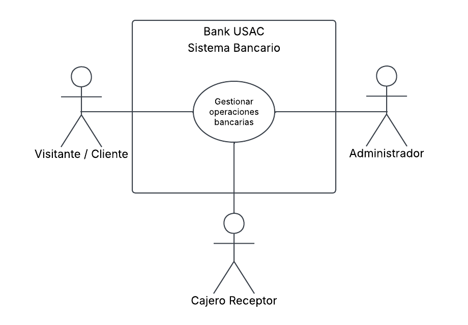
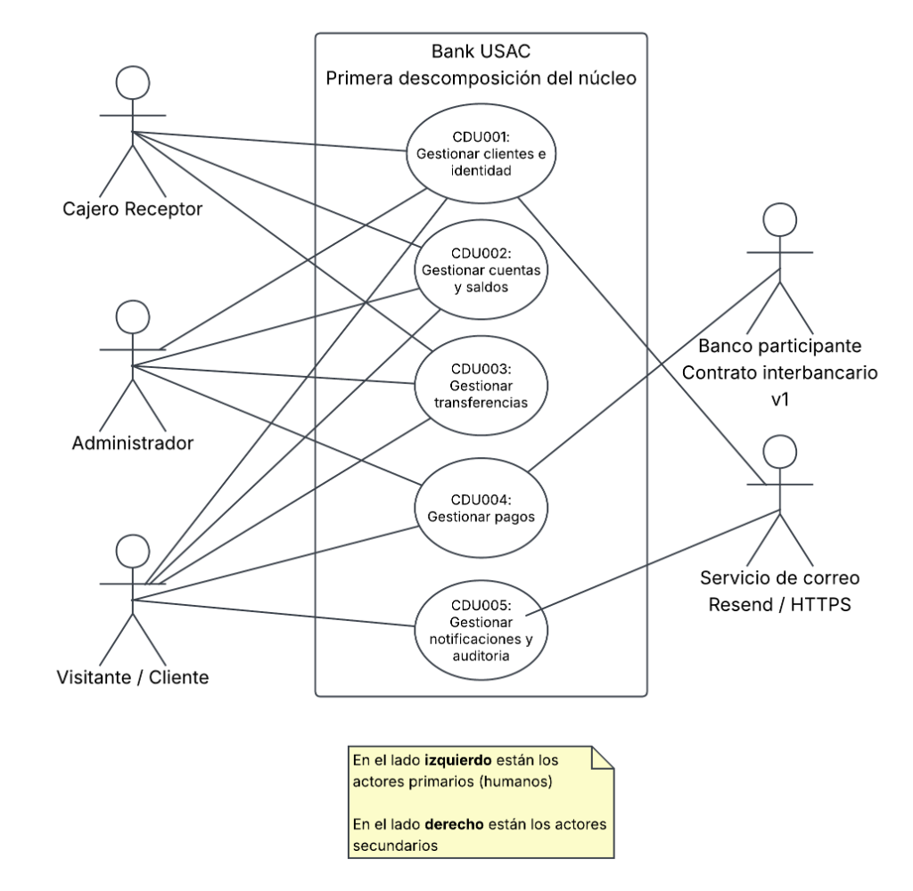
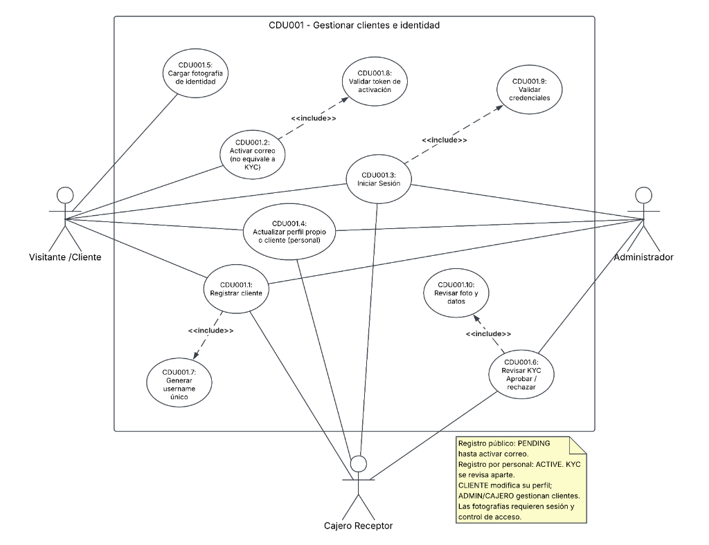
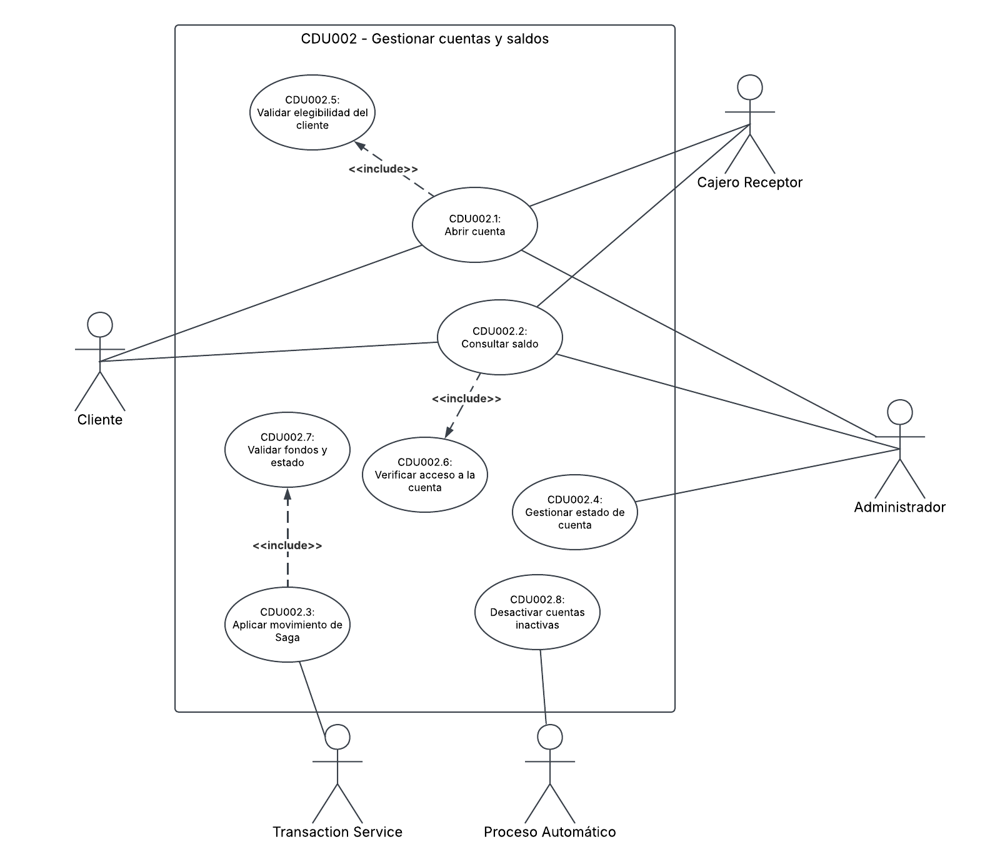
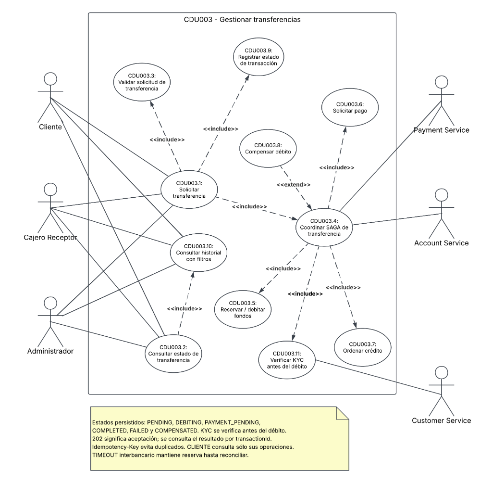
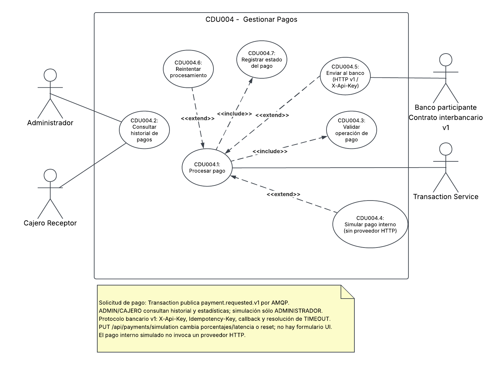
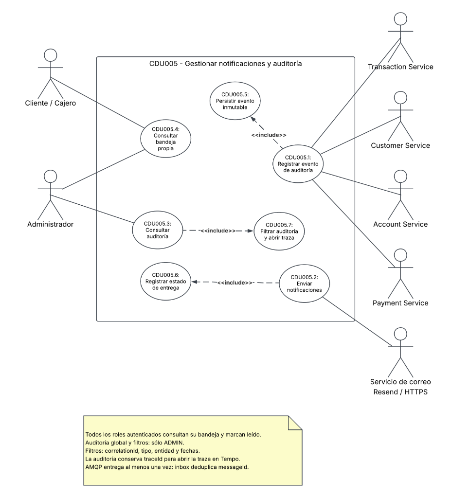

# Diagramas de Casos de Uso (UML) — Jerarquía Completa

Este documento consolida la jerarquía de Casos de Uso de **Bank USAC**, desde el nivel de negocio hasta el detalle por microservicio, cumpliendo con los estándares de la OMG y la descomposición solicitada.

---

## 1. Nivel Macro: Alto Nivel del Sistema (`CDU000`)

Muestra a Bank USAC como una caja negra en el nivel de negocio. A la izquierda se encuentran los actores primarios (humanos) y a la derecha los actores secundarios (sistemas externos de apoyo).

Fuentes: [PlantUML (`00-alto-nivel.puml`)](../architecture/diagrams/cdu/00-alto-nivel.puml) · [Mermaid (`00-alto-nivel.mmd`)](../architecture/diagrams/cdu/00-alto-nivel.mmd)

---

## 2. Primera Descomposición Funcional (`CDU001` - `CDU005`)

Descompone el núcleo del banco en sus cinco funciones principales, correspondientes a cada microservicio de dominio:

Fuentes: [PlantUML (`01-primera-descomposicion.puml`)](../architecture/diagrams/cdu/01-primera-descomposicion.puml) · [Mermaid (`01-primera-descomposicion.mmd`)](../architecture/diagrams/cdu/01-primera-descomposicion.mmd)

---

## 3. Detalle de Casos de Uso por Microservicio

Cada microservicio constituye un límite autónomo de sistema (*System Boundary*):

### A. Customer Service (`CDU001 - Gestionar clientes e identidad`)
* Registro de usuario, carga de DPI, activación por correo, inicio de sesión y validación de identidad por el cajero/admin.
* Diagrama: 
* Fuentes: [PlantUML](../architecture/diagrams/cdu/customer/customer-casos-de-uso.puml) · [Mermaid](../architecture/diagrams/cdu/customer/customer-casos-de-uso.mmd)

### B. Account Service (`CDU002 - Gestionar cuentas y saldos`)
* Apertura de cuentas, consulta de saldos, movimientos de Saga, depósito en ventanilla y desactivación automática.
* Diagrama: 
* Fuentes: [PlantUML](../architecture/diagrams/cdu/account/account-casos-de-uso.puml) · [Mermaid](../architecture/diagrams/cdu/account/account-casos-de-uso.mmd)

### C. Transaction Service (`CDU003 - Gestionar transferencias`)
* Transferencias de fondos, consulta de estado, coordinación de la Saga coreografiada, validaciones de fondos, solicitud de pago y compensación contable.
* Diagrama: 
* Fuentes: [PlantUML](../architecture/diagrams/cdu/transaction/transaction-casos-de-uso.puml) · [Mermaid](../architecture/diagrams/cdu/transaction/transaction-casos-de-uso.mmd)

### D. Payment Service (`CDU004 - Gestionar pagos`)
* Procesamiento de pagos internos y externos, reintentos con backoff exponencial y registro de estados de cobro.
* Diagrama: 
* Fuentes: [PlantUML](../architecture/diagrams/cdu/payment/payment-casos-de-uso.puml) · [Mermaid](../architecture/diagrams/cdu/payment/payment-casos-de-uso.mmd)

### E. Notification & Audit Service (`CDU005 - Gestionar notificaciones y auditoría`)
* Registro inmutable de auditoría con datos personales redactados, consulta de auditoría filtrada por `correlationId` y despacho de notificaciones al buzón personal.
* Diagrama: 
* Fuentes: [PlantUML](../architecture/diagrams/cdu/notification-audit/notification-audit-casos-de-uso.puml) · [Mermaid](../architecture/diagrams/cdu/notification-audit/notification-audit-casos-de-uso.mmd)
