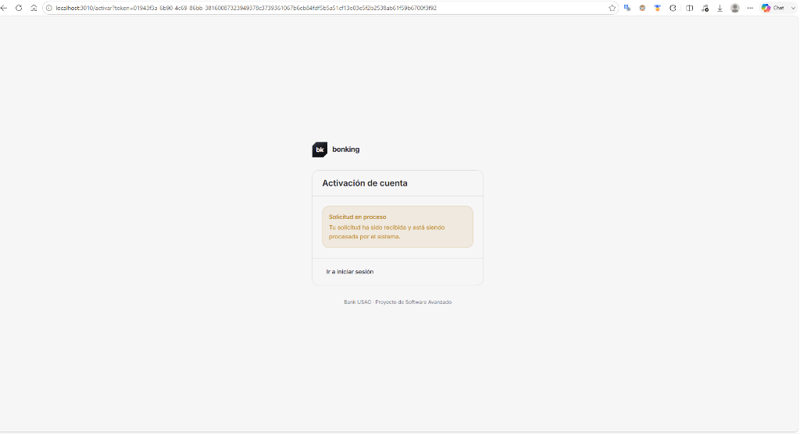

# Manual de Usuario — Bank USAC

Bienvenido al manual de usuario de **Bank USAC**. Esta guía detalla la operación de la plataforma bancaria web para cada uno de los tres roles del sistema: **Cliente**, **Cajero Receptor** y **Administrador**.

---

## 1. Acceso y Navegación General

* **URL de Acceso Local**: `http://localhost:3010/`
* **Punto de Entrada API Gateway**: `http://localhost:3000/`
* **Credenciales Demo Rápidas**:
  * **Cliente Principal (Marco Tulio López)**: `2895884051401@ingenieria.usac.edu.gt` / `BankUsac#2026`
  * **Cliente Tercero (Clara Cliente)**: `cliente@bankusac.gt` / `BankUsac#2026`
  * **Cajero Receptor**: `cajero@bankusac.gt` / `BankUsac#2026`
  * **Administrador**: `admin@bankusac.gt` / `BankUsac#2026`

---

## 2. Rol: Cliente (`CLIENTE`)

El cliente opera desde la comodidad de su dispositivo personal para gestionar sus finanzas.

### A. Registro y Activación
1. En la página de inicio, haga clic en **"Registrarse"** (`/registro`).
2. Ingrese sus datos personales: Nombre completo, DPI (13 dígitos), Fecha de nacimiento, Dirección y Correo electrónico.
3. Cargue la fotografía clara de su documento de identificación (DPI).
4. El sistema enviará un correo de confirmación. Abra el enlace de activación para activar su cuenta.

### B. Consulta de Cuentas y Saldos
* Desde el **Inicio**, visualice sus cuentas monetarias y de ahorro activas con sus saldos actualizados en Quetzales.
* Haga clic en una cuenta para ver el historial detallado de movimientos contables (`/cuentas/[id]`).

### C. Transferencias entre Cuentas
1. Ingrese a **Transferencias** (`/transferencias`).
2. Seleccione su cuenta de origen y especifique la cuenta de destino (propia o de terceros).
3. Ingrese el monto en Quetzales y confirme la operación.
4. El sistema procesa la transferencia en tiempo real con confirmación visual de la Saga y comprobante descargable.

### D. Pago de Servicios
1. Diríjase a **Pagos** (`/pagos`).
2. Seleccione el facturador (por ejemplo, Agua, Electricidad, Telefonía).
3. Ingrese el número de referencia de la factura y seleccione la cuenta a debitar.
4. Confirme el pago para obtener su comprobante digital.

### E. Buzón de Notificaciones
* Acceda al icono de campana en la barra superior (`/notificaciones`) para consultar alertas de débitos, créditos y avisos de seguridad, con opción de marcarlas como leídas.

---

## 3. Rol: Cajero Receptor (`CAJERO_RECEPTOR`)

El cajero receptor atiende al público en las agencias bancarias y realiza operaciones presenciales.

### A. Mesa de Control de Identidad (Validaciones)
1. Ingrese a **Validaciones** (`/clientes/validaciones`).
2. Revise la lista de clientes con documentos DPI pendientes de validación.
3. Inspeccione la fotografía subida y coteje los datos ingresados contra la imagen.
4. Haga clic en **Aprobar** para habilitar al cliente para aperturar cuentas, o **Rechazar** indicando el motivo.

### B. Apertura de Cuentas Bancarias
1. Una vez validada la identidad del cliente, ingrese a **Cuentas → Abrir Cuenta** (`/cuentas/nueva`).
2. Ingrese el identificador o DPI del cliente verificado.
3. Seleccione el tipo de cuenta: **Monetaria** o **Ahorro**.
4. Confirme la apertura. La cuenta nace activa con saldo inicial de `Q 0.00`.

### C. Depósito en Efectivo por Ventanilla
1. Ingrese a **Cuentas → Depósito** (`/cuentas/deposito`).
2. Ingrese el número de cuenta de destino del cliente.
3. Ingrese el monto en efectivo recibido en ventanilla.
4. Haga clic en **Registrar Depósito**. El sistema acredita el saldo de inmediato (`200 OK`) y emite el comprobante de depósito.
5. *Nota:* Si la cuenta del cliente se encontraba inactiva por falta de uso, el depósito la reactiva automáticamente.

---

## 4. Rol: Administrador (`ADMINISTRADOR`)

El administrador supervisa la seguridad, auditoría e infraestructura del banco.

### A. Auditoría Transversal del Sistema
1. Ingrese a **Auditoría** (`/auditoria`).
2. Filtre los eventos del sistema por código de trazabilidad (`correlationId`), rango de fechas, microservicio emisor o tipo de mensaje.
3. Inspeccione los payloads redactados para verificar el cumplimiento normativo sin exponer contraseñas ni datos confidenciales.

### B. Gestión y Estado de Cuentas
1. Ingrese a **Cuentas → Administración** (`/cuentas/administracion`).
2. Permite activar o desactivar manualmente cuentas bancarias ante bloqueos judiciales o solicitudes del titular.

### C. Monitor de la Saga y Flujos Distribuidos
* Inspeccione transferencias en curso, tiempos de respuesta de los microservicios y transiciones de la máquina de estados.

---

## 5. Guía Visual Paso a Paso (Flujo Práctico / Happy Path)

Esta sección documenta el uso del sistema a través de un ejemplo práctico, continuo y real, estructurado en **tres módulos complementarios** que corresponden a los tres roles del sistema: **Portal del Cliente**, **Portal del Cajero Receptor** y **Portal del Administrador**.

Todas las operaciones a lo largo de los tres módulos se ejecutan sobre el **mismo caso de negocio transversal**, permitiendo observar la interacción completa de la arquitectura orientada a eventos:

### Datos Maestros del Ejemplo Unificado
* **Cliente Principal (Auto-registro Web y Operaciones en Ventanilla)**:
  * **Nombre**: `Enner Esai Mendizabal Castro`
  * **Documento de Identificación (DPI)**: `1212121212121`
  * **Fecha de nacimiento**: `01/06/2005` (Edad: 21 años)
  * **Dirección declarada**: `chayanne`
  * **Correo electrónico**: `enneresamen@gmail.com`
  * **Usuario asignado**: `emendizabal`
  * **Contraseña inicial**: `ennero123` (actualizada a nueva clave en Paso 17)
  * **Datos Actualizados desde Mi Perfil (Paso 15)**: Nombre para mostrar: `Ennercito`, Dirección: `mi casa`, Fecha de nacimiento: `04/11/2003`
  * **Identificador de Cliente (`customerId`)**: `b165d73d-a709-4dd4-9620-688ea75219a3`
  * **Cuenta Monetaria Aperturada y Fondeada**: `e80bd8e9-930a-4f5a-9f34-229cc6d6e822`
  * **Saldo Inicial Fondeado en Ventanilla**: `Q 1,500.00`
  * **Transferencia Recibida (de Clara Cliente)**: `+ Q 400.00` (Saldo acumulado: `Q 1,900.00`, Transferencia ID: `2cc63338-833f-4871-b47f-d297e268de91`)
  * **Pago de Servicio Claro Realizado**: `- Q 500.00` (Saldo disponible resultante: `Q 1,400.00`, Transacción ID: `b0089530-7bd6-471b-9745-d1c0e65bde85`, Pago ID: `194f659d-55a1-4b40-afcc-a02c80a90572`)
  * **Código de Seguimiento Inicial (`correlationId`)**: `975be732-5808-47c6-8394-c6e39502255a`
* **Cliente Secundario (Enrolamiento Directo en Ventanilla)**:
  * **Nombre**: `luisito comunica`
  * **Documento de Identificación (DPI)**: `3223322332323`
  * **Correo electrónico**: `deennerparaprobar@gmail.com`
  * **Usuario asignado**: `lcomunica` / `luisitocomunica`
  * **Identificador de Cliente (`customerId`)**: `3809b1a4-0deb-4da3-8a12-e1bd8cfab72d`

---

### 5.1 Módulo 1: Portal del Cliente (`CLIENTE`)

Este módulo contempla las acciones ejecutadas por el cliente desde el portal web de autoservicio: solicitud de registro, envío de documentación y validaciones de seguridad de acceso.

#### Paso 1: Pantalla de Inicio de Sesión (`/login`)

Al acceder a la plataforma web de **Bank USAC** (`http://localhost:3010/login`), el usuario es recibido por el formulario de autenticación.

##### Elementos y Acciones Disponibles:
1. **Campos de Credenciales**:
   * **Correo**: Campo de texto para ingresar la dirección registrada.
   * **Contraseña**: Campo enmascarado para la clave de acceso.
2. **Botón Principal**:
   * **"Entrar"**: Envía la solicitud de autenticación al API Gateway.
3. **Enlaces de Navegación**:
   * **"Crear cuenta"**: Redirige al asistente de registro de clientes nuevos (`/registro`).
   * **"¿Olvidaste tu contraseña?"**: Redirige al flujo de recuperación de credenciales mediante correo electrónico (`/restablecer`).

---

#### Paso 2: Intento de Acceso con Cuenta Pendiente de Activación

Si un cliente intenta iniciar sesión antes de haber completado la verificación de su identidad o sin haber abierto el enlace de activación enviado a su correo, el sistema bloquea el acceso de forma preventiva.

##### Valores del Ejemplo:
* **Correo**: `enneresamen@gmail.com`
* **Contraseña**: `ennero123`

##### Comportamiento y Elementos Observados:
1. **Alerta de Estado**:
   * **Mensaje**: *"No pudimos iniciar sesión. No recibimos confirmación en el tiempo esperado. La operación NO fue cancelada: consulta su resultado con el código de seguimiento."*
   * **Indicación preventiva**: *"Si te acabas de registrar, recuerda que primero debes activar tu cuenta abriendo el enlace que enviamos a tu correo electrónico."*
2. **Código de Seguimiento (Trazabilidad)**:
   * El sistema genera un identificador único (`4c1f8cc1-7c8a-416b-bf39-fa43096cf073`) con opción para copiar al portapapeles, permitiendo rastrear la solicitud en la bitácora distribuida sin exponer credenciales.

---

#### Paso 3: Asistente de Registro — Paso 1: Datos Personales (`/registro`)

Al hacer clic en **"Crear cuenta"**, se abre el asistente guiado de registro. El primer paso recopila la información personal del solicitante.

##### Valores del Ejemplo:
* **Nombre completo**: `Enner Esai Mendizabal Castro`
* **Fecha de nacimiento**: `01/06/2005`
* **Dirección**: `chayanne`
* **Correo electrónico**: `enneresamen@gmail.com`

##### Funcionalidades y Validaciones:
1. **Barra de Progreso (Stepper)**: Indica la fase actual: *Datos personales* (activa), *Documento* y *Confirmación*.
2. **Cálculo Automático de Edad**: Al ingresar la fecha de nacimiento, el sistema calcula de inmediato la edad en tiempo real (`Edad: 21 años`) verificando que el solicitante sea mayor de edad (mínimo 18 años).
3. **Botón "Continuar"**: Valida los formatos requeridos antes de avanzar.
4. **Enlace inferior**: Permite regresar al inicio de sesión si el usuario ya posee cuenta.

---

#### Paso 4: Asistente de Registro — Paso 2: Documento de Identidad y Foto (`/registro`)

En la segunda fase del registro, el cliente ingresa su número de identificación oficial y adjunta una imagen legible de su DPI.

##### Valores del Ejemplo:
* **Número de DPI**: `1212121212121` (13 dígitos numéricos reglamentarios).
* **Foto del documento**: Archivo cargado (`2026-08-08 20_44_51-Me faltaría el ...`, `50 KB - Listo para enviar`).

##### Funcionalidades y Validaciones:
1. **Carga y Vista Previa de Archivo**:
   * Previsualización miniatura del documento adjunto.
   * Información de estado y peso del archivo (*"Listo para enviar"*).
   * Botón **"Cambiar"** para reemplazar la imagen antes del envío.
2. **Navegación**:
   * **"Volver"**: Retorna al Paso 1 para corregir datos sin perder la información.
   * **"Continuar"**: Valida la presencia de la fotografía y los 13 dígitos del DPI.

---

#### Paso 5: Asistente de Registro — Paso 3: Confirmación y Credenciales (`/registro`)

El último paso consolida toda la información declarada, genera automáticamente el nombre de usuario sugerido y permite definir la contraseña de acceso.

##### Valores del Ejemplo:
* **Resumen de datos declarados**:
  * **Nombre completo**: `Enner Esai Mendizabal Castro`
  * **Fecha de nacimiento**: `2005-06-01`
  * **Dirección**: `chayanne`
  * **Correo electrónico**: `enneresamen@gmail.com`
  * **Documento (DPI)**: `1212121212121`
  * **Documento**: Fotografía del DPI cargada en memoria.
* **Usuario generado**: `emendizabal` (asignado automáticamente por el sistema).
* **Contraseña**: `ennero123`
* **Confirmar contraseña**: `ennero123`

##### Funcionalidades y Validaciones:
1. **Previsualización de Usuario**: Muestra la identidad que se creará: *"Se genera a partir de tu nombre. Si ya existe, le añadimos un número al final."*
2. **Campos de Seguridad**: Validación estricta de coincidencia con botón de visibilidad de contraseña.
3. **Consentimiento Legal**: Casilla obligatoria de aceptación de términos y políticas de tratamiento de datos personales.
4. **Idempotencia Técnica**: Bloque **"CÓDIGO DE ESTA OPERACIÓN"** (`58404459-dc11-4561-bdaa-686a22b23127`) para evitar registros duplicados ante reintentos de red.
5. **Botón "Crear cuenta"**: Despacha la solicitud al sistema.

---

#### Paso 6: Confirmación de Solicitud Recibida e Identificadores Generados

Una vez enviada la solicitud, el sistema presenta la confirmación del registro recibido exitosamente e informa los identificadores definitivos asignados al cliente.

##### Valores Emitidos por el Sistema:
* **NÚMERO DE CLIENTE (`customerId`)**: `b165d73d-a709-4dd4-9620-688ea75219a3` (con botón de copia).
* **USUARIO ASIGNADO**: `emendizabal` (con botón de copia).
* **CÓDIGO DE SEGUIMIENTO (`correlationId`)**: `975be732-5808-47c6-8394-c6e39502255a` (con botón de copia).

##### Elementos y Flujo Operativo:
1. **Encabezado de Aprobación**: Icono de verificación verde con el título **"Solicitud de registro recibida"**.
2. **Mensaje Explicativo**:
   * *"Recibimos tu solicitud y documento de identidad. Un cajero revisará tu información. Una vez aprobada tu identidad, recibirás un correo electrónico en **enneresamen@gmail.com** con el enlace para activar tu cuenta."*
3. **Indicador de Siguiente Paso**:
   * Recuadro informativo destacando que un cajero verificará el documento en la mesa de control antes de que la cuenta pueda ser utilizada.
4. **Acción**:
   * Botón **"Volver a inicio de sesión"** para regresar a la página principal.

---

#### Paso 7: Recepción del Correo de Activación de Cuenta (`enneresamen@gmail.com`)

Una vez que el cajero receptor aprueba la identidad del cliente (como se detalla en el Paso 21 en la mesa de revisión), el microservicio de notificaciones despacha automáticamente un correo real a la bandeja del solicitante con un token criptográfico de un solo uso.

##### Datos del Correo Electrónico Recibido:
* **De**: `bonking <no-reply@guatechnology.com>`
* **Para**: `enneresamen@gmail.com`
* **Asunto**: *"Activa tu cuenta de bonking"*
* **Enlace de activación**: `http://localhost:3010/activar?token=01943f3a-6b90-4c69-86bb-38160087323949378c3739361067b6eb84fdf5b5a51cf13e03e5f2b2538ab61f59b6700f3f92`

##### Efecto en el Sistema:
Al pulsar en **"Continuar"** o abrir el enlace, el sistema activa la cuenta del cliente (`status = ACTIVE`), permitiéndole a **Enner Esai Mendizabal Castro** iniciar sesión formalmente y operar sus cuentas.

---

#### Paso 8: Activación de Cuenta en Línea — Validación de Token en Proceso (`/activar`)

Al pulsar sobre el enlace recibido en el correo electrónico de activación, el navegador abre el asistente de activación (`http://localhost:3010/activar?token=...`). De forma asíncrona, el frontend envía el token criptográfico al API Gateway para su cotejo en `customer-service`.

##### Elementos y Estados Observados:
1. **Tarjeta de Activación**:
   * **Título**: *"Activación de cuenta"*
   * **Alerta en Estado de Espera (Ámbar)**:
     * **Título**: *"Solicitud en proceso"*
     * **Mensaje**: *"Tu solicitud ha sido recibida y está siendo procesada por el sistema."*
2. **Acción Alternativa**:
   * Enlace inferior: **"Ir a iniciar sesión"** (`/login`).
3. **Pie de Página**:
   * Identidad institucional: `Bank USAC · Proyecto de Software Avanzado`.

---

#### Paso 9: Activación de Cuenta Exitosa (`/activar`)

En cuestión de milisegundos, `customer-service` valida el hash del token contra la base de datos, confirma que no haya expirado, marca el cliente como activo (`status = ACTIVE`, `email_verified_at = now()`) y notifica al frontend la confirmación definitiva.

##### Elementos de la Confirmación:
1. **Alerta de Éxito (Verde)**:
   * **Título**: *"Operación completada"*
   * **Mensaje Informativo**: *"Tu cuenta está activa. Ya puedes iniciar sesión. Para abrir cuentas bancarias, un cajero debe validar la foto de tu documento."*
   * **CÓDIGO DE SEGUIMIENTO (Trazabilidad)**: `2eaaeade-7fee-482c-be58-4c268a55c4cc` [Copiar].
2. **Navegación**:
   * Enlace destacado: **"Ir a iniciar sesión"**, que traslada al cliente al formulario de login para autenticarse formalmente con su nuevo usuario (`emendizabal`) y contraseña (`ennero123`).

---

#### Paso 10: Panel Principal del Cliente (Dashboard) — Saldo Consolidado y Operaciones (`/`)

Una vez completadas las operaciones de ventanilla (validación de identidad, apertura de cuenta monetaria y fondeo, como se detalla en el Módulo 2), el cliente **Enner Esai Mendizabal Castro** inicia sesión y accede a su panel principal de banca en línea (`http://localhost:3010/`).

##### Elementos del Dashboard y Estado Financiero:
1. **Encabezado y Barra Superior**:
   * Saludo personalizado: **"Hola, ennermendizabal"** (*"Estás operando como Cliente."*).
   * Identificador de usuario en barra superior: `E ennermendizabal`.
   * **Campana de Notificaciones con Alerta Activa**: Badge numérico rojo destacando **5** notificaciones no leídas.
2. **Tarjeta de Posición Consolidada**:
   * **TOTAL CONSOLIDADO**: **Q 1,400.00**
   * **Cuentas Activas**: `1 cuenta` (cuenta monetaria `e80bd8e9-930a-4f5a-9f34-229cc6d6e822`).
   * *Consistencia Contable del Ejemplo*: Este saldo de **Q 1,400.00** refleja con exactitud las operaciones financieras del flujo completo:
     * `+ Q 1,500.00`: Depósito inicial en efectivo realizado en ventanilla por el cajero.
     * `+ Q 400.00`: Transferencia interbancaria recibida desde Clara Cliente.
     * `- Q 500.00`: Pago de factura de servicios de telecomunicaciones a Claro.
     * **Total Disponible**: **Q 1,400.00**.
3. **Accesos Rápidos de Autoservicio**:
   * **"Transferir"**: Acceso directo para enviar transferencias a cuentas propias o de terceros (`/transferencias/nueva`).
   * **"Pagar un servicio"**: Acceso directo para el pago de agua, luz o teléfono (`/pagos/nuevo`).
   * **"Mis cuentas →"**: Navegación al detalle de movimientos contables (`/cuentas`).
4. **Sección de Movimientos Recientes**:
   * Área de histórico con enlace `"Ver todo →"`.
5. **Pie de Pantalla y Auditoría**:
   * Botón **"Actualizar"** para refrescar saldos en tiempo real.
   * **CÓDIGO DE SEGUIMIENTO**: `1972ba95-d9bc-4345-a52e-50b87d571d44` [Copiar].
   * Barra de estado inferior: `ennermendizabal · Cliente | 210 ms`.

---

#### Paso 11: Centro de Notificaciones del Cliente — Bandeja de Mensajes Sin Leer (`/notificaciones`)

Al hacer clic en el icono de la campana en la barra superior (`http://localhost:3010/notificaciones`), el cliente visualiza su bandeja de notificaciones generadas automáticamente por los microservicios del banco a lo largo de su interacción con el sistema.

##### Elementos de la Bandeja:
1. **Encabezado**:
   * Título: **"Notificaciones"** (*"Lo que el banco te ha comunicado."*).
   * Botón de acción masiva: **"Marcar todas como leídas"**.
2. **Bandeja de Entrada (Badge Rojo: `5 sin leer`)**:
   Las notificaciones se presentan en orden cronológico inverso, cada una con un punto rojo indicador de no leída:
   * **Punto Rojo** · **"Tu cuenta quedó activa"**: Emitida tras procesar la activación por correo (`Cuenta activada · 3/09/2026, 9:38 p. m.`). [Ver →]
   * **Punto Rojo** · **"Tu cuenta fue creada"**: Emitida cuando el cajero aperturó la cuenta bancaria en ventanilla (`Cuenta creada · 3/09/2026, 9:31 p. m.`). [Ver →]
   * **Punto Rojo** · **"Activa tu cuenta de bonking"**: Notificación con el enlace y token de seguridad (`Activación de cuenta · 3/09/2026, 9:26 p. m.`). [Ver →]
   * **Punto Rojo** · **"Tu identidad fue verificada"**: Emitida cuando el cajero aprobó el DPI en la mesa de control (`Identidad verificada · 3/09/2026, 9:26 p. m.`). [Ver →]
   * **Punto Rojo** · **"Recibimos tu registro"**: Confirmación inicial al completar el formulario web (`Registro recibido · 3/09/2026, 9:22 p. m.`). [Ver →]

---

#### Paso 12: Centro de Notificaciones — Gestión y Marcado Masivo como Leídas (`/notificaciones`)

Al hacer clic sobre el botón **"Marcar todas como leídas"**, el cliente actualiza el estado de toda su bandeja en una sola operación interactiva y limpia sus avisos pendientes.

##### Efectos Inmediatos en la Interfaz:
1. **Actualización del Contador Superior**: El badge numérico rojo `5` de la campana en el encabezado desaparece inmediatamente.
2. **Actualización de la Bandeja**:
   * Los puntos rojos en cada una de las 5 notificaciones se desactivan.
   * La etiqueta roja `5 sin leer` desaparece de la cabecera de la lista.
   * El botón "Marcar todas como leídas" se oculta dinámicamente al no existir mensajes pendientes.
3. **Disponibilidad Permanente de Auditoría**: Cada notificación permanece consultable en el historial con su enlace `"Ver →"` para revisar el detalle de la alerta cuando el cliente lo requiera.

---

#### Paso 13: Consulta de Cuentas Propias del Cliente (`/cuentas`)

Al navegar a la sección de **Cuentas** desde el menú lateral (`http://localhost:3010/cuentas`), el cliente accede al directorio de productos financieros aperturados a su nombre.

##### Elementos y Estados Observados:
1. **Encabezado y Saldo Acumulado**:
   * **Título**: *"Mis cuentas"* (*"Cuentas monetarias y de ahorro asociadas a tu identidad."*).
   * **Total Consolidado**: **Q 1,400.00** en la parte superior derecha.
   * Botón: **"Abrir cuenta"** para solicitar productos bancarios adicionales.
2. **Tabla de Cuentas Asociadas**:
   * **TIPO**: `MO Monetaria` (identificada por la etiqueta institucional `MO`).
   * **NÚMERO DE CUENTA**: `e80bd8e9-930a-4f5a-9f14-229cc6d6e822`.
   * **ESTADO**: Badge verde `ACTIVA`.
   * **SALDO**: **Q 1,400.00**.
   * Botón de acción: **"Ver detalle"** (enlaza a la cartola bancaria individual `/cuentas/[id]`).
3. **Pie de Pantalla y Auditoría**:
   * Botón **"Actualizar"** para releer los balances contables.
   * **CÓDIGO DE SEGUIMIENTO**: `1eefa78d-cb54-421c-a5e4-8ce73c7296b0` [Copiar].

---

#### Paso 14: Perfil de Usuario — Consulta y Edición de Datos Personales (`/perfil`)

El cliente accede a su módulo de autogestión de perfil (`http://localhost:3010/perfil`) para consultar su expediente personal, verificar el estado de su identidad y actualizar datos de contacto.

##### Elementos y Secciones en Pantalla:
1. **Tarjeta de Datos Personales (Panel Izquierdo)**:
   * Nota explicativa: *"Escribe solo lo que quieras cambiar: un campo vacío se deja como está. El correo y el usuario no se pueden modificar."*
   * **Ficha de Lectura (Valores Originales)**:
     * Nombre: `Enner Esai Mendizabal Castro` | Usuario: `ennermendizabal`
     * Correo: `enneresamen@gmail.com` | Documento: `1212121212121`
     * Nacimiento: `2005-06-01` | Dirección: `chayanne`
     * Rol: `Cliente` | Identidad: `Identidad verificada`
   * **Campos Editables con Nuevos Valores**:
     * **Nombre completo**: `Ennercito`
     * **Dirección**: `mi casa`
     * **Fecha de nacimiento**: `04/11/2003` (mediante selector de fecha integrado).
   * **Idempotencia Técnica**:
     * `CÓDIGO DE ESTA OPERACIÓN`: `88ef2df7-d9ad-42af-9cab-bbae2d7883fb` (*"Se mantiene igual mientras reintentas, para que el sistema reconozca que es la misma operación."*).
   * Botón: **"Guardar cambios"**.
2. **Tarjeta de Identificación (Panel Derecho Superior)**:
   * Usuario: `ennermendizabal`.
   * Correo: `enneresamen@gmail.com` (*"El correo es tu identificador de acceso y no se cambia desde aquí."*).
   * Rol: `Cliente`.
   * Número de cliente (`customerId`): `b165d73d-a709-4dd4-9620-688ea75219a3`.
3. **Tarjeta de Validación de Identidad (Panel Derecho Inferior)**:
   * Badge verde: `Identidad verificada`.
   * Leyenda: *"El documento de identificación ha sido verificado satisfactoriamente."*

---

#### Paso 15: Perfil de Usuario — Confirmación de Datos Actualizados (`/perfil`)

Al presionar el botón **"Guardar cambios"**, el microservicio `customer-service` procesa la actualización atómica en PostgreSQL y devuelve la confirmación inmediata en pantalla.

##### Efectos Inmediatos:
1. **Alerta de Éxito (Verde)**:
   * **Mensaje**: *"Tus datos personales han sido actualizados en el sistema."*
   * **CÓDIGO DE SEGUIMIENTO (Trazabilidad)**: `e48421c0-f67f-4e59-86fc-9a6c9b3fb533` [Copiar].
2. **Actualización en Tiempo Real de la Ficha Superior**:
   * **Nombre**: Pasa de `Enner Esai Mendizabal Castro` a **`Ennercito`**.
   * **Nacimiento**: Se actualiza a **`2003-11-04`**.
   * **Dirección**: Se actualiza a **`mi casa`**.
   * Los identificadores de acceso (correo, documento DPI y número de cliente) se mantienen inalterados por diseño de seguridad.

---

#### Paso 16: Seguridad de Acceso — Formulario de Cambio de Contraseña (`/perfil`)

En la parte inferior de la pantalla de perfil, el cliente cuenta con un formulario de seguridad dedicado para rotar sus credenciales de acceso de forma autónoma.

##### Principios de Seguridad y Campos Requeridos:
1. **Gobernanza Criptográfica**:
   * *"Necesitas la contraseña actual. Nadie más puede cambiarla por ti — ni un cajero ni un administrador."* (Garantiza que ningún colaborador bancario pueda suplantar la clave de un titular).
2. **Campos del Formulario**:
   * **Contraseña actual**: Campo protegido con asteriscos (se ingresa la clave vigente `ennero123`).
   * **Contraseña nueva**: Campo protegido (mínimo 8 caracteres reglamentarios).
   * **Confirmar**: Campo protegido con botón de alternancia de visibilidad (icono de ojo).
3. **Acción**:
   * Botón **"Actualizar contraseña"**.

---

#### Paso 17: Seguridad de Acceso — Confirmación de Contraseña Actualizada (`/perfil`)

Al enviar el formulario, el sistema valida la contraseña actual contra el hash `scrypt` almacenado en la base de datos, computa el nuevo hash criptográfico y actualiza el registro del cliente.

##### Elementos de la Confirmación:
1. **Alerta Verde de Éxito**:
   * **Título**: *"Contraseña actualizada"*
   * **Indicación**: *"La próxima vez que inicies sesión usa la contraseña nueva."*
2. **Trazabilidad de Seguridad**:
   * **CÓDIGO DE SEGUIMIENTO**: `2a77bda8-641b-4cfa-b302-d6ec15f6b3ca` [Copiar].
3. **Integración con Navegador**: Despliegue automático de la ventana de gestión de contraseñas seguras para sincronizar la nueva clave en el gestor del usuario.

---

### 5.2 Módulo 2: Portal del Cajero Receptor (`CAJERO_RECEPTOR`)

Este módulo cubre la operativa bancaria presencial realizada por el cajero receptor: validación documental de clientes web y enrolamiento integral de nuevos clientes en ventanilla.

* **Credenciales de Acceso del Cajero**: `cajero@bankusac.gt` / `BankUsac#2026`

---

#### Paso 18: Panel de Control del Cajero Receptor (`/`)

Al iniciar sesión con las credenciales de cajero receptor, el sistema presenta el tablero de mando operativo con las métricas del día.

##### Elementos y Métricas Observadas:
1. **Encabezado de Bienvenida**:
   * Identificación del usuario: *"Hola, cajero. Estás operando como Cajero receptor."*
   * Avatar superior con indicación de rol `c cajero` y logotipo institucional.
2. **Tarjetas de Indicadores Operativos**:
   * **VALIDACIONES PENDIENTES**: Contador en `1` con la leyenda *"Identidades esperando el veredicto de un cajero"*. Este valor refleja en tiempo real la solicitud ingresada por Enner en el Módulo 1. Incluye acceso directo: **"Revisar la cola →"**.
   * **CUENTAS CREADAS HOY**: Contador de aperturas (`4`) con enlace directo: **"Crear cuenta →"**.
   * **DEPÓSITOS DEL DÍA**: Muestra el total recibido en ventanilla (`0 · Q 0.00`) con enlace directo: **"Registrar depósito →"**.
3. **Barra de Navegación Lateral (Sidebar)**:
   * Acceso rápido a los submódulos autorizados para el cajero: **Inicio**, **Clientes**, **Cuentas**, **Transferencias**, **Pagos** y botón de **Cerrar sesión**.
4. **Trazabilidad**:
   * Código de seguimiento asignado a la sesión de consulta (`82a06452-1602-41f9-afff-76c9ae616403`).

---

#### Paso 19: Directorio Bancario de Clientes (`/clientes`)

Al ingresar a la sección de **Clientes**, el cajero visualiza tanto las herramientas de gestión de expedientes como el listado completo de clientes registrados.

##### Herramientas de Expediente:
1. **Registrar un cliente**: Botón **"Nuevo cliente"** para enrolar a una persona de forma presencial en ventanilla.
2. **Validación de identidad**: Botón **"Ver la cola"** para acceder a los trámites pendientes de revisión.
3. **Abrir la ficha de un cliente**: Campo de búsqueda por UUID para acceder directamente al expediente bancario de un titular.

##### Directorio de Clientes Registrados:
* La tabla presenta el listado consolidado de titulares:
  * **Fila 1 (Cliente del Ejemplo Principal)**:
    * **Cliente / Nombre**: `Enner Esai Mendizabal Castro` (`@ennermendizabal`).
    * **No. Cliente (UUID)**: `b165d73d-a709-4dd4-9620-688ea75219a3` (con botón de copia rápida).
    * **Correo electrónico**: `enneresamen@gmail.com`.
    * **Rol**: `CLIENTE`.
    * **Estado de Identidad**: Badge en color amarillo **"Pendiente"**, confirmando que su documento aún no ha sido dictaminado.
    * **Acciones disponibles**: Botones **"Ficha"** y **"Abrir cuenta"**.
  * **Filas 2, 3 y 4 (Clientes Pre-sembrados y Staff)**:
    * Muestra a `Clara Cliente`, `Marco Tulio Lopez Medina` y `Carlos Cajero` con su respectivo badge verde **"Verificada"**.

---

#### Paso 20: Cola de Clientes en Espera de Validación (`/clientes/validaciones`)

Al hacer clic en **"Revisar la cola"** o **"Ver la cola"**, el cajero ingresa a la bandeja de trabajo de verificación documental.

##### Elementos y Acciones:
1. **Título y Descripción**:
   * **"Validación de identidad"** — *"Clientes registrados que esperan revisión de su documento."*
2. **Tarjeta de Solicitud**:
   * Muestra el nombre del solicitante: **Enner Esai Mendizabal Castro** y su correo registrado `enneresamen@gmail.com`.
3. **Acción**:
   * Botón **"Revisar →"**: Abre el expediente específico de validación (`/clientes/validaciones/b165d73d-a709-4dd4-9620-688ea75219a3`).

---

#### Paso 21: Mesa de Revisión y Veredicto de Identidad (`/clientes/validaciones/[id]`)

En esta pantalla crítica de seguridad bancaria, el cajero realiza el cotejo entre la imagen del DPI almacenada en MinIO y los datos ingresados en el formulario.

##### Datos y Elementos en Pantalla:
1. **Panel Izquierdo — "Documento cargado"**:
   * Renderiza la imagen digitalizada del DPI enviada por el cliente desde el almacenamiento de objetos seguro (MinIO).
2. **Panel Derecho — "Datos declarados"**:
   * **Nombre completo**: `Enner Esai Mendizabal Castro`
   * **Número de documento**: `1212121212121`
   * **Fecha de nacimiento**: `2005-06-01`
   * **Dirección**: `chayanne`
   * **Usuario**: `ennermendizabal`
   * **Estado de identidad**: Badge **"Pendiente de revisión"** (amarillo).
3. **Acciones de Decisión Operativa**:
   * **"Aprobar identidad"** (botón principal): Emite el evento `customer.identity.validated.v1`, actualiza el estado del cliente a `VALIDATED` y activa la emisión del token de activación por correo electrónico (recibido en el Paso 7).
   * **"Rechazar"** (botón secundario rojo): Deniega la solicitud en caso de ilegibilidad o falsedad documental, notificando el motivo al cliente.
   * **"Volver a validaciones"**: Permite regresar a la cola sin emitir veredicto.

---

#### Paso 22: Registro de Clientes en Ventanilla — Paso 1: Datos Personales (`/clientes/nuevo`)

Además de validar registros web, el cajero receptor tiene la facultad de enrolar nuevos clientes que acuden presencialmente a la agencia.

##### Datos del Ejemplo de Alta Presencial:
* **Nombre completo**: `luisito comunica`
* **Fecha de nacimiento**: `01/07/1988` (Cálculo dinámico de edad: `38 años`).
* **Dirección**: `mexicocu`
* **Correo electrónico**: `deennerparaprobar@gmail.com`

##### Características de la Interfaz:
1. **Asistente de Enrolamiento de 3 Pasos**: *Datos personales*, *Documento* y *Confirmación*.
2. **Botón "Continuar"**: Valida los campos y avanza a la carga del documento.

---

#### Paso 23: Registro de Clientes en Ventanilla — Paso 2: Documento de Identidad (`/clientes/nuevo`)

En la segunda etapa del alta en ventanilla, el cajero solicita el DPI físico al cliente, lo digitaliza e ingresa el código numérico.

##### Datos del Ejemplo:
* **Número de DPI (13 dígitos)**: `3223322332323`
* **Foto del documento**: Archivo escaneado o fotográfico cargado (`2026-07-16 08_47_04-Descargas - Explorador de archivos.png`, `50 KB · Listo para enviar`).

##### Controles Disponibles:
1. **Previsualización de Documento**: Muestra la imagen cargada con botón **"Cambiar"** para corregir el archivo si fuera necesario.
2. **Navegación**: Botón **"Volver"** y botón **"Continuar"** para avanzar al resumen.

---

#### Paso 24: Registro de Clientes en Ventanilla — Paso 3: Confirmación y Credenciales (`/clientes/nuevo`)

El cajero revisa el consolidado con el solicitante presente en ventanilla, genera su nombre de usuario institucional y define su contraseña de acceso temporal o definitiva.

##### Resumen Declarado y Credenciales:
* **Nombre completo**: `luisito comunica`
* **Fecha de nacimiento**: `1988-07-01`
* **Dirección**: `mexicocu`
* **Correo electrónico**: `deennerparaprobar@gmail.com`
* **Documento (DPI)**: `3223322332323`
* **Documento**: Archivo cargado en memoria.
* **Usuario generado**: `lcomunica`
* **Contraseña / Confirmación**: `lcomunica`
* **Consentimiento Legal**: Casilla de aceptación de términos y políticas de datos.
* **Idempotencia Técnica**: Código de operación `19484b11-10ce-428e-afae-119fbfa6ee89`.

---

#### Paso 25: Confirmación de Alta Exitosa en Ventanilla (`/clientes/nuevo`)

Al presionar **"Crear cuenta"**, la operación se procesa de forma inmediata. Debido a que el trámite lo efectúa un cajero en persona, el cliente queda automáticamente **registrado y validado** sin requerir mesa de control posterior.

##### Valores Emitidos por el Sistema:
* **Mensaje**: *"Cliente registrado. El cliente fue registrado y validado exitosamente. Se envió el enlace de activación a **deennerparaprobar@gmail.com**."*
* **NÚMERO DE CLIENTE (`customerId`)**: `3809b1a4-0deb-4da3-8a12-e1bd8cfab72d` [Copiar]
* **USUARIO ASIGNADO**: `lcomunica` [Copiar]
* **CÓDIGO DE SEGUIMIENTO**: `a275f50a-560b-40d5-bc37-a7cd7a06b209` [Copiar]

##### Acciones Disponibles:
* **"Ver el cliente"**: Abre la ficha bancaria recién creada.
* **"Registrar otro"**: Reinicia el formulario para atender a un nuevo usuario en cola.

---

#### Paso 26: Notificación de Activación para el Cliente de Ventanilla (`deennerparaprobar@gmail.com`)

De manera sincronizada con el alta presencial, el sistema despacha el correo formal de bienvenida y activación a la dirección registrada por el cajero.

##### Datos del Correo Electrónico:
* **De**: `bonking <no-reply@guatechnology.com>`
* **Para**: `deennerparaprobar@gmail.com`
* **Asunto**: *"Activa tu cuenta de bonking"*
* **Enlace de activación**: `http://localhost:3010/activar?token=91560277-d4b4-4c6a-a37d-a3b47fbda9b88ba3e6da429e237d7a8b808ce97db2cc1902193b3a989289894f8b3bea6fc64a`

##### Operación de Activación:
Al ingresar al enlace, el cliente activa su cuenta y queda listo para iniciar sesión en la banca en línea con el usuario `lcomunica` y la contraseña asignada.

---

#### Paso 27: Ficha Técnica y Modificación de Datos del Cliente (`/clientes/[id]`)

Tanto los cajeros como los administradores pueden consultar el expediente individual de cualquier cliente registrado para revisar su estado de validación o actualizar datos de contacto permitidos.

##### Datos y Estructura en Pantalla:
1. **Panel Izquierdo — "Datos personales"**:
   * **Campos Inmutables por Seguridad**:
     * **Correo**: `deennerparaprobar@gmail.com`
     * **Usuario**: `luisitocomunica`
     * *(Por normativa bancaria estricta, el correo y el nombre de usuario no son modificables desde la ficha para proteger la identidad del titular).*
   * **Datos Registrados**:
     * **Nombre**: `luisito comunica`
     * **Documento**: `3223322332323`
     * **Nacimiento**: `1988-07-01`
     * **Dirección**: `mexicocu`
     * **Rol**: `Cliente`
     * **Identidad**: `Identidad verificada`
   * **Formulario de Actualización**:
     * Permite ingresar un nuevo **Nombre completo**, **Dirección** o **Fecha de nacimiento** con selector de calendario. Los campos vacíos preservan los datos actuales sin cambios.
   * **Control de Idempotencia**:
     * Código de operación: `45bd6735-01b4-4573-a36a-877b1c082a31`.
     * Botón **"Guardar cambios"**: Aplica las modificaciones de forma segura.
2. **Panel Derecho — "Validación de identidad"**:
   * **Badge de Estado**: Verde **"Identidad verificada"**.
   * **Descripción**: *"El documento de identificación ha sido verificado satisfactoriamente."*
   * **Número de cliente**: `3809b1a4-0deb-4da3-8a12-e1bd8cfab72d`.
   * **Usuario**: `luisitocomunica`.

---

#### Paso 28: Directorio de Cuentas Bancarias y Saldo Custodiado (`/cuentas`)

Al navegar a la sección de **Cuentas** en la barra lateral, el cajero receptor tiene acceso a la visión consolidada de las cuentas de clientes custodiadas por el banco.

##### Indicadores y Controles de Cabecera:
1. **Saldo Total Custodiado**:
   * Destacado en la parte superior derecha: **`Q 9,800.00`**, reflejando la suma líquida total custodiada en todas las cuentas de clientes del banco.
2. **Acciones Operativas de Ventanilla**:
   * Botón **"Depósito"**: Abre el modal o formulario para recibir efectivo y acreditarlo de inmediato.
   * Botón **"Abrir cuenta"**: Inicia el proceso para emitir una nueva cuenta monetaria o de ahorro (`/cuentas/nueva`).

##### Inventario de Cuentas en Pantalla:
| TIPO | NÚMERO DE CUENTA | ESTADO | SALDO | ACCIÓN |
| :--- | :--- | :---: | :---: | :--- |
| **AH** Ahorro | `b0000000-0000-4000-8000-000000000004` | `ACTIVA` | **Q 800.00** | [Ver detalle] |
| **MO** Monetaria | `b0000000-0000-4000-8000-000000000003` | `ACTIVA` | **Q 2,500.00** | [Ver detalle] |
| **AH** Ahorro | `b0000000-0000-4000-8000-000000000002` | `ACTIVA` | **Q 1,500.00** | [Ver detalle] |
| **MO** Monetaria | `b0000000-0000-4000-8000-000000000001` | `ACTIVA` | **Q 5,000.00** | [Ver detalle] |

##### Pie de Página y Auditoría:
* Enlace **"Actualizar"** para refrescar la lista con los últimos saldos.
* **CÓDIGO DE SEGUIMIENTO**: `9c017653-0fad-45c5-9842-6c63c6402c54` [Copiar].

---

#### Paso 29: Detalle de Cuenta Bancaria y Consulta de Movimientos (`/cuentas/[id]`)

Al pulsar el botón **"Ver detalle"** en cualquiera de las cuentas del directorio (en este ejemplo, la cuenta `b0000000-0000-4000-8000-000000000004`), se despliega la ficha financiera de la cuenta.

##### Elementos de la Tarjeta Principal:
1. **Encabezado**:
   * Tipo de producto: **Cuenta Ahorro** acompañada del badge verde de estado **`ACTIVA`**.
   * Acciones: Botón **"Actualizar"** (para consultar el saldo más reciente) y **"Volver"** (para regresar al directorio de cuentas).
2. **Saldo Disponible**:
   * **`Q 800.00`** (con tipografía grande y destacada para verificación inmediata).
3. **Número de Cuenta**:
   * `b0000000-0000-4000-8000-000000000004` con botón rápido **"Copiar"**.
4. **Registro del Último Movimiento**:
   * *Último movimiento: 3/09/2026, 8:20 p. m.*

##### Sección de Movimientos:
* Espacio destinado a la cronología de débitos, abonos, transferencias y pagos asociados a la cuenta.
* Mensaje informativo en cuentas sin transacciones previas: *"Esta cuenta todavía no tiene movimientos. Aparecerán aquí en cuanto reciba o envíe una transferencia."*

##### Trazabilidad de Consulta:
* **CÓDIGO DE SEGUIMIENTO**: `7c0799a4-bc5f-4cf7-ab47-a7f92f0f4ca4` [Copiar].

---

#### Paso 30: Apertura de Cuenta en Ventanilla — Tipo de Cuenta y Selección de Titular (`/cuentas/nueva`)

El cajero hace clic en **"Abrir cuenta"** para crear una nueva cuenta bancaria. Siguiendo el hilo del ejemplo unificado, se abre una cuenta para el cliente principal **Enner Esai Mendizabal Castro** (quien fue registrado en el Módulo 1 y validado en el Paso 21).

##### Configuración de la Cuenta:
1. **Tipo de Cuenta**:
   * **Monetaria** *(Seleccionada)*: *"Uso diario, transferencias y pagos sin límite de movimientos."*
   * **Ahorro**: *"Para guardar dinero y acumular fondos."*
2. **Política Bancaria de Inactividad**:
   * Notificación visible: *"Toda cuenta bancaria (Monetaria o Ahorro) se desactiva automáticamente si permanece inactiva por 6 meses con saldo menor a Q 50.00."*
3. **Selección del Titular (Cliente Validado)**:
   * Campo de búsqueda: **"Buscar cliente por Nombre o DPI"**.
   * Valor seleccionado de la lista: `Enner Esai Mendizabal Castro · DPI: 12121212121 · (5219a3)`.
   * **Número de cliente del titular (UUID)**: El sistema autorrellena automáticamente el UUID verificado `b165d73d-8f09-44d6-9620-698ea75219a3`.
   * **Validación de Identidad en Verde**: `✓ Cliente: Enner Esai Mendizabal Castro (DPI: 1212121212121)`, asegurando que la cuenta solo se abra a un cliente real y previamente validado.
4. **Idempotencia Técnica**:
   * CÓDIGO DE ESTA OPERACIÓN: `7d5918ee-f8e0-4961-b712-5ffe02e165e8`.
5. **Navegación**:
   * Botón **"Continuar"** para revisar la confirmación.

---

#### Paso 31: Confirmación y Emisión de la Cuenta Bancaria (`/cuentas/nueva`)

En el segundo paso de la apertura, el cajero corrobora los datos finales antes de efectuar el alta definitiva en el sistema bancario.

##### Datos de la Confirmación:
* **Titular**: `Enner Esai Mendizabal Castro · DPI: 12121212121 (b165d73d-8f09-44d6-9620-698ea75219a3)`
* **Tipo de cuenta**: `Monetaria`
* **Saldo inicial**: `Q 0.00` *(La cuenta nace en balance cero y con estado `ACTIVA`)*

##### Acciones Disponibles:
* Botón **"Volver"**: Permite regresar para cambiar el tipo de cuenta o seleccionar a otro cliente.
* Botón **"Crear la cuenta"**: Al pulsarlo, el Gateway envía el comando transaccional `account.create.v1` hacia `account-service`, creando la cuenta bancaria con el número único asignado **`e80bd8e9-930a-4f5a-9f34-229cc6d6e822`**, asociándola formalmente a Enner y registrando el evento de auditoría correspondiente.

---

#### Paso 32: Depósito en Ventanilla — Datos y Fondeo Inicial de la Cuenta (`/cuentas/deposito`)

Una vez creada la cuenta monetaria de Enner, el cliente se acerca a la ventanilla para realizar su primer abono en efectivo y fondear sus fondos disponibles. El cajero pulsa el botón **"Depósito"** en la barra superior o en el directorio de cuentas.

##### Datos del Depósito en Efectivo:
1. **Cuenta Destino**:
   * **Búsqueda**: Selector desplegable *"Buscar cuenta destino por titular o número"*.
   * **Seleccionado**: `Enner Mendizabal · Monetaria · ...d6e822 · Q 0.00`.
   * **Número de cuenta destino (UUID)**: `e80bd8e9-930a-4f5a-9f34-229cc6d6e822`.
   * **Confirmación visual en verde**: `✓ Cuenta destino: Enner Mendizabal · Monetaria · ...d6e822 · Q 0.00`.
2. **Monto a Depositar**:
   * **`Q 1,500.00`** (con controles intuitivos de incremento `+` y decremento `-`).
3. **Descripción o Concepto**:
   * Texto ingresado: `dinero que dejo mi abuelo`.
   * Regla de cumplimiento: El concepto se asienta textualmente en el extracto bancario sin admitir datos personales reservados.
4. **Reglas Operativas Explicadas en Interfaz ("Qué hace esta operación")**:
   * **Acreditación Directa**: El efectivo ingresa al banco sin debitar otra cuenta cliente; la transacción concluye de forma sincrónica e inmediata.
   * **Reactivación Automática**: Si la cuenta destino se encontrara inactiva por desuso o saldo insuficiente, el depósito la restituye a estado `ACTIVA`.
   * **Idempotencia Transaccional**: El reintento con el mismo identificador de operación previene dobles abonos accidentales.
5. **Navegación**:
   * Botón **"Continuar"** para revisar la confirmación de caja.

---

#### Paso 33: Confirmación de Depósito en Efectivo (`/cuentas/deposito`)

En la pantalla de validación previa al arqueo y asiento contable, el cajero corrobora los datos con el depositante en ventanilla.

##### Resumen de la Operación:
* **Advertencia de Seguridad**: *"Revisa la cuenta y el monto. Un depósito acreditado no se revierte desde esta pantalla."*
* **Cuenta destino**: `Enner Mendizabal · Monetaria · ...d6e822 · Q 0.00`
* **Monto a Abonar**: **`Q 1,500.00`**
* **Descripción**: `dinero que dejo mi abuelo`

##### Acciones Disponibles:
* Botón **"Volver"**: Permite retornar a la pantalla anterior si el cliente desea cambiar el monto o la cuenta destino.
* Botón **"Registrar depósito"**: Envía el comando `account.deposit.v1` a `account-service`. El balance se actualiza bajo un bloqueo de fila (`SELECT ... FOR UPDATE`), garantizando consistencia absoluta ante operaciones concurrentes.

---

#### Paso 34: Comprobante de Depósito Acreditado en Ventanilla (`/cuentas/deposito`)

Al procesar la transacción, el sistema confirma la acreditación del efectivo y emite el recibo digital de ventanilla.

##### Resultados Emitidos por el Sistema:
* **Monto acreditado**: **`Q 1,500.00`** (en verde destacado).
* **Nuevo Saldo Disponible**: **`Q 1,500.00`** (actualizado desde Q 0.00).
* **Cuenta destino acreditada**: `e80bd8e9-930a-4f5a-9f34-229cc6d6e822`.
* **Identificador de Operación (`operationId`)**: `b6662425-284d-406d-8415-123d32838bb5`.
* **Código de Seguimiento Auditable (`correlationId`)**: `7d37951f-5229-476f-8ad1-9138881af678` [Copiar].

##### Opciones Posteriores:
* Botón **"Registrar otro depósito"**: Reinicia el formulario para atender al siguiente usuario en ventanilla.
* Botón **"Ver la cuenta"**: Conduce al detalle de saldos y extractos de la cuenta recién fondeada.

---

#### Paso 35: Directorio de Cuentas con Nueva Cuenta Fondeada y Saldo Custodiado (`/cuentas`)

Tras concluir el depósito, el cajero regresa al directorio general de cuentas bancarias. La pantalla evidencia el impacto contable del nuevo saldo y la inclusión de la cuenta de Enner.

##### Métricas y Cambios Globales Observados:
1. **Incremento del Saldo Total Custodiado**:
   * El saldo en custodia de la institución sube a **`Q 11,300.00`** (un incremento exacto de `Q 1,500.00` sobre los `Q 9,800.00` iniciales que se apreciaban en el Paso 28).
2. **Nueva Fila en la Tabla de Cuentas**:
   * **Fila 1 (Cuenta de Enner)**:
     * Tipo: `MO` Monetaria
     * Número de cuenta: `e80bd8e9-930a-4f5a-9f34-229cc6d6e822`
     * Estado: Badge verde **`ACTIVA`**
     * Saldo: **`Q 1,500.00`**
     * Acción: Botón **"Ver detalle"**
   * **Filas 2 a 5**: Las cuentas pre-sembradas de Ahorro y Monetaria de los otros clientes (`Q 800.00`, `Q 2,500.00`, `Q 1,500.00`, `Q 5,000.00`).
3. **Auditoría de Consulta**:
   * CÓDIGO DE SEGUIMIENTO: `169a3d0e-e495-4c40-90da-dd954aa9772a` [Copiar].

---

#### Paso 36: Módulo de Transferencias entre Cuentas y Consulta de Operaciones (`/transferencias`)

El cajero accede a la sección de **Transferencias** en el menú lateral para consultar la actividad interbancaria o brindar soporte sobre operaciones en curso.

##### Componentes y Herramientas del Módulo:
1. **Botones de Control Superior**:
   * **"Monitoreo"**: Enlace directo a la vista de seguimiento de la Saga coreografiada y estado de las colas de mensajería.
   * **"Nueva transferencia"**: Permite iniciar una nueva transferencia entre cuentas autorizadas.
2. **Tarjeta "Historial de operaciones de clientes"**:
   * En este momento inicial no se han efectuado transferencias entre clientes: *"No hay transferencias registradas. Aún no se han procesado movimientos de transferencia entre cuentahabientes en el sistema."*
   * Botón interior: **"Registrar transferencia"**.
   * CÓDIGO DE SEGUIMIENTO: `db13f64e-0fbf-4ded-b52b-5e6d7fe4f5ab` [Copiar].
3. **Tarjeta "Consultar una transferencia"**:
   * Herramienta de soporte rápido para ventanilla: permite ingresar un **Número de operación** (UUID de 36 caracteres) para verificar si una transacción enviada por un cliente fue completada, compensada por fallo de débito o se encuentra pendiente de liquidación.
   * Botón: **"Ver el estado"**.

---

#### Paso 37: Formulario de Nueva Transferencia entre Clientes (`/transferencias/nueva`)

El cajero hace clic en **"Nueva transferencia"** para iniciar un traslado de fondos interbancario a solicitud de un usuario. Siguiendo el caso de uso transversal, la clienta **Clara Cliente** transfiere fondos a la cuenta de **Enner Mendizabal**.

##### Configuración de la Transferencia:
1. **Cuenta de Origen**:
   * Selector: `Clara Cliente · Ahorro · ...000004 · Q 800.00`.
   * Indicación: *"De aquí sale el dinero."*
2. **Destino de los Fondos ("¿A dónde va el dinero?")**:
   * Opción seleccionada: **"A cuenta de otro cliente"** (transferencia hacia un tercero).
3. **Cuenta de Destino**:
   * Selector / Búsqueda: `Enner Mendizabal · Monetaria · ...d6e822 · Q 1,500.00`.
   * Identificador único (UUID): `e80bd8e9-930a-4f5a-9f34-229cc6d6e822`.
   * Confirmación visual en verde: `✓ Cuenta destino: Enner Mendizabal · Monetaria · ...d6e822 · Q 1,500.00`.
4. **Monto**:
   * **`Q 400.00`** (con botones para ajustar la cantidad).
5. **Panel de Entorno de Evaluación ("SOLO PARA DEMOSTRACIÓN")**:
   * Control exclusivo para demostración y pruebas de fiabilidad:
     * **Escenario de pago**: `Aprobar el pago` (*"La transferencia se completa. Es el camino normal."*).
6. **Navegación**:
   * Botón **"Continuar"** para revisar el resumen.

---

#### Paso 38: Revisión y Confirmación de Transferencia (`/transferencias/nueva`)

Antes de someter la operación al orquestador distribuido de la Saga, el cajero corrobora los datos esenciales de la transferencia.

##### Datos Consolidados:
* **Sale de**: `Clara Cliente · Ahorro · ...000004 · Q 800.00`
* **Entra a**: `Enner Mendizabal · Monetaria · ...d6e822 · Q 1,500.00`
* **Monto**: **`Q 400.00`**
* **Control de Idempotencia**:
  * Código de operación único: `5b169e36-f2f4-489b-8395-1f03eb2198b4`.
  * Garantía técnica: Se mantiene constante durante reintentos de red para evitar duplicar el cargo.

##### Acciones:
* Botón **"Corregir"**: Regresa al formulario para subsanar cualquier parámetro.
* Botón **"Confirmar y enviar"**: Despacha la orden hacia el API Gateway e inicia la Saga coreografiada.

---

#### Paso 39: Recepción Asíncrona — Solicitud en Proceso (`/transferencias/[id]`)

Al presionar **"Confirmar y enviar"**, el sistema acepta de inmediato la solicitud y redirige al monitor transaccional, asignando temporalmente el identificador de operación `25c5b09a-fb89-46cc-864c-9d72a6385bd3`.

##### Comportamiento Reactivo:
* **Estado Visible**: Banner color crema **"Solicitud en proceso"**.
* **Mensaje al Operador**: *"El sistema aceptó la transferencia y la está registrando. Esta pantalla se actualiza sola."*
* **Arquitectura Subyacente**: El Gateway encoló el comando en RabbitMQ y la interfaz cliente se sincroniza de forma reactiva esperando la resolución de los microservicios sin necesidad de recargar la página.

---

#### Paso 40: Monitor de la Saga en Tiempo Real — Procesando Pago (`/transferencias/[id]`)

En cuestión de milisegundos, el sistema transiciona al identificador definitivo de transferencia `2cc63338-833f-4871-b47f-d297e268de91` y despliega la máquina de estados coreografiada en tiempo real.

##### Estado del Avance de la Transferencia (Badge Naranja: `PROCESANDO PAGO`):
* **Principio de Compensación Explicado en Pantalla**: *"El dinero ya salió de la cuenta de origen y el pago está en proceso. Si el pago falla, se devuelve automáticamente."*
* **Paso 1: Solicitada** `(✓)` — El sistema aceptó la solicitud formal.
* **Paso 2: Débito** `(✓)` — `account-service` debitó exitosamente los **Q 400.00** de la cuenta de Clara Cliente.
* **Paso 3: Pago** `(Spinner en proceso)` — `payment-service` se encuentra procesando la liquidación interbancaria.
* **Paso 4: Completada** `(Pendiente)` — Pendiente de acreditación final.

##### Tarjeta "Resultado del Pago" (Badge Naranja: `EN PROCESO`):
* **Título**: *"El pago está en proceso"*
* **Número del pago**: `25c5b09a-fb89-46cc-864c-9d72a6385bd3`.
* Botón **"Ver el detalle del pago"** para inspeccionar la traza técnica de liquidación.

---

#### Paso 41: Monitor de la Saga en Tiempo Real — Transferencia Completada (`/transferencias/[id]`)

Una vez validado el pago, `payment-service` emite `payment.completed.v1`, `account-service` acredita los fondos en la cuenta de Enner y `transaction-service` cierra la Saga de forma exitosa.

##### Estado Final de la Transferencia (Badge Verde: `COMPLETADA`):
* **Subtítulo de Éxito**: *"El dinero llegó a la cuenta de destino."*
* **Cuatro Hitos Coreografiados Exitosos**:
  1. `(✓) Solicitada`: Aceptada por el API Gateway.
  2. `(✓) Débito`: Q 400.00 debitados de Clara Cliente.
  3. `(✓) Pago`: Liquidación aprobada por el procesador de pagos.
  4. `(✓) Completada`: Q 400.00 acreditados en la cuenta de Enner Mendizabal.

##### Tarjeta "Resultado del Pago" (Badge Verde: `APROBADO`):
* **Título**: *"El pago se aprobó"*
* **Descripción**: *"Se ordenó el crédito a la cuenta de destino."*
* **Número del pago**: `25c5b09a-fb89-46cc-864c-9d72a6385bd3`.
* **Hora de resolución**: `3/09/2026, 9:33 p. m.`.
* Botón superior disponible: **"Nueva transferencia"**.

---

#### Paso 42: Historial General de Transferencias Actualizado (`/transferencias`)

Al volver al módulo principal de transferencias, la tabla histórica de clientes se actualiza automáticamente con la transacción registrada, inmutable y auditable.

##### Fila Liquidada en el Historial:
| FECHA | ORIGEN → DESTINO | ESTADO | MONTO | ACCIÓN |
| :--- | :--- | :---: | :---: | :--- |
| `3/09/2026, 9:33 p. m.` | `b00000000004 → 229cc6d6e822` | `Completada` | **Q 400.00** | [Ver →] |

##### Trazabilidad de Auditoría:
* CÓDIGO DE SEGUIMIENTO: `ccbb49c2-ee41-4980-b827-614c1b458733` [Copiar].

---

#### Paso 43: Módulo de Pago de Servicios (`/pagos`)

El cajero receptor ingresa a la sección de **Pagos** desde el menú lateral (`http://localhost:3010/pagos`) para gestionar pagos de facturas y servicios públicos en ventanilla (electricidad, agua, telecomunicaciones).

##### Elementos y Arquitectura de la Pantalla:
1. **Encabezado y Acciones Rápidas**:
   * **"Monitoreo"**: Permite acceder a la vista de supervisión técnica de los pagos y su correlación con la Saga distribuida.
   * **"Nuevo pago"**: Abre el asistente interactivo para iniciar un nuevo cobro por servicio público (`/pagos/nuevo`).
2. **Historial de Pagos (Estado Inicial)**:
   * Muestra el mensaje informativo: *"Todavía no has pagado ningún servicio. Cuando pagues luz, agua o teléfono, cada pago aparecerá aquí con su referencia y su estado."*
   * Botón central: **"Pagar un servicio"**.
3. **Pie de Tarjeta y Trazabilidad**:
   * Botón **"Actualizar"** para refrescar la consulta de pagos en segundo plano.
   * **CÓDIGO DE SEGUIMIENTO**: `84e71bc5-450b-450b-9c64-94e4c3b1665c` [Copiar].
4. **Fundamento Conceptual del Sistema ("Por qué un pago aparece como transferencia")**:
   * *"Cada prestador tiene una cuenta recaudadora en este banco, así que pagar un servicio es transferirle dinero. Por eso el detalle de un pago se ve en la pantalla de la transferencia: es la misma operación, con los mismos pasos y con la misma devolución automática si el pago falla."*

---

#### Paso 44: Formulario de Pago de Servicios (`/pagos/nuevo`)

Al presionar **"Nuevo pago"** o **"Pagar un servicio"**, el sistema despliega el formulario para seleccionar la cuenta a debitar, el prestador del servicio y el monto de la factura.

##### Datos Registrados para el Ejemplo Unificado:
* **Cuenta origen**: `Enner Mendizabal · Monetaria ···d6e822 · Q 1,900.00`
  * **Saldo disponible mostrado**: `Q 1,900.00`.
  * *Coherencia contable*: El saldo disponible refleja con exactitud los **Q 1,500.00** depositados en ventanilla (Paso 24) más los **Q 400.00** recibidos por transferencia desde Clara Cliente (Paso 31).
* **Servicio público o factura**: `Claro · Telefonía` (facturador externo de telecomunicaciones).
* **Monto**: `Q 500.00` (ajustado mediante los controles numéricos `-` / `+`).
* **Número de contrato o referencia**: `saldo de mis niños`
  * *Texto de ayuda*: *"Número de contrato, de medidor o de línea. Es lo que le dice al prestador de quién es el pago."*
* **Código de Operación (Idempotencia)**: `64f97a14-fd81-41c8-9227-21f181a5f17d`
  * Protege la transacción de cobros duplicados en caso de reintentos por intermitencia de red.

##### Panel Informativo Lateral ("Qué pasa al pagar"):
* **Modelo Unificado**: Un pago de servicio es una transferencia a la cuenta recaudadora del prestador (luz, agua, teléfono) y pasa por los mismos pasos: débito de la cuenta de origen, procesamiento externo del pago y acreditación en la cuenta del prestador.
* **Garantía de Compensación Automática**: Si algo falla después del débito en la pasarela externa, la Saga orquesta de inmediato la reversión contable devolviendo los fondos al cliente.
* **Validación en Vivo**: El saldo se valida de forma atómica y estricta en el momento del cobro.

Al presionar el botón **"Pagar servicio"**, la orden ingresa al API Gateway e inicia la Saga coreografiada en RabbitMQ.

---

#### Paso 45: Confirmación de la Saga del Pago Completado (`/transferencias/[id]`)

El sistema redirige automáticamente al monitor de la transferencia (`http://localhost:3010/transferencias/b0089530-7bd6-471b-9745-d1c0e65bde85`), confirmando la finalización exitosa de todas las etapas distribuidas del pago.

##### Resumen de la Operación:
* **MONTO**: **Q 500.00**
* **Identificador de Transferencia (`transactionId`)**: `b0089530-7bd6-471b-9745-d1c0e65bde85`
* **Solicitada / Última actualización**: `3/09/2026, 9:38 p. m.`

##### Avance de la Transferencia (Badge Verde: `COMPLETADA`):
* Mensaje: *"El dinero llegó a la cuenta de destino."*
* **Hitos de la Saga**:
  1. `(✓) Solicitada`: El sistema aceptó la solicitud formal.
  2. `(✓) Débito`: Se descontaron **Q 500.00** de la cuenta de Enner Mendizabal (saldo remanente: `Q 1,400.00`).
  3. `(✓) Pago`: Se procesó el pago hacia el prestador de telefonía.
  4. `(✓) Completada`: El crédito se liquidó exitosamente en la cuenta recaudadora de Claro.

##### Tarjeta "Resultado del Pago" (Badge Verde: `APROBADO`):
* **Estado**: *"El pago se aprobó — Se ordenó el crédito a la cuenta de destino."*
* **Número del pago (`paymentId`)**: `194f659d-55a1-4b40-afcc-a02c80a90572`
* **Resuelto**: `3/09/2026, 9:38 p. m.`
* Botón: **"Ver el detalle del pago"** para inspeccionar los identificadores técnicos del proveedor.

---

#### Paso 46: Detalle y Trazabilidad Técnica del Pago (`/pagos/[id]`)

Al hacer clic en **"Ver el detalle del pago"**, se accede a la ficha técnica del servicio (`http://localhost:3010/pagos/194f659d-55a1-4b40-afcc-a02c80a90572`), que reúne todos los identificadores de trazabilidad distribuida para auditoría y soporte bancario.

##### Panel de Estado del Pago:
* **Identificador Principal**: `194f659d-55a1-4b40-afcc-a02c80a90572`
* **Dictamen**: Badge Verde `APROBADO` (*"El pago se aprobó. Se ordenó el crédito a la cuenta de destino."*)
* **MONTO**: **Q 500.00**
* **Tiempos**: Solicitado y resuelto el `3/09/2026, 9:38 p. m.`
* **Escalafón de Intentos**: `Intento 1 aprobado` (aprobado al primer intento sin necesidad de reintentos en la escalera de reintentos).
* Botón **"Ver la transferencia"** para regresar a la vista de la transacción contable.

##### Identificadores de Auditoría y Trazabilidad Transversal:
| Identificador | Valor | Propósito en la Arquitectura |
| :--- | :--- | :--- |
| **NÚMERO DEL PAGO** | `194f659d-55a1-4b40-afcc-a02c80a90572` | Identificador único emitido por `payment-service`. |
| **TRANSACTIONID ASOCIADO** | `b0089530-7bd6-471b-9745-d1c0e65bde85` | Transacción contable en `transaction-service`. |
| **CÓDIGO DE SEGUIMIENTO DE ORIGEN** | `45c09190-a637-4242-9843-0f5cc6fcebab` | `correlationId` raíz que vincula todos los eventos en `notification-audit-service`. |
| **REFERENCIA DEL PROVEEDOR** | `6af14ee9-299c-406a-864b-7a012e610ad4` | Identificador externo de confirmación devuelto por Claro. |

> [!NOTE]
> **Trazabilidad Inmutable**: Los tres identificadores permiten a la mesa de soporte o al administrador auditar el flujo completo de punta a punta. La búsqueda en la bitácora de eventos se realiza primariamente mediante el `correlationId` de origen.

---

#### Paso 47: Historial General de Pagos con Operación Liquidada (`/pagos`)

Al regresar a la pantalla general de pagos (`http://localhost:3010/pagos`), la tabla de movimientos exhibe la transacción registrada con su estado final y enlace de consulta.

##### Fila Liquidada en el Historial de Pagos:
| FECHA | SERVICIO | ESTADO | MONTO | ACCIÓN |
| :--- | :--- | :---: | :---: | :--- |
| `3/09/2026, 9:38 p. m.` | `Claro · Telefonía` `[Externo]` | `Completada` | **Q 500.00** | [Ver →] |

##### Metadatos de la Consulta:
* **CÓDIGO DE SEGUIMIENTO**: `02ba4c80-5592-4b22-8d9f-cbdabb5490b1` [Copiar].
* **Balance contable posterior**: La cuenta monetaria de Enner Mendizabal pasa de `Q 1,900.00` a `Q 1,400.00` de saldo custodiado disponible.

---

### 5.3 Módulo 3: Portal del Administrador (`ADMINISTRADOR`)

Este módulo ilustra la supervisión global, auditoría técnica y gestión institucional que el administrador ejerce sobre las operaciones originadas por los clientes y cajeros:

* **5.3.1 Pista de Auditoría Transversal (`/auditoria`)**:
  * Consulta y filtrado de eventos mediante el código de seguimiento `975be732-5808-47c6-8394-c6e39502255a`.
  * Verificación de payloads inmutables redactados (cumplimiento de privacidad sin exhibir datos sensibles ni credenciales).
* **5.3.2 Monitor de la Saga y Mensajería RabbitMQ**:
  * Visualización de las transiciones distribuidas entre microservicios (Customer, Account, Transaction, Payment, Notification & Audit).
* **5.3.3 Control y Bloqueo de Cuentas (`/cuentas/administracion`)**:
  * Supervisión del estado operativo de las cuentas aperturadas.

*(Las capturas paso a paso correspondientes a la supervisión del administrador se detallarán a continuación).*

---

Para guías específicas por pantalla y capturas paso a paso adicionales, consulte el [Directorio Detallado de Manuales](manual/README.md).

