# Manual de Usuario — Bank USAC

Bienvenido al manual de usuario de **Bank USAC**. Esta guía detalla la operación de la plataforma bancaria web para cada uno de los tres roles del sistema: **Cliente**, **Cajero Receptor** y **Administrador**.

---

## 1. Acceso y Navegación General

* **URL de Acceso Local**: `http://localhost:3010/`
* **Punto de Entrada API Gateway**: `http://localhost:3000/`
* **Credenciales Demo Rápidas**:
  * **Cliente Principal (Enner Esaí Mendizabal)**: `deennerparaprobar@gmail.com` / `ennero777`
  * **Cliente Tercero (Marco Tulio López)**: `2895884051401@ingenieria.usac.edu.gt` / `BankUsac#2026`
  * **Cajero Receptor**: `cajero@bankusac.gt` / `BankUsac#2026`
  * **Administrador**: `admin@bankusac.gt` / `BankUsac#2026`

---

## 2. Rol: Cliente (`CLIENTE`)

El cliente opera desde la comodidad de su dispositivo personal para gestionar sus finanzas.

### A. Registro y Activación
1. En la página de inicio, haga clic en **"Registrarse"** (`/registro`).
2. Ingrese sus datos personales: Nombre completo, DPI (13 dígitos), Fecha de nacimiento, Dirección y Correo electrónico.
3. Cargue la fotografía clara de su documento de identificación (DPI).
4. El sistema enviará un correo de confirmación. Abra el enlace de activación para activar su cuenta.

### B. Consulta de Cuentas y Saldos
* Desde el **Inicio**, visualice sus cuentas monetarias y de ahorro activas con sus saldos actualizados en Quetzales.
* Haga clic en una cuenta para ver el historial detallado de movimientos contables (`/cuentas/[id]`).

### C. Transferencias entre Cuentas
1. Ingrese a **Transferencias** (`/transferencias`).
2. Seleccione su cuenta de origen y especifique la cuenta de destino (propia o de terceros).
3. Ingrese el monto en Quetzales y confirme la operación.
4. El sistema procesa la transferencia en tiempo real con confirmación visual de la Saga y comprobante descargable.

### D. Pago de Servicios
1. Diríjase a **Pagos** (`/pagos`).
2. Seleccione el facturador (por ejemplo, Agua, Electricidad, Telefonía).
3. Ingrese el número de referencia de la factura y seleccione la cuenta a debitar.
4. Confirme el pago para obtener su comprobante digital.

### E. Buzón de Notificaciones
* Acceda al icono de campana en la barra superior (`/notificaciones`) para consultar alertas de débitos, créditos y avisos de seguridad, con opción de marcarlas como leídas.

---

### F. Demostración Paso a Paso del Happy Path (Cliente)

A continuación se detalla el recorrido visual del cliente en la plataforma, explicando los datos ingresados, la funcionalidad de cada botón interactivo y el comportamiento del sistema.

#### Paso 1: Inicio de Sesión (`/login`)

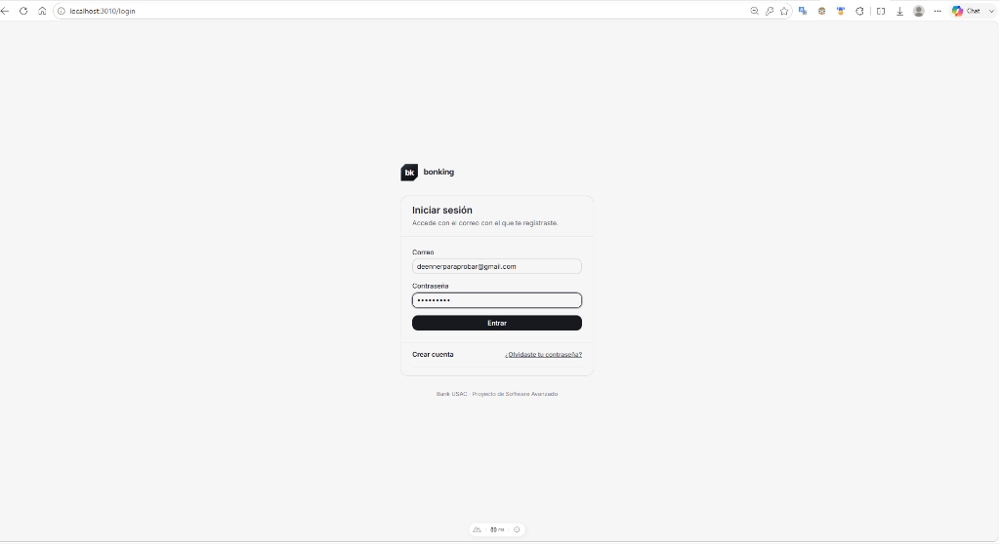

* **URL de acceso**: `http://localhost:3010/login`
* **Datos a ingresar**:
  * **Correo**: `deennerparaprobar@gmail.com` (correo registrado del cliente).
  * **Contraseña**: `ennero777` (clave personal definida en el sistema).
* **Acciones y botones disponibles**:
  * **Botón `Entrar`**: Valida las credenciales enviando `POST /api/auth/login` al API Gateway. El microservicio `customer-service` verifica el hash criptográfico `scrypt`. Si es correcto, el Gateway genera un token de sesión JWT con los permisos de `CLIENTE`, establece la sesión y redirige al usuario al panel principal.
  * **Enlace `Crear cuenta`**: Redirige al asistente de auto-registro en 3 pasos (`/registro`) para nuevos usuarios que aún no poseen credenciales.
  * **Enlace `¿Olvidaste tu contraseña?`**: Dirige a la pantalla de recuperación (`/recuperar`), permitiendo solicitar el restablecimiento mediante token enviado por correo electrónico.

---

#### Paso 2: Menú Clientes y Tarjeta "Mis Datos" (`/clientes`)

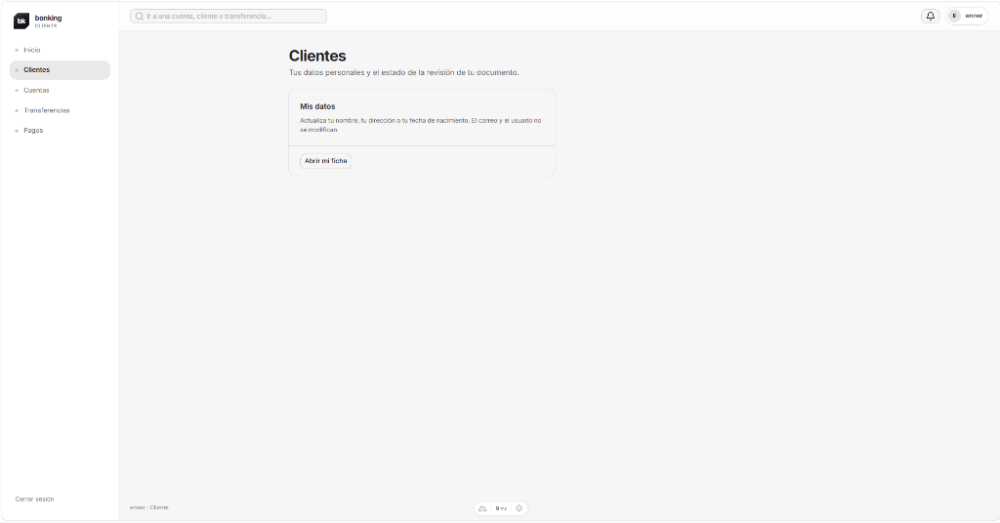

* **URL de acceso**: `http://localhost:3010/clientes`
* **Descripción de la vista**: Desde la barra lateral de navegación, al hacer clic en **Clientes**, el sistema presenta la sección informativa personal del titular: *"Tus datos personales y el estado de la revisión de tu documento"*.
* **Acciones y botones disponibles**:
  * **Botón `Abrir mi ficha`**: Carga y abre la ficha completa de perfil del cliente (`/clientes/[id]`), consultando mediante `GET /api/customers/:id` los datos registrados y el estado de verificación de identidad.

---

#### Paso 3: Mi Perfil y Edición de Datos Personales (`/clientes/[id]`)

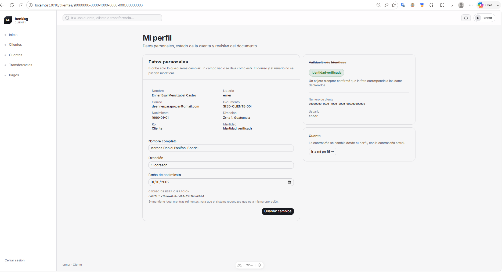

* **URL de acceso**: `http://localhost:3010/clientes/a0000000-0000-4000-8000-000000000003`
* **Elementos informativos y estado**:
  * **Ficha de Datos Registrados (Solo lectura)**: Muestra el nombre registrado (`Enner Esaí Mendizabal Castro`), usuario (`enner`), correo (`deennerparaprobar@gmail.com`), DPI (`SEED-CLIENTE-001`), fecha de nacimiento (`1990-01-01`), dirección (`Zona 1, Guatemala`) y rol asignado (`Cliente`).
  * **Insignia `Identidad verificada` (Verde)**: Confirma que el Cajero Receptor ya cotejó la fotografía del DPI en la mesa de control y emitió el veredicto favorable (`identityStatus = VALIDATED`), facultando al cliente a poseer y abrir cuentas.
  * **Tarjeta `Cuenta` con botón `Ir a mi perfil →`**: Permite acceder a las opciones de cambio de contraseña actual.
* **Formulario de Actualización de Datos**:
  * Permite al titular modificar datos de contacto o corregir su nombre:
    * *Nombre completo*: Campo editable para actualizar nombre (ej. `Marcos Daniel Bonifasi Bondel`).
    * *Dirección*: Campo editable para actualizar domicilio (ej. `tu corazón` o zona residencial).
    * *Fecha de nacimiento*: Selector interactivo tipo calendario (ej. `01/10/2002`).
  * **Código de esta operación (`idempotencyKey`)**: Clave única UUID autogenerada (ej. `cc097fc1-...`). Asegura que si la conexión parpadea o el usuario presiona dos veces el botón, el backend reconoce la solicitud como idéntica y no procesa cambios duplicados.
* **Acciones y botones disponibles**:
  * **Botón `Guardar cambios`**: Envía la solicitud `PUT /api/customers/:id`. El Gateway acepta la solicitud de forma asíncrona (`202 Accepted`) y publica el comando `customer.update.v1` hacia RabbitMQ.

---

#### Paso 4: Confirmación de Operación Asíncrona Aceptada

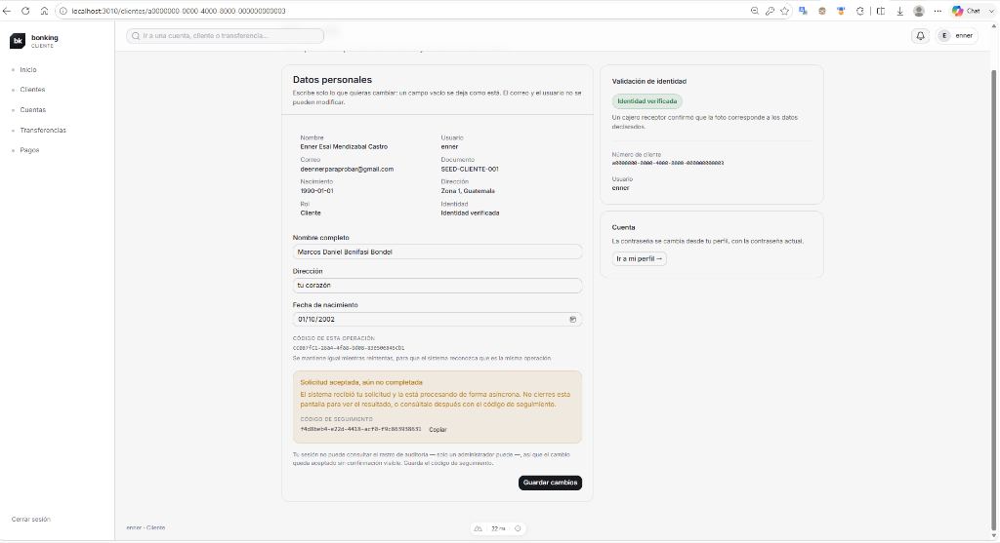

* **Notificación y estado**:
  * **Banner informativo**: *"Solicitud aceptada, aún no completada. El sistema recibió tu solicitud y la está procesando de forma asíncrona. No cierres esta pantalla para ver el resultado, o consúltalo después con el código de seguimiento."*
  * **Código de seguimiento (`correlationId`)**: Código UUID de rastreo transversal (ej. `f4d8be04-...`) que viaja en el encabezado del mensaje a través de todos los microservicios.
  * **Botón `Copiar`**: Copia el código de seguimiento al portapapeles con un solo clic para futuras consultas.
  * **Nota de seguridad y gobernanza**: Recuerda que la consulta detallada del log de auditoría está reservada para el rol de Administrador según la matriz de seguridad D-06.

---

#### Paso 5: Consulta Consolidada en "Mis Cuentas" (`/cuentas`)

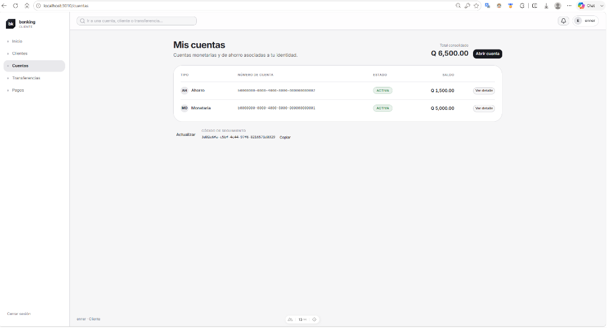

* **URL de acceso**: `http://localhost:3010/cuentas`
* **Elementos informativos y estado**:
  * **Total consolidado**: `Q 6,500.00`. Suma en tiempo real de los saldos líquidos en Quetzales de todas las cuentas activas del titular (Q 5,000.00 + Q 1,500.00).
  * **Tabla de Cuentas Asociadas**:
    1. **Cuenta de Ahorro**:
       * *Número*: `b0000000-0000-4000-8000-000000000002`
       * *Estado*: Badge verde `ACTIVA`
       * *Saldo disponible*: `Q 1,500.00`
       * *Acción*: Botón **`Ver detalle`** para ingresar al extracto de movimientos.
    2. **Cuenta Monetaria**:
       * *Número*: `b0000000-0000-4000-8000-000000000001`
       * *Estado*: Badge verde `ACTIVA`
       * *Saldo disponible*: `Q 5,000.00`
       * *Acción*: Botón **`Ver detalle`** para ingresar al extracto de movimientos.
* **Acciones y botones disponibles**:
  * **Botón `Abrir cuenta`**: Permite al cliente validado crear de inmediato una nueva cuenta bancaria adicional (Monetaria o Ahorro) en `Q 0.00`.
  * **Botón `Actualizar`**: Refresca la tabla consultando `GET /api/accounts` para reflejar al instante créditos, transferencias entrantes o depósitos recibidos.
  * **Código de seguimiento y botón `Copiar`**: Muestra la correlación de la última consulta realizada para auditoría.

---

#### Paso 6: Activación de Cuenta mediante Token Criptográfico (`/activar`)

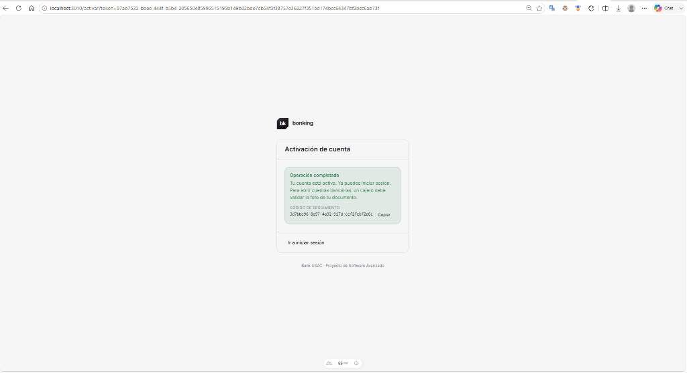

* **URL de acceso**: `http://localhost:3010/activar?token=87ab7523-...`
* **Descripción del flujo**:
  * El usuario abre el enlace de activación único generado con expiración de 24 horas.
  * `customer-service` valida el hash del token en base de datos, marca `email_verified_at = now()` y pasa el estado del cliente a `ACTIVE`.
* **Elementos en pantalla**:
  * **Banner verde de confirmación**: *"Operación completada. Tu cuenta está activa. Ya puedes iniciar sesión. Para abrir cuentas bancarias, un cajero debe validar la foto de tu documento."*
  * **Código de seguimiento (`correlationId`)**: Identificador de trazabilidad distribuida con botón **Copiar**.
* **Acciones y botones**:
  * **Botón `Ir a iniciar sesión`**: Redirige a `/login` para autenticarse ahora que la cuenta está activa.

---

#### Paso 7: Dashboard Inicial del Nuevo Cliente (`/`)

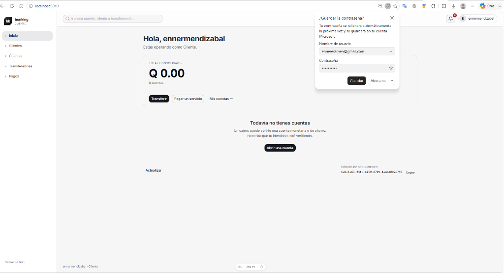

* **URL de acceso**: `http://localhost:3010/`
* **Elementos en pantalla**:
  * **Saludo de bienvenida**: *"Hola, ennermendizabal. Estás operando como Cliente."*
  * **Saldo consolidado**: `Q 0.00` (0 cuentas aperturadas).
  * **Bandeja de notificaciones**: Campana superior con indicador numérico rojo (**5 alertas sin leer**).
  * **Estado de cuentas**: Mensaje *"Todavía no tienes cuentas. Un cajero puede abrirte una cuenta monetaria o de ahorro. Necesita que tu identidad esté verificada."*
* **Acciones y botones disponibles**:
  * **Botones de acción rápida**: `Transferir`, `Pagar un servicio`, `Mis cuentas →`.
  * **Botón `Abrir una cuenta`**: Permite al titular solicitar la apertura de su primera cuenta digital.
  * **Botón `Actualizar`**: Consulta al Gateway para refrescar el saldo y estado de cuentas.

---

#### Paso 8: Bandeja de Notificaciones del Cliente (`/notificaciones`)

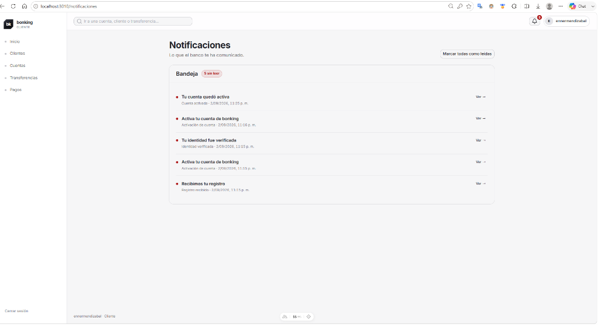

* **URL de acceso**: `http://localhost:3010/notificaciones`
* **Descripción de la vista**: Presenta el historial cronológico de eventos bancarios y de seguridad notificados al cliente:
  1. *Tu cuenta quedó activa* (Cuenta activada tras validar token).
  2. *Activa tu cuenta de bonking* (Enlace temporal reexpedido al intentar login).
  3. *Tu identidad fue verificada* (Aprobación de fotografía de DPI).
  4. *Activa tu cuenta de bonking* (Enlace inicial despachado al registrarse).
  5. *Recibimos tu registro* (Confirmación de recepción de solicitud).
* **Acciones y botones**:
  * **Botón `Marcar todas como leídas`**: Cambia el estado de todas las alertas a leídas y limpia el contador de la campana.
  * **Enlaces `Ver →`**: Muestran el detalle específico de cada notificación.

---

#### Paso 9: Gestión de Perfil y Validación de Caso Borde (Edad Mínima)

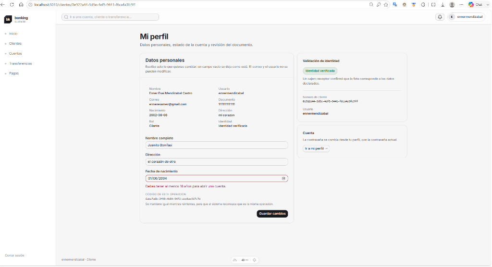

* **URL de acceso**: `http://localhost:3010/clientes/0e922a44-3d5e-4ef5-9441-f6ca4a3fc9ff`
* **Demostración de Regla de Negocio y Caso Borde**:
  * El usuario intenta modificar su fecha de nacimiento a una fecha que incumple la mayoría de edad para ciertas operaciones bancarias (`01/06/2004`).
  * El sistema resalta el campo en rojo y bloquea la operación mostrando el mensaje de validación estricto:
    > *"Debes tener al menos 18 años para abrir una cuenta."*
  * Esto demuestra cómo el frontend y el backend protegen los invariantes normativos antes de admitir cualquier movimiento en la base de datos.

---

#### Paso 10: Actualización Exitosa de Datos Personales (`/clientes/[id]`)

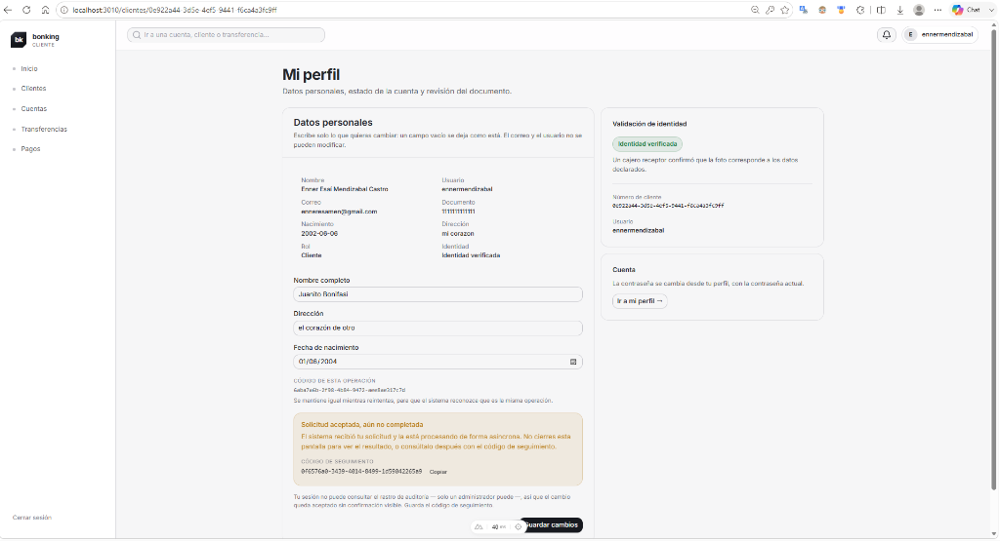

* **URL de acceso**: `http://localhost:3010/clientes/0e922a44-3d5e-4ef5-9441-f6ca4a3fc9ff`
* **Datos modificados**:
  * **Nombre completo**: `Juanito Bonifasi`
  * **Dirección**: `el corazón de otro`
* **Acción ejecutada**:
  * Al hacer clic en **`Guardar cambios`**, el frontend envía `PATCH /api/customers/:id` con un código de idempotencia único.
  * El API Gateway publica `customer.update.v1` y retorna `202 Accepted` con el código de seguimiento `correlationId` para trazabilidad distribuida.

---

#### Paso 11: Comprobación de Datos Actualizados en Perfil (`/perfil`)

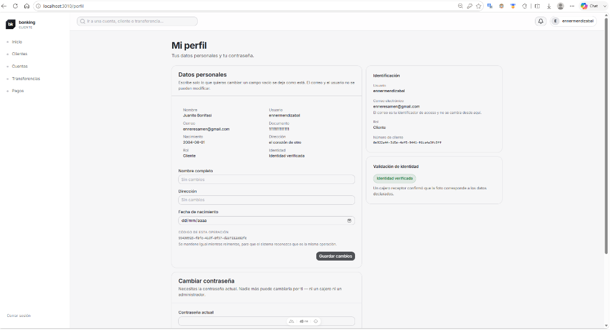

* **URL de acceso**: `http://localhost:3010/perfil`
* **Elementos en pantalla**:
  * Los nuevos datos quedan consolidados en la base de datos: Nombre: `Juanito Bonifasi`, Dirección: `el corazón de otro`.
  * La actualización emite el evento `customer.updated.v1`, lo cual genera una notificación directa en la bandeja de entrada del usuario confirmando la modificación.

---

#### Paso 12: Consulta de Cuentas Vacía y Solicitud de Apertura (`/cuentas`)

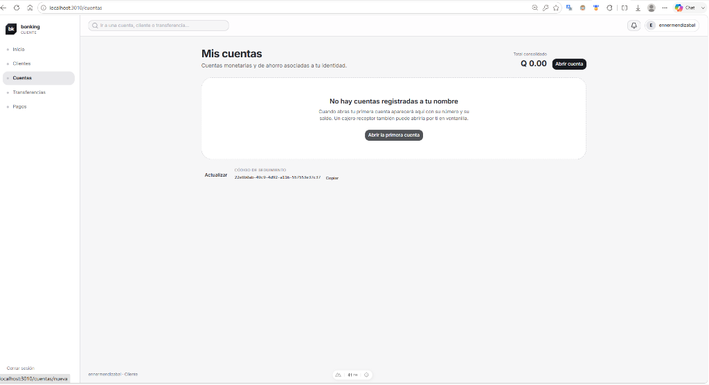

* **URL de acceso**: `http://localhost:3010/cuentas`
* **Estado inicial**:
  * **Total consolidado**: `Q 0.00`.
  * **Aviso**: *"No hay cuentas registradas a tu nombre. Cuando abras tu primera cuenta aparecerá aquí con su número y su saldo."*
* **Acciones y botones**:
  * **Botón `Abrir la primera cuenta`**: Inicia el asistente de apertura digital de cuentas bancarias.
  * **Botón `Abrir cuenta`** (esquina superior derecha): Enlace alternativo para abrir una nueva cuenta.

---

#### Paso 13: Selección del Tipo de Cuenta (`/cuentas/nueva` - Paso 1)

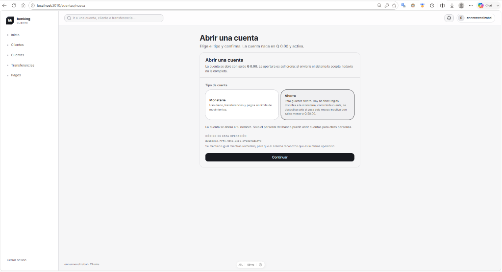

* **URL de acceso**: `http://localhost:3010/cuentas/nueva`
* **Opciones disponibles**:
  1. **Monetaria**: Diseñada para uso diario, pagos de servicios y transferencias sin límite de movimientos.
  2. **Ahorro**: Diseñada para guardar dinero con intereses y reglas de permanencia.
* **Acciones y botones**:
  * **Tarjeta interactiva**: Selección del producto financiero (el usuario selecciona **Ahorro**).
  * **Botón `Continuar`**: Valida la selección y avanza a la pantalla de confirmación.

---

#### Paso 14: Confirmación y Envío de Apertura (`/cuentas/nueva` - Paso 2)

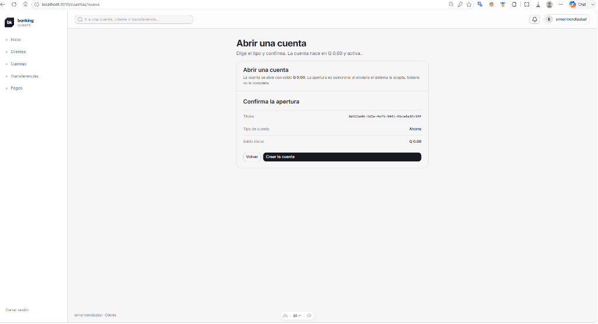

* **URL de acceso**: `http://localhost:3010/cuentas/nueva`
* **Resumen de la solicitud**:
  * **Titular**: `0e922a44-3d5e-4ef5-9441-f6ca4a3fc9ff`
  * **Tipo de cuenta**: `Ahorro`
  * **Saldo inicial**: `Q 0.00`
* **Acciones y botones**:
  * **Botón `Volver`**: Permite regresar al paso anterior para cambiar el tipo de producto.
  * **Botón `Crear la cuenta`**: Emite la solicitud asíncrona hacia el Gateway (`POST /api/accounts`), el cual publica el comando `account.open.v1` hacia `account-service`.

---

#### Paso 15: Creación Exitosa de la Cuenta Bancaria (`/cuentas/nueva` - Paso 3)

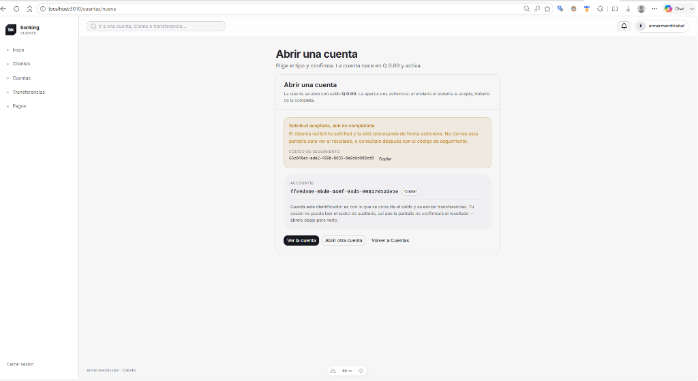

* **URL de acceso**: `http://localhost:3010/cuentas/nueva`
* **Identificador generado (`accountId`)**: `ffe9d369-0bd0-440f-93d5-90817052de5e`
* **Datos y estado del resultado**:
  * **Estado de la solicitud**: Solicitud procesada y aceptada por `account-service`.
  * **Código de seguimiento (`correlationId`)**: Identificador único emitido por el Gateway para rastreo SRE transversal en RabbitMQ y PostgreSQL.
  * **Confirmación del sistema**:
    > *Guarda este identificador: es con lo que se consulta el saldo, se reciben depósitos en ventanilla y se realizan transferencias.*
    > *✓ Tu cuenta bancaria ha sido creada exitosamente con saldo inicial de Q 0.00.*
* **Acciones y botones disponibles**:
  * **Botón `Copiar`**: Copia automáticamente el UUID de la cuenta al portapapeles.
  * **Botón `Ver la cuenta`**: Conduce al detalle de la cuenta creada (`/cuentas/ffe9d369-0bd0-440f-93d5-90817052de5e`), donde se visualiza el saldo en tiempo real y el historial de movimientos.
  * **Botón `Abrir otra cuenta`**: Reinicia el formulario para aperturar un producto financiero adicional (ej. Monetaria).
  * **Botón `Volver a Cuentas`**: Regresa a la vista consolidada de "Mis Cuentas" (`/cuentas`).

---

## 3. Rol: Cajero Receptor (`CAJERO_RECEPTOR`)

El cajero receptor atiende al público en las agencias bancarias y realiza operaciones presenciales.

### A. Mesa de Control de Identidad (Validaciones)
1. Ingrese a **Validaciones** (`/clientes/validaciones`).
2. Revise la lista de clientes con documentos DPI pendientes de validación.
3. Inspeccione la fotografía subida y coteje los datos ingresados contra la imagen.
4. Haga clic en **Aprobar** para habilitar al cliente para aperturar cuentas, o **Rechazar** indicando el motivo.

### B. Apertura de Cuentas Bancarias
1. Una vez validada la identidad del cliente, ingrese a **Cuentas → Abrir Cuenta** (`/cuentas/nueva`).
2. Ingrese el identificador o DPI del cliente verificado.
3. Seleccione el tipo de cuenta: **Monetaria** o **Ahorro**.
4. Confirme la apertura. La cuenta nace activa con saldo inicial de `Q 0.00`.

### C. Depósito en Efectivo por Ventanilla
1. Ingrese a **Cuentas → Depósito** (`/cuentas/deposito`).
2. Ingrese el número de cuenta de destino del cliente.
3. Ingrese el monto en efectivo recibido en ventanilla.
4. Haga clic en **Registrar Depósito**. El sistema acredita el saldo de inmediato (`200 OK`) y emite el comprobante de depósito.
5. *Nota:* Si la cuenta del cliente se encontraba inactiva por falta de uso, el depósito la reactiva automáticamente.

---

## 4. Rol: Administrador (`ADMINISTRADOR`)

El administrador supervisa la seguridad, auditoría e infraestructura del banco.

### A. Auditoría Transversal del Sistema
1. Ingrese a **Auditoría** (`/auditoria`).
2. Filtre los eventos del sistema por código de trazabilidad (`correlationId`), rango de fechas, microservicio emisor o tipo de mensaje.
3. Inspeccione los payloads redactados para verificar el cumplimiento normativo sin exponer contraseñas ni datos confidenciales.

### B. Gestión y Estado de Cuentas
1. Ingrese a **Cuentas → Administración** (`/cuentas/administracion`).
2. Permite activar o desactivar manualmente cuentas bancarias ante bloqueos judiciales o solicitudes del titular.

### C. Monitor de la Saga y Flujos Distribuidos
* Inspeccione transferencias en curso, tiempos de respuesta de los microservicios y transiciones de la máquina de estados.

---

Para guías específicas por pantalla y capturas paso a paso, consulte el [Directorio Detallado de Manuales](manual/README.md).
